# SuvroGhosh.IN architecture

Canonical architecture reference. Last verified: **20 October 2026**, against application commit `2a31d9a33bf305354c9e159f45257074f6f8c8f0` and the subsequent documentation/enforcement, focused-publishing, urgent correctness/request-containment, visualization-review, Mrinmoyee atelier and personal-site reorientation changes on 20 October 2026. Versions below describe this checkout, not the newest available releases. The [forensic audit](FORENSIC_AUDIT.md) records evidence, known defects, coverage, and verification limits.

The mandatory architecture-change policy has one authoritative definition: [CONTRIBUTING.md — Architecture change gate](../../CONTRIBUTING.md#architecture-change-gate). This document describes the implementation; recommendations in the audit are not implemented features.

The 21 October SEO/AEO release additionally verifies and updates the affected public Notes response/discovery contract, exact notebook canonical headers, deferred résumé video loading and browser measurement policy below. This is a review of those boundaries, not a new complete forensic audit.

The 22 October privacy/analytics implementation changes optional browser measurement to explicit
consent, adds bounded geographic page-view rollups in Supabase, and reuses the configured-owner
workspace for reports. Hosted migration/configuration and retention-job activation must be verified
separately from application tests. See [ADR 0006](decisions/0006-consented-aggregate-analytics.md).

## 1. System and principles

SuvroGhosh.IN is one SvelteKit application deployed through the Vercel adapter. It combines a repository-backed publishing site, interactive scientific/educational experiences, browser games, downloadable resources, a media library, and a single-owner handwritten-notes application. There is no separate application server, generic CMS, global state store, or shared simulation engine governing every experience.

The principal boundaries are:

- Editorial Markdown and static assets are versioned inputs. Build scripts generate derived content, image metadata, search documents, and supporting media.
- Public content metadata is collected in server registries. Universal loads import compiled Markdown components for SSR and browser navigation. Components themselves are not serialized out of a server load.
- Framework-independent numerical engines, domain models, workers, and persistence helpers sit beside feature-specific Svelte interfaces. Features use different renderers and lifecycles where their needs differ.
- Private notes use authenticated server actions/APIs and Supabase authorization. Public notes expose frozen publication snapshots, never the mutable working document.
- Browser capabilities progressively enhance readable SSR content: canvas/WebGL, motion, theme persistence, offline public-note reading, and media controls.

These principles are reconstructed from imports, route options, tests, and feature documents. They are not evidence that every feature fully complies. See findings `AF-001` through `AF-013` in the audit.

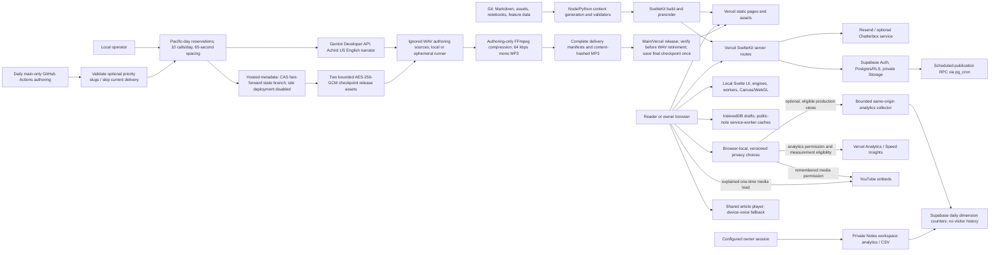

## 2. Directory responsibilities

Paths are relative to the repository root. This is a responsibility map rather than a claim of team ownership; the repository has no CODEOWNERS file.

| Path                                                                                             | Responsibility and boundary                                                                                                                                                                            |
| ------------------------------------------------------------------------------------------------ | ------------------------------------------------------------------------------------------------------------------------------------------------------------------------------------------------------ |
| `src/routes/`                                                                                    | SvelteKit pages/layouts, server loads, actions, endpoints, route-local specialization.                                                                                                                 |
| `src/hooks.server.ts`                                                                            | URL normalization, selective notes-session resolution, response headers and private-cache policy.                                                                                                      |
| `src/app.html`, `src/app.css`, `static/app-bootstrap.js`                                         | Document shell, shared visual tokens/styles, pre-hydration theme/motion and image fallback.                                                                                                            |
| `src/lib/content/`                                                                               | Browser-safe editorial types, path helpers, sections/category mapping, series and reading-path definitions.                                                                                            |
| `src/lib/server/content/`                                                                        | Eager metadata registries, published-post/resource/topic resolution, metadata search, SEO-ready page data.                                                                                             |
| `src/lib/posts/`                                                                                 | Active article Markdown and a crosslink data file. The post glob does not load retained archives.                                                                                                      |
| `src/lib/topics/`, `src/lib/prompts/`, `src/lib/lists/`                                          | Curated headquarters and resource Markdown, with stricter topic/resource contracts.                                                                                                                    |
| `src/lib/components/`                                                                            | Site shell, editorial UI, feature interfaces, notes editor/viewer, UI adapters, visualization components.                                                                                              |
| `src/lib/visualizations/`                                                                        | Feature models, simulation/rendering helpers, data, workers, local tests, generic experiment registry and contracts. Some features also co-locate Svelte interfaces here (Barnum Lab and Meaning Map). |
| `src/lib/games/`                                                                                 | Game catalog, domain models/engines/content, rendering helpers and local tests.                                                                                                                        |
| `src/lib/notes/`                                                                                 | Shared note model/schema/geometry/history/export; browser editor state and Dexie draft/outbox persistence. Server persistence is elsewhere.                                                            |
| `src/lib/server/notes/`                                                                          | Server Supabase clients, owner authorization, rate limiting, recovery, repository and image sanitation.                                                                                                |
| `src/lib/privacy/`                                                                               | Browser-local consent validation, persistence, expiry, cross-tab subscriptions and privacy-settings events; no visitor identifier.                                                                     |
| `src/lib/analytics/`                                                                             | Browser-safe report types, per-document page-view ledger and consent-gated provider/first-party measurement lifecycle.                                                                                 |
| `src/lib/server/analytics/`                                                                      | Server-only public-path registry, trusted-geography/dimension policy and bounded aggregate write/report RPCs.                                                                                          |
| `src/lib/motion/`, `src/lib/attachments/`, `src/lib/utils/`                                      | Motion policy and procedural helpers, DOM attachments, small shared utilities.                                                                                                                         |
| `src/lib/generated/`, `src/lib/server/generated/`                                                | Generated media/music/sketch indexes and server image dimensions; edit their generators/inputs.                                                                                                        |
| `src/lib/data/`, `src/lib/notebooks/`, `src/lib/config/`, `src/lib/sketches/`, `src/lib/assets/` | Curated folio/model data, notebook sources, public link definitions, sketch types, source assets.                                                                                                      |
| `scripts/`                                                                                       | Build generators, source/render validators, asset tools, Node tests and architecture gate.                                                                                                             |
| `tests/`, `playwright.*.config.ts`, `vitest*.config.ts`                                          | Browser/visual checks and unit-runner configuration; most unit tests live with source.                                                                                                                 |
| `supabase/`                                                                                      | Notes and analytics migrations, development configuration, publication scheduling and bounded analytics-retention SQL. No generated database types are committed.                                      |
| `static/`                                                                                        | Public media, notebook HTML, generated word clouds/search inputs, bootstrap script and crawler assets. Never private storage.                                                                          |
| `docs/`                                                                                          | Feature design/authoring documents and dated audit evidence. This directory's `architecture/` owns the cross-cutting current reference.                                                                |
| `src/lib/SavedPosts/`, `suvroghosh-post-backups/`                                                | Retained editorial material/backups, not the active post registry. Excluded from normal formatting; SavedPosts has a separate inventory tool.                                                          |
| `artifacts/`                                                                                     | Committed captures/reports and numerical evidence. Some BZ build checks deliberately consume evidence here; this is not uniformly disposable output.                                                   |
| `.github/workflows/`                                                                             | Focused feature regressions, IndexNow submission, architecture documentation gate and main-only daily narration authoring/publication.                                                                 |
| `.agents/skills/`, `AGENTS.md`, `CONTRIBUTING.md`                                                | Authoring/agent guidance and the canonical contribution policy.                                                                                                                                        |

The complete baseline inventory and inspection limits are in [AUDIT_COVERAGE.md](AUDIT_COVERAGE.md).

## 3. Toolchain ground truth

Installed `node_modules` package versions matched `package-lock.json` when inspected. Ranges are from `package.json`.

| Tool               | Declared range | Installed / locked |
| ------------------ | -------------- | ------------------ |
| Svelte             | `^5.54.0`      | `5.56.4`           |
| SvelteKit          | `^2.50.2`      | `2.69.2`           |
| TypeScript         | `^5.9.3`       | `5.9.3`            |
| Vite               | `^7.3.1`       | `7.3.6`            |
| Vercel adapter     | `^6.3.1`       | `6.3.3`            |
| Svelte Vite plugin | `^6.2.4`       | `6.2.4`            |
| mdsvex             | `^0.12.7`      | `0.12.7`           |
| Tailwind CSS       | `^4.2.2`       | `4.2.2`            |
| Vitest             | `^4.1.10`      | `4.1.10`           |
| Playwright test    | `^1.62.0`      | `1.62.0`           |

The audit host ran Node `24.11.1`, npm `11.12.1`, and Python `3.12.3`. These are observations, not a repository-wide runtime pin. Existing feature CI uses Node 22; the new dependency-free architecture gate uses Node 24. Check individual workflows before assuming the same runtime everywhere.

Important libraries include Supabase SSR/client, Zod, Dexie, Sharp, perfect-freehand and jsPDF for notes; D3, Three.js, p5, Observable runtime, decimal.js and ml-matrix for feature-specific work; Bits UI and local adapters for UI; KaTeX/remark/rehype for Markdown; Resend for contact; Vercel analytics/speed insights. Installed packages alone do not imply every dependency is loaded by every page. `tsconfig.json` enables strict TypeScript and `checkJs`; generated Kit configuration supplies route types and aliases.

Notebook authoring is separate: `pixi.toml` pins Mojo `1.0.0b2` on Linux x64/macOS ARM64, with constrained Jupyter dependencies. Native Windows authoring uses the documented WSL path. The full feature lane can verify committed notebook HTML when a local renderer is unavailable; routine article builds do not invoke the notebook toolchain.

The two committed standalone perceptron notebook HTML exports are alternate reading formats of their existing `/blog/mojollm/...` articles. Exact-path Vercel `Link: <article URL>; rel="canonical"` headers identify those article canonicals without modifying notebook cell output, regenerating exports or adding conflicting `noindex` directives. The export and article URLs remain accessible at their existing paths.

## 4. Routes, layouts and rendering

The root server layout supplies shared SEO defaults. The root Svelte layout uses `$app/state`, snippets, and derived route data to choose the site shell, private studio shell, immersive/site game shell, or one of two registered editorial folios. It owns route atmosphere, analytics, reduced-motion handling and guarded view transitions. `src/routes/blog/+layout.svelte` adds blog typography.

| Route family                                                                                           | Current behavior                                                                                                                                                                                                                                                                                                   |
| ------------------------------------------------------------------------------------------------------ | ------------------------------------------------------------------------------------------------------------------------------------------------------------------------------------------------------------------------------------------------------------------------------------------------------------------ |
| `/`, `/about`, `/writing`, `/consulting`, `/projects`, `/start-here`, `/resume`, `/healthcare-it-gulf` | Explicitly prerendered personal, editorial, work and career-background pages.                                                                                                                                                                                                                                      |
| `/blog`                                                                                                | Dynamic server metadata search/filtering and pagination; readable without client search.                                                                                                                                                                                                                           |
| `/blog/[category]`, `/blog/archive/[year]`, `/blog/archive/[year]/[month]`, `/blog/topics/[topic]`     | Dynamic archive loads, validated params/filters and pagination.                                                                                                                                                                                                                                                    |
| `/blog/topics`, `/blog/visualizations`                                                                 | Prerendered indexes. Promoted topics redirect to curated headquarters.                                                                                                                                                                                                                                             |
| `/blog/[category]/[slug]`                                                                              | `prerender = 'auto'`; generated canonical entries plus server fallback for category/legacy redirects. Server load resolves published metadata; universal load imports the compiled Markdown component.                                                                                                             |
| `/blog/games/[slug]`                                                                                   | Prerendered entries from `gamesCatalog`; a dedicated page renders one of four catalog experiences. The generic article entry generator excludes games.                                                                                                                                                             |
| Three concrete `/blog/visualizations/...` pages                                                        | Bias Archipelago, Barnum Lab and Meaning & Connection Map have route-specific SSR loads and component wrappers. They reuse the generic article page. Barnum has explicit critical-CSS/preload controls; Meaning Map overlays the article after mount. These exceptions are not a second general publishing engine. |
| `/topics`, `/topics/[slug]`                                                                            | Prerendered index and `auto` headquarters entries with validated registry membership and lazy Markdown bodies.                                                                                                                                                                                                     |
| `/resources`, `/resources/[kind=resourceKind]/[slug]`                                                  | Prerendered resource index/details; param matcher limits kind to prompts/lists; universal component import follows server metadata validation.                                                                                                                                                                     |
| `/images`, `/images/sketches`                                                                          | Server gallery/sketch loads; generated asset catalogs; the museum has browser enhancement.                                                                                                                                                                                                                         |
| `/notes/**`                                                                                            | Inherits `prerender = false`; public list/read, owner auth/recovery, protected studio/editor/preview.                                                                                                                                                                                                              |
| `/notes/studio/analytics`, `/notes/studio/analytics/export`                                            | Configured-owner aggregate dashboard and CSV download; each independently authorizes before bounded report queries and returns private/no-store/noindex responses.                                                                                                                                                 |
| `/privacy`                                                                                             | Explicitly prerendered public storage, measurement and media policy; its settings action reopens the shared browser-local preferences dialog.                                                                                                                                                                      |
| `/api/analytics/pageview`                                                                              | Same-origin consented page-view intake with streamed input limits, trusted production geolocation, eligible-path validation, deadlines and admission controls; no development/preview writes.                                                                                                                      |
| `/api/notes/**`                                                                                        | Owner-only document/assets APIs.                                                                                                                                                                                                                                                                                   |
| `/api/public/notes/**`                                                                                 | Visible snapshot document and publication-gated private-storage asset reads.                                                                                                                                                                                                                                       |
| `/contact`, `/api/tts/chatterbox`                                                                      | Contact form action and optional speech proxy.                                                                                                                                                                                                                                                                     |
| `/rss.xml`, `/sitemap.xml`                                                                             | Prerendered repository-backed discovery outputs. Notes has a separate dynamic sitemap.                                                                                                                                                                                                                             |
| `/tags/[slug]`, `/[indexnowKey].txt`                                                                   | Dynamic legacy tag redirects and secret-backed IndexNow verification.                                                                                                                                                                                                                                              |

The personal-site introduction leads with independent entrepreneurship, making and writing. Primary navigation connects existing work (`/projects`), writing (`/writing`), the verified external YouTube channel, `/about`, and the existing Start Here reading guide. Secondary discovery remains in the footer and command palette. `/about` is a small prerendered profile using the shared `Person` identity, with career history linked at the unchanged `/resume` URL. `/consulting` and `/healthcare-it-gulf` retain their URLs as career-context pages without current service or availability promises. No article routes or publication metadata were renamed.

SSR and client hydration remain enabled by default; there is no global SPA-only setting. Universal content loads intentionally return component constructors because that code executes in both environments. Server loads return serializable metadata. The generic article page supplies article SEO, breadcrumbs, author/tools, navigation, related posts and notebook/folio variants.

Public Notes lists use the shared strict page-number parser. Unfiltered later pages have page-specific titles and canonicals; filtered searches keep the `/notes` canonical and emit `noindex,follow`. The repository treats out-of-range later pages as 404, including a PostgREST `PGRST103`/416 response or an empty successful range, while genuine backend faults remain 503. The demo fallback follows the same page-existence rule. The main repository-backed sitemap includes the public `/notes` shelf without a database lookup or an invented modification date; the separate dynamic Notes sitemap supplies visible publication URLs.

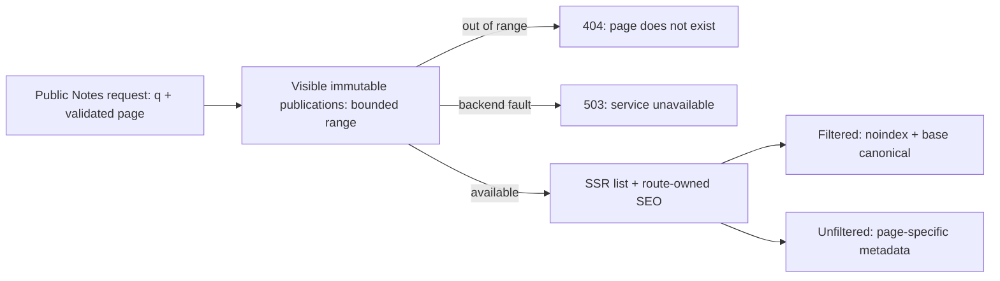

The three concrete visualization wrappers are intentional bundle/rendering adaptations. Their differing entry exclusions and duplicated load scaffolding are visible maintenance costs. The Meaning Map's earlier unbalanced global scroll mutation (`AF-006`) is corrected by mount-owned cleanup; it is not an approved route convention. Its separate interaction-state/accessibility debt remains `AF-013`.

## 5. Content, build and search data flow

`svelte.config.js` preprocesses Markdown with author-helper imports, image markup enrichment and mdsvex; remark/rehype handle math, heading IDs/links, heading collection, H1 demotion, Bengali language markup and square-bracket styling. Its global imports are limited to the editorial helpers named there. Authors explicitly import substantial interactive experiences.

For corrections limited to article `description` and `thumbnailAlt`, `node scripts/refresh-seo-metadata.mjs --base <committed-revision>` is a separate, guarded authoring operation. It resolves an ancestor commit, verifies each prior cache entry against that committed article, and requires unchanged article bodies (apart from platform line endings) and every other frontmatter field, including dates, tags, titles, categories and artwork paths. The complete batch must pass before it updates only the revision hashes in the tag manifest. This preserves editorial modification dates and visible answer layers during metadata maintenance. The ordinary publishing generator retains its existing freshness checks for unrefreshed edits; the utility does not add a build-time bypass or relax content/SEO validation. `seo:test` includes both pure-boundary and temporary-Git CLI regressions for this operation.

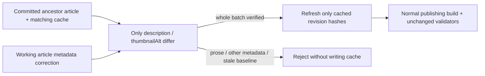

`src/lib/server/content/posts.ts` eagerly imports only Markdown metadata, omits unpublished/redirected posts, validates required fields, maps categories into sections, and derives topic membership, archives, navigation, related posts, curated paths and facets. Publication currently means `published !== false`; missing publication flags are not implicitly private. `src/lib/content/posts.ts` defines the metadata interface and runtime checks, but does not offer the same strict runtime schema as notes or topic headquarters.

Categories may have parents, defined by `categoryParents` in `src/lib/content/categories.ts`; `categoryTrail` supplies the root-to-leaf ancestry with cycle detection. Poetry is the parent of Limerick. Both map into the existing Essays section in `sections.json`, leaving the six permanent sections intact. Posts retain one leaf `category` and the existing `/blog/[category]/[slug]` canonical URL. Parent archives and category search include descendant posts; archive facets/counts, the writing index and sitemap include their populated ancestors. Category archives link their published children and parents. Article breadcrumbs use the same ancestry in visible navigation and JSON-LD. Categories without parents preserve their existing behavior.

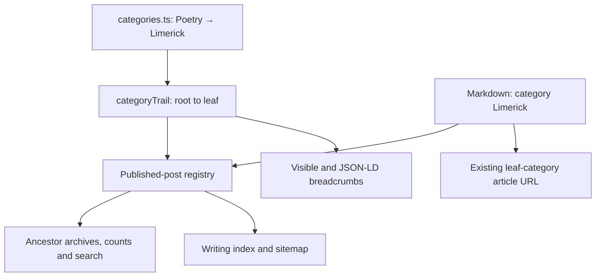

`src/lib/content/professional-projects.ts` remains the single work registry used by the work page and résumé. Optional factual status labels distinguish experiments, demos, the in-use publishing system and past work without constraining future media or industries. The homepage server load selects three IDs from that same registry and sends serializable card and optional image metadata (source, alternative text and dimensions) to `WorkWorlds`; recent writing continues to come from the published-post registry. Work-page ordering puts existing independent work before career projects while preserving each project anchor. The shared YouTube destination lives in `config/links.ts`; no video feed, new third-party integration or separate product catalog was added.

### Homepage fieldbook rendering

The prerendered homepage composes the Calcutta Fieldbook from `LivingHero`, `WorkWorlds`, `RecentSignalGrid`, `FieldbookIndex` and `ClosingInvitation`. The hero links to existing pigment and sculpture experiences through static, dimensioned artwork. Work previews use the selected registry image metadata; the publishing-system preview is an inline editorial SVG illustration, not a separate application or product. `FieldbookIndex` consumes the existing serialized reading paths and featured-series parts in one compact section. Authored article bodies and article layouts remain outside this presentation change.

The route no longer imports or mounts `LivingIndexScene`, its dynamic WebGL controller, the old four-way gateways or the separate large reading/series sections. Those source components remain available but are not homepage runtime dependencies. The normal shell retains the existing `homeStandard` static atmosphere contract, so neither the shell nor the homepage mounts an ambient canvas. The full document and destinations render without JavaScript or WebGL. Scoped component styles and homepage-only `fieldbook.css` own the responsive composition and locally loaded display fonts; the shared theme and motion preferences remain owned by the normal layout/header. Image hover transitions respect Still and OS reduced motion. No new frame loop, state store, endpoint or integration was introduced.

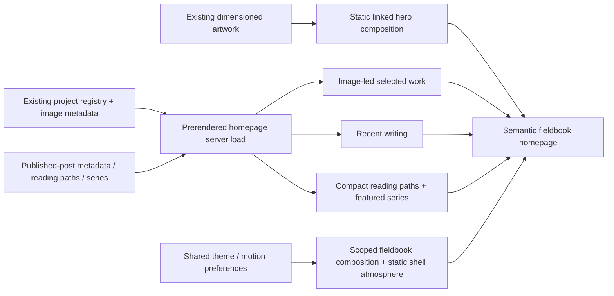

Resources use `parseResourceMetadata` and marked copy regions. Topic headquarters use a strict Zod schema plus registry validation for canonical paths, membership, promoted aliases and reading-path references. `sections.json` is shared taxonomy data; category/path normalization and alias consumers are still partially duplicated in Node scripts (`AF-009`).

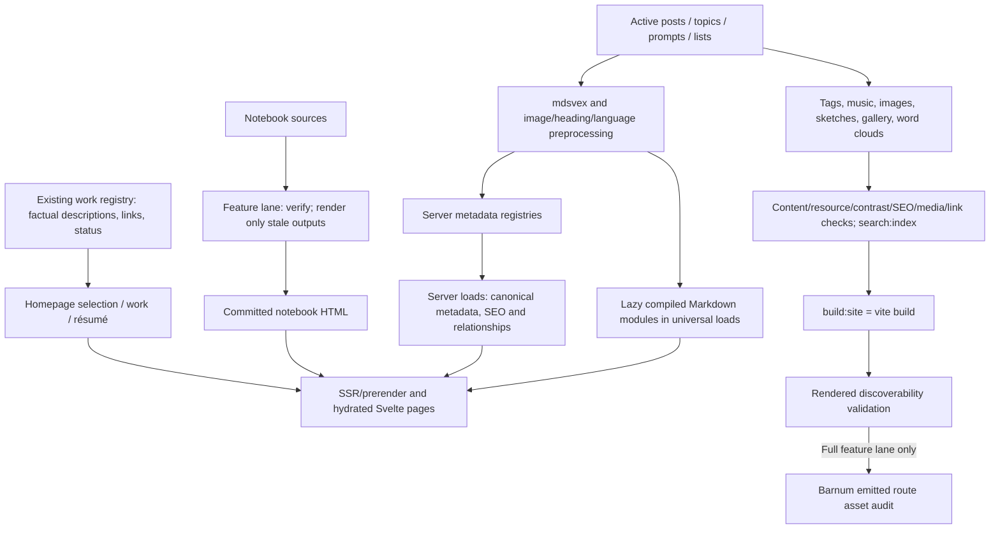

`npm run build` is the routine production/publishing lane, including the hosting default when no remote override is configured. npm invokes `prebuild` once:

1. `content:generate`: tags → music → image optimization → sketches → gallery → word clouds.
2. Content, resources, contrast, SEO and media validation → search indexing → link validation.
3. `build:site` (`vite build`) → discoverability checks against rendered output.

This lane uses committed notebook HTML. It neither invokes notebook preparation nor runs the dedicated visualization artifact audits. It still compiles/prerenders the shared site's existing routes, so real application compilation errors remain blockers and old feature names may appear in compiler output. Global publication/index/link checks remain global where cross-content relationships require them.

`npm run build:full` is the feature-maintenance lane:

1. `features:check` runs the deterministic Barnum, Bias, BZ, Prior Authorization, Strange Attractor, Mrinmoyee, Scale Elevator and probabilistic piano artifact checks. The Scale Elevator and piano checks verify committed captures and their source-provenance manifests without a running site or native video encoder; generation is a separate explicit command.
2. `notebooks:prepare` validates notebook shape/source hashes/renderer versions, leaves current HTML untouched and renders only stale/missing output when rendering dependencies exist. If required output is stale and dependencies are absent, it fails instead of silently accepting it. Explicit `notebooks:render` remains a full refresh.
3. The routine `npm run build` runs its normal prebuild/build once.
4. Barnum's emitted route assets are audited after the site build.

The feature-artifacts CI workflow selects feature/notebook/shared-build changes, with ordinary posts and their routine generated metadata excluded. CI uses verify-only image/word-cloud settings; notebook authors commit prepared HTML. See [ADR 0002](decisions/0002-separate-post-and-feature-builds.md) for the boundary and trade-offs. Workflow execution and hosted required-status configuration remain unverified.

The `build:site` split avoids recursive npm/Vercel build invocation; history `a56d0791` records the fix. Do not collapse it casually. Generators deliberately write tracked artifacts. A full build is not a read-only audit command.

The image optimizer currently resizes large raster inputs and applies lossy JPEG/opaque-WebP encoding, writing accepted output at the same path. Some formats/animated/original sketch sources are preserved. This conflicts with the existing local instruction permitting only lossless, same-dimension processing of an as-is image (`AF-007`). The canonical reference records the conflict; this task does not change the optimizer or weaken the instruction.

Search has two roles: server metadata search supports `/blog` filters and no-JavaScript requests; `search:index` emits full-content search input and Pagefind assets for the browser search component. Neither is a notes database search replacement. Notes uses Postgres full-text search. Different search backends here are deliberate, although build/runtime canonical URL rules should remain consistent.

## 6. Components, state and Svelte 5

Most feature UI lives under `src/lib/components/visualizations/<feature>/` or `components/games/<feature>/`, while its non-UI engine/data lives under the corresponding feature domain. This is a convention, not an enforced import rule: Meaning Map and Barnum Lab co-locate Svelte interfaces under the domain directory, and some large components still contain persistence/controller logic.

The prevailing style is Svelte 5 `$props`, `$state`, `$derived`, `$effect`, callback/event attributes, snippets and `{@render}`. All 406 library Svelte files compiled without warnings/errors in the audit's parse/compiler sweep. A source scan found 397 library modules containing runes, no `export let`, `$:` or `on:` event syntax, and one unreferenced legacy `svelte/store` utility (`utils/reducedMotion.ts`). These observations do not establish runtime correctness or full accessibility.

State ownership follows the feature:

- Page inputs arrive through generated `PageData`/`ActionData` types, although not every older page declares an explicit annotation.
- Local UI state is component-owned; derived values normally use `$derived`.
- Notes' editor state is built by `editor-state.svelte.ts`, with model/history/index helpers and IndexedDB recovery/outbox storage.
- Simulations use feature-owned engines/controllers, deterministic random streams where supplied, workers/message protocols and explicit lifecycle methods. Renderer needs differ; the shader registry is not the interface for every visualization.
- Theme/motion preference is stored in browser localStorage and document datasets. Bootstrap code applies it before hydration; layout/header modules maintain it after mount.
- Browser DOM/resource side effects belong to a component/attachment lifecycle and must release listeners, frames, simulations, observers, contexts and document styles at teardown. Meaning Map now returns instance-owned mount cleanup through `meaning-connection-map/lifecycle.ts`; its earlier resource leak is resolved. The audit found exceptions, not an absence of lifecycle facilities.

Meaning Map composes its component-owned search, category and selection state through one reactive renderer update. Pure projections in its existing `simulation.ts` compute visible and connected IDs; the D3 update applies opacity, pointer access, tab order and selection styling together. Filtering a selected concept clears that selection; following a detail-panel connection explicitly enables its category and clears a conflicting search. Authored directional edge IDs remain separate from D3-mutated simulation edges. The SVG viewport follows its container through an instance-owned resize observer. A second owned observer measures the site navigation so the fixed map begins beneath it, retaining access to both navigation and all map controls. Graph nodes expose keyboard activation and semantic names. Focused source, unit and production-browser checks cover search, keyboard selection and mobile/header geometry; they do not establish complete screen-reader or interaction coverage.

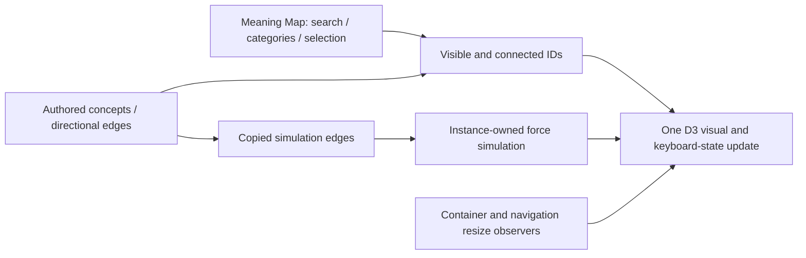

There is no `src/lib/stores/` or universal singleton state framework. Do not add module-global per-user mutable state to server-executed modules. A valid legacy component/store is not itself an architectural defect: [Svelte's legacy overview](https://svelte.dev/docs/svelte/legacy-overview) documents compatibility. Modernization should solve a demonstrated problem. [Lifecycle cleanup](https://svelte.dev/docs/svelte/lifecycle-hooks#onMount) applies to imperative resources regardless of syntax.

Spacetime Laboratory owns a per-mount runes store, a complete bounded URL scene/animation-clock codec and one WebGL2 renderer. The renderer's actual context creation and shader compilation determine support; it does not use the shared stricter WebGL1/2 preflight. Initialization is abortable: `KHR_parallel_shader_compile` completion polling has a 15-second deadline; without the extension, the required synchronous link check cannot have an interruptible driver deadline. The shader evaluates its model, compact-object tracer and procedural sky at single call sites to avoid pathological native D3D11 compilation expansion. Explicit `webgl=off`, context-creation failure, shader failure and context loss have distinct fallback paths; retry mounts a fresh canvas. The canvas owns resize/intersection/motion/visibility listeners and GPU cleanup. It draws while visible and playing, or once after a paused scene changes; hidden/offscreen scenes suspend GPU work. Keyboard commands belong only to its focused viewport. Schwarzschild and Reissner–Nordström rays use spherical static null-geodesic integration with analytic capture classification; Kerr, emission/colour transfer, projected reference guides and cosmological sky patterns remain labelled illustrations. A feature-local Friedmann background solver supplies FLRW scale factor/redshift to both the UI and shader; curvature density obeys Ωk = 1 − Ωm − Ωr − ΩΛ. This is neither a shared simulation engine nor an Einstein-field-equation solver.

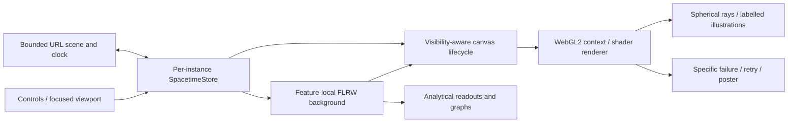

### Mrinmoyee sculpture atelier

Mrinmoyee uses the ordinary Visualizations Markdown article and generic blog route, with an immersive Svelte shell under `components/visualizations/mrinmoyee`. It introduces no route exception, endpoint, provider or shared state manager. Its feature domain under `visualizations/mrinmoyee` owns the versioned design contract, six presets, bounded normalization, construction geometry, browser renderer, optional synthesized sound and device-gallery persistence. This extends the existing feature-owned Three.js pattern; it does not introduce a shared sculpture engine.

The shell owns current design, undo/redo, comparison selection, design locks and presentation preferences. `state.ts` validates complete version-1 JSON documents with a 24 KiB UTF-8 limit, carries design state in a URL fragment, and stores up to twelve normalized designs in browser local storage. Imported strings, enums, finite ranges and camera vectors pass through the same normalizer. The fragment includes camera, geometry, surface and lighting settings; it is not sent to the server. Saved thumbnails are size-bounded data images, with a design-only retry when storage quota is exhausted. Gallery deletion affects this browser only. There is no cloud persistence or server-side per-user mutable state.

`AtelierViewport.svelte` dynamically imports the renderer after mount. The renderer owns its Three.js scene, OrbitControls, lights, environment map, interaction handlers, observers and animation frame. `sculpture.ts` builds actual three-dimensional parts and consolidates compatible geometry by material and selectable region. The making slider switches structural layers through framework, clay, paint, cloth, ornament and complete stages. Sculptural identity remains separate from camera and lighting changes. Still views render on demand; explicit ambient motion, bell interaction and presentation may schedule animation while visible. Reduced motion suppresses animation. Context loss presents a poster and a retry that creates a fresh canvas; unmount disposes the renderer, geometry, materials, textures, controls and observers. Sound is instantiated only after an explicit enable action and suspended when the document is hidden.

PNG export renders the current scene through a camera adjusted to contain the selected view in the requested aspect ratio. Transparent capture temporarily hides the background/atmosphere; a final 2D canvas adds optional title and signature. Export restores the interactive size, pixel ratio and scene visibility. Publication posters and preset thumbnails are captures of this same renderer, with social typography composited over the real scene. `scripts/render-mrinmoyee-assets.mjs` records source provenance and dimensions; its check is part of the full feature-artifact lane. See [the feature record](../visualizations/mrinmoyee.md) for limits and verification commands.

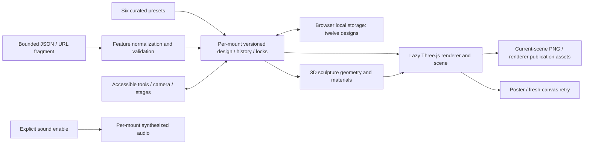

### Scale Elevator semantic-zoom exhibit

The Scale Elevator uses the ordinary Visualizations Markdown article and generic blog route. Its feature UI under `components/visualizations/scale-elevator` owns per-mount progress, scenario, local inspection, selection and guided-tour state. Its pure domain under `visualizations/scale-elevator` owns typed measurement contracts, the canonical eleven-floor/scenario registry, bounded URL state, the tour schedule and educational oxygen/aggregation calculations. This follows the existing dedicated-feature pattern without adding an endpoint, route exception, external data service, persistence store or shared simulation engine. The gallery consumes lightweight summary/subject metadata; it does not import Three.js through that registry.

Semantic progress is distinct from a floor's illustrative physical viewing extent and from presentation time. Local scene coordinates keep atomic and city geometry in numerically manageable ranges. Label selection uses hysteresis around floor midpoints. Physiological content/delivery, normalised small-scale illustrations and compatible source-gas allocation are explicit model families; the camera cannot create a scientific quantity or convert SpO₂ into gas demand. All clinical traces, infrastructure records and geography are synthetic. The floor registry supplies measurement passport fields, controls, the accessible ordered ledger and capture enumeration.

The stage dynamically imports the browser renderer after mount and viewport activation. The renderer owns its Three.js resources and bounded scene transforms; HTML/SVG owns sharp explanatory labels and charts. Visibility and reduced-motion policy control scheduling, while teardown owns pending-load cancellation and resource disposal. The matching scene stills and server-rendered ledger provide a readable path when WebGL or JavaScript cannot run. The public URL carries bounded synthetic state only.

Publication assets use deterministic page captures so the HTML/SVG measurement context accompanies the actual scene. The capture script opens an existing local development/preview origin with an explicit capture flag and sends bounded `scale-capture` events to the feature root; the card target includes HTML/SVG, while clean fallbacks capture the stage canvas. The script produces eleven annotated stops, matching clean scene fallbacks, a contact sheet, a social image and a continuous tour recording. `static/images/visualizations/scale-elevator/assets.json` records rendering-source provenance, capture state and output metadata. Generation needs the local site, Chrome and a native FFmpeg executable; verification needs only the committed media and source. Their check belongs to `features:check` and the full feature-artifact lane, whose workflow explicitly tracks the article path and `static/videos/visualizations/scale-elevator/**` for pull requests and main pushes, including recording-only edits. See [the feature record](../visualizations/scale-elevator.md) for equations, synthetic assumptions, units, lifecycle boundaries and verification commands. This is a local extension of the established renderer pattern; no foundational decision changes, so a separate ADR is unnecessary.

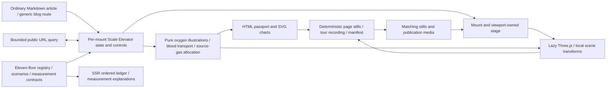

### The Piano That Forgives

The feature extension below was implemented and locally verified on **21 October 2026**; the earlier system-wide audit baseline remains as dated above.

The probabilistic piano uses an ordinary Visualizations Markdown article and the generic blog route. Its explicit Svelte shell under `components/visualizations/probabilistic-piano` owns current harmony/settings, focused pointer/keyboard inputs, recent history, frozen inspection, transport and presentation state per mount. The pure feature model under `visualizations/probabilistic-piano` owns integer-MIDI harmony palettes, bounded settings, score/softmax selection, deterministic musical randomness and the versioned original replay fixture. The gallery consumes lightweight summary/subject metadata; it does not import the piano's browser audio or painting runtime. This is an extension of the existing feature-owned model pattern, with no endpoint, inference service, account, credential, persistence store or new route exception.

Each note-on freezes its harmony/settings snapshot and calculates one decision containing the request, complete eligibility set, admitted candidates, normalized probabilities, selected pitch and explanation. That same decision feeds audio, key marks, probability bars and the readable ledger. Nearest admits only literal closest pitches; Wander expands its distance bound by at most one semitone; both preserve eligible requests. Raw preserves every valid request. Authored musical-role, previous-note, repetition and held-voice preferences weight only the admitted set. The musical seed/event stream is independent of visual draws, and painting never makes a musical choice. The article's worked example is the tested clean C♯4 request between C4 and D4 in C6/9.

An input ledger stores the exact selected output and unique audio voice ID. Note-off releases that ID without recalculating harmony, so simultaneous inputs sharing a pitch release independently and held notes retain their pitch across chord changes. The browser audio module is instantiated through explicit activation and owns one lazily created Web Audio context. Its original five-partial piano approximation bounds playable voices, retiring tails and oscillator nodes; audio-clock parameter scheduling is independent of rendering. Pending startup has cancellation/disposal guards. Stop, blur, hidden/offscreen state, preset switches and teardown clear owned playing state and pending transport work; teardown closes the context and removes observers/listeners. These limits do not constitute a universal loudness guarantee or a model of a listener's taste.

The impressionist pond is deterministic local canvas artwork rendered on demand at capped pixel density. Stable native key buttons retain recognizable grouping and hit targets; labelled request/result marks, exact probability values and an optional recent-note history keep the musical explanation available without colour or sound. Painting failure uses a quiet-wash semantic keyboard, while the server-rendered poster and prose remain available without JavaScript. The shell uses the existing motion resolver for operating-system and site Still changes, with stable musical marks in Still mode. Publication captures show the implemented instrument's seeded state. See [the feature record](../visualizations/probabilistic-piano.md) for scores, palettes, audio bounds, asset provenance and the assembled verification receipt. This change does not alter a foundational decision, so no additional ADR is required.

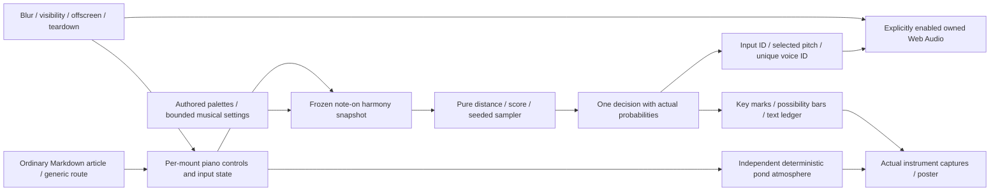

### The Music of Missing Data

The Missingness-Pattern Explorer uses an ordinary Visualizations Markdown article and the generic blog route. Its small Svelte shell under `components/visualizations/missing-data` lazily loads the interactive implementation and owns settings, inspection and transport per mount. The pure feature domain under `visualizations/missing-data` owns bounded seeded synthetic data, seven explicit disappearance processes, observed-only imputation, numerical summaries and versioned replay state. The gallery imports lightweight metadata only. There is no endpoint, uploaded dataset, external service, credential, persistent reader profile or new route exception.

Complete synthetic truth remains separate from the masked observed-data projection. Only simulation, explicit reveal and evaluation can read hidden values; the imputer receives observed values and the fully observed baseline predictor. For a given seed and matrix view, the same complete sample remains fixed while scenario, missingness intensity, imputation or display ordering changes. Separate random streams generate data, latent missingness draws and conditional predictive completions. A row/column permutation changes presentation only. One experiment snapshot supplies matrix cells, count summaries, selected-variable estimates, optional sound and downloadable fingerprints, preventing independently generated decorative data from diverging from the numerical explanation.

The multivariate view is bounded at 96 observations × 16 variables; longitudinal examples use 96 participants × 24 visits for one synthetic score. The baseline predictor stays observed outside the displayed matrix. MCAR, MAR and MNAR presets describe known simulation rules; dropout, whole-variable loss, instrument outages and nonresponse expose their particular mechanisms rather than claiming that a visible pattern establishes a mechanism. Column means have no estimated uncertainty. Conditional linear predictive draws use only measured outcomes; model-dependent predictive standard deviation supplies their halo spread. A completely unobserved variable remains unestimable. The MNAR sensitivity shift changes only missing-outcome assumptions. These draws are not presented as pooled multiple-imputation inference.

The browser renderer owns a raw WebGL matrix and demand-driven drawing at capped pixel density, with a labelled fallback when WebGL is disabled or fails. The renderer is dynamically imported separately from the interactive implementation. `colors.ts` owns the pure fixed-score palette shared by the fallback preview, audio and fingerprint exporter; those modules do not import the GPU runtime. HTML/SVG readouts and native controls keep the interpretation available without colour, hover or audio. The optional local synthesiser creates its owned Web Audio context only after a reader gesture, samples a bounded number of cells per scan step and preserves rests for missing values. Visibility, offscreen and motion preferences govern transport; teardown disposes owned observers/listeners, frames, GPU resources, audio and download URLs. The server-rendered article and model-derived poster remain readable without JavaScript.

The fingerprint PNG is a composed plate, and its JSON companion records current versioned parameters, seed, counts, missingness summaries, ordering and imputation assumptions from the same experiment. Bounded, validated URL settings reproduce synthetic state without sending a dataset to a service. Publication capture executes the actual model/export modules in Chrome, using direct development-module imports when available or an esbuild bundle of those same sources otherwise; the manifest records capture mode and source/pixel hashes. Generation therefore requires a browser but not a running development server. See [the feature record](../visualizations/missing-data.md) for the scientific contract, rendering/audio bounds, exports and verification limits. This is a feature-owned extension of the established model/UI pattern; no foundational decision changes, so no additional ADR is required.

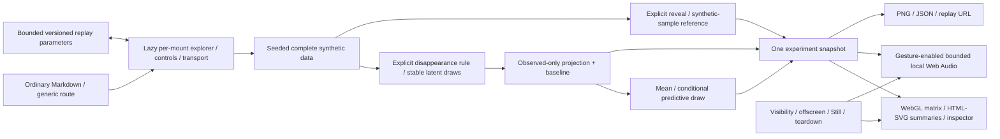

### The Shape of Waiting

The Queue-Distribution Laboratory uses an ordinary Visualizations Markdown article and the generic blog route at `/blog/visualizations/the-shape-of-waiting`. The small shell under `components/visualizations/shape-of-waiting` lazily loads the interactive implementation. The feature owns settings, baseline comparison, playback and ticket selection per mount; its pure TypeScript domain under `visualizations/shape-of-waiting` owns identity-keyed synthetic demand, discrete-event scheduling, snapshots, summaries and versioned bounded replay state. The gallery imports lightweight metadata only. There is no endpoint, external service, uploaded dataset, account, credential, persistent reader profile or new route exception.

Model time is independent of animation time. A scheduled-event priority queue orders events by simulated time, explicit precedence and a stable tie-breaker. Policy-only comparisons reuse the same arrivals, underlying service requirements, class, patience and attendance draws. A finite arrivals window is followed by draining queued and active work; computation bounds produce an explicit incomplete status and unresolved population. Main summaries describe people whose service has started, while current waiting ages, no-shows and abandonment remain distinct. Class medians/p90s and overtaking expose the consequences of a scheduling rule without importing the Calcutta Queue game's social-position mechanics.

Bounded browser-worker execution keeps model work off the rendering thread. Each requested configuration has an identity; cancellation/replacement prevents stale responses from overriding newer settings. The same computed run supplies a selected-time snapshot for Canvas crowd marks, SVG/HTML distributions, textual metrics, accessible inspection and frozen PNG/JSON receipts. Rendering does not generate model randomness. Position expresses scheduling order for deterministic rules; random rank is illustrative because each service selection redraws the ordering. Colour expresses age on a fixed scale, and class receives a secondary mark. The server-rendered article and model-derived poster remain readable without JavaScript. The complete laboratory shell carries `data-tts-exclude`, so the shared narration extractor reads only the surrounding authored article in both script-disabled and hydrated DOMs; loading text, live metrics and replay state cannot change that transcript hash. Per-mount lifecycle handles Still/reduced motion, hidden/offscreen state, workers, animation frames, observers/listeners and download URLs.

Replay encodes bounded versioned settings, optional baseline and observation time, rerunning the engine rather than trusting serialized results. A frozen snapshot supplies receipt numbers and graphics; publication captures derive from the implemented engine/render state and carry provenance. See [the feature record](../visualizations/shape-of-waiting.md) for definitions, paired experiments, limits and verification. This extends the existing feature-owned model/UI/worker pattern without changing a foundational decision, so no additional ADR is required.

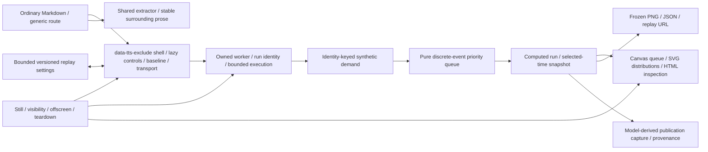

Local UI adapters use Bits UI/tailwind variants, `cn`, and barrel exports. Five bounded runtime import cycles occur inside these adapters (badge/button/sheet/tabs/tooltip); the static graph found no domain-wide runtime cycle. These cycles have no demonstrated initialization failure and are documented coupling, rather than a counted defect. The graph excluded type-only imports, glob expansion and nonliteral imports; it is not a formal proof of acyclicity.

### Two Calendars, One Life

The historical Calcutta–America edition uses the ordinary Visualizations Markdown article and generic blog route at `/blog/visualizations/two-calendars-one-life`. Its Svelte component under `components/visualizations/two-calendars` owns year/comparison selection, native-scroll chapter observation and postcard controls per mount. The pure feature domain under `visualizations/two-calendars` owns the curated 1940–1959 records and references, explicit date/relationship contracts, chronology layout, bounded public URL selection and shared postcard composition. The feature introduces no endpoint, route exception, external runtime service, credential, persistence store, dependency or global state manager.

Both calendar ribbons use the same Gregorian chronology. Record precision is separate from documented duration and uncertainty: a year-only record is not thereby a year-long event. Geographic scope and source references travel with the records. Connecting threads explicitly distinguish shared time, editorial thematic comparison and documented relationship; graphical proximity alone cannot establish a causal claim. The component server-renders historical reading and sources, then progressively enhances selection and scroll-linked emphasis. Observers and listeners belong to the mounted component and are released on teardown; native scrolling and motion preferences preserve the reading path.

The selected records and relationship supply both the interactive reading and composed postcard SVG. Browser rasterization produces the PNG from that same composition; SVG/PNG exports and copyable captions retain precision, attribution and a replayable selection link. Validated URL state selects supported public records only. The article's publication artwork is a static default social preview, not a promise of selection-specific server-generated Open Graph images. See [the feature record](../two-calendars.md) for authoring constraints and future personal-edition privacy/time-zone boundaries. This extends the existing feature-owned model/UI pattern; no foundational decision changes, so a separate ADR is unnecessary.

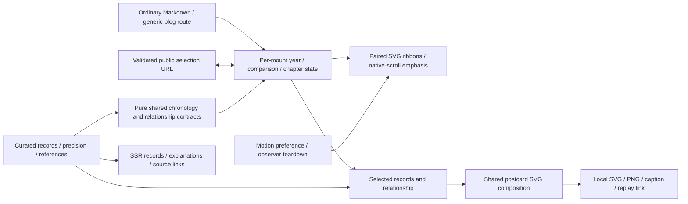

### The Patient Between the Systems: OpenHIE exchange instrument

The OpenHIE teaching instrument uses the ordinary Visualizations Markdown article and generic blog route at `/blog/visualizations/the-patient-between-the-systems`. The server-rendered shell under `components/visualizations/openhie` carries `data-tts-exclude` and lazily imports its interactive runtime as the figure approaches the viewport. Surrounding authored prose, sources and a captured publication image remain readable without JavaScript. The gallery imports lightweight summary and subject metadata only. The feature adds no route exception, backend, network integration, account, credential, uploaded patient data, persistence store or global state manager.

The pure TypeScript domain under `visualizations/openhie` owns synthetic source records, declared identity links, code mappings, four normalized boolean gates and immutable exchange-event/snapshot construction. Six scenarios expose successful exchange, ambiguous identity, missing terminology mapping, denied clinical access, a selected pre-commit service outage and duplicate delivery. Explicit statuses separate message receipt, shared persistence and delivery to Hospital B. Local originals, the normalized shared subset and the returned subset remain separate collections; provenance retains original codes, source identifiers and distinct occurrence, source-recording and exchange timestamps. Authorized retrieval selects persisted events for the resolved identity. Denied clinical access returns no clinical payload and never sends that query to the shared-record service. These are local teaching decisions, not operational authentication, consent, audit or OpenHIE conformance services.

Presentation state belongs to the component mount: scenario overrides, selected step, guided/explore mode, Patient/Clinician/Architect lens, inspected part or transaction, and playback. All views inspect the same model snapshot. Playback pace cannot change domain events or clinical timestamps. Reduced motion and the site's Still setting stop automatic progression; visibility, intersection and preference observers, listeners and timers are released on teardown. The versioned replay parser accepts exact allowlisted scenarios, explicit booleans and bounded integer steps, rejects malformed owned fields and oversized queries, and recompiles the model instead of trusting serialized results. A JSON exchange receipt exports the selected immutable snapshot with settings, assumptions and primary references; it does not execute a new clinical query.

The dimensional figure consumes committed `visualizations/openhie/instrument.json` geometry. `scripts/generate-openhie-instrument.mjs` generates its controlled SVG fragments with the MIT-licensed Anatomy geometry kit vendored under `scripts/lib/openhie-anatomy`; that kit runs during authoring and verification, not in the browser. The interactive SVG places a carriage and state highlights over those generated parts. Reader input and replay query text do not supply SVG markup. `scripts/render-openhie-assets.mjs` captures the actual local article instrument as the social/fallback poster, with source and pixel provenance. `openhie:assets:check` verifies generated instrument and publication artifacts in the full feature-artifact lane; the workflow explicitly tracks the article for pull requests and main pushes. See [the feature record](../visualizations/openhie.md) for the physical-metaphor contract, synthetic case, limits and focused verification commands. This extends the existing feature-owned pure-model/lazy-UI pattern, so no new foundational decision or separate ADR is required.

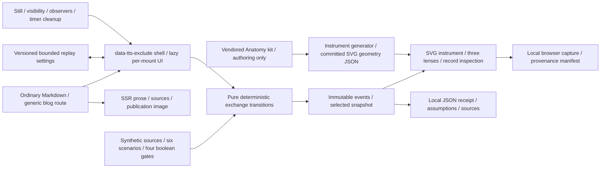

### Maker / entrepreneur / explainer collection

The three connected articles, `build-one-build-a-thousand`, `the-six-week-shadow`
and `the-museum-of-almost`, use ordinary Markdown under `src/lib/posts` and the
generic `/blog/visualizations/<slug>` route. Each owns an independent pure
TypeScript domain under `visualizations/<slug>` and a viewport-lazy Svelte shell
and runtime under `components/visualizations/<slug>`. Editorial prose remains in
Markdown. The gallery reads lightweight registry entries, including Design and
Entrepreneurship subjects; it does not import the three runtimes. These are local
feature additions with no new endpoint, external runtime service, account,
persistence layer, shared simulation engine or foundational renderer decision.
No additional ADR is required.

Build One derives preparation, per-unit work, workshop fixes, material waiting,
ready-to-send day and separately labelled after-shipping problems from one
validated workshop snapshot. Its original-setup comparison preserves quantity
and stock assumptions while disabling the three decisions. The Six-Week Shadow
derives start/finish times, elapsed working days, person-day effort and a stable
controlling path from a validated dependency graph. Parallel effort is distinct
from elapsed time; visual filters and replay do not remove tasks. The museum
uses typed author-controlled specimens, evidence, interpretations, unknowns and
explicit onward relationships. Its four initial records are fictional. Content
status and reuse status are separate; URL selections cannot turn demonstration
evidence into verified personal claims. Onward targets are terminal, validated
records rather than an unbounded traversal graph.

Each component mount owns its guided beat, choices and inspection. Presentation
progress remains separate from calculated results or curated record content.
The site's existing theme/motion preferences remain authoritative. Visibility,
Still/reduced-motion policy and teardown govern owned presentation frames and
observers/listeners. SSR shells expose representative SVG scenes and readable
accounts, with `data-tts-exclude` keeping live controls out of article narration.
Small allowlisted versioned URL selections, where offered, select model inputs
or existing records, never results or SVG markup.

Each feature's `generate-geometry.mjs` uses the existing MIT-licensed Anatomy kit
under `scripts/lib/openhie-anatomy` at authoring/verification time and commits
controlled `geometry.json` fragments. Browser code consumes those fragments;
it does not import the kit or depend on a user's skill directory. The three
generators check recorded true solids and deterministic output through
`maker-collection:geometry`. `scripts/render-maker-collection-assets.mjs` captures
the implemented local articles with service workers blocked, producing 1200 ×
630 posters and source/pixel provenance. `maker-collection:assets:check` verifies
the committed captures without starting a browser. Both checks belong to
`features:check`; the feature-artifact workflow also tracks the three Markdown
entries. The shared capture script reflects the repeated publication task;
models, fixtures and UI state remain independent. See the feature records for
[Build One](../visualizations/build-one-build-a-thousand.md),
[the Shadow](../visualizations/the-six-week-shadow.md) and
[the Museum](../visualizations/the-museum-of-almost.md), including model limits
and the museum's verified-record authoring guide.

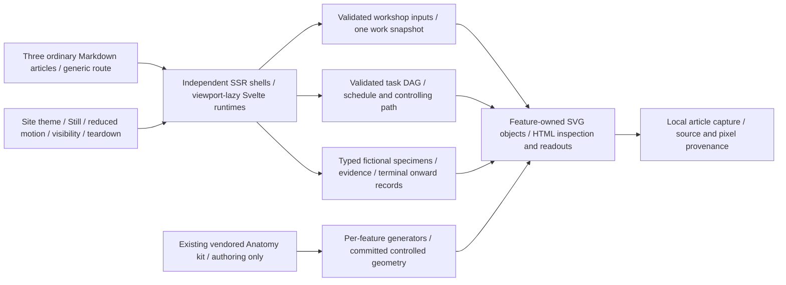

## 7. Notes client/server/persistence lifecycle

```mermaid
sequenceDiagram
    participant Owner as Owner browser
    participant Local as Dexie draft/outbox
    participant Kit as SvelteKit owner action/API
    participant Auth as Supabase Auth/RLS
    participant DB as Postgres RPCs/snapshots
    participant Reader as Public reader
    Owner->>Local: Persist device recovery state
    Owner->>Kit: Save document with revision and request identity
    Kit->>Auth: Verify cookie user and configured owner
    Kit->>DB: save_note_document with optimistic revision/idempotency
    DB-->>Owner: New revision or conflict via Kit
    Owner->>Kit: Publish or schedule frozen saved document
    Kit->>DB: Fresh-session publication RPC
    DB->>DB: Snapshot + publication asset manifest; cron activates schedule
    Reader->>Kit: Read visible publication metadata/document/asset
    Kit->>DB: Anonymous RLS visibility check
    Kit-->>Reader: Snapshot data; gated private blob for authorized publication
```

`notes` is the mutable private working row. `note_versions` preserves working history; `note_publications` contains immutable editions. Scheduling freezes the scheduling-time state. Editing a draft does not update the edition already visible to readers. Assets remain in a private bucket and are linked to publication manifests.

The server creates three distinct clients: request-cookie SSR client, anonymous publication reader, and privileged service-role client. The privileged client performs gated storage/manifest duties, durable auth-throttle RPCs and the configured-owner email lookup during recovery. It must never be exposed to browser imports. Database security-definer functions use an empty search path, explicit actor checks and controlled grants. Fresh authentication (12 hours) is required by sensitive RPCs. The metadata action now checks freshness before actual status changes and every publish/schedule operation; unchanged draft/private/archived metadata avoids an unnecessary transition RPC. Its repository update checks the server-observed status and undeleted row, returning 409 on an intervening status/deletion change (`AF-002`, corrected). Metadata and subsequent RPCs remain separate operations; this is not complete atomicity or same-status edit concurrency protection.

When Supabase URL/publishable-key configuration is absent, public repository reads intentionally return the demo published note; protected authoring fails configuration checks. This is different from an empty, configured database. Hosted data and configuration were not inspected.

Public viewers fetch the document separately from metadata, draw culled canvas objects, and retain a semantic transcript/controls around canvas output. Owner editing supports local draft recovery and a queued save path; a stalled unbounded browser request can currently hold the autosave path (`AF-004`). Fractal Atlas now normalizes imported and locally saved laboratory envelopes through its feature-local `specimen-state.ts`: bounded finite divider/path controls, strict boolean/enum values, validated comparison core state, and finite decimal coordinates describing the same numeric point. Its existing core-state parser remains responsible for the fractal recipe (`AF-005`, corrected).

Supabase rows are manually described/asserted in `repository.ts`; clients do not use generated end-to-end database types. Existing tests cover shared geometry/schema/history/export, recovery/referrer helpers and SQL source patterns. Running the migration under real roles and testing concurrent RPC behavior remains open work (`AF-003`).

## 8. Integrations and environment

| Boundary                              | Implementation and credential placement                                                                                                                                                                                                                                       |
| ------------------------------------- | ----------------------------------------------------------------------------------------------------------------------------------------------------------------------------------------------------------------------------------------------------------------------------- |
| Resend contact email                  | `/contact` server action; server environment API key, sender and recipient. Normal HTML form with optional `use:enhance`.                                                                                                                                                     |
| Chatterbox speech                     | `/api/tts/chatterbox` server proxy; private endpoint/key/model/voice settings; optional browser visibility flag. Supports native/OpenAI-compatible request mapping and WAV/MP3/Opus choices; accepts upstream `audio/*` bytes.                                                |
| Google article narration              | Explicit `scripts/article-narration.mjs` authoring command; script-only Gemini key and Free-tier confirmation. Saved same-origin audio/manifests feed the shared player, with US English device speech as fallback. No public synthesis endpoint or build-time provider call. |
| Supabase                              | Server-only URL/publishable/service credentials and owner UUID. Browser drafts are local Dexie data; browser code does not receive a service-role client.                                                                                                                     |
| IndexNow                              | Secret-backed verification route; deployment workflow compares live sitemap snapshots, verifies live ownership against the repository secret, and submits changed URLs only after that proof matches.                                                                         |
| Vercel analytics / speed insights     | Root layout browser initialization; CSP allows the named Vercel endpoints.                                                                                                                                                                                                    |
| YouTube and static notebooks          | CSP permits self/YouTube frame destinations; notebook HTML uses a sandboxed iframe. Compatibility with Vercel's blanket frame-denial response header needs deployed-header/browser verification.                                                                              |
| Jupyter/Mojo and Python asset tooling | Author/build tools, not request-time notebook execution.                                                                                                                                                                                                                      |

For each nonempty live IndexNow submission, `scripts/indexnow.mjs` first fetches the canonical
secret-backed verification URL with redirects rejected and a 15-second deadline. It requires
HTTP 200, `text/plain` and an exact streamed byte match to the configured ASCII key, rejecting
an oversized body immediately without buffering it in full. Only then does it POST the canonical URLs, with its own
15-second deadline. HTTP 200 or 202 permits saving the successful sitemap snapshot; ownership,
network and provider failures preserve the prior snapshot. An unchanged sitemap needs no POST.
Dry runs validate the payload without the ownership request. Diagnostic errors omit the key,
verification URL and response bodies. Vercel's production environment and the GitHub repository
secret must contain the same value, and a Vercel variable change requires a new deployment.
The workflow checks out the deployment SHA and runs the dependency-free submission contract tests.

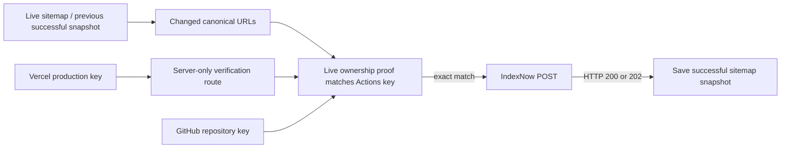

`.env.example` is the public configuration inventory. Its entries have no real secrets. `PUBLIC_ENABLE_CHATTERBOX_TTS` is a browser-readable feature setting currently consumed through `$env/dynamic/public`; it is not authorization to use the speech endpoint. This is an existing exception to the preference for static public imports for build-time flags. Private environment imports belong only in server routes, hooks, scripts or `$lib/server`. For new build flags prefer `$env/static/public` and document visitor visibility.

The forensic architecture audit did not inspect real secret values, live provider configuration, Vercel overrides, production Supabase settings or account quotas. `supabase/config.toml` is a development template, not production-state evidence.

Article narration is a separate authoring lane, described in
[ADR 0003](decisions/0003-pre-generated-article-narration.md), the hosted continuation decision
[ADR 0004](decisions/0004-github-actions-article-narration.md), and the
[operational guide](../article-narration.md); this boundary was reviewed on 21 October 2026.
`narration:generate` reads canonical published URLs
from a loopback site's sitemap, checks source publication metadata, and extracts rendered text
with scripts disabled. The generator and shared player use one deterministic DOM extractor and
transcript hash. Generation stores WAV sources, checksum checkpoints and complete source manifests
in ignored `.codex-artifacts/narration-sources/<slug>/`; incomplete work stays there as checkpoints.
`narration:compress` validates complete sources, encodes 64 kbps / 24 kHz mono MP3 with local FFmpeg,
fully decodes the result to check duration, and atomically publishes delivery manifests plus
content-hashed MP3 files under `static/audio/articles/<slug>/`. It has no provider requests or
uploads. Source fingerprints remain unchanged; delivery metadata separately identifies encoder
settings, source hashes and encoded hashes. Generation reads private source manifests and
recognizes current, checksum-verified MP3 delivery without requiring retained WAV sources;
resumption cannot overwrite delivered MP3 manifests. Within a selected generation route,
validated partial work takes priority over new articles. Auditions and partial articles are
excluded from delivery. Missing/stale audio falls back to browser
speech, preferring US English and permitting user voice selection. Playback and speed changes
reuse saved audio; builds, hydration and visitor actions never synthesize through Google.

Real generation requires `GEMINI_API_KEY` and `GEMINI_TTS_FREE_TIER_CONFIRMED=true`; the latter is
an operator assertion, not an API verification of project billing. Use a Free-tier project with
billing disabled. Achird is the default US English narrator; its regional catalogue metadata is
verified during authoring. Local CLI operations share the ignored
`.codex-artifacts/narration-quota.json` ledger while holding the repository generation lock.
Hosted operations reserve each attempt on `codex/narration-state` before transport, using a
commit based on the previous state and a non-forced fast-forward update. State conflicts or
persistence failure prevent the provider request. Reservations conservatively include catalogue,
failed and interrupted attempts, cap invocations together at ten calls per Pacific day and retain
65-second spacing across restarts. Pacific midnight reset handles DST; HTTP 429 blocks until the
next day. Corrupt state and clock rollback stop generation without a paid model/provider fallback.
Local and hosted ledgers cannot observe one another or other clients; do not generate concurrently
from independent ledgers. Interactive games are excluded from the prose queue.

`.github/workflows/article-narration.yml` invokes `narration:hosted` on standard GitHub-hosted
Ubuntu 24.04 at 08:45 UTC daily or by manual dispatch, from `main` only. It has no PR trigger and
uses one repository-wide concurrency group with cancellation disabled. Its token has
`contents: write` and `deployments: read`; no Vercel token, Google IAM credential, OIDC grant or
personal access token is added. The pinned API-key hash and project identity record the
21 October 2026 operator verification that Google billing was unlinked and Vercel was on Hobby.
This is static configuration attestation, not an automatic account-tier/billing audit; future
external billing changes are not observable by this job. The synthesis key cannot enable billing,
and the job cannot upgrade Vercel. Account settings must remain within the verified free tiers.

The optional Actions repository variable `NARRATION_PRIORITY_SLUGS` supplies an ordered list of
at most 20 comma-separated entries, bounded to 4,096 characters. The hosted parent trims entries,
deduplicates them in first-listed order and requires exact membership in the published,
narratable inventory. Empty entries, invalid syntax, excessive input and unknown, draft or game
slugs fail before recovery or provider access, including in `verify_only` mode. Blank whole
values leave ordinary selection unchanged. Current transcript/configuration and delivery
checksum validation skip ready priorities, including deliveries whose WAV sources were retired.
Missing/stale priorities precede private stale sources and background selection through the
existing generation pipeline; the report records priorities, skips and actual routes. This is
bounded selection configuration within the existing hosted authoring lane, with no new schedule,
quota, credential or foundational decision requiring another ADR.

The hosted state branch contains only small quota/checkpoint metadata and a `vercel.json` that
disables Git deployment. Pending WAV snapshots are AES-256-GCM encrypted with the 32-byte
`NARRATION_STATE_KEY` repository secret before upload to the `narration-checkpoints` prerelease;
their pointers and checksums are committed on the state branch. Ciphertext is public in this
public repository. Raw pending data is capped at 384 MiB and the archive at 512 MiB. A new snapshot
is uploaded and its pointer committed before older owned assets are pruned to two retained
snapshots. Failed persistence blocks additional provider calls. Actions caches/artifacts and
ephemeral runner disk are not the authoritative quota/checkpoint store.

Complete MP3s/manifests are committed to `main` and published through the existing Vercel Git
integration. The job reads the matching commit's production deployment status and verifies live
custom-domain manifests/audio before retiring completed WAV copies from hosted state; local
originals remain. Routine runs verify only newly ready deliveries and unverified pending
publications. Post-verification source pruning attempts one final checkpoint write; cleanup does
not blindly repeat an uncertain write. Preview shutdown, fallback checkpoint preservation and the
run summary each run independently, with original and cleanup failures retained together. State
API errors identify the failed operation without response bodies or credentials; state failures
remain fatal and cannot authorize another provider request. A later housekeeping failure leaves
the verified publication receipt intact.
A no-work run does not launch production verification. Explicit `verify_only`
and deployment probes retain the three initial smoke fixtures. All narration browser contexts
block service workers, preventing verification from warming unrelated offline assets.
Publication is bounded at 6 GiB of delivery audio and 8 GiB of site payload.
These caps cannot measure account-wide retained deployment storage or transfer, and no account
read credential is granted to do so. The limits sit below the documented 10 GiB Hobby
deployment-storage allowance; old deployments and
other projects can still consume that account allowance. Hosted generation requires 2 GiB free
runner disk; manual local generation has no automatic free-disk admission guard. Platform limits
halt hosted work without enabling paid capacity.
`NARRATION_FREE_TIERS_CONFIRMED=true` records the operator attestation and
`NARRATION_HOSTED_ENABLED` stays `false` during bootstrap. A `verify_only` dispatch validates
restore/delivery without provider calls; the one-time `deployment_probe` can create an empty bot
commit to prove GitHub-token pushes reach Vercel. Routine runs create no empty commits.
Hosted activation requires a successful restore/publication/production-verification run before
the former local heartbeat is paused, preventing duplicate schedules. GitHub schedules are best
effort and public-repository inactivity can disable them; manual dispatch is the recovery path.
No application cron or public synthesis endpoint is added.
New segments are bounded at 6,000 UTF-16 code units, 7,000 UTF-8 bytes and 900 words, with a
600-second WAV ceiling, 48 MiB response limit and 240-second provider deadline. Recognized
manifest segmentation policies preserve completed legacy audio and legacy checkpoints for
unfinished articles; unknown policies are not considered ready. This increases useful speech
per daily request without increasing the request quota or introducing paid inference.

## 9. Security, errors and validation

Root-layout measurement is owned by `src/lib/analytics/client.ts` and the browser-safe
`src/lib/measurement.ts` policy. `src/lib/privacy/consent.ts` validates a version-one, browser-local
`suvroghosh:consent` choice with a 180-day lifetime, in-memory fallback, expiry and cross-tab updates.
The initial privacy notice can be dismissed for the current layout lifetime without writing a
consent choice or enabling optional services. The footer settings button, or the compact trigger
on immersive pages, reopens preferences. Shared privacy and command-palette dialogs close before
client navigation, including search-form submissions and history changes, so their native modal
top layer does not leave the destination inert.
Analytics and Speed Insights initialize only after affirmative analytics consent on the canonical
production origin, outside development and `navigator.webdriver` contexts, and when neither local
nor session storage contains `suvroghosh:measurement=off`. Denied storage still fails closed for
measurement. SDK `beforeSend` callbacks recheck eligibility, strip query/fragment state and suppress
API and Notes studio/auth paths, including encoded forms. Custom visualization events use the same
gate. A per-document navigation ledger sends one view per eligible pathname visit; it stores no
visitor/session identifier. Withdrawal aborts pending first-party requests and blocks subsequent
provider callbacks. Already accepted aggregates cannot be traced back to a withdrawing browser.

The first-party `POST /api/analytics/pageview` accepts a small, schema-validated consent indication
and known public pathname. It enforces a streamed body limit, exact same-origin requests, production
eligibility, bounded deadlines and admission controls. Geography comes from Vercel production
headers, never the submitted body; unknown/malformed geography stays Unknown. Separate daily
rollups retain total/page/country/city/referrer/device/browser counts for 180 Asia/Kolkata reporting
days. They do not retain raw event rows, raw IP/UA, coordinates, durable IP hashes or visitor IDs.
Transient admission data is separate from reports. RLS denies direct browser access; server-only
service-role RPCs own writes and report queries. Migration/cron setup and operational limits are
documented in [the setup guide](../privacy-analytics.md); app deployment alone does not run SQL.

`/notes/studio/analytics` and its CSV export independently require the existing configured owner
before querying. They inherit the studio session resolution and no-store/noindex headers. No public
report endpoint or client authentication bypass is added. Reports describe consented recorded page
views rather than unique people, and provider analytics are not added to first-party totals. Provider
infrastructure logging remains outside the application's aggregate-only storage claim.

The shared Notes owner identity lookup now has a five-second deadline and passes its abort signal
through the Supabase SSR client's fetch without discarding a downstream request's own signal. The
deadline ends when identity verification finishes; later report/Notes operations retain their own
lifecycle. If identity lookup fails before route resolution, hooks return a private no-store,
noindex 503 response instead of continuing to a report or exposing an unbounded wait. Other Notes
mutation body limits and non-auth provider deadlines remain separate audit findings.

The shared YouTube component now server-renders a local placeholder for every embed: title/caption,
a labelled one-time-load button, privacy settings and a direct watch link, with no remote thumbnail
or player. Remembered external-media permission loads ordinary embeds after mount; `clickToPlay`
embeds still need activation. One-time activation does not persist media permission. Rejection,
withdrawal or expiry removes active players. The existing YouTube host/CSP and article content are
preserved. Same-origin notebook frames are outside this optional external-media category.

The checked-in CSP is defined in `svelte.config.js` with automatic nonce/hash handling, self-by-default scripts, named Vercel endpoints, bounded frame/worker policy, no objects and no framing. `vercel.json` adds transport response headers and apex-to-www redirects. `hooks.server.ts` adds request IDs and headers to resolved application responses; it normalizes blog categories and resolves notes sessions only for protected/auth-dependent routes.

Private studio/auth/API responses receive private no-cache/no-store headers and noindex/noarchive directives. Auth pages intentionally use `same-origin` referrers on clean URLs and `no-referrer` while a recovery/callback secret remains in the URL; recovery tokens are consumed only after an explicit same-origin confirmation POST. Local auth config must not be treated as proof of hosted signup/session settings.

Owner authorization checks both the configured immutable user UUID and database membership/RLS. Public notes are filtered through active/unrevoked publication visibility, then publication-specific assets are checked. The public asset path is not permission to read arbitrary private blobs.

Errors currently follow several mechanisms: Kit `error`/`redirect`, form `fail` data, Zod parsing, repository error translation, provider HTTP responses, and a site `+error.svelte`. Universal Markdown import failures are logged and mapped to 404; they do not expose a detailed import error to readers. Notes use bounded runtime Zod validation (ordinary object schemas strip unknown keys); topic/resource authored metadata contracts are stricter. Article metadata uses a lighter validator and build checks. This diversity is real; a single universal error/schema layer does not exist.

New expensive/state-changing endpoints must follow the existing security invariants in [AGENTS.md](../../AGENTS.md): validate input, enforce streamed body limits, same-origin rules where browser-invoked, timeouts and cost-appropriate throttling. TTS and contact now use the shared server-only `http/body.ts` streamed reader/deadline helper and bounded `local-admission.ts` guard. Their 64 KiB input limits apply before parsing, with ten-second read deadlines and exact origin checks. TTS limits audio to 32 MiB within a 120-second provider deadline; contact delivery has a 15-second deadline. Admission is process-local, including a bounded fallback bucket when the adapter cannot resolve an address, and is not a distributed guarantee. Notes mutation readers and non-auth Supabase deadlines outside the bounded analytics repository remain gaps (`AF-001`, in progress); the shared identity lookup is bounded as described above. SvelteKit's built-in form CSRF check is present; it does not replace explicit policy for every JSON endpoint. The named `security:audit` and `security:smoke` commands are currently absent, so they cannot be presented as passing safeguards.

## 10. Caching and offline behavior

- Prerendered pages and immutable build chunks use the adapter/CDN path; dynamic archives execute server loads.
- `vercel.json` gives semantic `/images`, `/photos`, `/sketch`, `/videos`, `/fonts` URLs one year of immutable caching. Other static families have separate long shared-cache rules. There is no general source-content hash in editorial image URLs; replacement at the same path can remain stale (`AF-008`).
- `PostImage.svelte` emits responsive Vercel optimizer URLs with a local-original fallback. Its sizes must agree with adapter image sizes. Those URLs do not currently include a content revision.
- Article narration uses revalidated `/audio/articles/<slug>/manifest.json` metadata and SHA-256-named MP3 URLs with one-year immutable caching. Browser playback validates the current extracted transcript hash before selecting saved audio. No audio bytes enter hydration payloads or JS bundles, no application runtime disk is a persistent cache, and this feature adds no service-worker audio caching. Local WAV sources stay in the ignored authoring cache; hosted pending sources use bounded encrypted release snapshots and a durable state-branch pointer. Completed runner WAV copies are retired only after their `main` MP3/manifests and production delivery are verified. Git and Vercel upload exclusions reject public WAV/checkpoint/audition files. The first three complete narrations encode from 20,919,474 WAV bytes to 3,485,511 MP3 bytes (83.34% smaller). Delivery uses this existing project's free Vercel Hobby static storage/CDN, confirmed active on 21 October 2026; it adds no storage account, paid tier or cross-origin media dependency. The original corpus estimate of 31.56 GiB of WAV corresponds to roughly 5.3 GiB of 64 kbps MP3, within the hosted 6 GiB audio guard. The separate 8 GiB site-payload guard, evolving corpus size and account-wide storage/transfer still require review. Low-level generation/compression remain upload-free; the dedicated hosted authoring workflow owns checkpoint uploads and bounded Git publication.
- Public notes use short HTTP caches; private responses use no-store. The notes sitemap has its own short shared cache.
- `src/service-worker.ts` creates an empty build cache at installation and caches allowed build assets only on actual requests, with concurrent fetch deduplication. It no longer downloads the complete `$service-worker` build list on every installation. This matters to the Hobby request allowance even for CDN cache hits. The decision and migration trade-off are recorded in [ADR 0005](decisions/0005-demand-driven-offline-caching.md).
- Public notes retain network-first page/document/asset reads. The worker excludes private notes/auth/API paths, rejects private/no-store or cookie-bearing public responses, evicts online 404/410, and permits retained public responses for up to 30 days with a 240-entry public-cache cap. `PublicNoteCanvas.svelte` calls the browser-only `notes/public-offline.ts` helper after rendering a publication. Its bounded readiness message rescues resources already requested before worker control: at most 128 URLs, with a five-second resource observer. The worker validates the actual same-origin public-note window, checks immutable URLs against the build allowlist, and permits public image URLs only when referenced by that note's frozen document. Rescue fetches omit credentials, and a 32-client map avoids repeated metadata preparation. Private note viewers do not invoke this helper.
- During service-worker activation, older build caches are removed when their recorded age exceeds 30 days; ordinary build-asset requests do not enforce a hard 30-day TTL. Retention supports old offline note HTML/runtime compatibility. The cache contains build assets, not a blanket copy of every public static video/image.

The first-note rescue prioritizes requested document runtime/style references and bootstrap
entry points, then the newest resource entries, so old SPA history cannot take priority over
the current note. The rescue remains bounded and best effort: resources beyond its cap or
finishing outside its observation window are not promised offline availability.

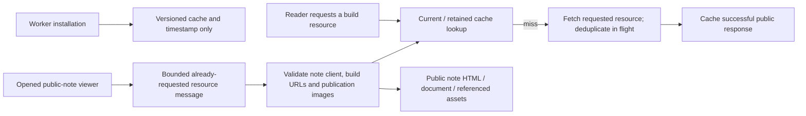

Delivered publications cannot be recalled from an offline device. This is a documented product constraint, not an authorization guarantee. Do not extend the worker to cache authenticated pages or mutable draft APIs.

## 11. Tests and architectural verification

`privacy:test` covers consent parsing/lifecycle, eligible-browser SDK/collector gating, navigation
deduplication, bounded intake, geographic normalization, report ranges, private owner access and CSV
escaping. `privacy:browser:test` runs against a built loopback preview with service workers blocked;
the separately isolated test-only dashboard harness contains labelled synthetic aggregate fixtures,
not a production auth bypass. Database migration execution/grant/retention tests use an isolated
local engine when available; these do not establish hosted migration or cron activation. The
critical-boundaries workflow includes the new privacy suite and affected application/migration paths.

The critical-boundaries workflow also watches the measurement policy/root layout, deferred YouTube component/résumé, notebook header configuration, internal-link validator and their Node regression files. `test:critical` includes `seo:test` for production-origin/opt-out/private-URL measurement rules, real Svelte server rendering of deferred/default players, notebook-to-published-parent canonical consistency and internal-link CLI fixtures. The link validator recognises canonical topic paths only when strict topic frontmatter matches its lowercase kebab-case filename, is published and has the actual topic route handler; missing, unpublished and nested topic paths remain errors. `seo:browser:test` uses an already-built loopback preview, blocks service workers and external requests, and checks keyboard player activation/focus, narrow-screen Writing links and rendered metadata. It does not rebuild the app or serve as a field-performance measurement.

Link integrity has three complementary checks. `validate:links` parses authored Markdown and
Svelte/TypeScript navigation expressions and scans shared public registries; canonical same-site
absolute/protocol-relative URLs and route-relative URLs are checked alongside root-relative paths.
Published topic/resource metadata and actual route handlers determine valid dynamic destinations;
directories alone do not qualify as downloadable files, and static paths must match the actual
entry's letter case on every host OS. Code examples do not create navigation
references. This deterministic source check remains in the publishing prebuild.

`links:audit` starts a loopback production preview (or accepts an explicitly supplied HTTP loopback
origin), reuses the existing source URL inventory, reconciles the sitemap, and follows rendered
public links with bounded GETs and redirects. It preserves query states, validates cross-page
fragments against rendered IDs/named anchors, and records referring pages, redirects, exclusions,
external destinations and incomplete/failing checks in `.codex-artifacts/site-links.json`.
Private/auth/API routes are excluded; public Notes use the available local fixture/backend state,
so this check does not establish hosted publication availability or owner authorization.

`links:browser:test` uses the built loopback preview with service workers blocked and external
navigation fixtures to exercise footer controls and shared navigation at desktop/mobile sizes.
`links:test` tests source resolution, crawl boundaries, rendered failures and external-checker
classification. The feature-artifacts workflow runs those fixtures, the local rendered audit and
the navigation browser suite around its existing full build, retaining audit evidence.
The separate content-links workflow covers ordinary post/topic/resource and static-asset changes
with the routine build and local HTTP audit, preserving the publishing/feature build separation;
compressed narration-only changes are excluded. Both workflows retain read-only repository
permissions and require no provider credentials. External
availability is checked separately with `external-links:audit`, consuming the rendered inventory:
bounded unauthenticated GETs distinguish confirmed failures from publisher challenges, authentication,
rate limits and transport failures. External network checks do not gate ordinary builds or CI.

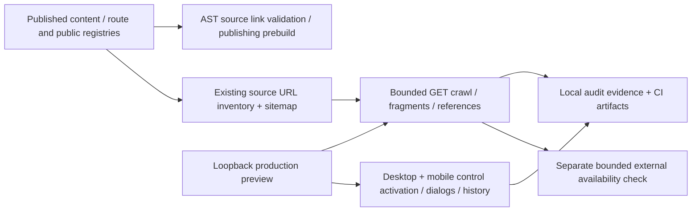

Unit tests primarily live alongside engines and models. The main Vitest config includes 283 baseline source test files; separate ray-marching and Human+AI ICU configurations account for ten additional source test files. Its coverage-report include list is narrowly notes-focused; it is not a repository-wide coverage promise. `notes:test` invokes the entire default Vitest collection and then SQL-pattern tests, despite its name. `npm test` invokes several focused suites before that global run, repeating work (`AF-010`).

Browser tests use 30 root Playwright configurations and feature-specific npm commands, including reduced-motion, layout/accessibility, simulation interaction and visual regression checks where authored. Twenty-seven configurations use `build:site` and preview; Fractal Atlas uses the full mutating build; Calcutta Footpath and Kagojer Dana use Vite dev. Several default ports overlap, so do not assume concurrent feature suites are isolated. Existing CT/double-pendulum workflows are scoped feature checks; IndexNow is deployment automation. There is no general required lint/type/unit/security CI workflow in the baseline. The subsequent feature-artifacts workflow runs the full maintenance build on relevant source/configuration/artifact paths; it excludes plain posts and their routine generated indexes. It does not run the entire unit/lint/security collection. The architecture workflow is a documentation gate, not a substitute. The critical-boundaries workflow additionally runs `check` and `test:critical` for request/Notes/map/configuration changes, excluding generated server image metadata so ordinary posts do not invoke it. These are checked-in jobs; hosted required-status settings remain unverified.

Production-capable missing-data and spacetime browser suites, performance probes, piano and
Kagojer Dana captures explicitly block service workers; the traffic audit and Scale Elevator
capture already did so. Offline regressions enable workers against local fixtures. Feature and
repeated performance checks belong on loopback production previews; release checks remain
small and bounded, as specified in [CONTRIBUTING.md](../../CONTRIBUTING.md#verification-and-scope).
The critical-boundaries workflow watches the worker, its regression harness and public-note
viewer as well as existing Notes paths. `test:critical` runs the worker's Node harness and
browser-helper unit tests alongside the existing security, Notes and map checks.

Use `npm run check`, focused unit/Node/browser suites, and relevant validators for the changed boundary. `npm run lint` runs formatting first and only reaches ESLint if formatting succeeds. For routine publication use `npm run build` once; do not separately run its generators first or broaden the task into unrelated feature audits. Use `npm run build:full` when changing feature/notebook/shared-build inputs. For documentation-only work, check links, evidence, Markdown, gate fixtures and diff integrity without regenerating production content.

CT and shared-header browser regressions use full Chromium's headless mode in CI, rather than the standalone shell that repeatedly crashed while creating later test contexts. Local runs default to installed Chrome; `PLAYWRIGHT_CHANNEL` selects another installed channel. The CI installation downloads the full browser with `--no-shell`.

Spacetime's `spacetime:test` runs wiring, analytical relations, float32 numerical ray/conservation/convergence checks, independent FLRW limits and state/store/renderer regressions. `spacetime:browser:test` renders all nine modes in native and software WebGL2, checks error diagnostics/retry/context loss, idle scheduling, keyboard scope, current-scene PNG capture and portrait layout. Explicit capture may draw once outside the viewport to export changed settings. These bounded fixtures do not certify exact Kerr images, radiative transfer, every GPU/driver, or all near-critical higher-order images; see [the dated audit](../spacetime-laboratory-audit-2026-10-20.md).

The [audit validation record](FORENSIC_AUDIT.md#validation-record) distinguishes completed, failed and unavailable checks. Local compiler/static checks do not establish browser usability, numerical/scientific correctness, live role security or a successful production deployment.

## 12. Architectural invariants and prohibited patterns

The existing agent/contributor rules govern changes. In practical terms:

1. Never import private env or server modules into browser/universal code; preserve Kit's [server-only import boundary](https://svelte.dev/docs/kit/server-only-modules).
2. Treat every `PUBLIC_` value as visitor-readable. Keep `.env.example` accurate.
3. Keep public article/RSS/sitemap/social/crawler/static access working. Do not introduce broad user-agent, country, bot, HTTPS-origin or `/.well-known/` blocks.
4. Preserve CSP, deployment headers and private cache controls. Resolve resource exceptions narrowly and update their checks.
5. Keep notes drafts/version history private and public publication snapshots immutable. Reuse owner/RLS/fresh-session rules instead of duplicating weaker checks.
6. Validate imported/user data before committing it to feature state or persistence. TypeScript casts are not runtime validation.
7. Own browser resources and global DOM mutations with cleanup. Keep per-user state out of server module singletons.
8. Keep prose in the active Markdown/content directories and heavy feature logic in feature modules. Use the relevant registry/schema rather than creating a parallel route-discovery mechanism.
9. Preserve determinism and numerical limits where a feature defines them; do not force unrelated engines into a shared abstraction without evidence.
10. Treat generated output and source assets according to their generator contract. Resolve the optimizer/as-is conflict before claiming lossless preservation.

Known violations remain audit findings. Listing an invariant does not claim it is automatically enforced everywhere.

## 13. Dependency boundaries

```mermaid
flowchart TB
    Routes["Route pages and universal loads"] --> UI["Svelte components / feature shells"]
    Routes --> Contracts["Browser-safe content and domain contracts"]
    ServerRoutes["Server loads, actions, endpoints, hooks"] --> Server["lib/server content + notes repositories"]
    Server --> Contracts
    Server --> Backend["Providers / Supabase"]
    UI --> Contracts
    UI --> Models["Feature engines, workers, local controllers"]
    UI --> Browser["DOM / IndexedDB / canvas / GPU"]
    Scripts["Build scripts"] --> Sources["Markdown / taxonomy / data / assets"]
    Scripts --> Generated["Generated registries / static output"]
    Server --> Generated
    UI --> Generated
```

This diagram describes permitted directions at a coarse level, not an ESLint-enforced layer system. The current server SEO helpers live in `components/seo/SEO.ts` but are browser-safe pure data/functions; a directory named `components` does not make that helper browser-only. The module graph has bounded UI-barrel cycles and build-script parsing of runtime source. Kit enforces server-only module imports; no custom full-domain dependency linter exists.

## 14. Existing decisions and debt

Before this change there was no formal ADR directory. Feature documents and Git history are decision evidence, not retroactively approved ADRs. Important reconstructed decisions include repository-backed articles with a server metadata/universal component split; dedicated feature engines rather than one universal visualization interface; static canonical pages with dynamic redirects/exceptions; single-owner Supabase notes with frozen editions; and offline retention limited to public notes/build assets.

Start with [decisions/README.md](decisions/README.md) and [ADR 0001](decisions/0001-canonical-architecture.md) for the documentation policy. [ADR 0002](decisions/0002-separate-post-and-feature-builds.md) records the subsequent publishing/feature-build split. Significant future decisions should state context, options, consequences and status, and link the affected sections here. Never overwrite historical ADR reasoning to imply the past already matched current code.

[ADR 0005](decisions/0005-demand-driven-offline-caching.md) records demand-driven offline caching
and bounded live verification after the 21 October 2026 Edge Request incident.

The [forensic findings](FORENSIC_AUDIT.md#findings) are the remediation inventory. Open debt includes remaining distributed/Notes request controls; notes transaction and integration-test gaps; browser save deadlines; comprehensive accessibility verification of Meaning Map's corrected interaction state; image provenance/cache policy; duplicated path rules; and repeated test orchestration. Fractal's laboratory-envelope validation and Meaning Map's composed interaction state are corrected, with focused unit and browser regressions. The earlier map resource leak and stale-session metadata no-op path are also corrected. Proposed remediation does not change this document's as-built descriptions until implemented and verified.

## 15. Adding features and reviewing structural changes

Before implementation, identify the route/render mode, source of truth, client/server boundary, owner of state/resources, integration credentials, validation and test seam. Extend the existing post/resource/topic/game registry when it fits. Use a dedicated feature domain when its model differs; justify any new cross-cutting abstraction with actual repeated responsibilities. Add a server integration only through a server entry point with the required admission controls.

For notes or persistence changes, model authorization, fresh-session requirements, atomicity, revision/conflict semantics, public visibility and offline behavior together. Schema changes after deployment belong in a new migration; do not assume editing the initial SQL changes a hosted database. For renderer changes, test fallback, teardown, reduced motion, keyboard access and repeat navigation. For content tooling, verify deterministic output, alias parity and source-asset preservation before changing the pipeline. Feature/notebook/shared-build work uses `build:full`; text-and-image publication uses the routine build and does not automatically repair unrelated older features.

Follow the [canonical contribution gate](../../CONTRIBUTING.md#architecture-change-gate) in the same change. Review the affected text, diagrams, invariants and ADR references; update only sections whose meaning changed. Include the architecture-impact declaration and rationale in a PR. The automated gate catches explicit declarations and selected structural signals; reviewers remain responsible for semantic changes inside existing files. Repository maintainers must verify Actions event-policy permission and configure the workflow as a required branch-protection status before describing it as merge enforcement. The trusted-base workflow inspects proposed Git trees as data and executes only base code; its introducing change is validated locally until the workflow is adopted on the trusted/default branch.
