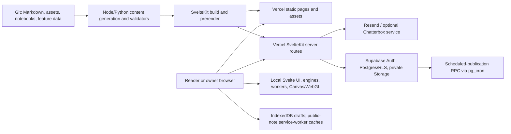
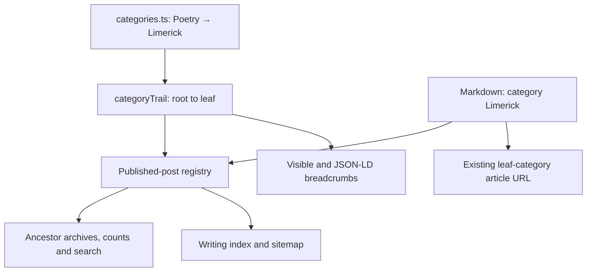
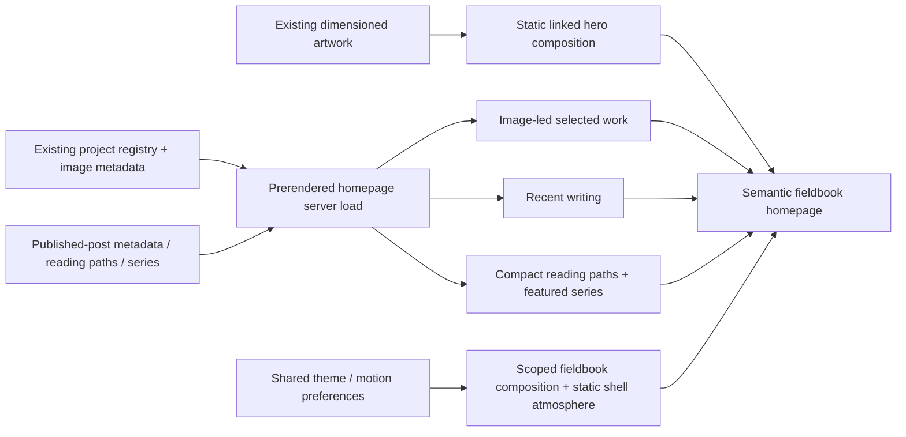
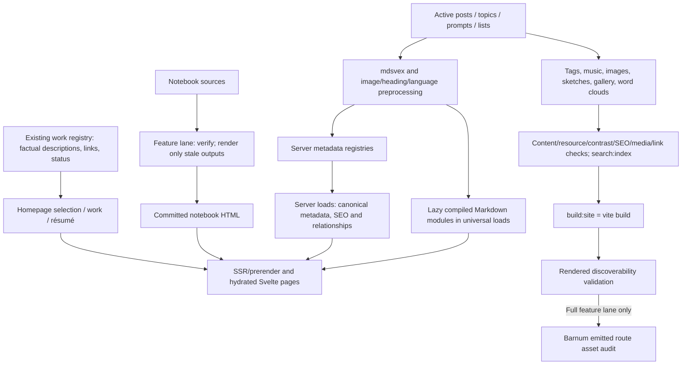
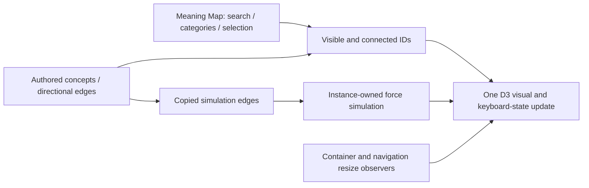
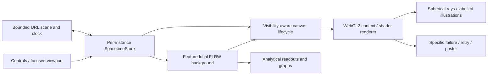
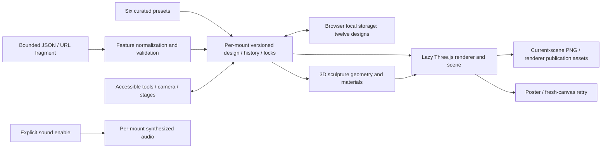
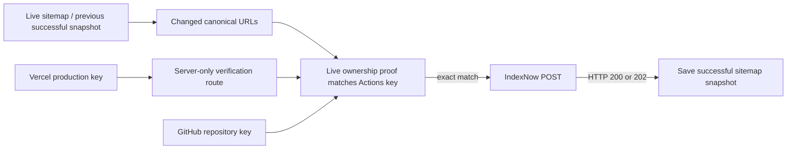
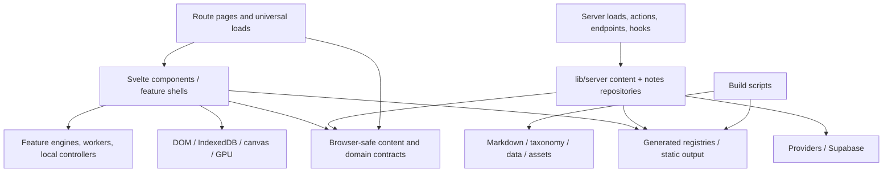

# SuvroGhosh.IN architecture

Canonical architecture reference. Last verified: **20 October 2026**, against application commit `2a31d9a33bf305354c9e159f45257074f6f8c8f0` and the subsequent documentation/enforcement, focused-publishing, urgent correctness/request-containment, visualization-review, Mrinmoyee atelier and personal-site reorientation changes on 20 October 2026. Versions below describe this checkout, not the newest available releases. The [forensic audit](FORENSIC_AUDIT.md) records evidence, known defects, coverage, and verification limits.

The mandatory architecture-change policy has one authoritative definition: [CONTRIBUTING.md — Architecture change gate](../../CONTRIBUTING.md#architecture-change-gate). This document describes the implementation; recommendations in the audit are not implemented features.

## 1. System and principles

SuvroGhosh.IN is one SvelteKit application deployed through the Vercel adapter. It combines a repository-backed publishing site, interactive scientific/educational experiences, browser games, downloadable resources, a media library, and a single-owner handwritten-notes application. There is no separate application server, generic CMS, global state store, or shared simulation engine governing every experience.

The principal boundaries are:

- Editorial Markdown and static assets are versioned inputs. Build scripts generate derived content, image metadata, search documents, and supporting media.
- Public content metadata is collected in server registries. Universal loads import compiled Markdown components for SSR and browser navigation. Components themselves are not serialized out of a server load.
- Framework-independent numerical engines, domain models, workers, and persistence helpers sit beside feature-specific Svelte interfaces. Features use different renderers and lifecycles where their needs differ.
- Private notes use authenticated server actions/APIs and Supabase authorization. Public notes expose frozen publication snapshots, never the mutable working document.
- Browser capabilities progressively enhance readable SSR content: canvas/WebGL, motion, theme persistence, offline public-note reading, and media controls.

These principles are reconstructed from imports, route options, tests, and feature documents. They are not evidence that every feature fully complies. See findings `AF-001` through `AF-013` in the audit.



## 2. Directory responsibilities

Paths are relative to the repository root. This is a responsibility map rather than a claim of team ownership; the repository has no CODEOWNERS file.

| Path                                                                                             | Responsibility and boundary                                                                                                                                                                            |
| ------------------------------------------------------------------------------------------------ | ------------------------------------------------------------------------------------------------------------------------------------------------------------------------------------------------------ |
| `src/routes/`                                                                                    | SvelteKit pages/layouts, server loads, actions, endpoints, route-local specialization.                                                                                                                 |
| `src/hooks.server.ts`                                                                            | URL normalization, selective notes-session resolution, response headers and private-cache policy.                                                                                                      |
| `src/app.html`, `src/app.css`, `static/app-bootstrap.js`                                         | Document shell, shared visual tokens/styles, pre-hydration theme/motion and image fallback.                                                                                                            |
| `src/lib/content/`                                                                               | Browser-safe editorial types, path helpers, sections/category mapping, series and reading-path definitions.                                                                                            |
| `src/lib/server/content/`                                                                        | Eager metadata registries, published-post/resource/topic resolution, metadata search, SEO-ready page data.                                                                                             |
| `src/lib/posts/`                                                                                 | Active article Markdown and a crosslink data file. The post glob does not load retained archives.                                                                                                      |
| `src/lib/topics/`, `src/lib/prompts/`, `src/lib/lists/`                                          | Curated headquarters and resource Markdown, with stricter topic/resource contracts.                                                                                                                    |
| `src/lib/components/`                                                                            | Site shell, editorial UI, feature interfaces, notes editor/viewer, UI adapters, visualization components.                                                                                              |
| `src/lib/visualizations/`                                                                        | Feature models, simulation/rendering helpers, data, workers, local tests, generic experiment registry and contracts. Some features also co-locate Svelte interfaces here (Barnum Lab and Meaning Map). |
| `src/lib/games/`                                                                                 | Game catalog, domain models/engines/content, rendering helpers and local tests.                                                                                                                        |
| `src/lib/notes/`                                                                                 | Shared note model/schema/geometry/history/export; browser editor state and Dexie draft/outbox persistence. Server persistence is elsewhere.                                                            |
| `src/lib/server/notes/`                                                                          | Server Supabase clients, owner authorization, rate limiting, recovery, repository and image sanitation.                                                                                                |
| `src/lib/motion/`, `src/lib/attachments/`, `src/lib/utils/`                                      | Motion policy and procedural helpers, DOM attachments, small shared utilities.                                                                                                                         |
| `src/lib/generated/`, `src/lib/server/generated/`                                                | Generated media/music/sketch indexes and server image dimensions; edit their generators/inputs.                                                                                                        |
| `src/lib/data/`, `src/lib/notebooks/`, `src/lib/config/`, `src/lib/sketches/`, `src/lib/assets/` | Curated folio/model data, notebook sources, public link definitions, sketch types, source assets.                                                                                                      |
| `scripts/`                                                                                       | Build generators, source/render validators, asset tools, Node tests and architecture gate.                                                                                                             |
| `tests/`, `playwright.*.config.ts`, `vitest*.config.ts`                                          | Browser/visual checks and unit-runner configuration; most unit tests live with source.                                                                                                                 |
| `supabase/`                                                                                      | Initial notes migration, development configuration, scheduled activation SQL. No generated database types are committed.                                                                               |
| `static/`                                                                                        | Public media, notebook HTML, generated word clouds/search inputs, bootstrap script and crawler assets. Never private storage.                                                                          |
| `docs/`                                                                                          | Feature design/authoring documents and dated audit evidence. This directory's `architecture/` owns the cross-cutting current reference.                                                                |
| `src/lib/SavedPosts/`, `suvroghosh-post-backups/`                                                | Retained editorial material/backups, not the active post registry. Excluded from normal formatting; SavedPosts has a separate inventory tool.                                                          |
| `artifacts/`                                                                                     | Committed captures/reports and numerical evidence. Some BZ build checks deliberately consume evidence here; this is not uniformly disposable output.                                                   |
| `.github/workflows/`                                                                             | Focused feature regressions, IndexNow submission, architecture documentation gate.                                                                                                                     |
| `.agents/skills/`, `AGENTS.md`, `CONTRIBUTING.md`                                                | Authoring/agent guidance and the canonical contribution policy.                                                                                                                                        |

The complete baseline inventory and inspection limits are in [AUDIT_COVERAGE.md](AUDIT_COVERAGE.md).

## 3. Toolchain ground truth

Installed `node_modules` package versions matched `package-lock.json` when inspected. Ranges are from `package.json`.

| Tool               | Declared range | Installed / locked |
| ------------------ | -------------- | ------------------ |
| Svelte             | `^5.54.0`      | `5.56.4`           |
| SvelteKit          | `^2.50.2`      | `2.69.2`           |
| TypeScript         | `^5.9.3`       | `5.9.3`            |
| Vite               | `^7.3.1`       | `7.3.6`            |
| Vercel adapter     | `^6.3.1`       | `6.3.3`            |
| Svelte Vite plugin | `^6.2.4`       | `6.2.4`            |
| mdsvex             | `^0.12.7`      | `0.12.7`           |
| Tailwind CSS       | `^4.2.2`       | `4.2.2`            |
| Vitest             | `^4.1.10`      | `4.1.10`           |
| Playwright test    | `^1.62.0`      | `1.62.0`           |

The audit host ran Node `24.11.1`, npm `11.12.1`, and Python `3.12.3`. These are observations, not a repository-wide runtime pin. Existing feature CI uses Node 22; the new dependency-free architecture gate uses Node 24. Check individual workflows before assuming the same runtime everywhere.

Important libraries include Supabase SSR/client, Zod, Dexie, Sharp, perfect-freehand and jsPDF for notes; D3, Three.js, p5, Observable runtime, decimal.js and ml-matrix for feature-specific work; Bits UI and local adapters for UI; KaTeX/remark/rehype for Markdown; Resend for contact; Vercel analytics/speed insights. Installed packages alone do not imply every dependency is loaded by every page. `tsconfig.json` enables strict TypeScript and `checkJs`; generated Kit configuration supplies route types and aliases.

Notebook authoring is separate: `pixi.toml` pins Mojo `1.0.0b2` on Linux x64/macOS ARM64, with constrained Jupyter dependencies. Native Windows authoring uses the documented WSL path. The full feature lane can verify committed notebook HTML when a local renderer is unavailable; routine article builds do not invoke the notebook toolchain.

## 4. Routes, layouts and rendering

The root server layout supplies shared SEO defaults. The root Svelte layout uses `$app/state`, snippets, and derived route data to choose the site shell, private studio shell, immersive/site game shell, or one of two registered editorial folios. It owns route atmosphere, analytics, reduced-motion handling and guarded view transitions. `src/routes/blog/+layout.svelte` adds blog typography.

| Route family                                                                                       | Current behavior                                                                                                                                                                                                                                                                                                   |
| -------------------------------------------------------------------------------------------------- | ------------------------------------------------------------------------------------------------------------------------------------------------------------------------------------------------------------------------------------------------------------------------------------------------------------------ |
| `/`, `/about`, `/writing`, `/consulting`, `/projects`, `/start-here`, `/resume`, `/healthcare-it-gulf`       | Explicitly prerendered personal, editorial, work and career-background pages.                                                                                                                                                                                                                                                                 |
| `/blog`                                                                                            | Dynamic server metadata search/filtering and pagination; readable without client search.                                                                                                                                                                                                                           |
| `/blog/[category]`, `/blog/archive/[year]`, `/blog/archive/[year]/[month]`, `/blog/topics/[topic]` | Dynamic archive loads, validated params/filters and pagination.                                                                                                                                                                                                                                                    |
| `/blog/topics`, `/blog/visualizations`                                                             | Prerendered indexes. Promoted topics redirect to curated headquarters.                                                                                                                                                                                                                                             |
| `/blog/[category]/[slug]`                                                                          | `prerender = 'auto'`; generated canonical entries plus server fallback for category/legacy redirects. Server load resolves published metadata; universal load imports the compiled Markdown component.                                                                                                             |
| `/blog/games/[slug]`                                                                               | Prerendered entries from `gamesCatalog`; a dedicated page renders one of four catalog experiences. The generic article entry generator excludes games.                                                                                                                                                             |
| Three concrete `/blog/visualizations/...` pages                                                    | Bias Archipelago, Barnum Lab and Meaning & Connection Map have route-specific SSR loads and component wrappers. They reuse the generic article page. Barnum has explicit critical-CSS/preload controls; Meaning Map overlays the article after mount. These exceptions are not a second general publishing engine. |
| `/topics`, `/topics/[slug]`                                                                        | Prerendered index and `auto` headquarters entries with validated registry membership and lazy Markdown bodies.                                                                                                                                                                                                     |
| `/resources`, `/resources/[kind=resourceKind]/[slug]`                                              | Prerendered resource index/details; param matcher limits kind to prompts/lists; universal component import follows server metadata validation.                                                                                                                                                                     |
| `/images`, `/images/sketches`                                                                      | Server gallery/sketch loads; generated asset catalogs; the museum has browser enhancement.                                                                                                                                                                                                                         |
| `/notes/**`                                                                                        | Inherits `prerender = false`; public list/read, owner auth/recovery, protected studio/editor/preview.                                                                                                                                                                                                              |
| `/api/notes/**`                                                                                    | Owner-only document/assets APIs.                                                                                                                                                                                                                                                                                   |
| `/api/public/notes/**`                                                                             | Visible snapshot document and publication-gated private-storage asset reads.                                                                                                                                                                                                                                       |
| `/contact`, `/api/tts/chatterbox`                                                                  | Contact form action and optional speech proxy.                                                                                                                                                                                                                                                                     |
| `/rss.xml`, `/sitemap.xml`                                                                         | Prerendered repository-backed discovery outputs. Notes has a separate dynamic sitemap.                                                                                                                                                                                                                             |
| `/tags/[slug]`, `/[indexnowKey].txt`                                                               | Dynamic legacy tag redirects and secret-backed IndexNow verification.                                                                                                                                                                                                                                              |

The personal-site introduction leads with independent entrepreneurship, making and writing. Primary navigation connects existing work (`/projects`), writing (`/writing`), the verified external YouTube channel, `/about`, and the existing Start Here reading guide. Secondary discovery remains in the footer and command palette. `/about` is a small prerendered profile using the shared `Person` identity, with career history linked at the unchanged `/resume` URL. `/consulting` and `/healthcare-it-gulf` retain their URLs as career-context pages without current service or availability promises. No article routes or publication metadata were renamed.

SSR and client hydration remain enabled by default; there is no global SPA-only setting. Universal content loads intentionally return component constructors because that code executes in both environments. Server loads return serializable metadata. The generic article page supplies article SEO, breadcrumbs, author/tools, navigation, related posts and notebook/folio variants.

The three concrete visualization wrappers are intentional bundle/rendering adaptations. Their differing entry exclusions and duplicated load scaffolding are visible maintenance costs. The Meaning Map's earlier unbalanced global scroll mutation (`AF-006`) is corrected by mount-owned cleanup; it is not an approved route convention. Its separate interaction-state/accessibility debt remains `AF-013`.

## 5. Content, build and search data flow

`svelte.config.js` preprocesses Markdown with author-helper imports, image markup enrichment and mdsvex; remark/rehype handle math, heading IDs/links, heading collection, H1 demotion, Bengali language markup and square-bracket styling. Its global imports are limited to the editorial helpers named there. Authors explicitly import substantial interactive experiences.

`src/lib/server/content/posts.ts` eagerly imports only Markdown metadata, omits unpublished/redirected posts, validates required fields, maps categories into sections, and derives topic membership, archives, navigation, related posts, curated paths and facets. Publication currently means `published !== false`; missing publication flags are not implicitly private. `src/lib/content/posts.ts` defines the metadata interface and runtime checks, but does not offer the same strict runtime schema as notes or topic headquarters.

Categories may have parents, defined by `categoryParents` in `src/lib/content/categories.ts`; `categoryTrail` supplies the root-to-leaf ancestry with cycle detection. Poetry is the parent of Limerick. Both map into the existing Essays section in `sections.json`, leaving the six permanent sections intact. Posts retain one leaf `category` and the existing `/blog/[category]/[slug]` canonical URL. Parent archives and category search include descendant posts; archive facets/counts, the writing index and sitemap include their populated ancestors. Category archives link their published children and parents. Article breadcrumbs use the same ancestry in visible navigation and JSON-LD. Categories without parents preserve their existing behavior.



`src/lib/content/professional-projects.ts` remains the single work registry used by the work page and résumé. Optional factual status labels distinguish experiments, demos, the in-use publishing system and past work without constraining future media or industries. The homepage server load selects three IDs from that same registry and sends serializable card and optional image metadata (source, alternative text and dimensions) to `WorkWorlds`; recent writing continues to come from the published-post registry. Work-page ordering puts existing independent work before career projects while preserving each project anchor. The shared YouTube destination lives in `config/links.ts`; no video feed, new third-party integration or separate product catalog was added.

### Homepage fieldbook rendering

The prerendered homepage composes the Calcutta Fieldbook from `LivingHero`, `WorkWorlds`, `RecentSignalGrid`, `FieldbookIndex` and `ClosingInvitation`. The hero links to existing pigment and sculpture experiences through static, dimensioned artwork. Work previews use the selected registry image metadata; the publishing-system preview is an inline editorial SVG illustration, not a separate application or product. `FieldbookIndex` consumes the existing serialized reading paths and featured-series parts in one compact section. Authored article bodies and article layouts remain outside this presentation change.

The route no longer imports or mounts `LivingIndexScene`, its dynamic WebGL controller, the old four-way gateways or the separate large reading/series sections. Those source components remain available but are not homepage runtime dependencies. The normal shell retains the existing `homeStandard` static atmosphere contract, so neither the shell nor the homepage mounts an ambient canvas. The full document and destinations render without JavaScript or WebGL. Scoped component styles and homepage-only `fieldbook.css` own the responsive composition and locally loaded display fonts; the shared theme and motion preferences remain owned by the normal layout/header. Image hover transitions respect Still and OS reduced motion. No new frame loop, state store, endpoint or integration was introduced.



Resources use `parseResourceMetadata` and marked copy regions. Topic headquarters use a strict Zod schema plus registry validation for canonical paths, membership, promoted aliases and reading-path references. `sections.json` is shared taxonomy data; category/path normalization and alias consumers are still partially duplicated in Node scripts (`AF-009`).



`npm run build` is the routine production/publishing lane, including the hosting default when no remote override is configured. npm invokes `prebuild` once:

1. `content:generate`: tags → music → image optimization → sketches → gallery → word clouds.
2. Content, resources, contrast, SEO and media validation → search indexing → link validation.
3. `build:site` (`vite build`) → discoverability checks against rendered output.

This lane uses committed notebook HTML. It neither invokes notebook preparation nor runs the dedicated visualization artifact audits. It still compiles/prerenders the shared site's existing routes, so real application compilation errors remain blockers and old feature names may appear in compiler output. Global publication/index/link checks remain global where cross-content relationships require them.

`npm run build:full` is the feature-maintenance lane:

1. `features:check` runs the preserved deterministic Barnum, Bias, BZ, Prior Authorization and Strange Attractor artifact checks.
2. `notebooks:prepare` validates notebook shape/source hashes/renderer versions, leaves current HTML untouched and renders only stale/missing output when rendering dependencies exist. If required output is stale and dependencies are absent, it fails instead of silently accepting it. Explicit `notebooks:render` remains a full refresh.
3. The routine `npm run build` runs its normal prebuild/build once.
4. Barnum's emitted route assets are audited after the site build.

The feature-artifacts CI workflow selects feature/notebook/shared-build changes, with ordinary posts and their routine generated metadata excluded. CI uses verify-only image/word-cloud settings; notebook authors commit prepared HTML. See [ADR 0002](decisions/0002-separate-post-and-feature-builds.md) for the boundary and trade-offs. Workflow execution and hosted required-status configuration remain unverified.

The `build:site` split avoids recursive npm/Vercel build invocation; history `a56d0791` records the fix. Do not collapse it casually. Generators deliberately write tracked artifacts. A full build is not a read-only audit command.

The image optimizer currently resizes large raster inputs and applies lossy JPEG/opaque-WebP encoding, writing accepted output at the same path. Some formats/animated/original sketch sources are preserved. This conflicts with the existing local instruction permitting only lossless, same-dimension processing of an as-is image (`AF-007`). The canonical reference records the conflict; this task does not change the optimizer or weaken the instruction.

Search has two roles: server metadata search supports `/blog` filters and no-JavaScript requests; `search:index` emits full-content search input and Pagefind assets for the browser search component. Neither is a notes database search replacement. Notes uses Postgres full-text search. Different search backends here are deliberate, although build/runtime canonical URL rules should remain consistent.

## 6. Components, state and Svelte 5

Most feature UI lives under `src/lib/components/visualizations/<feature>/` or `components/games/<feature>/`, while its non-UI engine/data lives under the corresponding feature domain. This is a convention, not an enforced import rule: Meaning Map and Barnum Lab co-locate Svelte interfaces under the domain directory, and some large components still contain persistence/controller logic.

The prevailing style is Svelte 5 `$props`, `$state`, `$derived`, `$effect`, callback/event attributes, snippets and `{@render}`. All 406 library Svelte files compiled without warnings/errors in the audit's parse/compiler sweep. A source scan found 397 library modules containing runes, no `export let`, `$:` or `on:` event syntax, and one unreferenced legacy `svelte/store` utility (`utils/reducedMotion.ts`). These observations do not establish runtime correctness or full accessibility.

State ownership follows the feature:

- Page inputs arrive through generated `PageData`/`ActionData` types, although not every older page declares an explicit annotation.
- Local UI state is component-owned; derived values normally use `$derived`.
- Notes' editor state is built by `editor-state.svelte.ts`, with model/history/index helpers and IndexedDB recovery/outbox storage.
- Simulations use feature-owned engines/controllers, deterministic random streams where supplied, workers/message protocols and explicit lifecycle methods. Renderer needs differ; the shader registry is not the interface for every visualization.
- Theme/motion preference is stored in browser localStorage and document datasets. Bootstrap code applies it before hydration; layout/header modules maintain it after mount.
- Browser DOM/resource side effects belong to a component/attachment lifecycle and must release listeners, frames, simulations, observers, contexts and document styles at teardown. Meaning Map now returns instance-owned mount cleanup through `meaning-connection-map/lifecycle.ts`; its earlier resource leak is resolved. The audit found exceptions, not an absence of lifecycle facilities.

Meaning Map composes its component-owned search, category and selection state through one reactive renderer update. Pure projections in its existing `simulation.ts` compute visible and connected IDs; the D3 update applies opacity, pointer access, tab order and selection styling together. Filtering a selected concept clears that selection; following a detail-panel connection explicitly enables its category and clears a conflicting search. Authored directional edge IDs remain separate from D3-mutated simulation edges. The SVG viewport follows its container through an instance-owned resize observer. A second owned observer measures the site navigation so the fixed map begins beneath it, retaining access to both navigation and all map controls. Graph nodes expose keyboard activation and semantic names. Focused source, unit and production-browser checks cover search, keyboard selection and mobile/header geometry; they do not establish complete screen-reader or interaction coverage.



There is no `src/lib/stores/` or universal singleton state framework. Do not add module-global per-user mutable state to server-executed modules. A valid legacy component/store is not itself an architectural defect: [Svelte's legacy overview](https://svelte.dev/docs/svelte/legacy-overview) documents compatibility. Modernization should solve a demonstrated problem. [Lifecycle cleanup](https://svelte.dev/docs/svelte/lifecycle-hooks#onMount) applies to imperative resources regardless of syntax.

Spacetime Laboratory owns a per-mount runes store, a complete bounded URL scene/animation-clock codec and one WebGL2 renderer. The renderer's actual context creation and shader compilation determine support; it does not use the shared stricter WebGL1/2 preflight. Initialization is abortable: `KHR_parallel_shader_compile` completion polling has a 15-second deadline; without the extension, the required synchronous link check cannot have an interruptible driver deadline. The shader evaluates its model, compact-object tracer and procedural sky at single call sites to avoid pathological native D3D11 compilation expansion. Explicit `webgl=off`, context-creation failure, shader failure and context loss have distinct fallback paths; retry mounts a fresh canvas. The canvas owns resize/intersection/motion/visibility listeners and GPU cleanup. It draws while visible and playing, or once after a paused scene changes; hidden/offscreen scenes suspend GPU work. Keyboard commands belong only to its focused viewport. Schwarzschild and Reissner–Nordström rays use spherical static null-geodesic integration with analytic capture classification; Kerr, emission/colour transfer, projected reference guides and cosmological sky patterns remain labelled illustrations. A feature-local Friedmann background solver supplies FLRW scale factor/redshift to both the UI and shader; curvature density obeys Ωk = 1 − Ωm − Ωr − ΩΛ. This is neither a shared simulation engine nor an Einstein-field-equation solver.



### Mrinmoyee sculpture atelier

Mrinmoyee uses the ordinary Visualizations Markdown article and generic blog route, with an immersive Svelte shell under `components/visualizations/mrinmoyee`. It introduces no route exception, endpoint, provider or shared state manager. Its feature domain under `visualizations/mrinmoyee` owns the versioned design contract, six presets, bounded normalization, construction geometry, browser renderer, optional synthesized sound and device-gallery persistence. This extends the existing feature-owned Three.js pattern; it does not introduce a shared sculpture engine.

The shell owns current design, undo/redo, comparison selection, design locks and presentation preferences. `state.ts` validates complete version-1 JSON documents with a 24 KiB UTF-8 limit, carries design state in a URL fragment, and stores up to twelve normalized designs in browser local storage. Imported strings, enums, finite ranges and camera vectors pass through the same normalizer. The fragment includes camera, geometry, surface and lighting settings; it is not sent to the server. Saved thumbnails are size-bounded data images, with a design-only retry when storage quota is exhausted. Gallery deletion affects this browser only. There is no cloud persistence or server-side per-user mutable state.

`AtelierViewport.svelte` dynamically imports the renderer after mount. The renderer owns its Three.js scene, OrbitControls, lights, environment map, interaction handlers, observers and animation frame. `sculpture.ts` builds actual three-dimensional parts and consolidates compatible geometry by material and selectable region. The making slider switches structural layers through framework, clay, paint, cloth, ornament and complete stages. Sculptural identity remains separate from camera and lighting changes. Still views render on demand; explicit ambient motion, bell interaction and presentation may schedule animation while visible. Reduced motion suppresses animation. Context loss presents a poster and a retry that creates a fresh canvas; unmount disposes the renderer, geometry, materials, textures, controls and observers. Sound is instantiated only after an explicit enable action and suspended when the document is hidden.

PNG export renders the current scene through a camera adjusted to contain the selected view in the requested aspect ratio. Transparent capture temporarily hides the background/atmosphere; a final 2D canvas adds optional title and signature. Export restores the interactive size, pixel ratio and scene visibility. Publication posters and preset thumbnails are captures of this same renderer, with social typography composited over the real scene. `scripts/render-mrinmoyee-assets.mjs` records source provenance and dimensions; its check is part of the full feature-artifact lane. See [the feature record](../visualizations/mrinmoyee.md) for limits and verification commands.



Local UI adapters use Bits UI/tailwind variants, `cn`, and barrel exports. Five bounded runtime import cycles occur inside these adapters (badge/button/sheet/tabs/tooltip); the static graph found no domain-wide runtime cycle. These cycles have no demonstrated initialization failure and are documented coupling, rather than a counted defect. The graph excluded type-only imports, glob expansion and nonliteral imports; it is not a formal proof of acyclicity.

## 7. Notes client/server/persistence lifecycle

```mermaid
sequenceDiagram
    participant Owner as Owner browser
    participant Local as Dexie draft/outbox
    participant Kit as SvelteKit owner action/API
    participant Auth as Supabase Auth/RLS
    participant DB as Postgres RPCs/snapshots
    participant Reader as Public reader
    Owner->>Local: Persist device recovery state
    Owner->>Kit: Save document with revision and request identity
    Kit->>Auth: Verify cookie user and configured owner
    Kit->>DB: save_note_document with optimistic revision/idempotency
    DB-->>Owner: New revision or conflict via Kit
    Owner->>Kit: Publish or schedule frozen saved document
    Kit->>DB: Fresh-session publication RPC
    DB->>DB: Snapshot + publication asset manifest; cron activates schedule
    Reader->>Kit: Read visible publication metadata/document/asset
    Kit->>DB: Anonymous RLS visibility check
    Kit-->>Reader: Snapshot data; gated private blob for authorized publication
```

`notes` is the mutable private working row. `note_versions` preserves working history; `note_publications` contains immutable editions. Scheduling freezes the scheduling-time state. Editing a draft does not update the edition already visible to readers. Assets remain in a private bucket and are linked to publication manifests.

The server creates three distinct clients: request-cookie SSR client, anonymous publication reader, and privileged service-role client. The privileged client performs gated storage/manifest duties, durable auth-throttle RPCs and the configured-owner email lookup during recovery. It must never be exposed to browser imports. Database security-definer functions use an empty search path, explicit actor checks and controlled grants. Fresh authentication (12 hours) is required by sensitive RPCs. The metadata action now checks freshness before actual status changes and every publish/schedule operation; unchanged draft/private/archived metadata avoids an unnecessary transition RPC. Its repository update checks the server-observed status and undeleted row, returning 409 on an intervening status/deletion change (`AF-002`, corrected). Metadata and subsequent RPCs remain separate operations; this is not complete atomicity or same-status edit concurrency protection.

When Supabase URL/publishable-key configuration is absent, public repository reads intentionally return the demo published note; protected authoring fails configuration checks. This is different from an empty, configured database. Hosted data and configuration were not inspected.

Public viewers fetch the document separately from metadata, draw culled canvas objects, and retain a semantic transcript/controls around canvas output. Owner editing supports local draft recovery and a queued save path; a stalled unbounded browser request can currently hold the autosave path (`AF-004`). Fractal Atlas now normalizes imported and locally saved laboratory envelopes through its feature-local `specimen-state.ts`: bounded finite divider/path controls, strict boolean/enum values, validated comparison core state, and finite decimal coordinates describing the same numeric point. Its existing core-state parser remains responsible for the fractal recipe (`AF-005`, corrected).

Supabase rows are manually described/asserted in `repository.ts`; clients do not use generated end-to-end database types. Existing tests cover shared geometry/schema/history/export, recovery/referrer helpers and SQL source patterns. Running the migration under real roles and testing concurrent RPC behavior remains open work (`AF-003`).

## 8. Integrations and environment

| Boundary                              | Implementation and credential placement                                                                                                                                                                                        |
| ------------------------------------- | ------------------------------------------------------------------------------------------------------------------------------------------------------------------------------------------------------------------------------ |
| Resend contact email                  | `/contact` server action; server environment API key, sender and recipient. Normal HTML form with optional `use:enhance`.                                                                                                      |
| Chatterbox speech                     | `/api/tts/chatterbox` server proxy; private endpoint/key/model/voice settings; optional browser visibility flag. Supports native/OpenAI-compatible request mapping and WAV/MP3/Opus choices; accepts upstream `audio/*` bytes. |
| Supabase                              | Server-only URL/publishable/service credentials and owner UUID. Browser drafts are local Dexie data; browser code does not receive a service-role client.                                                                      |
| IndexNow                              | Secret-backed verification route; deployment workflow compares live sitemap snapshots, verifies live ownership against the repository secret, and submits changed URLs only after that proof matches.                          |
| Vercel analytics / speed insights     | Root layout browser initialization; CSP allows the named Vercel endpoints.                                                                                                                                                     |
| YouTube and static notebooks          | CSP permits self/YouTube frame destinations; notebook HTML uses a sandboxed iframe. Compatibility with Vercel's blanket frame-denial response header needs deployed-header/browser verification.                               |
| Jupyter/Mojo and Python asset tooling | Author/build tools, not request-time notebook execution.                                                                                                                                                                       |

For each nonempty live IndexNow submission, `scripts/indexnow.mjs` first fetches the canonical
secret-backed verification URL with redirects rejected and a 15-second deadline. It requires
HTTP 200, `text/plain` and an exact streamed byte match to the configured ASCII key, rejecting
an oversized body immediately without buffering it in full. Only then does it POST the canonical URLs, with its own
15-second deadline. HTTP 200 or 202 permits saving the successful sitemap snapshot; ownership,
network and provider failures preserve the prior snapshot. An unchanged sitemap needs no POST.
Dry runs validate the payload without the ownership request. Diagnostic errors omit the key,
verification URL and response bodies. Vercel's production environment and the GitHub repository
secret must contain the same value, and a Vercel variable change requires a new deployment.
The workflow checks out the deployment SHA and runs the dependency-free submission contract tests.



`.env.example` is the public configuration inventory. Its entries have no real secrets. `PUBLIC_ENABLE_CHATTERBOX_TTS` is a browser-readable feature setting currently consumed through `$env/dynamic/public`; it is not authorization to use the speech endpoint. This is an existing exception to the preference for static public imports for build-time flags. Private environment imports belong only in server routes, hooks, scripts or `$lib/server`. For new build flags prefer `$env/static/public` and document visitor visibility.

The forensic architecture audit did not inspect real secret values, live provider configuration, Vercel overrides, production Supabase settings or account quotas. `supabase/config.toml` is a development template, not production-state evidence.

## 9. Security, errors and validation

The checked-in CSP is defined in `svelte.config.js` with automatic nonce/hash handling, self-by-default scripts, named Vercel endpoints, bounded frame/worker policy, no objects and no framing. `vercel.json` adds transport response headers and apex-to-www redirects. `hooks.server.ts` adds request IDs and headers to resolved application responses; it normalizes blog categories and resolves notes sessions only for protected/auth-dependent routes.

Private studio/auth/API responses receive private no-cache/no-store headers and noindex/noarchive directives. Auth pages intentionally use `same-origin` referrers on clean URLs and `no-referrer` while a recovery/callback secret remains in the URL; recovery tokens are consumed only after an explicit same-origin confirmation POST. Local auth config must not be treated as proof of hosted signup/session settings.

Owner authorization checks both the configured immutable user UUID and database membership/RLS. Public notes are filtered through active/unrevoked publication visibility, then publication-specific assets are checked. The public asset path is not permission to read arbitrary private blobs.

Errors currently follow several mechanisms: Kit `error`/`redirect`, form `fail` data, Zod parsing, repository error translation, provider HTTP responses, and a site `+error.svelte`. Universal Markdown import failures are logged and mapped to 404; they do not expose a detailed import error to readers. Notes use bounded runtime Zod validation (ordinary object schemas strip unknown keys); topic/resource authored metadata contracts are stricter. Article metadata uses a lighter validator and build checks. This diversity is real; a single universal error/schema layer does not exist.

New expensive/state-changing endpoints must follow the existing security invariants in [AGENTS.md](../../AGENTS.md): validate input, enforce streamed body limits, same-origin rules where browser-invoked, timeouts and cost-appropriate throttling. TTS and contact now use the shared server-only `http/body.ts` streamed reader/deadline helper and bounded `local-admission.ts` guard. Their 64 KiB input limits apply before parsing, with ten-second read deadlines and exact origin checks. TTS limits audio to 32 MiB within a 120-second provider deadline; contact delivery has a 15-second deadline. Admission is process-local, including a bounded fallback bucket when the adapter cannot resolve an address, and is not a distributed guarantee. Notes mutation readers and shared Supabase deadlines remain gaps (`AF-001`, in progress). SvelteKit's built-in form CSRF check is present; it does not replace explicit policy for every JSON endpoint. The named `security:audit` and `security:smoke` commands are currently absent, so they cannot be presented as passing safeguards.

## 10. Caching and offline behavior

- Prerendered pages and immutable build chunks use the adapter/CDN path; dynamic archives execute server loads.
- `vercel.json` gives semantic `/images`, `/photos`, `/sketch`, `/videos`, `/fonts` URLs one year of immutable caching. Other static families have separate long shared-cache rules. There is no general source-content hash in editorial image URLs; replacement at the same path can remain stale (`AF-008`).
- `PostImage.svelte` emits responsive Vercel optimizer URLs with a local-original fallback. Its sizes must agree with adapter image sizes. Those URLs do not currently include a content revision.
- Public notes use short HTTP caches; private responses use no-store. The notes sitemap has its own short shared cache.
- `src/service-worker.ts` caches build assets and explicitly opened public note pages/documents/assets. It excludes private notes/auth/API paths, rejects private/no-store or cookie-bearing public responses, uses network-first public reads, evicts online 404/410, and permits retained public responses for up to 30 days with a 240-entry public-cache cap.
- During service-worker activation, older build caches are removed when their recorded age exceeds 30 days; ordinary build-asset requests do not enforce a hard 30-day TTL. Retention supports old offline note HTML/runtime compatibility. The cache contains build assets, not a blanket copy of every public static video/image.

Delivered publications cannot be recalled from an offline device. This is a documented product constraint, not an authorization guarantee. Do not extend the worker to cache authenticated pages or mutable draft APIs.

## 11. Tests and architectural verification

Unit tests primarily live alongside engines and models. The main Vitest config includes 283 baseline source test files; separate ray-marching and Human+AI ICU configurations account for ten additional source test files. Its coverage-report include list is narrowly notes-focused; it is not a repository-wide coverage promise. `notes:test` invokes the entire default Vitest collection and then SQL-pattern tests, despite its name. `npm test` invokes several focused suites before that global run, repeating work (`AF-010`).

Browser tests use 30 root Playwright configurations and feature-specific npm commands, including reduced-motion, layout/accessibility, simulation interaction and visual regression checks where authored. Twenty-seven configurations use `build:site` and preview; Fractal Atlas uses the full mutating build; Calcutta Footpath and Kagojer Dana use Vite dev. Several default ports overlap, so do not assume concurrent feature suites are isolated. Existing CT/double-pendulum workflows are scoped feature checks; IndexNow is deployment automation. There is no general required lint/type/unit/security CI workflow in the baseline. The subsequent feature-artifacts workflow runs the full maintenance build on relevant source/configuration/artifact paths; it excludes plain posts and their routine generated indexes. It does not run the entire unit/lint/security collection. The architecture workflow is a documentation gate, not a substitute. The critical-boundaries workflow additionally runs `check` and `test:critical` for request/Notes/map/configuration changes, excluding generated server image metadata so ordinary posts do not invoke it. These are checked-in jobs; hosted required-status settings remain unverified.

Use `npm run check`, focused unit/Node/browser suites, and relevant validators for the changed boundary. `npm run lint` runs formatting first and only reaches ESLint if formatting succeeds. For routine publication use `npm run build` once; do not separately run its generators first or broaden the task into unrelated feature audits. Use `npm run build:full` when changing feature/notebook/shared-build inputs. For documentation-only work, check links, evidence, Markdown, gate fixtures and diff integrity without regenerating production content.

CT and shared-header browser regressions use full Chromium's headless mode in CI, rather than the standalone shell that repeatedly crashed while creating later test contexts. Local runs default to installed Chrome; `PLAYWRIGHT_CHANNEL` selects another installed channel. The CI installation downloads the full browser with `--no-shell`.

Spacetime's `spacetime:test` runs wiring, analytical relations, float32 numerical ray/conservation/convergence checks, independent FLRW limits and state/store/renderer regressions. `spacetime:browser:test` renders all nine modes in native and software WebGL2, checks error diagnostics/retry/context loss, idle scheduling, keyboard scope, current-scene PNG capture and portrait layout. Explicit capture may draw once outside the viewport to export changed settings. These bounded fixtures do not certify exact Kerr images, radiative transfer, every GPU/driver, or all near-critical higher-order images; see [the dated audit](../spacetime-laboratory-audit-2026-10-20.md).

The [audit validation record](FORENSIC_AUDIT.md#validation-record) distinguishes completed, failed and unavailable checks. Local compiler/static checks do not establish browser usability, numerical/scientific correctness, live role security or a successful production deployment.

## 12. Architectural invariants and prohibited patterns

The existing agent/contributor rules govern changes. In practical terms:

1. Never import private env or server modules into browser/universal code; preserve Kit's [server-only import boundary](https://svelte.dev/docs/kit/server-only-modules).
2. Treat every `PUBLIC_` value as visitor-readable. Keep `.env.example` accurate.
3. Keep public article/RSS/sitemap/social/crawler/static access working. Do not introduce broad user-agent, country, bot, HTTPS-origin or `/.well-known/` blocks.
4. Preserve CSP, deployment headers and private cache controls. Resolve resource exceptions narrowly and update their checks.
5. Keep notes drafts/version history private and public publication snapshots immutable. Reuse owner/RLS/fresh-session rules instead of duplicating weaker checks.
6. Validate imported/user data before committing it to feature state or persistence. TypeScript casts are not runtime validation.
7. Own browser resources and global DOM mutations with cleanup. Keep per-user state out of server module singletons.
8. Keep prose in the active Markdown/content directories and heavy feature logic in feature modules. Use the relevant registry/schema rather than creating a parallel route-discovery mechanism.
9. Preserve determinism and numerical limits where a feature defines them; do not force unrelated engines into a shared abstraction without evidence.
10. Treat generated output and source assets according to their generator contract. Resolve the optimizer/as-is conflict before claiming lossless preservation.

Known violations remain audit findings. Listing an invariant does not claim it is automatically enforced everywhere.

## 13. Dependency boundaries



This diagram describes permitted directions at a coarse level, not an ESLint-enforced layer system. The current server SEO helpers live in `components/seo/SEO.ts` but are browser-safe pure data/functions; a directory named `components` does not make that helper browser-only. The module graph has bounded UI-barrel cycles and build-script parsing of runtime source. Kit enforces server-only module imports; no custom full-domain dependency linter exists.

## 14. Existing decisions and debt

Before this change there was no formal ADR directory. Feature documents and Git history are decision evidence, not retroactively approved ADRs. Important reconstructed decisions include repository-backed articles with a server metadata/universal component split; dedicated feature engines rather than one universal visualization interface; static canonical pages with dynamic redirects/exceptions; single-owner Supabase notes with frozen editions; and offline retention limited to public notes/build assets.

Start with [decisions/README.md](decisions/README.md) and [ADR 0001](decisions/0001-canonical-architecture.md) for the documentation policy. [ADR 0002](decisions/0002-separate-post-and-feature-builds.md) records the subsequent publishing/feature-build split. Significant future decisions should state context, options, consequences and status, and link the affected sections here. Never overwrite historical ADR reasoning to imply the past already matched current code.

The [forensic findings](FORENSIC_AUDIT.md#findings) are the remediation inventory. Open debt includes remaining distributed/Notes request controls; notes transaction and integration-test gaps; browser save deadlines; comprehensive accessibility verification of Meaning Map's corrected interaction state; image provenance/cache policy; duplicated path rules; and repeated test orchestration. Fractal's laboratory-envelope validation and Meaning Map's composed interaction state are corrected, with focused unit and browser regressions. The earlier map resource leak and stale-session metadata no-op path are also corrected. Proposed remediation does not change this document's as-built descriptions until implemented and verified.

## 15. Adding features and reviewing structural changes

Before implementation, identify the route/render mode, source of truth, client/server boundary, owner of state/resources, integration credentials, validation and test seam. Extend the existing post/resource/topic/game registry when it fits. Use a dedicated feature domain when its model differs; justify any new cross-cutting abstraction with actual repeated responsibilities. Add a server integration only through a server entry point with the required admission controls.

For notes or persistence changes, model authorization, fresh-session requirements, atomicity, revision/conflict semantics, public visibility and offline behavior together. Schema changes after deployment belong in a new migration; do not assume editing the initial SQL changes a hosted database. For renderer changes, test fallback, teardown, reduced motion, keyboard access and repeat navigation. For content tooling, verify deterministic output, alias parity and source-asset preservation before changing the pipeline. Feature/notebook/shared-build work uses `build:full`; text-and-image publication uses the routine build and does not automatically repair unrelated older features.

Follow the [canonical contribution gate](../../CONTRIBUTING.md#architecture-change-gate) in the same change. Review the affected text, diagrams, invariants and ADR references; update only sections whose meaning changed. Include the architecture-impact declaration and rationale in a PR. The automated gate catches explicit declarations and selected structural signals; reviewers remain responsible for semantic changes inside existing files. Repository maintainers must verify Actions event-policy permission and configure the workflow as a required branch-protection status before describing it as merge enforcement. The trusted-base workflow inspects proposed Git trees as data and executes only base code; its introducing change is validated locally until the workflow is adopted on the trusted/default branch.
