# SuvroGhosh.IN architecture

Canonical architecture reference. Last verified: **20 October 2026**, against application commit `2a31d9a33bf305354c9e159f45257074f6f8c8f0` and the subsequent documentation/enforcement, focused-publishing, urgent correctness/request-containment, visualization-review, Mrinmoyee atelier and personal-site reorientation changes on 20 October 2026. Versions below describe this checkout, not the newest available releases. The [forensic audit](FORENSIC_AUDIT.md) records evidence, known defects, coverage, and verification limits.

The mandatory architecture-change policy has one authoritative definition: [CONTRIBUTING.md — Architecture change gate](../../CONTRIBUTING.md#architecture-change-gate). This document describes the implementation; recommendations in the audit are not implemented features.

The 28 October security hardening adds durable fail-closed Chatterbox admission, streamed Notes
mutation limits, bounded Notes Supabase transports, immutable Actions references and executable
security checks. This is a scoped review of those boundaries, with local PostgreSQL role/RPC
fixtures; it does not establish hosted configuration, multi-session database contention or a
completed Codex Security plugin scan. See the [remediation record](../security/2026-10-28-hardening.md)
and [ADR 0020](decisions/0020-durable-chatterbox-admission.md).

The same-day [release-preparation follow-up](../security/2026-10-28-release-readiness.md)
upgrades KaTeX to the tested 0.18.2 fix and records read-only production evidence and remaining
dependency/rollout gates. It does not deploy the local security changes.

The subsequent [preview preparation](../security/2026-10-28-preview-preparation.md) rebases
those changes onto `5331974c`, preserving the Post to UML feature. It adds isolated UML AI
enablement, disables UML provider calls on previews, and makes exported metadata inert during
Svelte compilation. Preview publication is separate from production release authorization.

The 21 October SEO/AEO release additionally verifies and updates the affected public Notes response/discovery contract, exact notebook canonical headers, deferred résumé video loading and browser measurement policy below. This is a review of those boundaries, not a new complete forensic audit.

The 22 October privacy/analytics implementation added bounded geographic page-view rollups in
Supabase and reused the configured-owner workspace for reports. The 23 October decision removes
analytics choices and current-browser first-party, performance and custom-event collection: public
pageviews use default cookieless Vercel Web Analytics, while version-two preferences govern YouTube
only. The bounded legacy collector and owner reports remain available. Hosted migration/configuration
and retention-job activation require separate verification. See [ADR 0008](decisions/0008-media-only-consent.md),
which supersedes the affected browser policies in [ADR 0006](decisions/0006-consented-aggregate-analytics.md)
and [ADR 0007](decisions/0007-default-vercel-pageviews.md). SEO/discovery fixes are preserved.

The 23 October moderated-comments implementation adds shared Supabase comment storage and a
private queue under the existing owner workspace. Article HTML keeps its existing rendering mode;
browser components fetch approved comments separately. The exact tested migration was applied
to the existing hosted Supabase project on 23 October; schema/grant inspection is recorded below.
Application deployment and live owner-browser checks are tracked in
[PR 12](https://github.com/suvrotica/suvroghosh-in/pull/12). See
[ADR 0009](decisions/0009-premoderated-post-comments.md) and the [setup guide](../post-comments.md).

The subsequent 23 October email-alert change adds an atomic private comment-notification outbox,
a production-only Resend dispatcher and a bearer-authenticated retry endpoint. It reuses the
contact form's sender and owner-selected inbox. A separately activated Supabase scheduled job
retries delivery; local implementation/tests do not establish hosted migration, Vault, job or
email activation. See [ADR 0010](decisions/0010-durable-comment-email-alerts.md). The owner's
subsequent request adds the display name and full plain-text comment to new version-two alerts
through that same provider and inbox. Migration 004 preserves legacy retry payloads and keys;
deploy its compatible application before applying it. See
[ADR 0011](decisions/0011-comment-email-review-content.md).
The next owner-requested extension adds Approve and Reject buttons to future version-three
alerts. A standalone confirmation route uses expiring, single-comment bearer authority without
an owner login; safe GET/HEAD handling and atomic service-only SQL preserve moderation intent.
Migration 005 requires the compatible application first and separate hosted verification. See
[ADR 0012](decisions/0012-comment-email-moderation-actions.md).
Migration 006 subsequently adds a separate Reply capability only to future version-four
emails. It permits one explicit author reply, with approval clearly required for a pending
source, while preserving all earlier payloads and the one-level thread model. See
[ADR 0013](decisions/0013-comment-email-author-replies.md) for authority, idempotency and rollout.

## 1. System and principles

SuvroGhosh.IN is one SvelteKit application deployed through the Vercel adapter. It combines a repository-backed publishing site, interactive scientific/educational experiences, browser games, downloadable resources, a media library, and a single-owner handwritten-notes application. The optional Synthetic Data Lab adds a separate Python simulation service behind a SvelteKit proxy; the rest of the site has no generic CMS, global state store, or shared simulation engine governing every experience.

The principal boundaries are:

- Editorial Markdown and static assets are versioned inputs. Build scripts generate derived content, image metadata, search documents, and supporting media.
- Public content metadata is collected in server registries. Universal loads import compiled Markdown components for SSR and browser navigation. Components themselves are not serialized out of a server load.
- Framework-independent numerical engines, domain models, workers, and persistence helpers sit beside feature-specific Svelte interfaces. Features use different renderers and lifecycles where their needs differ.
- Private notes use authenticated server actions/APIs and Supabase authorization. Public notes expose frozen publication snapshots, never the mutable working document.
- Reader comments use server-gated Supabase RPCs. Reader submissions stay private until owner approval; owner replies derive their identity and publication privileges on the server and in SQL.
- New guest comments atomically queue private owner-email alerts. Production server dispatch and a leased Supabase outbox handle delivery. Future version-four alerts include complete comment content and independent expiring Reply authority beside Approve/Reject; earlier versions retain exact payloads and keys. Explicit bounded POSTs may moderate their one source or publish one author reply under its approved root.
- Browser capabilities progressively enhance readable SSR content: canvas/WebGL, motion, theme persistence, offline public-note reading, and media controls.

These principles are reconstructed from imports, route options, tests, and feature documents. They are not evidence that every feature fully complies. See findings `AF-001` through `AF-013` in the audit.

```mermaid
flowchart LR
    Sources["Git: Markdown, assets, notebooks, feature data"] --> Generation["Node/Python content generation and validators"]
    Generation --> Kit["SvelteKit build and prerender"]
    Kit --> Static["Vercel static pages and assets"]
    Kit --> SSR["Vercel SvelteKit server routes"]
    Browser["Reader or owner browser"] --> Static
    Browser --> SSR
    Browser --> Engines["Local Svelte UI, engines, workers, Canvas/WebGL"]
    SSR --> Providers["Resend"]
    SSR --> TtsAdmission["Optional TTS: private enable / streamed input / shared admission"]
    TtsAdmission -->|service-only atomic quota| Supabase
    TtsAdmission -->|admitted work only| Chatterbox["Chatterbox provider: bounded audio and deadline"]
    SSR --> LabProxy["Private Synthetic Data Lab proxy: origin/body/deadline/admission"]
    LabProxy --> LabService["Separate Python service: owner-scoped simulation and result access"]
    LabService --> Scientific["Seeded NumPy/SciPy engine; CSV and reproducibility bundles"]
    LabService --> LabRedis["Hosted Redis: atomic admission / jobs / idempotency / expiry metadata"]
    LabService --> LabBlob["Private Blob: immutable expiring result snapshots"]
    LabCron["Authenticated daily Cron + bounded opportunistic cleanup"] --> LabService
    SSR --> Supabase["Supabase Auth, Postgres/RLS, private Storage"]
    Browser -->|explicit AI consent| AtlasAPI["Bounded Prompt Atlas API"]
    AtlasAPI -->|shared quota reservations| Supabase
    AtlasAPI --> FreeAI["AI Gateway / pinned free NVIDIA model"]
    Browser --> Comments["Bounded same-origin comment API"]
    Comments --> Supabase
    Supabase --> CommentOutbox["Atomic new-pending comment outbox"]
    CommentOutbox --> CommentMail["Production-only bounded alert dispatcher"]
    CommentMail -->|existing contact inbox; full content and versioned action links| Providers
    Providers --> MailAction["Private capability / standalone confirmation"]
    MailAction -->|explicit POST; scoped moderation or one author reply| Supabase
    Supabase --> CommentCron["pg_cron / pg_net / Vault: five-minute retry"]
    CommentCron -->|private bearer| CommentWorker["/api/internal/comment-notifications"]
    CommentWorker --> CommentMail
    Owner --> Moderation["Private comment queue / author replies / JSON export"]
    Moderation --> Supabase
    Supabase --> Cron["Scheduled-publication RPC via pg_cron"]
    Browser --> Local["IndexedDB drafts; public-note service-worker caches"]
    Browser --> Consent["Browser-local v2 YouTube preference"]
    Browser -->|default public pageviews; sanitized URLs| WebAnalytics["Vercel Web Analytics"]
    Legacy["Older consented browser clients"] -->|bounded compatible requests| Intake["Existing same-origin analytics collector"]
    Consent -->|remembered media permission| Media["YouTube embeds"]
    Browser -->|explained one-time media load| Media
    Intake --> Rollups["Supabase daily dimension counters; no visitor history"]
    Owner["Configured owner session"] --> Reports["Private Notes workspace analytics / CSV"]
    Reports --> Rollups
    Author["Local operator"] --> Ledger["Pacific-day reservations; 10 calls/day, 65-second spacing"]
    HostedAuthor["Daily main-only GitHub Actions authoring"] --> Priority["Validate optional priority slugs / skip current delivery"]
    Priority --> Ledger
    Ledger --> State["Hosted metadata: acknowledged non-forced fast-forward state updates; site deployment disabled"]
    State --> Checkpoints["Two bounded AES-256-GCM checkpoint release assets"]
    Ledger --> Google["Gemini Developer API; Achird US English narrator"]
    Google --> SourcesAudio["Ignored WAV authoring sources; local or ephemeral runner"]
    Checkpoints --> SourcesAudio
    SourcesAudio --> EncodeAudio["Authoring-only FFmpeg compression; 64 kbps mono MP3"]
    EncodeAudio --> Audio["Complete delivery manifests and content-hashed MP3"]
    Audio --> PublishAudio["Main/Vercel release; verify before WAV retirement; save final checkpoint once"]
    Recovery["Manual pending-publication recovery; no synthesis"] --> PublishAudio
    PublishAudio --> Static
    Browser --> Speech["Shared article player; device-voice fallback"]
    Audio --> ManifestPaths["Build-time saved-manifest path registry"]
    ManifestPaths --> NarrationData["Article server load: canonical slug + availability"]
    NarrationData --> Speech
```

## 2. Directory responsibilities

Paths are relative to the repository root. This is a responsibility map rather than a claim of team ownership; the repository has no CODEOWNERS file.

| Path                                                                                             | Responsibility and boundary                                                                                                                                                                                               |
| ------------------------------------------------------------------------------------------------ | ------------------------------------------------------------------------------------------------------------------------------------------------------------------------------------------------------------------------- |
| `src/routes/`                                                                                    | SvelteKit pages/layouts, server loads, actions, endpoints, route-local specialization.                                                                                                                                    |
| `src/hooks.server.ts`                                                                            | URL normalization, selective notes-session resolution, response headers and private-cache policy.                                                                                                                         |
| `src/app.html`, `src/app.css`, `static/app-bootstrap.js`                                         | Document shell, shared visual tokens/styles, pre-hydration theme/motion and image fallback.                                                                                                                               |
| `src/lib/content/`                                                                               | Browser-safe editorial types, path helpers, sections/category mapping, series and reading-path definitions.                                                                                                               |
| `src/lib/server/content/`                                                                        | Eager metadata registries, published-post/resource/topic resolution, metadata search, SEO-ready page data.                                                                                                                |
| `src/lib/posts/`                                                                                 | Active article Markdown and a crosslink data file. The post glob does not load retained archives.                                                                                                                         |
| `src/lib/topics/`, `src/lib/prompts/`, `src/lib/lists/`                                          | Curated headquarters and resource Markdown, with stricter topic/resource contracts.                                                                                                                                       |
| `src/lib/components/`                                                                            | Site shell, editorial UI, feature interfaces, notes editor/viewer, UI adapters, visualization components.                                                                                                                 |
| `src/lib/visualizations/`                                                                        | Feature models, simulation/rendering helpers, data, workers, local tests, generic experiment registry and contracts. Some features also co-locate Svelte interfaces here (Barnum Lab and Meaning Map).                    |
| `src/lib/games/`                                                                                 | Game catalog, domain models/engines/content, rendering helpers and local tests.                                                                                                                                           |
| `src/lib/notes/`                                                                                 | Shared note model/schema/geometry/history/export; browser editor state and Dexie draft/outbox persistence. Server persistence is elsewhere.                                                                               |
| `src/lib/server/notes/`                                                                          | Server Supabase clients, owner authorization, rate limiting, recovery, repository and image sanitation.                                                                                                                   |
| `src/lib/comments/`, `src/lib/components/comments/`                                              | Browser-safe comment contracts and reusable plain-text submission, thread and lazy article-comment interfaces. Submitted comments have no browser database.                                                               |
| `src/lib/server/prompt-atlas/`                                                                   | Optional free-only semantic analysis, streamed request/provider bounds, source grounding and shared-quota adapter.                                                                                                        |
| `src/lib/server/comments/`                                                                       | Published-article validation, strict request schemas, bounded HTTP handling, salted abuse keys, server-only Supabase RPC access and production-only durable email dispatch.                                               |
| `src/lib/privacy/`                                                                               | Browser-local media-only v2 preferences, v1 media migration, persistence, expiry, cross-tab subscriptions and settings events; no visitor identifier.                                                                     |
| `src/lib/analytics/`                                                                             | Browser-safe report types and one per-document navigation ledger for default Vercel public pageviews; no current-browser first-party/performance/custom-event dispatch.                                                   |
| `src/lib/server/analytics/`                                                                      | Server-only public-path registry, trusted-geography/dimension policy and bounded aggregate write/report RPCs.                                                                                                             |
| `src/lib/motion/`, `src/lib/attachments/`, `src/lib/utils/`                                      | Motion policy and procedural helpers, DOM attachments, small shared utilities.                                                                                                                                            |
| `src/lib/generated/`, `src/lib/server/generated/`                                                | Generated media/music/sketch indexes and server image dimensions; edit their generators/inputs.                                                                                                                           |
| `src/lib/data/`, `src/lib/notebooks/`, `src/lib/config/`, `src/lib/sketches/`, `src/lib/assets/` | Curated folio/model data, notebook sources, public link definitions, sketch types, source assets.                                                                                                                         |
| `scripts/`                                                                                       | Build generators, source/render validators, asset tools, Node tests and architecture gate.                                                                                                                                |
| `tests/`, `playwright.*.config.ts`, `vitest*.config.ts`                                          | Browser/visual checks and unit-runner configuration; most unit tests live with source.                                                                                                                                    |
| `supabase/`                                                                                      | Notes, analytics, moderated-comment/outbox migrations, hosted publication/notification job activation, bounded analytics retention and isolated comment SQL integration tests. No generated database types are committed. |
| `static/`                                                                                        | Public media, notebook HTML, generated word clouds/search inputs, bootstrap script and crawler assets. Never private storage.                                                                                             |
| `docs/`                                                                                          | Feature design/authoring documents and dated audit evidence. This directory's `architecture/` owns the cross-cutting current reference.                                                                                   |
| `src/lib/SavedPosts/`, `suvroghosh-post-backups/`                                                | Retained editorial material/backups, not the active post registry. Excluded from normal formatting; SavedPosts has a separate inventory tool.                                                                             |
| `artifacts/`                                                                                     | Committed captures/reports and numerical evidence. Some BZ build checks deliberately consume evidence here; this is not uniformly disposable output.                                                                      |
| `.github/workflows/`                                                                             | Focused feature regressions, IndexNow submission, architecture documentation gate and main-only daily narration authoring/publication.                                                                                    |
| `.agents/skills/`, `AGENTS.md`, `CONTRIBUTING.md`                                                | Authoring/agent guidance and the canonical contribution policy.                                                                                                                                                           |

The complete baseline inventory and inspection limits are in [AUDIT_COVERAGE.md](AUDIT_COVERAGE.md).

## 3. Toolchain ground truth

Installed `node_modules` package versions matched `package-lock.json` when inspected. Ranges are from `package.json`.

| Tool               | Declared range | Installed / locked |
| ------------------ | -------------- | ------------------ |
| Svelte             | `^5.54.0`      | `5.56.4`           |
| SvelteKit          | `^2.70.3`      | `2.70.3`           |
| TypeScript         | `^5.9.3`       | `5.9.3`            |
| Vite               | `^7.3.7`       | `7.3.7`            |
| Vercel adapter     | `^6.3.1`       | `6.3.3`            |
| Svelte Vite plugin | `^6.2.4`       | `6.2.4`            |
| mdsvex             | `^0.12.7`      | `0.12.7`           |
| Tailwind CSS       | `^4.2.2`       | `4.2.2`            |
| Vitest             | `^4.1.12`      | `4.1.12`           |
| Playwright test    | `^1.62.0`      | `1.62.0`           |
| PGlite (test only) | `0.5.11`      | `0.5.11`           |
| KaTeX              | `0.18.2`       | `0.18.2`           |

The audit host ran Node `24.11.1`, npm `11.12.1`, and Python `3.12.3`. These are observations, not a repository-wide runtime pin. Existing feature CI uses Node 22; the new dependency-free architecture gate uses Node 24. Check individual workflows before assuming the same runtime everywhere.

Important libraries include Supabase SSR/client, Zod, Dexie, Sharp, perfect-freehand and jsPDF for notes; D3, Three.js, p5, Observable runtime, decimal.js and ml-matrix for feature-specific work; Bits UI and local adapters for UI; KaTeX/remark/rehype for Markdown; Resend for contact and owner comment alerts; Vercel analytics/speed insights. Installed packages alone do not imply every dependency is loaded by every page. `tsconfig.json` enables strict TypeScript and `checkJs`; generated Kit configuration supplies route types and aliases.

Notebook authoring is separate: `pixi.toml` pins Mojo `1.0.0b2` on Linux x64/macOS ARM64, with constrained Jupyter dependencies. Native Windows authoring uses the documented WSL path. The full feature lane can verify committed notebook HTML when a local renderer is unavailable; routine article builds do not invoke the notebook toolchain.

The two committed standalone perceptron notebook HTML exports are alternate reading formats of their existing `/blog/mojollm/...` articles. Exact-path Vercel `Link: <article URL>; rel="canonical"` headers identify those article canonicals without modifying notebook cell output, regenerating exports or adding conflicting `noindex` directives. The export and article URLs remain accessible at their existing paths.

## 4. Routes, layouts and rendering

The root server layout supplies shared SEO defaults. The root Svelte layout uses `$app/state`, snippets, and derived route data to choose the site shell, private studio shell, immersive/site game shell, or one of two registered editorial folios. It owns route atmosphere, analytics, reduced-motion handling and guarded view transitions. `src/routes/blog/+layout.svelte` adds blog typography.

| Route family                                                                                           | Current behavior                                                                                                                                                                                                                                                                                                   |
| ------------------------------------------------------------------------------------------------------ | ------------------------------------------------------------------------------------------------------------------------------------------------------------------------------------------------------------------------------------------------------------------------------------------------------------------ |
| `/`, `/about`, `/writing`, `/consulting`, `/projects`, `/start-here`, `/resume`, `/healthcare-it-gulf` | Explicitly prerendered personal, editorial, work and career-background pages.                                                                                                                                                                                                                                      |
| `/blog`                                                                                                | Dynamic server metadata search/filtering and pagination; readable without client search.                                                                                                                                                                                                                           |
| `/blog/[category]`, `/blog/archive/[year]`, `/blog/archive/[year]/[month]`, `/blog/topics/[topic]`     | Dynamic archive loads, validated params/filters and pagination.                                                                                                                                                                                                                                                    |
| `/blog/topics`, `/blog/visualizations`                                                                 | Prerendered indexes. Promoted topics redirect to curated headquarters.                                                                                                                                                                                                                                             |
| `/blog/[category]/[slug]`                                                                              | `prerender = 'auto'`; generated canonical entries plus server fallback for category/legacy redirects. Server load resolves published metadata; universal load imports the compiled Markdown component.                                                                                                             |
| `/blog/games/[slug]`                                                                                   | Prerendered entries from `gamesCatalog`; a dedicated page renders one of four catalog experiences. The generic article entry generator excludes games.                                                                                                                                                             |
| Three concrete `/blog/visualizations/...` pages                                                        | Bias Archipelago, Barnum Lab and Meaning & Connection Map have route-specific SSR loads and component wrappers. They reuse the generic article page. Barnum has explicit critical-CSS/preload controls; Meaning Map overlays the article after mount. These exceptions are not a second general publishing engine. |
| `/topics`, `/topics/[slug]`                                                                            | Prerendered index and `auto` headquarters entries with validated registry membership and lazy Markdown bodies.                                                                                                                                                                                                     |
| `/resources`, `/resources/[kind=resourceKind]/[slug]`                                                  | Prerendered resource index/details; param matcher limits kind to prompts/lists; universal component import follows server metadata validation.                                                                                                                                                                     |
| `/comics`, `/comics/[slug]`                                                                            | Prerendered PDF comic gallery and finite catalogue-backed detail entries. Unknown comic slugs return 404; the covers and complete PDF editions are public static assets.                                                                                                                                           |
| `/tools/splat-studio`                                                                                  | Prerendered public procedural art tool with route-owned SEO and the existing immersive studio shell. The renderer, bounded URL settings, seed and PNG export remain browser-local. The visualization gallery links through a static captured-artwork card; the sitemap includes the tool URL.                      |
| `/images`, `/images/sketches`                                                                          | Server gallery/sketch loads; generated asset catalogs; the museum has browser enhancement.                                                                                                                                                                                                                         |
| `/notes/**`                                                                                            | Inherits `prerender = false`; public list/read, owner auth/recovery, protected studio/editor/preview.                                                                                                                                                                                                              |
| `/notes/studio/analytics`, `/notes/studio/analytics/export`                                            | Configured-owner aggregate dashboard and CSV download; each independently authorizes before bounded report queries and returns private/no-store/noindex responses.                                                                                                                                                 |
| `/notes/studio/comments`                                                                               | Independently authenticated moderation board, with status/article filters, unread state, author replies, page export and visibility-aware polling. Shared Studio navigation shows pending/unread counts.                                                                                                           |
| `/privacy`                                                                                             | Explicitly prerendered public storage, measurement and media policy; its settings action reopens the shared browser-local preferences dialog.                                                                                                                                                                      |
| `/api/analytics/pageview`                                                                              | Compatibility intake for older consented clients, with streamed input limits, trusted production geolocation, eligible-path validation, deadlines and admission controls; no development/preview writes.                                                                                                           |
| `/api/prompt-atlas`                                                                                    | GET public availability; explicit same-origin consented POST, free-route verification, atomic shared quota and bounded structured analysis; private/no-store.                                                                                                                                                      |
| `/api/mindmap-studio`                                                                                  | GET free-AI availability; bounded consented source-analysis POST with trusted excerpt IDs, the existing shared free-route/quota gate and private/no-store/noindex responses.                                                                                                                                       |
| `/api/comments`                                                                                        | Published-article approved comments/replies and pending guest submission; server-only service-role RPCs, bounded input/admission and no-store responses.                                                                                                                                                           |
| `/api/comments/moderate`                                                                               | Standalone private HTML email-action confirmation/composer; expiring single-comment moderation or one-author-reply capability, safe GET/HEAD and bounded same-origin POST; no Notes session, Svelte layout, analytics or external resources.                                                                       |
| `/api/notes/comments`                                                                                  | Independently configured-owner-authorized queue/count/session/page-export reads and moderation/read/author-reply mutations; authenticated session RPCs, private/no-store/noindex responses.                                                                                                                        |
| `/api/internal/comment-notifications`                                                                  | Production-only service POST with private bearer authentication, bounded empty JSON and a maximum five leased alerts per call; no owner cookie session, caller-selected destination or private comment response.                                                                                                   |
| `/api/notes/**`                                                                                        | Owner-only document/assets APIs and the separately described comment moderation API.                                                                                                                                                                                                                               |
| `/api/public/notes/**`                                                                                 | Visible snapshot document and publication-gated private-storage asset reads.                                                                                                                                                                                                                                       |
| `/contact`, `/api/tts/chatterbox`                                                                      | Contact form action and optional speech proxy.                                                                                                                                                                                                                                                                     |
| `/rss.xml`, `/sitemap.xml`                                                                             | Prerendered repository-backed discovery outputs. Notes has a separate dynamic sitemap.                                                                                                                                                                                                                             |
| `/tags/[slug]`, `/[indexnowKey].txt`                                                                   | Dynamic legacy tag redirects and secret-backed IndexNow verification.                                                                                                                                                                                                                                              |

The personal-site introduction leads with independent entrepreneurship, making and writing. Primary navigation connects existing work (`/projects`), writing (`/writing`), comics (`/comics`), the verified external YouTube channel, `/about`, and the existing Start Here reading guide. Secondary discovery remains in the footer and command palette. `/about` is a small prerendered profile using the shared `Person` identity, with career history linked at the unchanged `/resume` URL. `/consulting` retains its URL as a prerendered page for scoped independent technical services and Gulf delivery partnerships, with career background and public analysis below the offer. `/healthcare-it-gulf` remains a career-context page and links to that current offer without implying Gulf client engagements. The footer and home closing invitation expose the services page; enquiries reuse the unchanged `/contact` form and action. No article routes or publication metadata were renamed.

SSR and client hydration remain enabled by default; there is no global SPA-only setting. Universal content loads intentionally return component constructors because that code executes in both environments. Server loads return serializable metadata. The generic article page supplies article SEO, breadcrumbs, author/tools, navigation, related posts and notebook/folio variants.

Public Notes lists use the shared strict page-number parser. Unfiltered later pages have page-specific titles and canonicals; filtered searches keep the `/notes` canonical and emit `noindex,follow`. The repository treats out-of-range later pages as 404, including a PostgREST `PGRST103`/416 response or an empty successful range, while genuine backend faults remain 503. The demo fallback follows the same page-existence rule. The main repository-backed sitemap includes the public `/notes` shelf without a database lookup or an invented modification date; the separate dynamic Notes sitemap supplies visible publication URLs.

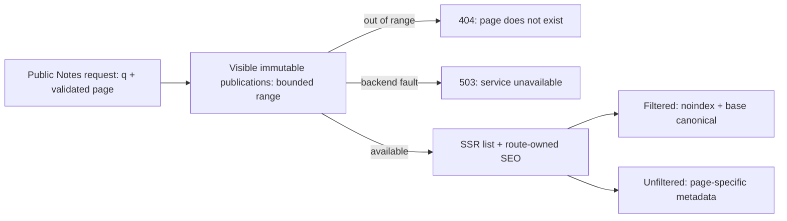

The three concrete visualization wrappers are intentional bundle/rendering adaptations. Their differing entry exclusions and duplicated load scaffolding are visible maintenance costs. The Meaning Map's earlier unbalanced global scroll mutation (`AF-006`) is corrected by mount-owned cleanup; it is not an approved route convention. Its separate interaction-state/accessibility debt remains `AF-013`.

## 5. Content, build and search data flow

`src/lib/content/comics.ts` is the browser-safe source of truth for published comic editions,
their original-story paths, cover dimensions/alternative text and PDF download metadata.
It drives the homepage's paired cover feature, `/comics` gallery, prerendered detail entries,
sitemap and finite public analytics path list. Detail loads resolve only catalogue slugs.
`loadPublishedBlogPost` matches an article's canonical path against the same catalogue on
the server and supplies a small nullable adaptation record. The standard article page renders
reciprocal comic/download links inline outside the prose and TTS reading region, without
importing a separate comic catalogue or UI component module into unrelated article clients; original
Markdown bodies and their publication metadata remain unchanged. Comics have their own
canonical URLs, CreativeWork/source relationships and collection discovery metadata.

Approved full editions are copied byte-for-byte to `static/comics/<slug>/`; `.gitattributes`
marks PDF files as binary so Windows Git line-ending conversion cannot alter them. Smaller WebP
cover derivatives serve the homepage and comic pages. The PDF is a direct static download,
with its size visible before downloading. It is not fetched by page loads, rendered in an
iframe, proxied through a Function or added to service-worker prefetching. No credentials,
new mutation endpoint, database, runtime storage or external integration is introduced.
This extends the existing repository-backed/static publication pattern without a new ADR.

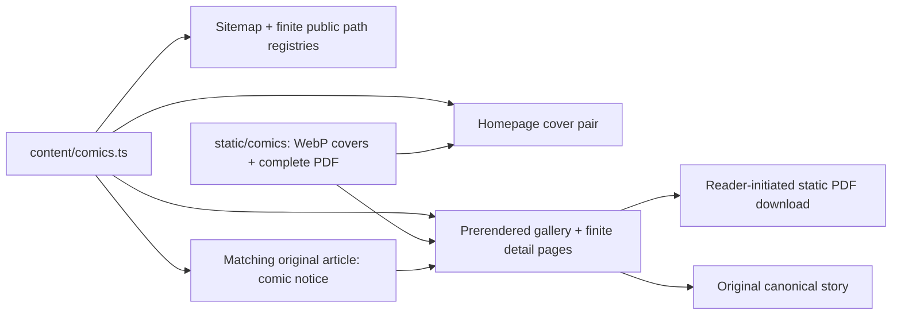

`svelte.config.js` preprocesses Markdown with author-helper imports, image markup enrichment and mdsvex; remark/rehype handle math, heading IDs/links, heading collection, H1 demotion, Bengali language markup and square-bracket styling. Its global imports are limited to the editorial helpers named there. Authors explicitly import substantial interactive experiences.

Markdown's `rehype-katex-svelte` bridge and the browser math renderers resolve the same pinned
KaTeX 0.18.2. A scoped package override replaces the bridge's affected 0.16 dependency range.
The security smoke suite checks inherited-trust rejection, bridge compilation and renderer
assets; the upgrade was additionally compared across 1,947 repository expressions with identical
MathML and TeX annotations. Layout HTML is version-dependent. Revalidate the override and math
rendering when either package changes; do not enable trusted HTML to accommodate a migration.

For corrections limited to article `description` and `thumbnailAlt`, `node scripts/refresh-seo-metadata.mjs --base <committed-revision>` is a separate, guarded authoring operation. It resolves an ancestor commit, verifies each prior cache entry against that committed article, and requires unchanged article bodies (apart from platform line endings) and every other frontmatter field, including dates, tags, titles, categories and artwork paths. The complete batch must pass before it updates only the revision hashes in the tag manifest. This preserves editorial modification dates and visible answer layers during metadata maintenance. The ordinary publishing generator retains its existing freshness checks for unrefreshed edits; the utility does not add a build-time bypass or relax content/SEO validation. `seo:test` includes both pure-boundary and temporary-Git CLI regressions for this operation.

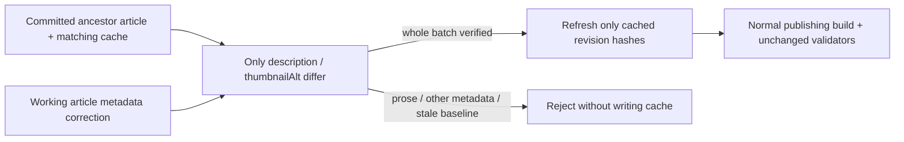

`src/lib/server/content/posts.ts` eagerly imports only Markdown metadata, omits unpublished/redirected posts, validates required fields, maps categories into sections, and derives topic membership, archives, navigation, related posts, curated paths and facets. Publication currently means `published !== false`; missing publication flags are not implicitly private. `src/lib/content/posts.ts` defines the metadata interface and runtime checks, but does not offer the same strict runtime schema as notes or topic headquarters.

### Optional article explanations and FAQ agreement

`inPlainEnglish`, `keyTerms` and `faq` are independently optional editorial metadata.
`scripts/validate-content.mjs` checks supplied values and FAQ object shapes, but no longer requires
an answer section or minimum term/FAQ counts because an article is in Healthcare IT or has been
updated. Empty optional arrays mean no items; a supplied summary must still be non-empty text.
The existing publication, calendar-date and revision-freshness checks remain in force. Editorial
additions use the actual modification date; shared component changes do not refresh article dates.

`ArticleQuickAnswer.svelte` and the bespoke Healthcare Human Margin folio identify their existing
FAQ containers, items, questions and answers with `data-article-faq` / `data-faq-*` attributes.
These markers add no content and preserve the standard or deferred reading order. The existing
server loader still derives FAQPage JSON-LD from the same authored metadata. During the routine
build's rendered discoverability checks, `scripts/lib/article-faq.mjs` parses each sampled article
with the existing LinkeDOM dependency and compares ordered authored, reader-facing and schema
question/answer pairs. Every published indexable article with FAQs is included in that check.
Absent or empty FAQ metadata must not emit FAQPage schema. Duplicates, omissions, extra items,
answer mismatches and incorrect canonical schema identities fail validation.

The static check excludes script/template/metadata content and explicitly hidden HTML; it does
not compute external stylesheets. Local browser tests cover representative standard, deferred,
bespoke and FAQ-free articles at desktop/mobile widths with JavaScript disabled, including actual
visibility. Accessible native disclosures are permitted by the static contract. Existing honest
FAQ markup is retained for descriptive consistency, without a Google FAQ rich-result claim.
The new validation fixtures run in `seo:test`; no runtime endpoint, storage or provider is added.

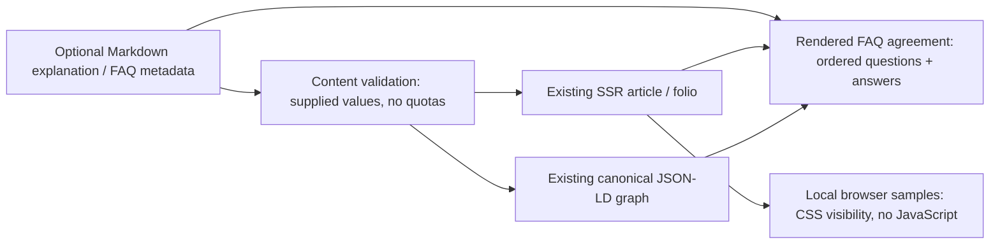

### Public blog catalog

`src/lib/server/content/blog-catalog.ts` projects exact fields from that existing registry into
`/feeds/blog-catalog.v1.json`. Unlike the general registry, export requires `published === true`
and a real calendar publication date no later than the UTC export day. Future or invalid publication
dates are omitted. Eligible items with malformed identifiers, text, tags or modification dates fail
the build rather than producing a partial misleading catalog. A supplied modification date must
be real, at least the publication date and no later than the export time's editorial calendar day
in `Asia/Kolkata`; absence stays absent. This matches the existing tag generator's editorial clock,
so an honest early-morning India revision does not fail while UTC is still on the previous date.
The UTC publication cutoff, exported source dates and ISO generation timestamp stay unchanged.
This stricter export rule does not change existing article publication or routing semantics.

| Contract            | Version 1                                                                                                                                                                                                                  |
| ------------------- | -------------------------------------------------------------------------------------------------------------------------------------------------------------------------------------------------------------------------- |
| Envelope            | `schemaVersion: 1`, `source: "suvroghosh.in"`, `canonicalOrigin: "https://www.suvroghosh.in"`, ISO `generatedAt`, SHA-256 `revision`, `items`                                                                              |
| Identity and URL    | `id: "suvroghosh.in:<slug>"`; source filename slug, at most 200 ASCII letters/digits/underscores/hyphens; production origin plus existing `postPath` for the canonical `/blog/<category>/<slug>` URL                       |
| Metadata            | Original `title` (240 characters maximum), `description` (1,200), calendar `publishedAt`, optional actual `modifiedAt`, normalized category `{slug, label}` (128/120), and `tags` (at most 20, each at most 80 characters) |
| Exclusions          | No article body, compiled Svelte component, author biography, image/thumbnail, FAQ, private note, draft record, credential, selection state or arbitrary metadata field                                                    |
| Bounds and ordering | At most 2,000 source entries and 2 MiB serialized UTF-8 output; duplicate slugs fail; newest publication date first, then stable ID by code-point order                                                                    |
| Revision            | SHA-256 of the deterministic projected `items` JSON; independent of input order and generation time; dates and prose metadata are not rewritten                                                                            |

The fixed production origin is used even in a local development catalog. Category changes retain
the same slug-derived ID while the canonical URL updates. A future slug rename needs an explicit
consumer migration; version 1 does not invent old-ID aliases or infer relationships from titles.
The catalog is a public candidate list, not a recommendation, endorsement or ClinConsult publishing
decision. ClinConsult owns its separate owner-reviewed selection. Source article prose remains in
this repository and full reading stays at its canonical URL. The existing latest-25 RSS and sitemap
contracts remain unchanged. The catalog exports metadata only; existing Markdown compilation for
the source site continues independently.

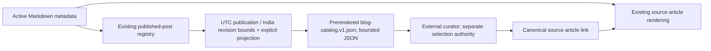

The endpoint performs no runtime source fetch or expensive input-dependent work. Adding new
catalog fields, bodies, media, cross-origin embeds or a selection/admin protocol requires its own
contract and boundary review. The source site's frame denial, CSP, canonical article graph, private
Notes access and current hosting adapter are unchanged.

### Categories and article discovery

Categories may have parents, defined by `categoryParents` in `src/lib/content/categories.ts`; `categoryTrail` supplies the root-to-leaf ancestry with cycle detection. Poetry is the parent of Limerick. Both map into the existing Essays section in `sections.json`, leaving the six permanent sections intact. Posts retain one leaf `category` and the existing `/blog/[category]/[slug]` canonical URL. Parent archives and category search include descendant posts; archive facets/counts, the writing index and sitemap include their populated ancestors. Category archives link their published children and parents. Article breadcrumbs use the same ancestry in visible navigation and JSON-LD. Categories without parents preserve their existing behavior.

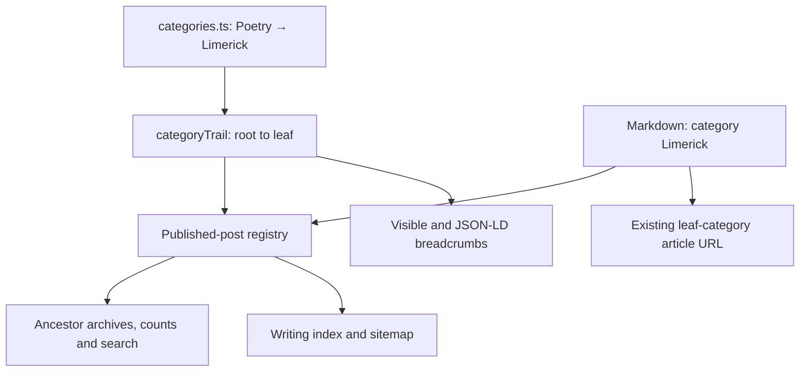

`src/lib/content/professional-projects.ts` remains the single work registry used by the work page and résumé. Optional factual status labels distinguish experiments, demos, the in-use publishing system and past work without constraining future media or industries. The homepage server load selects three IDs from that same registry and sends serializable card and optional image metadata (source, alternative text and dimensions) to `WorkWorlds`; recent writing continues to come from the published-post registry. Work-page ordering puts existing independent work before career projects while preserving each project anchor. The shared YouTube destination lives in `config/links.ts`; no video feed, new third-party integration or separate product catalog was added.

### App collections and Prompt Atlas

Posts retain one primary category and one canonical article URL. Optional, validated
`collections: ['apps']` membership adds an independent discovery facet. The prerendered
`/blog/apps` route filters the same published-post registry; the Viz archive continues to
filter by the primary category. Both listings link to
`/blog/visualizations/prompt-atlas`. The sitemap adds the Apps collection once, while RSS,
search and article canonical generation continue to use the single post registry. Navigation
in the header, command palette, footer and Viz page exposes the Apps collection.

Prompt Atlas uses feature-local TypeScript modules under `src/lib/visualizations/prompt-atlas`
and Svelte UI under `src/lib/components/visualizations/prompt-atlas`. Local mode is the default:
a deterministic reader runs in a cancellable browser worker with a ten-second deadline. Optional
semantic mode explicitly sends one consented prompt to the same-origin `/api/prompt-atlas`
endpoint, then through Vercel AI Gateway to NVIDIA. The browser gives public availability probes
their own twelve-second deadline while local analysis remains usable; consented analysis has a
separate sixty-five-second browser deadline. Choosing AI or typing does not submit text.
Editing, cancellation, changing mode and destruction abort pending work; generation IDs reject
late responses. A failure offers an explicit local-mode action. Existing narration credentials
are never reused.

The original editor value supports up to 200,000 Unicode code points. Feature-local extractive
compression deduplicates exact sentence/line units before packing adjacent retained ranges, then
selects bounded exact source fragments and prioritises
instructions, constraints, conditions and distributed context. Both readers retain the full
original text and remap evidence to its UTF-16 offsets. Compression is lossy: coverage counts
and a limit issue identify omissions; a graph is never presented as exhaustive when excerpts
were analysed. Provider-generated summaries cannot replace original evidence. A thin provider-only
knowledge-graph contract requests nodes, relationships, provenance, rationales and trusted source
unit IDs. The server derives layers from fixed kinds and reconstructs exact source context and
UTF-16 spans; the model cannot supply offsets, quotes, provider identity or physical defaults.
Unknown IDs, duplicate/dangling graph references and invalid provenance fail closed. Source
context identifies what was inspected; it is not proof that a semantic interpretation is true.

A deterministic local pass preserves omitted explicit instructions and storage facts without
replacing AI claims. Subject joins require one unique exact normalised label match. Physical
attributes, database targets, guards and cardinalities remain unknown unless recovered from
explicit source-backed local facts within inspected coverage. Inferences require rationales.
The canonical ontology, corrections and view eligibility rules remain shared with local mode.

An editable, versioned ontology is the state owner. Eleven fixed diagram projections, including
a knowledge graph across instruction and subject layers, consume that same graph without new
analysis requests. Eligibility/fit rules keep conceptual/logical/physical levels separate from
UML notation. Native SVG layouts and an accessible inspection list distinguish explicit,
inferred and user-confirmed information. Source changes make results stale and pause
corrections/exports. A JSON-LD graph export encodes nodes and reified, labelled relationships
without inventing a domain vocabulary. See [ADR 0014](decisions/0014-prompt-atlas-local-ontology.md)
and its optional-provider extension [ADR 0015](decisions/0015-prompt-atlas-free-semantic-analysis.md).

The server pins `nvidia/nemotron-3.5-lightning-free` and restricts routing to NVIDIA, with no
model fallback and no SDK retries. It checks the fixed model's live endpoint metadata before
every generation and fails closed unless every reported monetary price is zero and structured
output is supported. It never purchases credits, changes billing, or uses a paid route. Provider
pricing is an external contract: a future model change requires review, and availability may
end. Reasoning is disabled for bounded structured generation, and the native NVIDIA JSON Schema
format is set explicitly rather than relying on the hosted adapter’s generic schema flag.
Gateway reporting tags/user quota attribution are omitted because they can incur a surcharge
even when model pricing is zero. NVIDIA may retain submitted prompts/responses for model improvement; the consent UI states
this. Local mode remains usable without provider credentials or database configuration.

`src/lib/server/prompt-atlas` owns server configuration, provider access and request policy.
Credential availability is checked per invocation with the server-only `@vercel/oidc` helper,
which reads trusted Vercel Function request context or its environment fallback; a configured
Gateway API key also qualifies. Only availability is retained, never the runtime token, and
browser request headers are not used as an authentication source.
POST requires exact Origin, JSON, per-request consent, valid UTF-8 and a streamed 2 MiB body limit;
its body-read deadline is eight seconds and total work deadline sixty seconds. Provider bodies
are streamed and capped at 2 MiB. Private/no-store headers also cover framework errors through
`hooks.server.ts`. A bounded process-local guard supplements the service-only Supabase
`reserve_prompt_atlas_usage` RPC: an atomic reservation enforces fifty global requests per UTC
day and five per client per UTC hour across instances. Only hourly rotating HMACs are stored,
never prompts or raw addresses. Failed generations consume their reservation. Missing quota
configuration/RPC, unverified pricing or provider errors fail closed; rate limits alone are not
a billing guarantee. The additive migration has RLS, revoked direct table grants and bounded
expired-row cleanup. GET exposes public availability/model metadata only and caches public price
checks for thirty seconds; each POST rechecks independently.

Prompt text remains in browser memory by default. Device persistence requires an explicit Save
action and can be deleted. Versioned session import validates size (2 MiB), shape, source evidence
and identifiers. JSON reports omit the original source/evidence quotes; including source is an
explicit choice that produces an importable session. All exports still contain extracted user
content. Mode, provider/model and compression coverage travel with sessions and reports. SVG
export escapes text and contains no executable HTML or external resources. Hosting activation,
provider access and live zero-cost response verification are separate from mocked tests; see
`docs/prompt-atlas.md` for the rollout procedure and recorded verification.

```mermaid
flowchart LR
    MD["One Markdown post: Visualizations + apps membership"] --> Registry["Published-post registry"]
    Registry --> Viz["Viz listing"]
    Registry --> Apps["Apps listing"]
    Viz --> Canonical["One canonical Prompt Atlas article"]
    Apps --> Canonical
    Text["Exact editor text; local Unicode statistics"] --> Worker["Local browser worker: compress + analyse; default"]
    Text --> Consent["Explicit AI mode + per-request consent"]
    Consent --> API["Same-origin bounded private API"]
    API --> Price["Verify pinned free NVIDIA route"]
    Price --> Quota["Atomic shared Supabase reservation"]
    Quota --> ServerCompression["Source-fragment compression"]
    ServerCompression --> Gateway["Gateway / NVIDIA; no retries or fallback"]
    Gateway --> Grounding["Strict graph + trusted source ID validation"]
    Grounding --> LocalFacts["Preserve exact local instructions and storage facts"]
    Worker --> Validation["One validated ontology"]
    LocalFacts --> Validation
    Import["Explicit validated session import"] --> Validation
    Validation --> Ontology["Feature-local editable ontology"]
    Ontology --> Fit["Fixed model eligibility and fit"]
    Fit --> Projection["Selected SVG view / knowledge graph"]
    Ontology --> Inspector["Evidence, corrections and accessible list"]
    Inspector --> Ontology
    Ontology --> Save["Explicit save / SVG / JSON / Markdown / JSON-LD"]
```

### Mindmap Studio

Mindmap Studio is an ordinary Markdown visualization at
`/blog/visualizations/mindmap-studio`, with `collections: ['apps']` as secondary
discovery. It adds no article-route exception. Feature-local domain code under
`src/lib/visualizations/mindmap-studio`, UI under
`src/lib/components/visualizations/mindmap-studio`, server code under
`src/lib/server/mindmap-studio`, and the separate published `MindmapFigure` component
implement the boundaries in [ADR 0021](decisions/0021-mindmap-studio-source-model.md).

- **Source model**: A version-one project retains selected source text, stable node
  IDs, a parent hierarchy, typed cross-links, notes, epistemic status, analysis and
  coverage. Exact UTF-16 offsets and quotes link nodes/edges to sources. Imports
  reject duplicate/dangling references, parent cycles, invalid URLs and mismatched
  evidence. Explicit items require evidence; inferred/speculative links require a
  rationale. Exact source correspondence does not establish truth or semantic
  validity. Limits are eight sources/100,000 characters each/200,000 combined,
  500 nodes, 1,500 edges and 2 MiB editable JSON.
- **Input and local operation**: In local mode, text, Markdown and transcripts
  remain in the browser. On-demand PDF.js and its worker extract selected physical pages from
  files up to 10 MiB, at most 100 pages and 100,000 extracted characters, with a
  twenty-second document-task deadline. Missing text is identified; OCR and URL or
  video retrieval are absent. A terminable local worker returns a labelled
  extractive outline, not inferred arguments, with 24/60/120 passage limits and
  explicit omission counts. The default 43-node example is an original teaching
  essay with exact internal anchors and eight illustrative inferred cross-links.
- **Optional provider boundary**: `/api/mindmap-studio` has GET availability and
  an explicit same-origin consented POST. It reuses the private Prompt Atlas
  configuration, pinned free NVIDIA model, live zero-price/structured-output
  verification and service-only `reserve_prompt_atlas_usage` RPC. It shares the
  fifty-request UTC daily pool and five-per-client/hour identity with Prompt Atlas.
  This public free route does not inherit UML's owner-paid route. Its own local
  admission guard supplements the distributed quota. JSON/UTF-8 schema, streamed
  2 MiB/eight-second body admission, sixty-second operation deadline, bounded
  upstream reads and no retries/fallback are enforced; hooks also keep API errors
  private/no-store/noindex. Browser deadlines are twelve seconds for availability,
  twelve seconds for local work and sixty-five seconds for AI.
- **Grounding and coverage**: The same-origin server receives the bounded source
  set, prepares at most forty-eight trusted units/32,000 UTF-16 excerpt characters,
  and sends those excerpts with metadata/focus to one provider generation. Selection
  balances sources and prioritises focus plus distributed context. The model
  returns source-unit IDs; the server reconstructs exact quotes, offsets and
  locators. One serialised wire schema is supplied to both the model-visible system
  prompt and the native provider response format; every generated edge requires a
  rationale. The wire rejects a redundant provider `rootId`; the server derives
  the canonical root from exactly one null-parent node. Zero/multiple roots and
  all other topology/evidence invariants still reject. Unknown IDs or invalid
  project structure fail closed. Coverage measures
  submitted units and names omissions; it is not exhaustive progressive research
  or independent fact-checking. Consent names Gateway/NVIDIA transmission and
  possible provider retention. Application code does not persist source bodies
  server-side or log source-bearing provider/schema errors. Invalid-analysis
  diagnostics contain only enumerated stage/reason values and allowlisted
  structural field paths, never raw messages, unknown keys, IDs, quotations,
  labels or provider output. This does not relax acceptance validation.
- **Rendering and state**: Browser-loaded `mind-elixir@5.15.1` supplies hierarchy
  editing through an adapter, with app-owned undo and metadata. The native SVG
  graph uses finite seeded D3 layout and rectangular collision resolution over the
  same IDs; view changes do not regenerate analysis. Graph drag/camera state is
  local to its view. Edits enable debounced autosave of the current project to the
  feature-owned `suvro-mindmap-studio` IndexedDB database; the untouched example is
  not saved. There is no cloud synchronisation. Source bodies/notes travel in
  editable JSON; Markdown and escaped Mermaid are derived formats. The image
  adapter exports mind-map PNG. Portable SVG and its PNG rasterisation use the
  native graph; raster size is capped at an 8,192-pixel edge and 24 million pixels.
- **Publication boundary**: Public snapshot JSON removes original source bodies,
  source URL metadata, exact evidence and private notes, while retaining source-derived labels,
  descriptions and relationship rationales. `MindmapFigure` separately validates
  snapshot shape/structure, renders an SSR outline/relationships, and dynamically
  loads read-only map/graph views only on reader activation. All content is text,
  not raw HTML. The renderer-only projection carries `readonlySnapshot: true`,
  so editable validation rejects it; evidence is never fabricated to populate a
  reader view. Fixed disclosure states that published status labels are the
  author's classification and original evidence is absent. Explicit article
  imports keep these runtimes out of unrelated articles.

The [feature contract](../visualizations/mindmap-studio.md) records exact limits,
embed syntax and verification receipts. Implementation
`09b7f84ef8ffb532394ee4bbf5902eceda3c92be` is live through READY deployment
`dpl_5hL3kb9i4PnT88MDypmFg8Htim45`. One normal production UI request returned
HTTP 200 in 15.3 seconds: nine concepts, nine relationships, six analysis sections
and eighteen exact citations from two preserved sources, with all nine prepared
segments submitted. Domain validation, timestamped evidence, both rendered views,
consent reset, local save/reload and private response headers were verified with
no browser exceptions.

All 79 focused tests across seven files passed, along with the final repository
check (zero errors/warnings) and targeted lint/format/whitespace checks. Eleven
live browser cases passed on the unchanged frontend, including PDF extraction,
the published figure, real exports and seven responsive widths from 320 to
1,600 pixels. Three earlier rejected generations preserved the working map;
source-free diagnostics identified the redundant provider root reference, now
derived from the unique null-parent node without relaxing validation.

Feature/notebook/content stages, the site build and local Barnum route-asset
budget passed in stages. Hosted build/discoverability verified 748 published
posts and representative routes; the canonical article and Apps/catalogue
discovery passed. These receipts do not claim a single successful local
`npm run build:full` invocation, arbitrary-document analysis quality or future
free-provider availability.

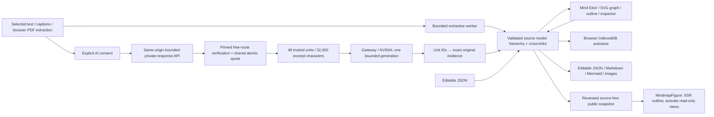

### Post to UML (`post-to-uml`, `/viz/uml`, `/api/uml`)

Post to UML is published as `/blog/visualizations/post-to-uml` (`src/lib/posts/post-to-uml.md`, `collections: ['apps']`), with `/viz/uml` retaining its HTTP 308 alias. Domain code lives under `src/lib/visualizations/post-to-uml/`, authoring UI in `src/lib/components/visualizations/post-to-uml/PostToUml.svelte`, and saved-figure display in `src/lib/components/blog/UmlFigure.svelte` (auto-imported by mdsvex). The 28 October rendering, authorization, grounding, and revision changes are recorded in [ADR 0020](decisions/0020-post-to-uml-browser-engine.md) and the [feature contract](../visualizations/post-to-uml.md).

The security integration requires a dedicated `UML_AI_ENABLED=true` opt-in; Prompt Atlas's
flag cannot enable this separate provider path. `VERCEL_ENV=preview` disables UML AI before
credential discovery while preserving local generation and editing. Main's completed owner
and shared-quota controls below are retained; request quotas do not verify provider pricing.
Exported figure metadata escapes HTML metacharacters and Svelte braces so titles, captions,
alt text and assumptions remain literal strings when an author compiles the Markdown bundle.
Compiler regression fixtures exercise that boundary.

- **Source and interpretation ownership**: The browser retains an immutable article revision independently of editable source and rendered assets. Paragraphs preserve exact raw source/evidence offsets, including inert fenced code. The local extractor is explicitly a conservative heuristic with a 120,000-code-point input limit and 40-concept glossary; it does not infer missing methods, interfaces, infrastructure, replies, state transitions, or timings. Its limited prose-pattern coverage is separate from renderer capability. Optional AI receives the whole bounded article and numbered paragraphs, not a silently truncated subset. All-14 mode maintains one evaluation per concrete type; current generation produces one figure per type rather than automatic multi-figure decomposition.
- **Official local rendering**: `plantuml/browser.ts` owns a serial queue (one active job, at most 32 pending) and terminable `engine.worker.ts`. The pinned MIT `@plantuml/core@1.2026.9` TeaVM engine uses bundled Smetana layout, a detached `linkedom` SVG DOM, and OffscreenCanvas text measurement. No JVM, Graphviz service, WASM evaluation, public renderer, or site-CSP weakening is required. Source is bounded to 100,000 UTF-16 units/1,500 lines; each active job has a 20-second termination deadline, `maxSvgSize: 6000`, and a 4,000,000-character SVG-output cap. The legacy custom parser/renderer remains a helper, not a PlantUML compatibility authority; browser figures must pass actual official-engine rendering, including recognition of error SVGs. Unknown valid syntax is not erased by legacy repair.
- **Renderer isolation and notation limits**: Security checks reject preprocessor/functions, external resources, active markup, and executable URI schemes. Independent worker boundaries deny network APIs and file/library loader callbacks; the detached DOM cannot run scripts or fetch resources. Sanitized SVGs are displayed through image contexts and sanitized again for export. Worker termination bounds time, not heap allocation. Fourteen genuine representative fixtures render, with composed notation for composite structure, profile, communication, and interaction overview. Profile uses verified filled-triangle `-up->>` extensions. Interaction overview uses named activity partitions with rectangular headers, an explicitly disclosed approximation of exact UML interaction-use frames.
- **Published-source loading**: `src/lib/server/uml/posts.ts` uses server-only build-time raw Markdown modules filtered through the canonical `getPublishedPosts` registry for both listing and individual loads. It removes only front matter and retains the exact article body as inert source. It does not depend on a deployed `src/` filesystem tree, expose unindexed drafts, or substitute curated examples for unavailable posts.
- **Owner-funded AI boundary**: `src/lib/server/uml/` and `/api/uml` preserve public status/post-loading and require `requireNotesOwner` plus explicit transmission consent before AI use. Configuration includes `UML_AI_ENABLED`, configurable `UML_AI_MODEL`, a private quota salt, Gateway key/OIDC, and existing Notes/Supabase owner settings. POST enforces exact same-origin, JSON schema, streamed 512 KiB/8-second body admission, a 60-second operation deadline, and process-local burst/concurrency limits. AI input is limited to 40,000 code points; provider response reads are streamed with a 2 MiB cap, output is bounded to 16,000 tokens for All 14 (8,000 otherwise), and SDK retries are disabled. `quota.ts` reuses the existing service-only `reserve_prompt_atlas_usage` RPC: a 50-request UTC daily pool shared with Prompt Atlas plus five UML requests per owner/UTC hour. The salted owner-hour identity is shared across instances; process-local admission is not represented as a global safeguard. Reservations are consumed even if the provider later fails. Request counts are not currency spending caps.
- **Provider response and state transitions**: `wire.ts` validates the envelope and individual figures, exact evidence quotations, requested-type coverage, explicit assumptions, and source security. A bad/omitted/duplicate figure yields an honest failure without replacing valid siblings or substituting local content. The provider never controls rendering success. Browser revision guards discard late loads/generations/renders; cancellation preserves completed results. Source edits clear the current SVG, retain a labeled last-successful preview, and require metadata/evidence review before publication. Export requires exact current-source equality as well as successful render and completed review; revision hashes are change labels, not security digests.
- **Static publication contract**: Safe Markdown preview and export keep original article text first, then saved figures/captions. ZIP includes original/derived Markdown, standalone source, validated SVG/PNG, repository-compatible embeds, and a revision/status/evidence manifest. Unreviewed/failed source stays under `drafts/` without stale images. PNG rasterization is sequential and bounded; ZIP paths are validated and total uncompressed data is capped at 64 MiB. `UmlFigure` serves saved assets with alternative text, limitations/assumptions, and optional source links. Reading a published article never triggers AI or authoring rendering. `/api/uml` retains private/no-store/noindex responses.

`svelte.config.js` auto-imports `UmlFigure` only in Markdown containing its component tag. The saved-image component has no renderer/sanitizer runtime imports and accepts image URLs rather than raw preview SVG. Authoring owns sanitization and `svgImageUrl` conversion before passing a safe image source. This separation keeps renderer and sanitizer dependencies out of ordinary article bundles and protects the established route-asset budgets.

The server build explicitly bundles `sanitize-html` and its dependency closure through Vite's `ssr.noExternal`. Its CommonJS entry requires an ESM-only parser; Vercel's Node loader rejects that external `require(ESM)` boundary even when ordinary local Node accepts it. Bundling preserves the locked nested package versions and keeps runtime imports limited to Node built-ins. This is a server packaging rule, not a relaxation of SVG sanitization or browser CSP. `npm run uml:ssr:test` builds the real sanitizer with the application SSR configuration and executes it with Node's `--no-experimental-require-module` restriction.

The UML feature's pre-integration local verification passed 83 unit tests across 10 files, Svelte/TypeScript checks with zero errors/warnings, and eight production-preview browser cases with desktop/mobile and figure visual inspection. The isolated renderer harness passed fourteen fixtures, six unsafe/invalid/oversized inputs, active/queued cancellation and recovery, legitimate error-text labels, SVG image loading, and no external requests under `script-src 'self'; connect-src 'none'`. The full-build run passed feature/notebook/content stages, site compilation, and discoverability before its final Barnum route budget caught the shared saved-figure sanitizer import. After that boundary was fixed, the affected site build, 744-post discoverability check, and Barnum asset audit all passed (296,873 raw JavaScript bytes, 107,389 gzip bytes, 36 assets). These checks do not establish arbitrary PlantUML coverage or production deployment. Real-provider and hosted owner/quota verification were not performed. The integrated security branch supplies executable `security:audit`/`security:smoke` checks; the historical forensic audit remains a record of earlier gaps.

```mermaid
flowchart LR
    Prose["Pasted / published article: immutable source revision"] --> Local["Conservative local heuristics + exact evidence"]
    Prose --> Activation["Explicit UML opt-in; disabled on previews"]
    Activation --> Owner["Explicit AI consent + configured Notes owner"]
    Owner --> Limits["Bounded API + shared Supabase quota reservation"]
    Limits --> Gateway["AI Gateway: full bounded article; no retries"]
    Gateway --> Wire["Per-type schema, evidence and source validation"]
    Local --> Source["Editable standalone PlantUML + metadata"]
    Wire --> Source
    Source --> Queue["Revision guard + bounded render queue"]
    Queue --> Worker["Terminable official PlantUML / Smetana worker"]
    Worker --> Sanitize["Sanitize SVG; safe image preview"]
    Sanitize --> Review["Current-source equality + metadata review"]
    Review --> Export["Saved SVG/PNG/source + embeds + manifest ZIP"]
    Prose --> Export
    Export --> Reader["Static article first, then figures/captions"]
```

### Homepage fieldbook rendering

The prerendered homepage composes the Calcutta Fieldbook from `LivingHero`, `WorkWorlds`, `RecentSignalGrid`, `FieldbookIndex` and `ClosingInvitation`. The hero links to existing pigment and sculpture experiences through static, dimensioned artwork. Work previews use the selected registry image metadata; the publishing-system preview is an inline editorial SVG illustration, not a separate application or product. `FieldbookIndex` consumes the existing serialized reading paths and featured-series parts in one compact section. Authored article bodies and article layouts remain outside this presentation change.

The route no longer imports or mounts `LivingIndexScene`, its dynamic WebGL controller, the old four-way gateways or the separate large reading/series sections. Those source components remain available but are not homepage runtime dependencies. The normal shell retains the existing `homeStandard` static atmosphere contract, so neither the shell nor the homepage mounts an ambient canvas. The full document and destinations render without JavaScript or WebGL. Scoped component styles and homepage-only `fieldbook.css` own the responsive composition and locally loaded display fonts; the shared theme and motion preferences remain owned by the normal layout/header. Image hover transitions respect Still and OS reduced motion. No new frame loop, state store, endpoint or integration was introduced.

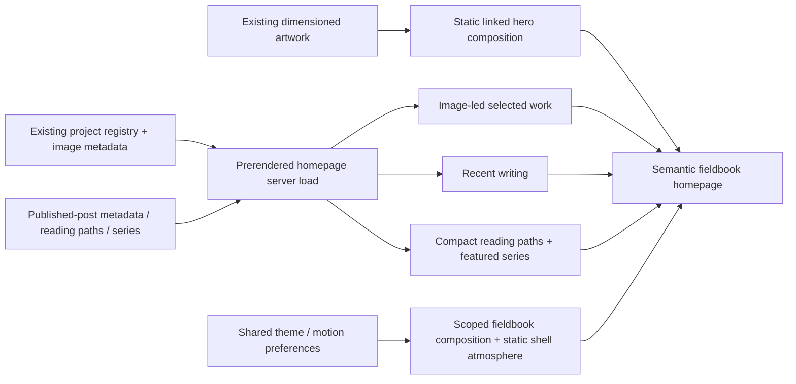

Resources use `parseResourceMetadata` and marked copy regions. Topic headquarters use a strict Zod schema plus registry validation for canonical paths, membership, promoted aliases and reading-path references. `sections.json` is shared taxonomy data; category/path normalization and alias consumers are still partially duplicated in Node scripts (`AF-009`).

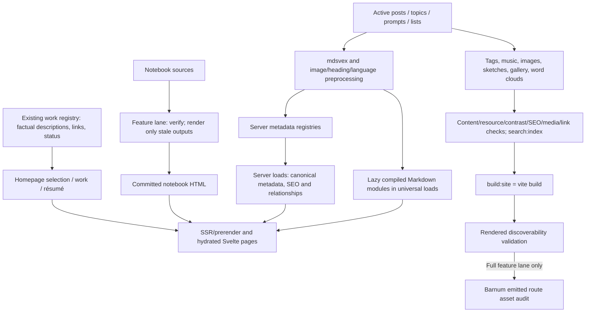

`npm run build` is the routine production/publishing lane, including the hosting default when no remote override is configured. npm invokes `prebuild` once:

1. `content:generate`: tags → music → image optimization → sketches → gallery → word clouds.
2. Content, resources, contrast, SEO and media validation → search indexing → link validation.
3. `build:site` (`vite build`) → discoverability checks against rendered output.

This lane uses committed notebook HTML. It neither invokes notebook preparation nor runs the dedicated visualization artifact audits. It still compiles/prerenders the shared site's existing routes, so real application compilation errors remain blockers and old feature names may appear in compiler output. Global publication/index/link checks remain global where cross-content relationships require them.

`npm run build:full` is the feature-maintenance lane:

1. `features:check` runs the deterministic Barnum, Bias, BZ, Prior Authorization, Strange Attractor, Mrinmoyee, Scale Elevator and probabilistic piano artifact checks. The Scale Elevator and piano checks verify committed captures and their source-provenance manifests without a running site or native video encoder; generation is a separate explicit command.
2. `notebooks:prepare` validates notebook shape/source hashes/renderer versions, leaves current HTML untouched and renders only stale/missing output when rendering dependencies exist. If required output is stale and dependencies are absent, it fails instead of silently accepting it. Explicit `notebooks:render` remains a full refresh.
3. The routine `npm run build` runs its normal prebuild/build once.
4. Barnum's emitted route assets are audited after the site build.

Barnum's corpus-audit entry bundles its pure audit and canonical-manifest sources
in memory with the existing esbuild dependency, then imports that trusted ESM
bundle. It starts no Vite/SvelteKit development server or watchers and creates no
temporary bundle files. The 1,000 representative sessions, committed-artifact
equality check and readability, collision and coverage release gates remain
unchanged; this isolates authoring-time module loading from site configuration.

The generated essay-anatomy TypeScript catalog is checked byte-for-byte beside
its JSON and SVG outputs. Its `.gitattributes` rule pins LF line endings, just as
the generated JSON and SVG artifacts already do, so a fresh Windows checkout
does not make an otherwise current catalog appear stale.

The feature-artifacts CI workflow selects feature/notebook/shared-build changes, with ordinary posts and their routine generated metadata excluded. CI uses verify-only image/word-cloud settings; notebook authors commit prepared HTML. See [ADR 0002](decisions/0002-separate-post-and-feature-builds.md) for the boundary and trade-offs. Workflow execution and hosted required-status configuration remain unverified.

The `build:site` split avoids recursive npm/Vercel build invocation; history `a56d0791` records the fix. Do not collapse it casually. Generators deliberately write tracked artifacts. A full build is not a read-only audit command.

The image optimizer currently resizes large raster inputs and applies lossy JPEG/opaque-WebP encoding, writing accepted output at the same path. Some formats/animated/original sketch sources are preserved. This conflicts with the existing local instruction permitting only lossless, same-dimension processing of an as-is image (`AF-007`). The canonical reference records the conflict; this task does not change the optimizer or weaken the instruction.

Search has two roles: server metadata search supports `/blog` filters and no-JavaScript requests; `search:index` emits full-content search input and Pagefind assets for the browser search component. Neither is a notes database search replacement. Notes uses Postgres full-text search. Different search backends here are deliberate, although build/runtime canonical URL rules should remain consistent.

## 6. Components, state and Svelte 5

Most feature UI lives under `src/lib/components/visualizations/<feature>/` or `components/games/<feature>/`, while its non-UI engine/data lives under the corresponding feature domain. This is a convention, not an enforced import rule: Meaning Map and Barnum Lab co-locate Svelte interfaces under the domain directory, and some large components still contain persistence/controller logic.

The prevailing style is Svelte 5 `$props`, `$state`, `$derived`, `$effect`, callback/event attributes, snippets and `{@render}`. All 406 library Svelte files compiled without warnings/errors in the audit's parse/compiler sweep. A source scan found 397 library modules containing runes, no `export let`, `$:` or `on:` event syntax, and one unreferenced legacy `svelte/store` utility (`utils/reducedMotion.ts`). These observations do not establish runtime correctness or full accessibility.

State ownership follows the feature:

- Page inputs arrive through generated `PageData`/`ActionData` types, although not every older page declares an explicit annotation.
- Local UI state is component-owned; derived values normally use `$derived`.
- Notes' editor state is built by `editor-state.svelte.ts`, with model/history/index helpers and IndexedDB recovery/outbox storage.
- Comments keep unsent text, retry UUIDs, filters and expanded threads in component memory. Approved data comes from the API; neither submitted comments nor moderation state is persisted to localStorage or IndexedDB. Requests, the lazy-load observer and owner polling/listeners are released at teardown.
- Simulations use feature-owned engines/controllers, deterministic random streams where supplied, workers/message protocols and explicit lifecycle methods. Renderer needs differ; the shader registry is not the interface for every visualization.
- Theme/motion preference is stored in browser localStorage and document datasets. Bootstrap code applies it before hydration; layout/header modules maintain it after mount.
- Browser DOM/resource side effects belong to a component/attachment lifecycle and must release listeners, frames, simulations, observers, contexts and document styles at teardown. Meaning Map now returns instance-owned mount cleanup through `meaning-connection-map/lifecycle.ts`; its earlier resource leak is resolved. The audit found exceptions, not an absence of lifecycle facilities.

Meaning Map composes its component-owned search, category and selection state through one reactive renderer update. Pure projections in its existing `simulation.ts` compute visible and connected IDs; the D3 update applies opacity, pointer access, tab order and selection styling together. Filtering a selected concept clears that selection; following a detail-panel connection explicitly enables its category and clears a conflicting search. Authored directional edge IDs remain separate from D3-mutated simulation edges. The SVG viewport follows its container through an instance-owned resize observer. A second owned observer measures the site navigation so the fixed map begins beneath it, retaining access to both navigation and all map controls. Graph nodes expose keyboard activation and semantic names. Focused source, unit and production-browser checks cover search, keyboard selection and mobile/header geometry; they do not establish complete screen-reader or interaction coverage.

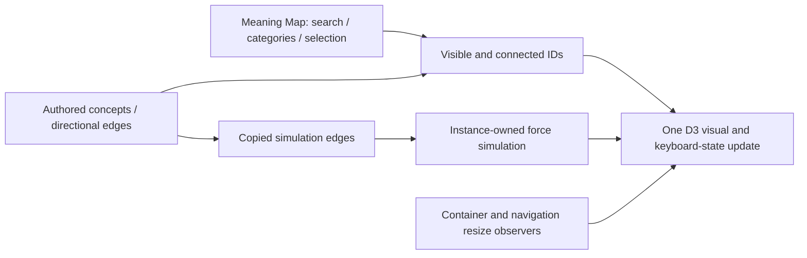

There is no `src/lib/stores/` or universal singleton state framework. Do not add module-global per-user mutable state to server-executed modules. A valid legacy component/store is not itself an architectural defect: [Svelte's legacy overview](https://svelte.dev/docs/svelte/legacy-overview) documents compatibility. Modernization should solve a demonstrated problem. [Lifecycle cleanup](https://svelte.dev/docs/svelte/lifecycle-hooks#onMount) applies to imperative resources regardless of syntax.

Spacetime Laboratory owns a per-mount runes store, a complete bounded URL scene/animation-clock codec and one WebGL2 renderer. The renderer's actual context creation and shader compilation determine support; it does not use the shared stricter WebGL1/2 preflight. Initialization is abortable: `KHR_parallel_shader_compile` completion polling has a 15-second deadline; without the extension, the required synchronous link check cannot have an interruptible driver deadline. The shader evaluates its model, compact-object tracer and procedural sky at single call sites to avoid pathological native D3D11 compilation expansion. Explicit `webgl=off`, context-creation failure, shader failure and context loss have distinct fallback paths; retry mounts a fresh canvas. The canvas owns resize/intersection/motion/visibility listeners and GPU cleanup. It draws while visible and playing, or once after a paused scene changes; hidden/offscreen scenes suspend GPU work. Keyboard commands belong only to its focused viewport. Schwarzschild and Reissner–Nordström rays use spherical static null-geodesic integration with analytic capture classification; Kerr, emission/colour transfer, projected reference guides and cosmological sky patterns remain labelled illustrations. A feature-local Friedmann background solver supplies FLRW scale factor/redshift to both the UI and shader; curvature density obeys Ωk = 1 − Ωm − Ωr − ΩΛ. This is neither a shared simulation engine nor an Einstein-field-equation solver.

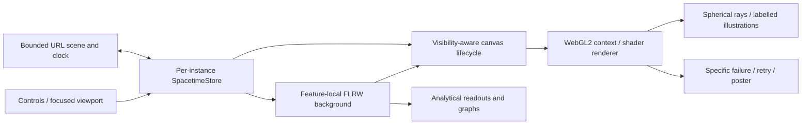

### Strange Matter: browser-owned generative sculpture

Strange Matter extends the dedicated visualization feature pattern through the
ordinary immersive Markdown article at `/blog/visualizations/strange-matter`.
Its server-rendered `StrangeMatter.svelte` shell lazily loads the feature's Svelte
app. The gallery retains only summary, subject and captured-poster metadata.
The generic article route continues to own publication discovery and SEO.

The feature domain under `visualizations/strange-matter` owns a bounded design
contract, deterministic seeded generation, curated palettes/presets and a versioned
URL codec. Per-mount UI state and undo history belong to the Svelte app. The
browser-only Three.js renderer owns the four procedural worlds, materials,
camera, animation clock and GPU resources. Share state includes the seed,
parameters, framing, camera and animation position; decoding normalises inputs
before renderer allocation. This is a local extension of the existing Three.js
feature pattern rather than a new shared renderer or state framework.

PNG export renders the current composition without the interface at a bounded
resolution and restores the live renderer after capture. Browser-supported canvas
recording downloads a short clip in its detected format. Creation and export add
no server endpoint, account, credential, external provider or durable visitor
store. The renderer is mounted only in the browser, suspends hidden/offscreen
animation, and releases its GPU and event resources at teardown. The SSR poster
and authored guide remain the fallback. See the [feature record](../visualizations/strange-matter.md)
for component ownership, export limits and verification commands.

The publication poster comes from the app's ordinary PNG download at the default
seed and paused animation time zero, resized to 1200 × 750. The authoring capture
script records the model/geometry/renderer source hashes and decoded pixel hash;
`strange-matter:assets:check` verifies those committed inputs during the full
feature build without starting a browser. Lossless PNG re-encoding preserves that
pixel provenance.

The existing feature-artifacts workflow watches the Strange Matter article and
browser spec, runs its seeded design/URL unit suite, and runs its production
feature-bundle browser suite after the full Chromium installation. Its existing
full-build step verifies the captured poster provenance. This adds feature
coverage within the current read-only workflow; hosted execution and required
status configuration remain separate verification concerns.

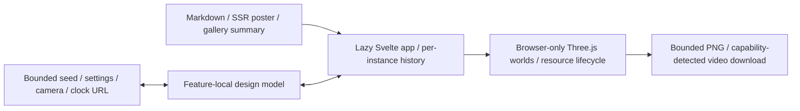

### Splat Studio: browser-local procedural splat art

`/tools/splat-studio` is a public tool route with readable Svelte markup and
client-mounted enhancement. The root layout selects its existing minimal studio
shell, with no site header or footer around the canvas. The route supplies the
shared SEO component and captured artwork for social previews. It does not create
an article or introduce another content registry. Its UI lives under
`components/visualizations/splat-studio`, and its pure model, Three.js renderer and Canvas 2D compatibility renderer
live under `visualizations/splat-studio`.

The component owns one settings object, transport and renderer instance per
mount. `model.ts` defines bounded numeric settings, six form presets, six splat
styles, palette data, deterministic geometry and a versioned URL settings codec.
Incoming URL state is normalized against explicit bounds and known enum values.
Copying a scene link exposes that configuration and seed in the URL; it does not
create a server project or promise the same animation frame or manually orbited
camera pose. PNG export is generated from the local renderer without interface
controls.

The renderer uses the installed Three.js dependency for instanced splat drawing,
camera controls and GPU materials. Its emissive additive blending is order
independent, with depth attenuation and bloom; it does not sort opaque surfels or
implement reconstructed radiance-field visibility. Geometry updates are separate
from shader animation and colour changes. Its instance owns frames,
resize/visibility observers, camera listeners and GPU resources, and releases
them on teardown. Reduced motion starts from a still composition; paused controls
can request a fresh render. The component checks WebGL 2 on its actual canvas using
browser-default GPU selection and checks HDR framebuffer support. Initialization,
shader or context failures switch once to a fresh canvas and lazy-loaded `canvas-renderer.ts`. This CPU-projected
Canvas 2D renderer reuses the seeded 3D geometry and settings, with bounded lower
particle counts and sprite-based glow instead of GPU bloom. It keeps the six
forms/styles, colour controls, orbit/zoom, transport, sharing and PNG export
interactive without WebGL. Each backend owns and releases its listeners,
observers and animation frames; switching preserves settings and transport but
resets the manually orbited camera and animation frame. A readable error remains
only if Canvas 2D also cannot start. `?webgl=off` selects compatibility mode for
reproducible checks; capability detection never branches on user-agent strings. These are
procedural Gaussian, surfel and artistic marks, not trained scene reconstruction.

The visualization landing page discovers the tool through a dimensioned static
capture and a link. That card does not import the studio component, renderer or
Three.js, and the standalone tool is not added to article counts or subject
filters. The sitemap includes its canonical URL without inventing a modification
date. The focused local preview builds the production component into an ignored
cache; its browser suite uses loopback production output with service workers
blocked. See [the feature document](../visualizations/splat-studio.md) for launch
commands, controls and verification scope.

No new API, authentication, secret, provider, persistence service or shared state
strategy is introduced. This follows the existing feature-owned rendering
pattern, so its route, discovery and lifecycle are documented here without a new
foundational ADR.

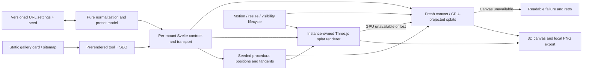

### Living Systems: four browser-local mathematical worlds

Living Systems uses the ordinary Visualizations Markdown article at
`/blog/visualizations/living-systems` and the generic article route. Its explicit
lazy shell under `components/visualizations/living-systems` loads a per-mount
runtime with transport, contextual controls, camera and Canvas 2D rendering.
The gallery imports a lightweight summary and poster reference, without importing
the numerical models. The article and captured poster remain available before
the interactive runtime loads.

Four pure TypeScript models under `visualizations/living-systems` own Conway's
Game of Life, Langton's ant, stable scalar diffusion and unbiased lattice random
walks. Life uses simultaneous double-buffered updates with an explicit finite
or wrapping boundary. The ant uses a sparse logical grid and a visible session
step limit. Diffusion conserves concentration without sources/manual edits and
uses a bounded explicit coefficient with impermeable boundaries. Random-walk
displacement uses unwrapped positions independently of display wrapping. Seeded
randomness is consumed by model updates rather than rendering; retained
trajectory/telemetry histories have explicit bounds.

The feature's shared bounded fixed-step clock separates model updates from
requestAnimationFrame painting. Per-mode state survives switching, and resizing
or camera changes preserve that state. The runtime owns its observers, motion
and visibility handling, pointer/keyboard inputs and animation cleanup. These
shared facilities apply to this feature's four modes, rather than becoming a
universal engine for unrelated visualizations. There is no endpoint, provider,
credential, persisted reader profile or route exception. This extends the
established feature-owned model/UI boundary, so a new foundational ADR is not
warranted. See [the feature contract](../visualizations/living-systems.md) for
rules, computational limits and verification seams.

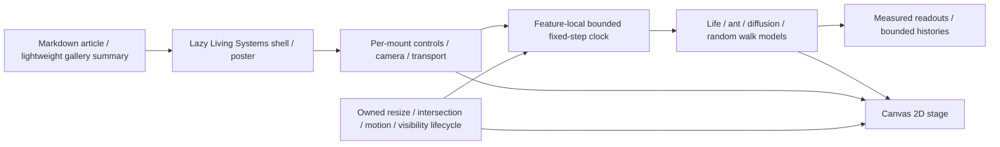

### Essay anatomy: source-linked literary specimens

The Anatomy of an Essay remains a normal explicitly imported Markdown visualization
at `/blog/visualizations/anatomy-of-an-essay`. Its lazy Svelte shell loads a
feature-owned reading/comparison interface. A pure browser-safe text analysis model
under `src/lib/visualizations/anatomy-of-an-essay` produces versioned paragraph,
sentence, punctuation, recurrence and explicit-citation records with displayed-text
offsets and original block source spans. Estimated English nesting is a documented
heuristic. The reading-order spine is independent of citation attachments.

An explicit public-post allowlist feeds `scripts/generate-essay-anatomy.ts`. The
generator checks publication eligibility, derives content-hashed models and uses the
same deterministic morphology/SVG renderer as the live specimen and portrait exports.
It emits a small catalog, individually loaded public JSON models and SVG/PNG portraits;
it does not replace other articles' thumbnails. Its read-only check recomputes expected
artifacts and detects stale or missing output. `essay-anatomy:assets:check` belongs to
the feature build lane. The generator is an explicit authoring operation, not a
network corpus crawl or runtime endpoint.

The mounted interface owns selection, reading position, comparison, fetch cancellation
and cache. Pasted plain text is bounded to 60,000 UTF-16 code units and analysed in a
disposable browser worker; it is not serialized into URLs, sent to an endpoint or
persisted. Closing/navigation disposes workers, requests, observers and animation
resources. SVG is the interactive and export source; a small Canvas punctuation trace
uses the selected sentence's actual marks with explicitly interpretive timing. Motion suspends
for visibility and reduced-motion preferences. Independent default scales are never
used to imply equal corpus sizes; normalized comparison is explicitly labelled.

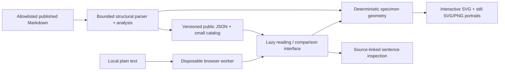

See [the feature contract](../visualizations/anatomy-of-an-essay.md) for source subset,
scales, limits, provenance and opt-in automation. Focused model/geometry tests and
local production-browser checks cover the feature; this does not claim comprehensive
linguistic parsing or semantic assessment.

### Patient X: fictional questionnaire walkthrough

Patient X uses the ordinary Markdown visualization route at
`/blog/visualizations/patient-x-depression-bipolar`, with secondary Apps discovery.
The existing `immersiveLead` convention places the feature-owned compact heading and
working charts first, with the generic article metadata/actions below the content;
there is no route-specific wrapper or shared layout override.
The pure TypeScript model under `src/lib/visualizations/patient-x` owns the seeded,
authored six-assessment example, item responses, native-scale totals, recall windows
and descriptive comparisons. Its Svelte component under the corresponding
`components/visualizations/patient-x` directory owns only the current example and
selected assessment. The initial charts, text and data tables render with the article;
browser interactions replace local example state. There is no endpoint, storage,
visitor questionnaire, health-data collection or diagnostic inference service.

The PHQ-9, ASRM and WHO-5 remain separate scores. ASRM covers seven days while the
other measures cover fourteen; the comparison plot joins assessments, not diagnoses
or simultaneous symptom episodes. Brief item summaries link to the official forms
without reproducing the full restricted ASRM instrument. The synthetic generator is
an educational scenario, not a calibrated model of patients or illness prevalence.

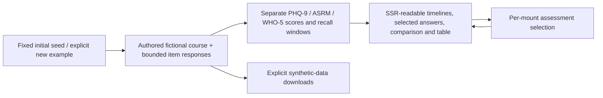

Focused model tests verify sums, ranges, determinism and date windows. Browser checks
exercise shared selection, regeneration, answer inspection and mobile/keyboard use
against a local production preview. This extends the existing feature-owned model/UI
pattern and introduces no foundational trade-off requiring an ADR.

### Knowledge Gap Atlas: local corpus analysis

Knowledge Gap Atlas is an ordinary Markdown visualization at
`/blog/visualizations/knowledge-gap-atlas`, with `collections: ['apps']` for secondary
discovery. Its feature-owned engine/storage modules live under
`src/lib/visualizations/knowledge-gap-atlas`; its Svelte interface and Canvas 2D map live
under the corresponding component directory. It adds no route exception, analysis endpoint,
AI provider, model download or server-side user-content store.

The feature uses its own `suvro-knowledge-gap-atlas` IndexedDB database through Dexie.
Original source text is stored in chunks alongside source metadata; project annotations,
term/edge aggregates and checkpoints have separate tables. Files use incremental UTF-8
decoding. The analysis worker consumes stored chunks, carries tokenizer/window state across
boundaries and commits aggregate updates with its checkpoint. Job identifiers and cancellation
separate active work from stale responses. Source spans use original UTF-16 offsets.

Where supported, browser Web Locks serialize analysis and source/project mutations with one
exclusive per-project lock. Conflicting operations return a visible busy error. Project saves
also validate result/source signatures transactionally and reject deleted-project resurrection.
Browsers without Web Locks retain the save-time validation but cannot guarantee serialized
cross-tab source edits. Evidence previews are clipped at 4,000 UTF-16 units with a visible notice;
original source text and offsets remain intact and the source reader is paged.

The pure engine constructs a sentence-bounded co-occurrence network, applies explicit support
and exclusion settings, and uses seeded Graphology Louvain communities with disconnected-group
repair. Revision-two projection merges English possessive variants while preserving explicit
alias targets, down-ranks document scaffolding and grammatical fragments, and requires gap
titles and excerpts to identify the same observed concept pair. Fragility findings require
substantial separated branches. These are graph-stage rules; the raw extractor and saved
checkpoints remain compatible. Representative source spans are bounded samples; counts remain separate. Findings
describe corpus-relative structural hypotheses, source concentration and normalized
target/reference coverage, not factual entailment or a user's knowledge. Questions use
deterministic templates. There is no optional connection to the existing Prompt Atlas API.

Canvas draws a display projection independently from the analytical graph; concept lists,
comparison and evidence inspection provide HTML alternatives. Project exports and research
reports are visitor-owned downloads. Browser-local persistence is not encryption or a permanent
backup. No source text or derived private content belongs in URLs or analytics.

The real-document refinement keeps that boundary while making the projection responsive:
the default overview selects a disclosed subset of topic islands and balanced representative
concepts, with search/selection promotion and a full-detail option. Topic selection and the HTML
concept list still reach the complete analytical graph. Shared label placement and edge
selection govern both Canvas and SVG exports. Evidence inspection chooses distinct reading
locations across sources instead of repeating overlapping previews.

Analysis snapshots carry an optional algorithm revision, independent of the portable file
format version. Older snapshots remain readable and offer an explicit rebuild using preserved
source aggregates; sources and saved research questions are retained. Practice-case identity is
optional project metadata carried through exports, while tutorial instructions live in the
feature-owned example registry. These additions do not introduce a new storage table, server
boundary or automatic reprocessing of visitor material.

There is no application-level word/token quota. Source ingestion and aggregate persistence are
chunked, but the final graph/community calculation materialises aggregate records in memory.
Browser storage, available memory and processing time therefore remain practical constraints.
This implementation does not claim OPFS, external-memory graph partitioning, an unlimited
physical resource envelope or an embedded language model.

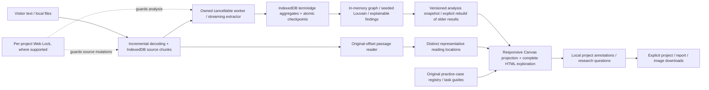

See [ADR 0019](decisions/0019-knowledge-gap-atlas-local-corpus.md) and the
[feature contract](../visualizations/knowledge-gap-atlas.md). Focused engine/storage/export
tests and local browser checks are the validation seams; test and benchmark outcomes must be
reported separately from the existence of the test code. The
[real-document review](../visualizations/knowledge-gap-atlas-real-world-review.md) records the
unchanged RFC 9110 corpus, baseline defects and verified correction results separately from
illustrative practice cases. These refinements extend ADR 0019 without changing its foundational
local-only processing decision.

### Mrinmoyee sculpture atelier

Mrinmoyee uses the ordinary Visualizations Markdown article and generic blog route, with an immersive Svelte shell under `components/visualizations/mrinmoyee`. It introduces no route exception, endpoint, provider or shared state manager. Its feature domain under `visualizations/mrinmoyee` owns the versioned design contract, six presets, bounded normalization, construction geometry, browser renderer, optional synthesized sound and device-gallery persistence. This extends the existing feature-owned Three.js pattern; it does not introduce a shared sculpture engine.

The shell owns current design, undo/redo, comparison selection, design locks and presentation preferences. `state.ts` validates complete version-1 JSON documents with a 24 KiB UTF-8 limit, carries design state in a URL fragment, and stores up to twelve normalized designs in browser local storage. Imported strings, enums, finite ranges and camera vectors pass through the same normalizer. The fragment includes camera, geometry, surface and lighting settings; it is not sent to the server. Saved thumbnails are size-bounded data images, with a design-only retry when storage quota is exhausted. Gallery deletion affects this browser only. There is no cloud persistence or server-side per-user mutable state.

`AtelierViewport.svelte` dynamically imports the renderer after mount. The renderer owns its Three.js scene, OrbitControls, lights, environment map, interaction handlers, observers and animation frame. `sculpture.ts` builds actual three-dimensional parts and consolidates compatible geometry by material and selectable region. The making slider switches structural layers through framework, clay, paint, cloth, ornament and complete stages. Sculptural identity remains separate from camera and lighting changes. Still views render on demand; explicit ambient motion, bell interaction and presentation may schedule animation while visible. Reduced motion suppresses animation. Context loss presents a poster and a retry that creates a fresh canvas; unmount disposes the renderer, geometry, materials, textures, controls and observers. Sound is instantiated only after an explicit enable action and suspended when the document is hidden.

PNG export renders the current scene through a camera adjusted to contain the selected view in the requested aspect ratio. Transparent capture temporarily hides the background/atmosphere; a final 2D canvas adds optional title and signature. Export restores the interactive size, pixel ratio and scene visibility. Publication posters and preset thumbnails are captures of this same renderer, with social typography composited over the real scene. `scripts/render-mrinmoyee-assets.mjs` records source provenance and dimensions; its check is part of the full feature-artifact lane. See [the feature record](../visualizations/mrinmoyee.md) for limits and verification commands.

```mermaid
flowchart LR
    Presets["Six curated presets"] --> Design["Per-mount versioned design / history / locks"]
    Import["Bounded JSON / URL fragment"] --> Normalize["Feature normalization and validation"]
    Normalize --> Design
    Design <--> Gallery["Browser local storage: twelve designs"]
    Controls["Accessible tools / camera / stages"] <--> Design
    Design --> Sculpture["3D sculpture geometry and materials"]
    Design --> Renderer["Lazy Three.js renderer and scene"]
    Sculpture --> Renderer
    Renderer --> Capture["Current-scene PNG / renderer publication assets"]
    Renderer --> Fallback["Poster / fresh-canvas retry"]
    Intent["Explicit sound enable"] --> Audio["Per-mount synthesized audio"]
```

### Scale Elevator semantic-zoom exhibit

The Scale Elevator uses the ordinary Visualizations Markdown article and generic blog route. Its feature UI under `components/visualizations/scale-elevator` owns per-mount progress, scenario, local inspection, selection and guided-tour state. Its pure domain under `visualizations/scale-elevator` owns typed measurement contracts, the canonical eleven-floor/scenario registry, bounded URL state, the tour schedule and educational oxygen/aggregation calculations. This follows the existing dedicated-feature pattern without adding an endpoint, route exception, external data service, persistence store or shared simulation engine. The gallery consumes lightweight summary/subject metadata; it does not import Three.js through that registry.

Semantic progress is distinct from a floor's illustrative physical viewing extent and from presentation time. Local scene coordinates keep atomic and city geometry in numerically manageable ranges. Label selection uses hysteresis around floor midpoints. Physiological content/delivery, normalised small-scale illustrations and compatible source-gas allocation are explicit model families; the camera cannot create a scientific quantity or convert SpO₂ into gas demand. All clinical traces, infrastructure records and geography are synthetic. The floor registry supplies measurement passport fields, controls, the accessible ordered ledger and capture enumeration.

The stage dynamically imports the browser renderer after mount and viewport activation. The renderer owns its Three.js resources and bounded scene transforms; HTML/SVG owns sharp explanatory labels and charts. Visibility and reduced-motion policy control scheduling, while teardown owns pending-load cancellation and resource disposal. The matching scene stills and server-rendered ledger provide a readable path when WebGL or JavaScript cannot run. The public URL carries bounded synthetic state only.

Publication assets use deterministic page captures so the HTML/SVG measurement context accompanies the actual scene. The capture script opens an existing local development/preview origin with an explicit capture flag and sends bounded `scale-capture` events to the feature root; the card target includes HTML/SVG, while clean fallbacks capture the stage canvas. The script produces eleven annotated stops, matching clean scene fallbacks, a contact sheet, a social image and a continuous tour recording. `static/images/visualizations/scale-elevator/assets.json` records rendering-source provenance, capture state and output metadata. Generation needs the local site, Chrome and a native FFmpeg executable; verification needs only the committed media and source. Their check belongs to `features:check` and the full feature-artifact lane, whose workflow explicitly tracks the article path and `static/videos/visualizations/scale-elevator/**` for pull requests and main pushes, including recording-only edits. See [the feature record](../visualizations/scale-elevator.md) for equations, synthetic assumptions, units, lifecycle boundaries and verification commands. This is a local extension of the established renderer pattern; no foundational decision changes, so a separate ADR is unnecessary.

```mermaid
flowchart LR
    Article["Ordinary Markdown article / generic blog route"] --> Shell["Per-mount Scale Elevator state and controls"]
    Query["Bounded public URL query"] <--> Shell
    Registry["Eleven-floor registry / scenarios / measurement contracts"] --> Shell
    Shell --> Model["Pure oxygen illustrations / blood transport / source-gas allocation"]
    Registry --> Ledger["SSR ordered ledger / measurement explanations"]
    Model --> Overlay["HTML passport and SVG charts"]
    Shell --> Stage["Mount and viewport-owned stage"]
    Stage --> Renderer["Lazy Three.js / local scene transforms"]
    Model --> Renderer
    Renderer --> Capture["Deterministic page stills / tour recording / manifest"]
    Overlay --> Capture
    Capture --> Fallback["Matching stills and publication media"]
    Fallback --> Stage
```

### The Piano That Forgives

The original feature was locally verified on **21 October 2026**. Its **22 October 2026** extension adds the full keyboard, navigation and bounded note effects described below; the current verification receipt is recorded in the feature document. The earlier system-wide audit baseline remains as dated above.

The probabilistic piano uses an ordinary Visualizations Markdown article and the generic blog route. Its explicit Svelte shell under `components/visualizations/probabilistic-piano` owns current harmony/settings, focused pointer/keyboard inputs, recent history, frozen inspection, transport, keyboard viewport/range and presentation state per mount. The pure feature model under `visualizations/probabilistic-piano` owns integer-MIDI harmony palettes across A0–C8 / MIDI 21–108, bounded settings, score/softmax selection, deterministic musical randomness and the versioned original replay fixture. Separate pure `keyboard.ts` geometry describes all 88 native keys, the overview and overlay positions without importing a browser renderer. The gallery consumes lightweight summary/subject metadata; it does not import the piano's browser audio or painting runtime. This is an extension of the existing feature-owned model pattern, with no endpoint, inference service, account, credential, persistence store or new route exception.

Each note-on freezes its harmony/settings snapshot and calculates one decision containing the request, complete eligibility set, admitted candidates, normalized probabilities, selected pitch and explanation. That same decision feeds audio, key marks, probability bars/curves, note effects and the readable ledger. Nearest admits only literal closest pitches; Wander expands its distance bound by at most one semitone; both preserve eligible requests. Raw preserves every valid request. Authored musical-role, previous-note, repetition and held-voice preferences weight only the admitted set. Model version 2 expands the range while retaining the scoring rule, sampling salt and original demo choices. The musical seed/event stream is independent of visual draws, and painting never makes a musical choice. The article's worked example remains the tested clean C♯4 request between C4 and D4 in C6/9.

An input ledger stores the exact selected output and unique audio voice ID. Note-off releases that ID without recalculating harmony, so simultaneous inputs sharing a pitch release independently and held notes retain their pitch across chord changes. The shell assigns a separate effect ID to the same frozen note and retains its reflection through pedal ownership. The browser audio module is instantiated through explicit activation and owns one lazily created Web Audio context. Its original approximation uses up to five partials, omitting frequencies near or above Nyquist, and bounds twenty playable voices plus four retiring tails to at most 120 oscillators. Register-dependent decay spans 5.4 seconds at A0 to 2.4 seconds at C8; audio-clock parameter scheduling is independent of rendering. Pending startup has cancellation/disposal guards. Stop, blur, hidden/offscreen state, preset switches and teardown clear owned playing state and pending transport work; teardown closes the context and removes observers/listeners. These limits do not constitute a universal loudness guarantee or a model of a listener's taste.

The impressionist pond is deterministic local canvas artwork cached separately from a transparent transient canvas. The per-mount `effects.ts` controller retains at most 48 velocity/duration-aware blooms, ripples, pigment ribbons and reflections; it animates only visible moving marks, settles held marks after 3.8 seconds and fades released marks over 2.8 seconds. Hidden/offscreen state suspends its frame, Stop clears marks, and teardown disposes the controller. Both canvases cap pixel density at 1.5. SVG candidate curves use actual probabilities for width/opacity and gold for the selected branch. The shell measures native-key geometry through viewport scroll, view changes and resize, so the curves and note effects remain aligned with the instrument.

Stable native key buttons retain recognizable grouping and hit targets in full-keyboard fit and comfortable playing views. A separate miniature overview, octave controls and return-to-C4 control navigate all 88 keys; active pointers guard viewport changes. A roving key Tab stop, arrow/Home/End/Page navigation and bounded computer-keyboard octave shifting keep the full range reachable. Focus view expands the inline stage without a separate overlay or browser fullscreen lifecycle. Labelled request/result marks, exact probability values and an optional recent-note history keep the musical explanation available without colour or sound. Painting failure uses a quiet-wash semantic keyboard, while the server-rendered poster and prose remain available without JavaScript. The shell uses the existing motion resolver for operating-system and site Still changes, drawing stable effect and probability marks without animation frames in Still mode. Publication captures show the implemented instrument's seeded state. See [the feature record](../visualizations/probabilistic-piano.md) for scores, palettes, audio bounds, asset provenance and the assembled verification receipt. This extension changes the feature's rendering lifecycle and geometry boundary within the established per-mount model pattern; it does not alter a foundational decision, so no additional ADR is required.

```mermaid
flowchart LR
    Article["Ordinary Markdown article / generic route"] --> Shell["Per-mount piano controls and input state"]
    Presets["Authored palettes / bounded musical settings"] --> Snapshot["Frozen note-on harmony snapshot"]
    Shell --> Snapshot
    Snapshot --> Model["Pure distance / score / seeded sampler"]
    Model --> Decision["One decision with actual probabilities"]
    Decision --> Ledger["Input ID / selected pitch / unique voice ID"]
    Ledger --> Audio["Explicitly enabled owned Web Audio"]
    Decision --> Readouts["Key marks / probability bars and curves / text ledger"]
    Decision --> Effects["Bounded note blooms / trails / reflections"]
    Ledger --> Effects
    Geometry["Pure A0–C8 keyboard geometry"] --> Keys["88 native keys / overview / roving focus"]
    Shell --> Keys
    Keys --> Measure["Measured scroll / resize / view geometry"]
    Measure --> Readouts
    Measure --> Effects
    Shell --> Paint["Cached deterministic pond canvas"]
    Shell --> Effects
    Paint --> Capture["Actual instrument captures / poster"]
    Effects --> Capture
    Readouts --> Capture
    Lifecycle["Blur / visibility / offscreen / teardown"] --> Audio
    Lifecycle --> Shell
    Lifecycle --> Effects
```

### The Music of Missing Data

The Missingness-Pattern Explorer uses an ordinary Visualizations Markdown article and the generic blog route. Its small Svelte shell under `components/visualizations/missing-data` lazily loads the interactive implementation and owns settings, inspection and transport per mount. The pure feature domain under `visualizations/missing-data` owns bounded seeded synthetic data, seven explicit disappearance processes, observed-only imputation, numerical summaries and versioned replay state. The gallery imports lightweight metadata only. There is no endpoint, uploaded dataset, external service, credential, persistent reader profile or new route exception.

Complete synthetic truth remains separate from the masked observed-data projection. Only simulation, explicit reveal and evaluation can read hidden values; the imputer receives observed values and the fully observed baseline predictor. For a given seed and matrix view, the same complete sample remains fixed while scenario, missingness intensity, imputation or display ordering changes. Separate random streams generate data, latent missingness draws and conditional predictive completions. A row/column permutation changes presentation only. One experiment snapshot supplies matrix cells, count summaries, selected-variable estimates, optional sound and downloadable fingerprints, preventing independently generated decorative data from diverging from the numerical explanation.

The multivariate view is bounded at 96 observations × 16 variables; longitudinal examples use 96 participants × 24 visits for one synthetic score. The baseline predictor stays observed outside the displayed matrix. MCAR, MAR and MNAR presets describe known simulation rules; dropout, whole-variable loss, instrument outages and nonresponse expose their particular mechanisms rather than claiming that a visible pattern establishes a mechanism. Column means have no estimated uncertainty. Conditional linear predictive draws use only measured outcomes; model-dependent predictive standard deviation supplies their halo spread. A completely unobserved variable remains unestimable. The MNAR sensitivity shift changes only missing-outcome assumptions. These draws are not presented as pooled multiple-imputation inference.

The browser renderer owns a raw WebGL matrix and demand-driven drawing at capped pixel density, with a labelled fallback when WebGL is disabled or fails. The renderer is dynamically imported separately from the interactive implementation. `colors.ts` owns the pure fixed-score palette shared by the fallback preview, audio and fingerprint exporter; those modules do not import the GPU runtime. HTML/SVG readouts and native controls keep the interpretation available without colour, hover or audio. The optional local synthesiser creates its owned Web Audio context only after a reader gesture, samples a bounded number of cells per scan step and preserves rests for missing values. Visibility, offscreen and motion preferences govern transport; teardown disposes owned observers/listeners, frames, GPU resources, audio and download URLs. The server-rendered article and model-derived poster remain readable without JavaScript.

The fingerprint PNG is a composed plate, and its JSON companion records current versioned parameters, seed, counts, missingness summaries, ordering and imputation assumptions from the same experiment. Bounded, validated URL settings reproduce synthetic state without sending a dataset to a service. Publication capture executes the actual model/export modules in Chrome, using direct development-module imports when available or an esbuild bundle of those same sources otherwise; the manifest records capture mode and source/pixel hashes. Generation therefore requires a browser but not a running development server. See [the feature record](../visualizations/missing-data.md) for the scientific contract, rendering/audio bounds, exports and verification limits. This is a feature-owned extension of the established model/UI pattern; no foundational decision changes, so no additional ADR is required.

```mermaid
flowchart LR
    Article["Ordinary Markdown / generic route"] --> Shell["Lazy per-mount explorer / controls / transport"]
    URL["Bounded versioned replay parameters"] <--> Shell
    Shell --> Truth["Seeded complete synthetic data"]
    Truth --> Mask["Explicit disappearance rule / stable latent draws"]
    Mask --> Observed["Observed-only projection + baseline"]
    Observed --> Imputation["Mean / conditional predictive draw"]
    Truth --> Evaluation["Explicit reveal / synthetic-sample reference"]
    Observed --> Snapshot["One experiment snapshot"]
    Imputation --> Snapshot
    Evaluation --> Snapshot
    Snapshot --> View["WebGL matrix / HTML-SVG summaries / inspector"]
    Snapshot --> Audio["Gesture-enabled bounded local Web Audio"]
    Snapshot --> Export["PNG / JSON / replay URL"]
    Lifecycle["Visibility / offscreen / Still / teardown"] --> View
    Lifecycle --> Audio
```

### The Shape of Waiting

The Queue-Distribution Laboratory uses an ordinary Visualizations Markdown article and the generic blog route at `/blog/visualizations/the-shape-of-waiting`. The small shell under `components/visualizations/shape-of-waiting` lazily loads the interactive implementation. The feature owns settings, baseline comparison, playback and ticket selection per mount; its pure TypeScript domain under `visualizations/shape-of-waiting` owns identity-keyed synthetic demand, discrete-event scheduling, snapshots, summaries and versioned bounded replay state. The gallery imports lightweight metadata only. There is no endpoint, external service, uploaded dataset, account, credential, persistent reader profile or new route exception.

Model time is independent of animation time. A scheduled-event priority queue orders events by simulated time, explicit precedence and a stable tie-breaker. Policy-only comparisons reuse the same arrivals, underlying service requirements, class, patience and attendance draws. A finite arrivals window is followed by draining queued and active work; computation bounds produce an explicit incomplete status and unresolved population. Main summaries describe people whose service has started, while current waiting ages, no-shows and abandonment remain distinct. Class medians/p90s and overtaking expose the consequences of a scheduling rule without importing the Calcutta Queue game's social-position mechanics.

Bounded browser-worker execution keeps model work off the rendering thread. Each requested configuration has an identity; cancellation/replacement prevents stale responses from overriding newer settings. The same computed run supplies a selected-time snapshot for Canvas crowd marks, SVG/HTML distributions, textual metrics, accessible inspection and frozen PNG/JSON receipts. Rendering does not generate model randomness. Position expresses scheduling order for deterministic rules; random rank is illustrative because each service selection redraws the ordering. Colour expresses age on a fixed scale, and class receives a secondary mark. The server-rendered article and model-derived poster remain readable without JavaScript. The complete laboratory shell carries `data-tts-exclude`, so the shared narration extractor reads only the surrounding authored article in both script-disabled and hydrated DOMs; loading text, live metrics and replay state cannot change that transcript hash. Per-mount lifecycle handles Still/reduced motion, hidden/offscreen state, workers, animation frames, observers/listeners and download URLs.

Replay encodes bounded versioned settings, optional baseline and observation time, rerunning the engine rather than trusting serialized results. A frozen snapshot supplies receipt numbers and graphics; publication captures derive from the implemented engine/render state and carry provenance. See [the feature record](../visualizations/shape-of-waiting.md) for definitions, paired experiments, limits and verification. This extends the existing feature-owned model/UI/worker pattern without changing a foundational decision, so no additional ADR is required.

```mermaid
flowchart LR
    Article["Ordinary Markdown / generic route"] --> Shell["data-tts-exclude shell / lazy controls / baseline / transport"]
    Article --> Narration["Shared extractor / stable surrounding prose"]
    URL["Bounded versioned replay settings"] <--> Shell
    Shell --> Worker["Owned worker / run identity / bounded execution"]
    Worker --> Demand["Identity-keyed synthetic demand"]
    Demand --> Events["Pure discrete-event priority queue"]
    Events --> Run["Computed run / selected-time snapshot"]
    Run --> View["Canvas queue / SVG distributions / HTML inspection"]
    Run --> Receipt["Frozen PNG / JSON / replay URL"]
    Run --> Capture["Model-derived publication capture / provenance"]
    Lifecycle["Still / visibility / offscreen / teardown"] --> Shell
    Lifecycle --> Worker
    Lifecycle --> View
```

Local UI adapters use Bits UI/tailwind variants, `cn`, and barrel exports. Five bounded runtime import cycles occur inside these adapters (badge/button/sheet/tabs/tooltip); the static graph found no domain-wide runtime cycle. These cycles have no demonstrated initialization failure and are documented coupling, rather than a counted defect. The graph excluded type-only imports, glob expansion and nonliteral imports; it is not a formal proof of acyclicity.

### Two Calendars, One Life

The historical Calcutta–America edition uses the ordinary Visualizations Markdown article and generic blog route at `/blog/visualizations/two-calendars-one-life`. Its Svelte component under `components/visualizations/two-calendars` owns year/comparison selection, native-scroll chapter observation and postcard controls per mount. The pure feature domain under `visualizations/two-calendars` owns the curated 1940–1959 records and references, explicit date/relationship contracts, chronology layout, bounded public URL selection and shared postcard composition. The feature introduces no endpoint, route exception, external runtime service, credential, persistence store, dependency or global state manager.

Both calendar ribbons use the same Gregorian chronology. Record precision is separate from documented duration and uncertainty: a year-only record is not thereby a year-long event. Geographic scope and source references travel with the records. Connecting threads explicitly distinguish shared time, editorial thematic comparison and documented relationship; graphical proximity alone cannot establish a causal claim. The component server-renders historical reading and sources, then progressively enhances selection and scroll-linked emphasis. Observers and listeners belong to the mounted component and are released on teardown; native scrolling and motion preferences preserve the reading path.

The selected records and relationship supply both the interactive reading and composed postcard SVG. Browser rasterization produces the PNG from that same composition; SVG/PNG exports and copyable captions retain precision, attribution and a replayable selection link. Validated URL state selects supported public records only. The article's publication artwork is a static default social preview, not a promise of selection-specific server-generated Open Graph images. See [the feature record](../two-calendars.md) for authoring constraints and future personal-edition privacy/time-zone boundaries. This extends the existing feature-owned model/UI pattern; no foundational decision changes, so a separate ADR is unnecessary.

```mermaid
flowchart LR
    Article["Ordinary Markdown / generic blog route"] --> CalendarUI["Per-mount year / comparison / chapter state"]
    URL["Validated public selection URL"] <--> CalendarUI
    Sources["Curated records / precision / references"] --> Chronology["Pure shared chronology and relationship contracts"]
    Chronology --> CalendarUI
    Sources --> Reading["SSR records / explanations / source links"]
    CalendarUI --> Ribbons["Paired SVG ribbons / native-scroll emphasis"]
    CalendarUI --> Selection["Selected records and relationship"]
    Sources --> Selection
    Selection --> Postcard["Shared postcard SVG composition"]
    Postcard --> Download["Local SVG / PNG / caption / replay link"]
    Lifecycle["Motion preference / observer teardown"] --> Ribbons
```

### Between a Click and a Page: HTTP/TCP request bench

The HTTP/TCP instrument is an ordinary Visualizations Markdown article at
`/blog/visualizations/between-a-click-and-a-page`. Its SSR shell under
`components/visualizations/between-a-click-and-a-page` renders a meaningful static
buffering example and lazily loads the interactive runtime near the viewport.
The gallery imports only the registry's lightweight summary and Computer Science
subject mapping. No route exception, endpoint, external network request, socket,
credential, persistence or global simulation engine is introduced.

The pure TypeScript domain under `visualizations/between-a-click-and-a-page` owns
bounded inputs, an immutable deterministic journey, cumulative byte-offset delivery,
loss buffering and an exact timing receipt. Four response ranges describe a decoded
illustrative response, not literal encrypted wire segments. Fresh browser cache,
already-secured connection reuse and fresh HTTPS setup are distinct scenarios.
One grouped follow-up exchange makes additional resources visible. The fixed
loss-recovery rule and pedagogic page-progress gauge are documented simplifications.

Each runtime mount owns input, scrub position, playback and selected mechanism.
Animation samples model time independently of wall time and writes token transforms
on scene refs; UI snapshots update at a bounded cadence. Still/reduced motion disables
automatic progression, and offscreen/hidden state stops frames. Intersection and
preference observers, media-query listeners, visibility listeners and frames are
released at teardown. Committed SVG fragments come from the existing vendored
MIT Anatomy kit through the feature's generator and measured geometry audit;
reader input never supplies markup. The local asset renderer captures the implemented
article and records source and pixel provenance. `http-tcp:geometry` and
`http-tcp:assets:check` participate in `features:check`; the feature workflow tracks
the article and runs its focused model and browser suites. See the
[feature record](../visualizations/between-a-click-and-a-page.md). This extends the
existing pure-model/lazy-UI pattern without a new foundational choice or ADR.

```mermaid
flowchart LR
    Article["Markdown / generic blog route"] --> Shell["SSR static bench / lazy runtime"]
    Controls["Per-mount conditions / timeline / inspection"] --> Journey["Pure deterministic timeline and byte ranges"]
    Journey --> Snapshot["One sampled state / exact timing receipt"]
    Snapshot --> Scene["Anatomy SVG / token transforms / receiving tray"]
    Snapshot --> Reading["Step explanation / counters / model limits"]
    Geometry["Vendored kit / recorded shapes / audit"] --> Scene
    Scene --> Assets["Local article capture / source and pixel provenance"]
    Lifecycle["Still / reduced motion / visibility / teardown"] --> Scene
```

### The Patient Between the Systems: OpenHIE exchange instrument

The OpenHIE teaching instrument uses the ordinary Visualizations Markdown article and generic blog route at `/blog/visualizations/the-patient-between-the-systems`. The server-rendered shell under `components/visualizations/openhie` carries `data-tts-exclude` and lazily imports its interactive runtime as the figure approaches the viewport. Surrounding authored prose, sources and a captured publication image remain readable without JavaScript. The gallery imports lightweight summary and subject metadata only. The feature adds no route exception, backend, network integration, account, credential, uploaded patient data, persistence store or global state manager.

The pure TypeScript domain under `visualizations/openhie` owns synthetic source records, declared identity links, code mappings, four normalized boolean gates and immutable exchange-event/snapshot construction. Six scenarios expose successful exchange, ambiguous identity, missing terminology mapping, denied clinical access, a selected pre-commit service outage and duplicate delivery. Explicit statuses separate message receipt, shared persistence and delivery to Hospital B. Local originals, the normalized shared subset and the returned subset remain separate collections; provenance retains original codes, source identifiers and distinct occurrence, source-recording and exchange timestamps. Authorized retrieval selects persisted events for the resolved identity. Denied clinical access returns no clinical payload and never sends that query to the shared-record service. These are local teaching decisions, not operational authentication, consent, audit or OpenHIE conformance services.

Presentation state belongs to the component mount: scenario overrides, selected step, guided/explore mode, Patient/Clinician/Architect lens, inspected part or transaction, and playback. All views inspect the same model snapshot. Playback pace cannot change domain events or clinical timestamps. Reduced motion and the site's Still setting stop automatic progression; visibility, intersection and preference observers, listeners and timers are released on teardown. The versioned replay parser accepts exact allowlisted scenarios, explicit booleans and bounded integer steps, rejects malformed owned fields and oversized queries, and recompiles the model instead of trusting serialized results. A JSON exchange receipt exports the selected immutable snapshot with settings, assumptions and primary references; it does not execute a new clinical query.

The dimensional figure consumes committed `visualizations/openhie/instrument.json` geometry. `scripts/generate-openhie-instrument.mjs` generates its controlled SVG fragments with the MIT-licensed Anatomy geometry kit vendored under `scripts/lib/openhie-anatomy`; that kit runs during authoring and verification, not in the browser. The interactive SVG places a carriage and state highlights over those generated parts. Reader input and replay query text do not supply SVG markup. `scripts/render-openhie-assets.mjs` captures the actual local article instrument as the social/fallback poster, with source and pixel provenance. `openhie:assets:check` verifies generated instrument and publication artifacts in the full feature-artifact lane; the workflow explicitly tracks the article for pull requests and main pushes. See [the feature record](../visualizations/openhie.md) for the physical-metaphor contract, synthetic case, limits and focused verification commands. This extends the existing feature-owned pure-model/lazy-UI pattern, so no new foundational decision or separate ADR is required.

```mermaid
flowchart LR
    Article["Ordinary Markdown / generic blog route"] --> Shell["data-tts-exclude shell / lazy per-mount UI"]
    Article --> Prose["SSR prose / sources / publication image"]
    Replay["Versioned bounded replay settings"] <--> Shell
    Case["Synthetic sources / six scenarios / four boolean gates"] --> Model["Pure deterministic exchange transitions"]
    Shell --> Model
    Model --> Snapshot["Immutable events / selected snapshot"]
    Snapshot --> View["SVG instrument / three lenses / record inspection"]
    Snapshot --> Receipt["Local JSON receipt / assumptions / sources"]
    Kit["Vendored Anatomy kit / authoring only"] --> Generator["Instrument generator / committed SVG geometry JSON"]
    Generator --> View
    View --> Capture["Local browser capture / provenance manifest"]
    Lifecycle["Still / visibility / observers / timer cleanup"] --> Shell
```

### Maker / entrepreneur / explainer collection

The three connected articles, `build-one-build-a-thousand`, `the-six-week-shadow`
and `the-museum-of-almost`, use ordinary Markdown under `src/lib/posts` and the
generic `/blog/visualizations/<slug>` route. Each owns an independent pure
TypeScript domain under `visualizations/<slug>` and a viewport-lazy Svelte shell
and runtime under `components/visualizations/<slug>`. Editorial prose remains in
Markdown. The gallery reads lightweight registry entries, including Design and
Entrepreneurship subjects; it does not import the three runtimes. These are local
feature additions with no new endpoint, external runtime service, account,
persistence layer, shared simulation engine or foundational renderer decision.
No additional ADR is required.

Build One derives preparation, per-unit work, workshop fixes, material waiting,
ready-to-send day and separately labelled after-shipping problems from one
validated workshop snapshot. Its original-setup comparison preserves quantity
and stock assumptions while disabling the three decisions. The Six-Week Shadow
derives start/finish times, elapsed working days, person-day effort and a stable
controlling path from a validated dependency graph. Parallel effort is distinct
from elapsed time; visual filters and replay do not remove tasks. The museum
uses typed author-controlled specimens, evidence, interpretations, unknowns and
explicit onward relationships. Its four initial records are fictional. Content
status and reuse status are separate; URL selections cannot turn demonstration
evidence into verified personal claims. Onward targets are terminal, validated
records rather than an unbounded traversal graph.

Each component mount owns its guided beat, choices and inspection. Presentation
progress remains separate from calculated results or curated record content.
The site's existing theme/motion preferences remain authoritative. Visibility,
Still/reduced-motion policy and teardown govern owned presentation frames and
observers/listeners. SSR shells expose representative SVG scenes and readable
accounts, with `data-tts-exclude` keeping live controls out of article narration.
Small allowlisted versioned URL selections, where offered, select model inputs
or existing records, never results or SVG markup.

Each feature's `generate-geometry.mjs` uses the existing MIT-licensed Anatomy kit
under `scripts/lib/openhie-anatomy` at authoring/verification time and commits
controlled `geometry.json` fragments. Browser code consumes those fragments;
it does not import the kit or depend on a user's skill directory. The three
generators check recorded true solids and deterministic output through
`maker-collection:geometry`. `scripts/render-maker-collection-assets.mjs` captures
the implemented local articles with service workers blocked, producing 1200 ×
630 posters and source/pixel provenance. `maker-collection:assets:check` verifies
the committed captures without starting a browser. Both checks belong to
`features:check`; the feature-artifact workflow also tracks the three Markdown
entries. The shared capture script reflects the repeated publication task;
models, fixtures and UI state remain independent. See the feature records for
[Build One](../visualizations/build-one-build-a-thousand.md),
[the Shadow](../visualizations/the-six-week-shadow.md) and
[the Museum](../visualizations/the-museum-of-almost.md), including model limits
and the museum's verified-record authoring guide.

```mermaid
flowchart LR
    Articles["Three ordinary Markdown articles / generic route"] --> Shells["Independent SSR shells / viewport-lazy Svelte runtimes"]
    Shells --> Workshop["Validated workshop inputs / one work snapshot"]
    Shells --> Schedule["Validated task DAG / schedule and controlling path"]
    Shells --> Archive["Typed fictional specimens / evidence / terminal onward records"]
    Workshop --> Views["Feature-owned SVG objects / HTML inspection and readouts"]
    Schedule --> Views
    Archive --> Views
    Kit["Existing vendored Anatomy kit / authoring only"] --> Geometry["Per-feature generators / committed controlled geometry"]
    Geometry --> Views
    Views --> Posters["Local article capture / source and pixel provenance"]
    Policy["Site theme / Still / reduced motion / visibility / teardown"] --> Shells
```

### Memory palace: learner-owned units and retrieval

The Memory Palace uses the ordinary Visualizations Markdown article at
`/blog/visualizations/a-place-for-every-idea`. Its server-rendered shell under
`components/visualizations/memory-palace` displays the house and lazily imports
the mounted interaction. The gallery reads lightweight metadata only. The pure
TypeScript domain under `visualizations/memory-palace` owns bounded parsing,
authored examples, occurrence identities, global route slots, answer comparison,
attempt summaries and escaped Markdown study-sheet export.

All material and practice state belong to the component mount. Reader input stays
in memory; there is no endpoint, account, external inference call, browser storage,
input-bearing URL or new route exception. Word parsing exposes delimiter selection
and retains duplicates. Paragraph suggestions are exact sentence/semicolon
fragments, not automatic semantic analysis; the learner edits meanings and
relationships before confirmation. Source or association edits clear prior
practice state. A 6,000-character / 48-unit interface bound and explicit twelve-locus
practice batches contain the work. Batches reuse the illustration as separate
sessions and are labelled for interference; they do not claim separate physical
palaces. Retry selection retains original global loci.

Recall removes targets and answer-bearing scene details from the mounted study
interface. Optional scene hints are logged. Word checks normalise Unicode, case
and whitespace while retaining occurrence/position identity; concept assessment
belongs to the learner after reveal. A submitted-before-reveal flag distinguishes
attempted retrieval from prior exposure. Static house geometry comes from the
existing authoring-only Anatomy kit; the browser receives controlled committed
SVG fragments, never user-supplied markup. The geometry and captured publication
image have deterministic source checks in the full feature lane. No foundational
decision changes, so no additional ADR is required. See the
[feature record](../visualizations/memory-palace.md) for contracts and verification.

```mermaid
flowchart LR
    Article["Markdown prose / generic route"] --> Shell["SSR house / lazy mounted runtime"]
    Input["Bounded word list or paragraph"] --> Units["Editable source-linked units / stable occurrence IDs"]
    Units --> Scenes["Learner scenes / global loci / explicit batches"]
    Scenes --> Study["Route rehearsal"]
    Study --> Recall["Hidden targets / recorded attempt / optional hint"]
    Recall --> Feedback["Word comparison or concept self-assessment"]
    Feedback --> Retry["Original-locus retry / scene revision"]
    Scenes --> Export["Local escaped Markdown download"]
    Kit["Existing authoring-only Anatomy kit"] --> Geometry["Committed controlled house geometry"]
    Geometry --> Shell
    Shell --> Capture["Loopback browser poster / source and pixel provenance"]
```

### Lens and Mirror Lab

The Lens and Mirror Lab uses the ordinary Visualizations Markdown article and generic
blog route at `/blog/visualizations/through-a-different-glass`. Its server-rendered
shell under `components/visualizations/lens-mirror-lab` lazily imports a per-mount
runtime. The feature domain under `visualizations/lens-mirror-lab` owns bounded
coordinate mappings, matching CPU/GLSL implementations, raster admission, sample
metadata, allowlisted URL settings and one WebGL renderer. The gallery imports
summary metadata only. This adds a feature-local image-processing boundary within
the existing dedicated-feature pattern; no foundational decision changes or new
ADR are required.

Local JPEG, PNG and static WebP inputs are checked for signature, container
dimensions and animation before decoding: 10,000,000 bytes, 20,000,000 pixels and
8192 pixels per edge. Orientation-aware decoding prepares a browser-local canvas
with a long edge at most 2048 pixels and within the GPU texture limit. Source
images and filenames are absent from sharing, persistence, telemetry and server
requests. The original canvas retains the prepared source while the GPU samples
its transformed coordinates. The strength presets are bounded reverse warps;
Advanced numerically inverts the documented forward Brown–Conrady model. Curved
mirror appearances remain labelled 2D approximations. Invalid/out-of-source
samples show a checkerboard rather than invented scene content.

Rendering occurs after source/control changes; explicit wave playback alone
requests continuous visible frames. Offscreen/hidden state and reduced-motion
preferences suspend playback. Teardown releases the source canvas, GPU resources,
listeners and observers. WebGL denial, initialization errors and context loss keep
the article and default captured comparison available. PNG downloads use the
current working resolution; shared URLs contain only bounded parameters and a
built-in sample ID. An authoring-only preview helper renders the same Markdown
and lab without the full eager article registry, shared site shell or read-aloud
control. It is loopback-only and does not add a production route; focused browser
checks against it do not establish the full site's routing/build status. See the
[feature record](../visualizations/lens-mirror-lab.md).

```mermaid
flowchart LR
    Article["Markdown / ordinary blog route"] --> Shell["SSR poster / lazy runtime"]
    Samples["Five original local sample images"] --> Prepared["Bounded browser-local source canvas"]
    File["Reader-selected local raster"] --> Admission["Signature / dimensions / animation / size checks"]
    Admission --> Decode["Orientation-aware decode / bounded preview"]
    Decode --> Prepared
    Prepared --> Original["Unmodified reference canvas"]
    Prepared --> GPU["Owned WebGL texture / reverse lookup shader"]
    Controls["Per-mount bounded settings"] --> GPU
    GPU --> Output["Distorted view / local PNG download"]
    Controls --> URL["Allowlisted sample ID / scalar settings only"]
    Shell --> Fallback["Default static comparison / readable article"]
```

### Synthetic Data Lab

`/tools/synthetic-data-lab` is a wide site-shell Svelte application, with public descriptive SSR
and client-driven previews. Its server load establishes a random HttpOnly, SameSite=Strict
one-hour owner capability and returns a private/no-store page. The page does not load reference
records or generate datasets during SSR. `src/lib/components/synthetic-data-lab/` owns the
workbench; browser-safe types, presets and API calls live in `src/lib/synthetic-data-lab/`.

`/api/synthetic-data-lab/[...path]` delegates only enumerated operations to the server-only
`src/lib/server/synthetic-data-lab/proxy.ts`. It uses the existing streamed-body and process-local
admission helpers: 512 KiB input, ten-second body deadline, exact-origin JSON mutations, and
private/no-store/noindex output. The proxy streams JSON, CSV and ZIP bodies while retaining its
admission lease, abort propagation and deadline until consumption, cancellation or failure.
Full-generation requests have a 150-second deadline, previews 40 seconds and other operations
30 seconds; the Vercel route declares `maxDuration: 180`. Actual output is capped at 64 MiB.
A declared excessive length is rejected before headers; crossing the bound after headers errors
the stream, so that transfer may be partial. It does not buffer the entire upstream response.
The proxy generates the trusted owner header from its cookie and never forwards a submitted
owner header. `SYNTHETIC_DATA_API_URL` and `SYNTHETIC_DATA_SERVICE_TOKEN` remain private. Production
service connections require HTTPS; development and the explicit private local-preview flag
`SYNTHETIC_DATA_ALLOW_LOOPBACK=true` permit loopback HTTP only. The optional server-only
`SYNTHETIC_DATA_DEPLOYMENT_BYPASS` becomes an `x-vercel-protection-bypass` header to the private
Python deployment and is never returned to the browser. The browser contacts only the site's
own API, so this feature adds no public CSP origins.

`services/synthetic-data-lab/` contains the optional FastAPI service and framework-independent
NumPy/SciPy engine. Previews and completed jobs call the same engine. Owner-scoped result IDs
refer to immutable generated rows; downloading does not resample. The local service mode's bounded,
expiring in-memory job/result store is a single-process deployment design. It is not durable
storage or a horizontally coordinated queue. Service restart or expiry removes results.
Installing the site alone does not provision the Python service. The local launcher shares
an ephemeral token directly through child-process environments without writing credentials.

Hosted `SYNTHETIC_DATA_STORAGE_MODE=blob` selects a separate Python Vercel deployment, also the
default when `VERCEL=1`. Its HTTP request awaits computation and persistence before returning;
there is no dependency on detached work after response. The UI shows indeterminate progress
and cancellation aborts the original request. A POST cancellation for an already running hosted
job returns 409 with that instruction. Local `memory` mode retains queued progress and cooperative
job cancellation. Native numerical calls cannot be forcibly interrupted in either mode.
The full-generation compute budget is 120 seconds, hosted preview compute is 20 seconds, and a
bounded 16-second commit allowance fits inside the proxy envelope. The Python function declares
180 seconds. The shared engine limits generation to 100,000 rows, 100 columns and two million
requested cells, with previews at most 5,000 rows. Backend bodies are streamed with a 2 MiB bound
and ten-second deadline; the public proxy is stricter.

Hosted mutable control state resides in dedicated Redis through its private HTTPS REST API.
Lua admission atomically reserves an expiring lease, applies minute quotas and binds a supplied
idempotency key to its owner and configuration. Two generation requests may run globally and
per owner, with separate preview/full minute admission buckets. Redis also holds
owner-hashed job/result metadata, read/download limits and retained-size accounting under the
`{synthetic-lab-v1}:` namespace. The frontend's admission guard remains process-local; the backend
Redis admission provides shared coordination. This does not make computation resumable after
an interrupted request or turn it into a background queue.

Immutable gzip JSON snapshots are uploaded with explicit private access and no overwrite to
`synthetic-lab/v1/data/<expiry>/<result-id>.json.gz` in Vercel Blob. Read access requires both
valid owner-scoped Redis metadata and an unexpired result; compressed snapshots are checksum
verified and bounded when read/decompressed. Neither Blob paths nor service/bypass credentials
are exposed as direct browser download capabilities. Hosted retention admits at most 24 results,
128 MiB of serialized JSON each and 256 MiB globally, with early expiry of the oldest completed
results under capacity pressure; these account for stored payloads, not
Python resident memory. Generated rows, configuration and optional internal diagnostic truth
may be stored in the private snapshot, while ordinary result responses omit truth. Reference
or empirical values supplied in configuration can therefore persist until cleanup.

Result metadata expires after 30 minutes and every read enforces that deadline. The Blob cleanup
index is recorded before upload, so interrupted writes remain eligible for deletion. Each new
generation opportunistically attempts at most 500 expired deletions with a 60-second shared gate.
The service declares a daily `/cleanup` Cron at 03:00 UTC, authenticated by a separate private
`CRON_SECRET`, and deletes at most 500 indexed expired objects per invocation. The normal service
token and owner cookie cannot authorize this operation through the public proxy. Expiry denies
access without waiting for Cron; physical Blob removal can be later if a scheduled run is delayed,
storage is unavailable or the cleanup batch is full. The deployment, Redis, private Blob,
protection bypass and Cron must each be verified before claiming hosted activation.

The implementation scope, configuration contract, verification and unsupported combinations
are recorded in [the feature guide](../visualizations/synthetic-data-lab.md).
[ADR 0016](decisions/0016-synthetic-data-lab-service.md) explains the separate compute boundary.
No formal differential-privacy guarantee is introduced by ordinary synthetic generation.
The clean release passed 97 Python tests (including 11 hosted), 35 Vitest tests, Svelte analysis
of 3,376 files with zero errors/warnings, the full feature build, the architecture gate and its
13 fixtures. Direct production-backend acceptance against deployment
`dpl_4xHW5LcCu2eWYHUKsTWtNtnBBsuD` / source `8261963` completed all 12 live preset previews,
a 100,000-row/12-numeric-column full result and a 10,987,026-byte streamed CSV. A different owner
received 404, and the stable alias could read the same shared result. The native Vercel Cron Run
action reached the protected cleanup endpoint with user agent `vercel-cron/1.0`, HTTP 200 and
111 ms response time; no expired objects were present. These checks establish direct backend
operation and Cron routing/authentication, not an elapsed production-retention test or a completed
daily scheduled run. Staged and public-domain HTTP acceptance passed for generation, parameter
changes and streamed CSV/ZIP, including a 100,000-row staged export. The feature guide records
the exact requests, measurements and delivered public-page capture. Earlier local measurements
describe memory mode separately.

## Customer enquiry demonstration

`/demos/customer-enquiries` is a working ClinConsult portfolio prototype with simulated
messaging. It has two separate storage/authorization modes. The loopback launcher retains the
local SQLite files, generated local staff password and independent CLI worker described in
[ADR 0017](decisions/0017-local-enquiry-demo.md). Hosted operation uses the visitor isolation in
[ADR 0018](decisions/0018-public-enquiry-sandboxes.md), enabled only by the private
`ENQUIRY_DEMO_PUBLIC_ENABLED` flag and a configured hosted repository. Hosted activation is a
release operation, not implied by source availability.

The browser-safe types are in `src/lib/enquiry-demo`; the state engine, snapshot repository,
session boundary and worker are in `src/lib/server/enquiry-demo`. The page uses the existing
SvelteKit shell with a full-width feature body. The public page has a readable introduction
without allocating records. Explicit customer/staff entry POSTs create or resume that visitor's
temporary workspace. Public staff entry grants access only to their own fictional data; the
local password is never a public credential. The native form fallback uses POST, preventing
entered values from entering query strings before hydration.

```mermaid
flowchart LR
    Visitor["Visitor: opaque HttpOnly cookie"] --> API["Same-origin bounded enquiry API"]
    API --> Scope["Server resolves cookie digest and real expiry"]
    Scope --> Snapshot["Private Supabase workspace: state + revision + staff expiry"]
    Snapshot --> Engine["Validated in-memory SQLite engine"]
    Engine --> Commit["Expected-revision atomic commit; bounded conflict replay"]
    Commit --> Snapshot
    Commit --> Receipt["Saved receipt only after durable commit"]
    Cron["Database cron: cleanup and due-work check each minute"] --> Worker["Bearer-protected Vercel fake-message worker"]
    Worker --> Claim["Persist claim lease, then persist result separately"]
    Claim --> Snapshot
    Engine --> Domain["Enquiry + acknowledgement + history transaction; unique reminder"]
    Browser["Receipt/submission storage by non-authorizing scope key"] --> Visitor
```

All mutable domain records and settings belong to a workspace snapshot: enquiries, jobs,
attempts, history, reminders, ownership/routing, demo clock, failure mode and resets. A random
256-bit cookie is hashed before lookup. A different random scope key namespaces sessionStorage
and carries no authority. Browser-supplied workspace IDs never select another visitor's state.
Snapshots expire after 24 real hours; staff grants expire after at most eight. Demo time affects
four-elapsed-hour response deadlines and retry demonstrations, never authorization or retention.

The existing domain transaction still saves the enquiry, stable reference, owner, deadline,
acknowledgement and history together. Its validated snapshot is then persisted through one
Supabase compare-and-swap. Requests return success only after that durable commit. Conflicts
reload/replay at most four times. The hosted worker saves a claim and completion independently,
so an interrupted function leaves a recoverable processing lease. A unique reminder stays in
the snapshot and cannot duplicate on repeated worker passes. The fake adapter has no outbound
email transport; neither a saved enquiry nor simulated success proves external delivery.

`202610260001_enquiry_demo_workspaces.sql` adds forced-RLS tables with no browser-role policies
or direct table grants. Only the server role executes the bounded storage RPCs. Shared advisory
locking serializes global size/admission checks and revision writes. State is capped at 512 KiB
compact JSON, 100 enquiries and 3,000 history events; SQL also enforces representation size,
200 active workspaces, a 32 MiB aggregate state cap, and per-key/global hourly creation limits.
`supabase/enquiry-demo-cron.sql` activates real-time expiry cleanup and an idle-aware minutely
worker trigger. The bearer credential lives in private Vercel configuration and Supabase Vault.

Every browser mutation checks exact origin, validates JSON and enforces a streamed 16 KiB body
limit with a five-second read deadline. Hosted calls have 15-second response/read deadlines and
bounded bytes. API/page responses are private/no-store/noindex; worker requests require an
independent server credential, a bounded body, deadline and admission guard. Existing site CSP,
security headers, articles and other services are preserved. The test HTTP bridge is loopback-only
and refuses Vercel execution; production cannot use its HTTP backend exception. The dedicated
local Vite configuration excludes authoring caches, outputs and database files from watching.

The [runbook](../enquiry-demo.md) separates local-mode and public-mode source verification from
hosted-release acceptance. It records commands, limits, screenshots and the activation/readback
procedure for `https://www.suvroghosh.in/demos/customer-enquiries`. Each release requires checks
with isolated visitors plus a successful scheduled-worker invocation and acknowledgement while
its browser is closed; record that live evidence in the task handoff. Source tests and build
success do not replace deployment readback. This feature preserves the current main branch's
route-asset budget.
The prototype remains fictional and is not a production security or exactly-once-delivery claim.

## 7. Notes client/server/persistence lifecycle

```mermaid
sequenceDiagram
    participant Owner as Owner browser
    participant Local as Dexie draft/outbox
    participant Kit as SvelteKit owner action/API
    participant Auth as Supabase Auth/RLS
    participant DB as Postgres RPCs/snapshots
    participant Reader as Public reader
    Owner->>Local: Persist device recovery state
    Owner->>Kit: Save document with revision and request identity
    Kit->>Auth: Verify cookie user and configured owner
    Kit->>DB: save_note_document with optimistic revision/idempotency
    DB-->>Owner: New revision or conflict via Kit
    Owner->>Kit: Publish or schedule frozen saved document
    Kit->>DB: Fresh-session publication RPC
    DB->>DB: Snapshot + publication asset manifest; cron activates schedule
    Reader->>Kit: Read visible publication metadata/document/asset
    Kit->>DB: Anonymous RLS visibility check
    Kit-->>Reader: Snapshot data; gated private blob for authorized publication
```

`notes` is the mutable private working row. `note_versions` preserves working history; `note_publications` contains immutable editions. Scheduling freezes the scheduling-time state. Editing a draft does not update the edition already visible to readers. Assets remain in a private bucket and are linked to publication manifests.

The server creates three distinct clients: request-cookie SSR client, anonymous publication reader, and privileged service-role client. The privileged client performs gated storage/manifest duties, durable auth-throttle RPCs, the configured-owner email lookup during recovery and the separately described reader-facing comment RPCs. It must never be exposed to browser imports. Database security-definer functions use an empty search path, explicit actor checks and controlled grants. Fresh authentication (12 hours) is required by sensitive Notes publication RPCs. The metadata action now checks freshness before actual status changes and every publish/schedule operation; unchanged draft/private/archived metadata avoids an unnecessary transition RPC. Its repository update checks the server-observed status and undeleted row, returning 409 on an intervening status/deletion change (`AF-002`, corrected). Metadata and subsequent RPCs remain separate operations; this is not complete atomicity or same-status edit concurrency protection.

When Supabase URL/publishable-key configuration is absent, public repository reads intentionally return the demo published note; protected authoring fails configuration checks. This is different from an empty, configured database. Hosted data and configuration were not inspected.

Public viewers fetch the document separately from metadata, draw culled canvas objects, and retain a semantic transcript/controls around canvas output. Owner editing supports local draft recovery and a queued save path; a stalled unbounded browser request can currently hold the autosave path (`AF-004`). Fractal Atlas now normalizes imported and locally saved laboratory envelopes through its feature-local `specimen-state.ts`: bounded finite divider/path controls, strict boolean/enum values, validated comparison core state, and finite decimal coordinates describing the same numeric point. Its existing core-state parser remains responsible for the fractal recipe (`AF-005`, corrected).

Supabase rows are manually described/asserted in `repository.ts`; clients do not use generated end-to-end database types. Existing tests cover shared geometry/schema/history/export, recovery/referrer helpers and SQL source patterns. The Notes PGlite suite now executes the unmodified migration under PostgreSQL roles and tests RPC authorization and state transitions. Hosted Auth/Storage/PostgREST integration and true concurrent-connection RPC behavior remain open work (`AF-003`).

### Moderated post comments

The generic article page mounts `DeferredPostComments.svelte` after its article/folio branches, keyed by the
validated, case-sensitive Markdown filename slug, including ASCII capitals in older filenames.
Category or canonical-path changes do not change this key; a
filename-slug rename needs a deliberate comment-data migration. Existing article prerendering,
metadata, Markdown and crawler-visible prose remain independent of Supabase. The initial article
contains only a comment-section heading and load control. At 250 px from the viewport, or on
explicit request, that wrapper dynamically imports `PostComments.svelte` with its form, thread
code and styles, then fetches approved rows. This keeps the complete comment interface outside
the initial static article asset closure, including the bounded Barnum route. Comments have
paged expandable replies and a refresh control. JavaScript is required for reading/submitting
comments; submitted comments are not embedded in prerendered article HTML.

The measured deferred Barnum closure contains 36 assets versus the preserved pre-comments
reference's 34: shared framework helpers introduce two additional split requests. Raw/gzip CSS
remains 33,199/9,491 bytes, while the final loader build and shared-module reshaping add 2,818 raw and
1,227 gzip JavaScript bytes. Its count ceiling is therefore 36, with all existing byte ceilings
and unrelated-feature/Barnum runtime checks preserved. The route audit resolves the complete
comment component through its manifest source entry and rejects its JavaScript or CSS appearing
in the initial static closure, including a missing dynamic boundary.

`/api/comments` validates the published-post registry before calling the privileged read or guest
submission RPC. Guest payloads are strict plain-text objects with a 60-character name, a
3,000-character body, a UUID retry identity and at most one parent level. A hidden honeypot rejects
basic automated submissions. The same-origin POST reads at most 16 KiB of actual streamed bytes
within three seconds; Supabase calls have a five-second transport deadline. Process-local
admission bounds request volume/concurrency. New guest attempts additionally consume durable
ten-minute database counters: five per daily salted address HMAC and 100 globally. Raw addresses
are used to derive the key, never stored with comments; separate abuse counters expire after
24 hours and are pruned opportunistically in bounded batches. This is not an ongoing scheduled
retention job or a distributed limit on public reads/owner actions.

The migration adds `post_comments`, `post_comment_history` and `post_comment_limits` with forced
RLS, revoked direct table access and explicit function grants. Only the service role can execute
reader-facing RPCs; public browsers receive no Supabase client or credentials. Owner RPCs instead
use the request-cookie client, require `auth.uid()` membership in `note_owners` in SQL, and are
preceded by the application's configured immutable-owner UUID check. They reuse the existing
owner session; the separate fresh-session rules for sensitive Notes publication do not apply to
comment moderation. Functions fix their search path and statement/lock timeout settings, and
one transaction advisory lock serializes comment mutations. This favors consistency at a small
site's submission volume over high write throughput.

Every reader comment/reply starts `pending`; owner replies beneath approved roots publish
immediately with the SQL-derived name “Suvro Ghosh” and author badge. Public projections include
only approved rows whose root parent is also approved, applying the same predicate to replies,
counts and parent lookups. Hiding, rejecting or returning a parent to pending hides the whole
thread on subsequent reads. Restoring the parent preserves each child's status. Moderation does
not delete rows or audit history, and cannot recall text already read or copied. Accepted guest
UUID retries disclose only `pending`, including after moderation, and create no duplicate row.

The private board and each of its API reads/mutations independently authorize the owner. It supports
pending/approved/rejected/hidden/all views, article filters, 20-row pages, parent context, unread
indicators and ten recent history events per row. Viewing a queue does not mark it read; explicit
read/moderation actions persist that state. Queue polling runs every 30 seconds and shared Studio
count polling every 60 seconds while visible, without overlapping reads. Missing comment setup
does not break the other Studio pages. JSON export downloads the selected private page, not an
unbounded dump. Email alerts additionally use the durable server path below.

Migration `202610230003_post_comments_notifications.sql` adds `post_comment_notifications` and
an insert trigger. Each new pending guest comment/reply queues one row in the same transaction;
the unique comment identity suppresses duplicate accepted retries. Owner replies, moderation
updates and pre-existing comments do not enqueue alerts. This table has forced RLS and revoked
direct access. Only service-role callers can use the bounded claim/finish RPCs. The outbox stores
delivery identities and state without copying a reader name, body or email. Two-minute tokened
leases make overlapping/restarted workers recoverable; expired claims can be retried. Claims
skip comments already moderated, though an email in flight can arrive after a moderation action.

Migration `202610230004_post_comments_notification_content.sql` adds a constrained
`content_version`: existing rows retain version one and future inserts default to version two.
The claim RPC joins immutable submitted comments for the stored display name and full body only
on version-two jobs; version-one text fields are null. The outbox stores no duplicate reader
prose. Deploy the version-aware application and updated privacy notice before applying this
additive migration. Claims from migration 003 without a version are handled as version one.
Existing leases, sent/cancelled state, forced RLS and service-only grants remain unchanged.

Migration 005 extends only future outbox rows to content version three and atomically creates
private `post_comment_email_actions` state for each new pending guest comment. Each action has
a distinct 64-hex random bearer token made from two UUIDs (244 random bits), a lookup hash and
a fixed seven-day expiry from enqueueing. Forced RLS and revoked direct grants keep this table
behind bounded service-only RPCs. The raw pair is retained only for unsent email retries, then
cleared on successful send acknowledgement or explicit owner moderation; hashes and
used/revoked state remain. No new secret, provider or scheduler is required, and no old job is
backfilled. Raw capability material is never included in public comment projections, board
exports, application logs or worker responses. It leaves the server only in the intended
private email links and scoped confirmation cookie.
Expired unsent jobs retain their unchanged payload and board fallback for delivery recovery;
expiry denies moderation and does not silently discard an alert or extend its authority.

The production-only `/api/comments/moderate` endpoint returns standalone server HTML, outside the global Svelte layout,
measurement and scripts. A syntactically valid token/action GET sets a narrow HttpOnly,
Secure, SameSite=Lax cookie with a random confirmation nonce for at most 15 minutes and
redirects to the clean URL. Token-bearing responses use `no-referrer`; clean pages use
`same-origin` so native form POSTs retain Origin. HEAD does no SQL work. GET and HEAD never
consume authority, mark read or moderate. A clean GET previews one eligible comment through a
bounded service-only RPC; the page contains no capability or nonce-bearing URL and no
external resources. A restrictive standalone CSP permits only its nonce-bound styles and
same-origin form submission, with no scripts. Its `/api/` path is excluded from analytics and
service-worker caching; private no-store/noindex headers also apply to errors and redirects.

The confirmation POST validates an actual streamed body, exact action/nonce fields, origin and
Fetch-Site before a five-second bounded service-only RPC, with local admission/concurrency
limits. Consumption can approve or reject only the still-pending guest comment bound to the
chosen token. In one transaction it changes status, marks read, invalidates both links and
adds an `email_moderated` history event with a null actor ID. Both email and board moderation
lock advisory state, comment, outbox and action rows in that order. Every explicit board
status call, including a no-op, revokes old links; a mark-read-only call can leave them valid.
Returning to pending does not restore authority. Expired, used or stale links cannot override
a newer decision, and opposite actions racing have at most one successful consumption. The
Approve/Reject capabilities grant no board access or reply privilege; forwarding the email can transfer their
limited authority and should be avoided. After expiry, use the existing signed-in board.

Migration `202610230006_post_comments_email_reply.sql` defaults future outbox rows to version
four and adds a separate random Reply token/hash, used/revoked state, `reply_submission_id`
and resulting reply identity to the existing private action row. Reply shares the fixed
seven-day expiry and unsent raw-material retention policy. An email Approve may preserve an
active Reply grant, captured under locks and restored after the status trigger runs; Reject
and every explicit board status call revoke it. A mark-read-only call does not. Old versions
gain no Reply link and retain their exact payloads, keys and action state.

The script-free standalone page previews the source plus `comment_status`,
`reply_parent_id` and `reply_is_sibling` for Reply. A pending source requires explicit
**Approve and reply**; an approved eligible source offers **Publish reply**. For a guest
child, the author reply is a sibling under its existing approved root, never a grandchild.
For a child source, its existing root must still be approved at consumption; a stale page cannot restore a hidden parent
or replace a newer moderation decision. Reply POSTs accept only action, nonce and a bounded
plain-text body. The actual streamed form limit is 40 KiB with a three-second read deadline,
allowing the 36 KiB worst-case percent encoding of 3,000 astral Unicode characters. A valid
draft can be returned escaped in a private POST error response for retry, with no logging,
analytics or cache persistence.

The service-only reply RPC receives only the token hash and body. Within the existing
advisory lock and comment → outbox → action lock order, it rechecks the source/root, approves
a pending source only through the explicit combined action, publishes one SQL-derived author
reply, marks the source read and consumes Reply plus the moderation pair atomically. A
durable submission UUID created at enqueueing makes uncertain retries idempotent: matching
content can acknowledge the existing reply; changed content cannot reuse the identity, and
retries never republish a later-moderated reply. Audit history records the email source with
null actor identity rather than a fabricated owner session. The Reply capability grants no
board access or arbitrary reply target; forwarding it can transfer authority to publish that
single author response.
Revocation affects the source, without an unbounded descendant scan. Hiding its root
temporarily blocks a child's Reply; deliberate root restoration can make an otherwise
active source grant usable again, but never restores a source-revoked grant.

After saving a guest comment, the server awaits one bounded alert attempt; a mail failure leaves
the comment successful and its notification queued. The submission form allows 30 seconds before
aborting: its three-second body read and four five-second save/claim/mail/acknowledgement deadlines
can use 23 seconds of server I/O budgets, with the remaining allowance for transport overhead.
An uncertain result retains the existing retry UUID. A separately activated `pg_cron`/`pg_net`
job, `deliver-post-comment-notifications`, POSTs `{}` every five minutes to the fixed production
`/api/internal/comment-notifications` endpoint. The worker uses a private bearer secret matched
between `COMMENTS_NOTIFICATION_SECRET` in Vercel Production and Supabase Vault, independently
of owner cookies. Streamed input bounds, explicit authentication, local admission, provider/RPC
timeouts and a maximum five claimed jobs bound each call. Failed sends use 60-second exponential
backoff capped at one hour; unacknowledged work recovers after lease expiry. There is no arbitrary
retry limit or automatic outbox deletion. Hosted setup is separate from deploying application code.

The `pg_net` queue temporarily contains the decrypted bearer header, readable to direct database
LOGIN roles under Supabase's documented extension boundary. Keep `net` out of exposed Data API
schemas and database logins trusted. This credential grants only bounded dispatch; responses
contain aggregate counts. See the [operator contract](../../supabase/post-comments.md#hosted-scheduler-activation)
and [Supabase's header-access guidance](https://supabase.com/docs/guides/troubleshooting/database-roles-can-read-request-headers-queued-by-pg_net-ad6357).

Dispatch requires `VERCEL_ENV=production`; preview/local runs cannot email the owner's real
inbox. The server reuses private `RESEND_API_KEY`, `CONTACT_FROM_EMAIL`, `CONTACT_TO_EMAIL` and
the existing contact defaults. No public flag, recipient input or new provider is introduced.
The static-subject email contains the published article title, submission timestamp
and fixed `https://www.suvroghosh.in/notes/studio/comments` link. Version-two alerts additionally
include the stored display name and entire comment without truncation, preserving multiline
Unicode within the existing 60/3,000-character limits. Version-three alerts add escaped HTML
with Approve/Reject buttons and a full plain-text alternative. Untrusted content is escaped
before HTML insertion and never supplies markup, headers, subject, sender or recipient.
The existing Resend provider and owner inbox receive this private
content before public approval; logs and aggregate worker responses exclude reader prose.
Delivered email cannot be recalled by later moderation or deletion. Version-one jobs keep their
exact original metadata-only body and `post-comment-approval/<comment_id>` key; version-two jobs
use `post-comment-approval-v2/<comment_id>`. Version-three jobs use
`post-comment-approval-v3/<comment_id>` with immutable action URLs and expiry across retries.
Deploy the compatible dispatcher/confirmation route before applying migration 005; do not
rewrite old payloads or roll back to code that cannot dispatch an existing version.
Version-four jobs add the independent Reply link and use
`post-comment-approval-v4/<comment_id>`, preserving the exact preceding three versions.
Deploy the version-four route, dispatcher and privacy notice before applying migration 006;
do not regenerate an uncertain retry's capability URLs, expiry or reply submission identity.
A stable version-specific Resend key supplies
24-hour provider deduplication, followed by durable SQL
acknowledgement. A provider-accepted send whose acknowledgement is lost can rarely duplicate if
recovery occurs after that window. Provider acceptance and inbox arrival are separate evidence;
neither the retry schedule nor these controls guarantee a delivery deadline.

```mermaid
flowchart LR
    Article["Prerendered article / folio"] --> Placeholder["Comment heading / load control"]
    Placeholder -->|viewport approach or explicit load| Reader["Dynamic comment UI + styles"]
    Reader -->|read approved / submit plain text| PublicAPI["Same-origin /api/comments"]
    Registry["Published Markdown slug registry"] --> PublicAPI
    PublicAPI -->|server service-role RPCs| DB["Supabase comments + audit + abuse counters"]
    DB -->|approved rows and approved parents only| Reader
    OwnerBrowser["Existing configured-owner session"] --> Board["Private moderation board / count badge"]
    Board -->|independent authorization| OwnerAPI["/api/notes/comments"]
    OwnerAPI -->|session RPC + SQL owner membership| DB
    OwnerAPI --> Export["Private paged JSON download"]
    DB -->|pending / unread queue| Board
    DB -->|atomic new guest pending insert| Outbox["Private notification outbox; no reader text"]
    PublicAPI -->|after save; one bounded attempt| Dispatch["Production-only Resend dispatcher"]
    Scheduled["pg_cron / pg_net every five minutes"] -->|Vault bearer; fixed destination| Worker["/api/internal/comment-notifications"]
    Worker -->|at most five| Dispatch
    Outbox -->|service-only claim; version and two-minute lease| Dispatch
    DB -->|v2+ immutable stored name and full body| Dispatch
    DB -->|atomic versioned enqueue| Actions["Private action hashes / fixed expiry / unsent raw material / v4 reply identity"]
    Actions -->|service-only claim; immutable URLs| Dispatch
    Dispatch -->|ack or bounded exponential retry| Outbox
    Dispatch -->|full content; escaped HTML buttons + text alternative| Inbox["Existing contact-form owner inbox"]
    Inbox -->|private action link GET| Confirm["Standalone /api/comments/moderate / clean confirmation or reply composer"]
    Confirm -->|explicit same-origin POST / one use / pending guest only| DB
    Confirm -->|v4 explicit reply POST / optional source approval / approved root / durable UUID| DB
    DB -->|email Approve consumes pair / preserves active Reply| Actions
    DB -->|source Reject or board status intent revokes all source grants| Actions
    DB -->|v4 Reply consumes once / durable identity / clear raw material| Actions
```

The exact tested migration was applied on 23 October 2026 to the existing hosted `suvroghoshin`
Supabase project, matched beforehand against its Notes/analytics tables and one registered owner.
Version `202610230001`, name `post_comments`, was recorded in the migration ledger within the same
transaction; PostgREST was notified to reload its schema cache. Hosted inspection confirmed
the subsequent compatibility migration `202610230002` is also recorded and its constraint accepts
ASCII capitals. It preserves exact filename keys and replaces only the slug alphabet in three
existing RPCs; their remaining definitions and grants are unchanged. Hosted inspection confirmed
comment schema readiness, denied anonymous direct table reads/reader-RPC execution, allowed
service-role reader-RPC execution, and the recorded migration. A separate transaction under the
actual hosted service/authenticated roles and existing owner membership passed assertions for
pending-reader privacy, owner queue access, approval, the author-badged reply and hidden-parent
protection including direct reply reads. It was rolled back, and a subsequent check confirmed no
test rows remained. This establishes schema/grant installation and the hosted SQL lifecycle,
separately from a live site-owner session or a complete deployed browser flow. Application
deployment and owner-browser release checks are recorded in
[the implementation pull request](https://github.com/suvrotica/suvroghosh-in/pull/12).

The notification migration, Vault secret, five-minute job and live email dispatch require their
own recorded hosted release checks; the preceding comment lifecycle evidence predates alerts.
See [the operational guide](../post-comments.md), [database contract](../../supabase/post-comments.md),
[ADR 0009](decisions/0009-premoderated-post-comments.md) and
[ADR 0010](decisions/0010-durable-comment-email-alerts.md). Migration 004 and live version-two
email content require separate release observations; earlier metadata-only delivery does not
establish the upgrade. See [ADR 0011](decisions/0011-comment-email-review-content.md).
Migration 005 and live version-three inbox actions likewise require separate ledger/grant,
deployment and bounded email-action observations; earlier full-content email delivery does not
prove capability activation. See [ADR 0012](decisions/0012-comment-email-moderation-actions.md).
Migration 006 and live version-four author replies require their own ledger/grant, deployment
and bounded inbox-to-thread observations; a working moderation button does not establish the
Reply extension. See [ADR 0013](decisions/0013-comment-email-author-replies.md).
Local tests and an isolated PostgreSQL
engine remain separate evidence from hosted inspection and do not prove live login or release.

## 8. Integrations and environment

| Boundary                              | Implementation and credential placement                                                                                                                                                                                                                                                                                                                  |
| ------------------------------------- | -------------------------------------------------------------------------------------------------------------------------------------------------------------------------------------------------------------------------------------------------------------------------------------------------------------------------------------------------------- |
| Resend contact / comment alerts       | `/contact` server action and production-only comment dispatcher reuse private API key, sender and recipient/defaults. Version-four alerts add independent one-author-reply authority to escaped action buttons and full-text alternatives; earlier jobs retain original payloads/keys. Contact retains its normal HTML form with optional `use:enhance`. |
| Chatterbox speech                     | `/api/tts/chatterbox` server proxy; private endpoint/key/model/voice settings; optional browser visibility flag. Supports native/OpenAI-compatible request mapping and WAV/MP3/Opus choices; accepts upstream `audio/*` bytes.                                                                                                                           |
| Google article narration              | Explicit `scripts/article-narration.mjs` authoring command; script-only Gemini key and Free-tier confirmation. Saved same-origin audio/manifests feed the shared player, with US English device speech as fallback. No public synthesis endpoint or build-time provider call.                                                                            |
| Supabase                              | Server-only URL/publishable/service credentials and owner UUID. Browser drafts are local Dexie data; browser code does not receive a service-role client.                                                                                                                                                                                                |
| Moderated article comments            | Reuses the existing Supabase clients, configured owner and `NOTES_RATE_LIMIT_SALT`; no new provider, public environment flag or third-party comment widget. Server-only HMAC keys and privileged RPCs; plain text and approved fields only reach readers.                                                                                                |
| Comment-alert scheduler               | Supabase `pg_cron`/`pg_net` and Vault call a fixed private production endpoint every five minutes. `COMMENTS_NOTIFICATION_SECRET` authorizes only bounded worker dispatch; it is private in Vercel Production and Vault. Hosted activation is verified separately.                                                                                       |
| IndexNow                              | Secret-backed verification route; deployment workflow compares live sitemap snapshots, verifies live ownership against the repository secret, and submits changed URLs only after that proof matches.                                                                                                                                                    |
| Vercel Web Analytics                  | Root layout initializes default public pageviews; CSP allows the named Vercel endpoints. Current browser code does not initialize Speed Insights or send custom events.                                                                                                                                                                                  |
| YouTube and static notebooks          | CSP permits self/YouTube frame destinations; notebook HTML uses a sandboxed iframe. Compatibility with Vercel's blanket frame-denial response header needs deployed-header/browser verification.                                                                                                                                                         |
| Jupyter/Mojo and Python asset tooling | Author/build tools, not request-time notebook execution.                                                                                                                                                                                                                                                                                                 |

For each nonempty live IndexNow submission, `scripts/indexnow.mjs` first fetches the canonical
secret-backed verification URL with redirects rejected and a 15-second deadline. It requires
HTTP 200, `text/plain` and an exact streamed byte match to the configured ASCII key, rejecting
an oversized body immediately without buffering it in full. Only then does it POST the canonical URLs, with its own
15-second deadline. HTTP 200 or 202 permits saving the successful sitemap snapshot; ownership,
network and provider failures preserve the prior snapshot. An unchanged sitemap needs no POST.
Dry runs validate the payload without the ownership request. Diagnostic errors omit the key,
verification URL and response bodies. Vercel's production environment and the GitHub repository
secret must contain the same value, and a Vercel variable change requires a new deployment.
The workflow checks out the deployment SHA and runs the dependency-free submission contract tests.

```mermaid
flowchart LR
    Sitemaps["Live sitemap / previous successful snapshot"] --> Delta["Changed canonical URLs"]
    Delta --> Proof["Live ownership proof matches Actions key"]
    Production["Vercel production key"] --> Route["Server-only verification route"]
    Route --> Proof
    Actions["GitHub repository key"] --> Proof
    Proof -->|exact match| Submit["IndexNow POST"]
    Submit -->|HTTP 200 or 202| Snapshot["Save successful sitemap snapshot"]
```

`.env.example` is the public configuration inventory. Its entries have no real secrets. `PUBLIC_ENABLE_CHATTERBOX_TTS` is a browser-readable feature setting currently consumed through `$env/dynamic/public`; it is not authorization to use the speech endpoint. This is an existing exception to the preference for static public imports for build-time flags. Private environment imports belong only in server routes, hooks, scripts or `$lib/server`. For new build flags prefer `$env/static/public` and document visitor visibility.

The forensic architecture audit did not inspect real secret values, live provider configuration, Vercel overrides, production Supabase settings or account quotas. `supabase/config.toml` is a development template, not production-state evidence.

Article narration is a separate authoring lane, described in
[ADR 0003](decisions/0003-pre-generated-article-narration.md), the hosted continuation decision
[ADR 0004](decisions/0004-github-actions-article-narration.md), and the
[operational guide](../article-narration.md); this boundary was reviewed on 21 October 2026.
`narration:generate` reads canonical published URLs
from a loopback site's sitemap, checks source publication metadata, and extracts rendered text
with scripts disabled. The generator and shared player use one deterministic DOM extractor and
transcript hash. Generation stores WAV sources, checksum checkpoints and complete source manifests
in ignored `.codex-artifacts/narration-sources/<slug>/`; incomplete work stays there as checkpoints.
`narration:compress` validates complete sources, encodes 64 kbps / 24 kHz mono MP3 with local FFmpeg,
fully decodes the result to check duration, and atomically publishes delivery manifests plus
content-hashed MP3 files under `static/audio/articles/<slug>/`. It has no provider requests or
uploads. Source fingerprints remain unchanged; delivery metadata separately identifies encoder
settings, source hashes and encoded hashes. Generation reads private source manifests and
recognizes current, checksum-verified MP3 delivery without requiring retained WAV sources;
resumption cannot overwrite delivered MP3 manifests. Within a selected generation route,
validated partial work takes priority over new articles. Auditions and partial articles are
excluded from delivery. Missing/stale audio falls back to browser
speech, preferring US English and permitting user voice selection. Playback and speed changes
reuse saved audio; builds, hydration and visitor actions never synthesize through Google.

Changing non-prose displays can declare an explicit plain-text `data-tts-text` reading alias.
The shared extractor uses that authored wording instead of the display's children, while all
existing exclusion rules still take precedence. The piano uses its original server-rendered
wording for changing light, musical-setting and probability/status labels. Its visible controls
remain live, but hydration and interaction cannot change the saved transcript hash. Unannotated
authored prose is still read and hashed normally; this additive annotation preserves the
existing extraction version and the already-generated piano audio without rewriting manifests.

The 23 October manifest-availability correction makes `loadPublishedBlogPost` derive
`narrationAvailable` from a server-only Vite glob of committed delivery-manifest paths. The
shared player reacts to that boolean and the canonical loaded slug on each navigation. Articles
without a saved manifest select device speech without a manifest
request. Existing paths still undergo the bounded fetch, streamed-size limit, timeout and
current-transcript validation before saved audio is offered; presence does not imply validity.
Only the slug and availability flag enter page data. The registry requires no runtime filesystem
access, new endpoint or authoring step, and newly committed narration is discovered on the next
site build. This refines the existing authoring/playback boundary without a foundational ADR
change.

Real generation requires `GEMINI_API_KEY` and `GEMINI_TTS_FREE_TIER_CONFIRMED=true`; the latter is
an operator assertion, not an API verification of project billing. Use a Free-tier project with
billing disabled. Achird is the default US English narrator; its regional catalogue metadata is
verified during authoring. Local CLI operations share the ignored
`.codex-artifacts/narration-quota.json` ledger while holding the repository generation lock.
Hosted operations reserve each attempt on `codex/narration-state` before transport, using a
commit based on the previous state and a non-forced fast-forward update. State conflicts or
persistence failure prevent the provider request. Reservations conservatively include catalogue,
failed and interrupted attempts, cap invocations together at ten calls per Pacific day and retain
65-second spacing across restarts. Pacific midnight reset handles DST; HTTP 429 blocks until the
next day. Corrupt state and clock rollback stop generation without a paid model/provider fallback.
Local and hosted ledgers cannot observe one another or other clients; do not generate concurrently
from independent ledgers. Interactive games are excluded from the prose queue.

The 24 October checkpoint correction accepts a state write only when GitHub's successful PATCH
response identifies the exact candidate commit. It does not use an immediately following ref GET
as the acknowledgement: that read can still return the old revision after an accepted write.
A rejected, interrupted or malformed acknowledgement latches the state client against further
mutation and checkpoint upload for that run. It never force-updates, blindly retries a write,
or authorizes another provider request from uncertain state. A new hosted run restores the
authoritative branch and encrypted checkpoint before continuing.

`.github/workflows/article-narration.yml` invokes `narration:hosted` on standard GitHub-hosted
Ubuntu 24.04 at 08:45 UTC daily or by manual dispatch, from `main` only. It has no PR trigger and
uses one repository-wide concurrency group with cancellation disabled. Its token has
`contents: write` and `deployments: read`; no Vercel token, Google IAM credential, OIDC grant or
personal access token is added. The pinned API-key hash and project identity record the
21 October 2026 operator verification that Google billing was unlinked and Vercel was on Hobby.
This is static configuration attestation, not an automatic account-tier/billing audit; future
external billing changes are not observable by this job. The synthesis key cannot enable billing,
and the job cannot upgrade Vercel. Account settings must remain within the verified free tiers.

The optional Actions repository variable `NARRATION_PRIORITY_SLUGS` supplies an ordered list of
at most 20 comma-separated entries, bounded to 4,096 characters. The hosted parent trims entries,
deduplicates them in first-listed order and requires exact membership in the published,
narratable inventory. Empty entries, invalid syntax, excessive input and unknown, draft or game
slugs fail before recovery or provider access, including in `verify_only` mode. Blank whole
values leave ordinary selection unchanged. Current transcript/configuration and delivery
checksum validation skip ready priorities, including deliveries whose WAV sources were retired.
Missing/stale priorities precede private stale sources and background selection through the
existing generation pipeline; the report records priorities, skips and actual routes. This is
bounded selection configuration within the existing hosted authoring lane, with no new schedule,
quota, credential or foundational decision requiring another ADR.

The hosted state branch contains only small quota/checkpoint metadata and a `vercel.json` that
disables Git deployment. Pending WAV snapshots are AES-256-GCM encrypted with the 32-byte
`NARRATION_STATE_KEY` repository secret before upload to the `narration-checkpoints` prerelease;
their pointers and checksums are committed on the state branch. Ciphertext is public in this
public repository. Raw pending data is capped at 384 MiB and the archive at 512 MiB. A new snapshot
is uploaded and its pointer committed before older owned assets are pruned to two retained
snapshots. Failed persistence blocks additional provider calls. Actions caches/artifacts and
ephemeral runner disk are not the authoritative quota/checkpoint store.

Complete MP3s/manifests are committed to `main` and published through the existing Vercel Git
integration. The job reads the matching commit's production deployment status and verifies live
custom-domain manifests/audio before retiring completed WAV copies from hosted state; local
originals remain. Routine runs verify only newly ready deliveries and unverified pending
publications. Post-verification source pruning attempts one final checkpoint write; cleanup does
not blindly repeat an uncertain write. Preview shutdown, fallback checkpoint preservation and the
run summary each run independently, with original and cleanup failures retained together. State
API errors identify the failed operation without response bodies or credentials; state failures
remain fatal and cannot authorize another provider request. A later housekeeping failure leaves
the verified publication receipt intact.
A no-work run does not launch production verification. Explicit `verify_only`
and deployment probes retain the three initial smoke fixtures. All narration browser contexts
block service workers, preventing verification from warming unrelated offline assets.
An explicit manual `resume_publication` dispatch instead checks only every slug in the pending
publication, using current committed manifests and the exact current `main` production deployment.
All pending deliveries must remain complete and match the current transcript. Only after the
deployment, transcript, MP3 checksums and browser playback pass does it record a verified receipt
for that commit. This recovery mode performs no Google transport, quota reservation, compression,
site publication, source pruning or replacement checkpoint upload; saved audio and pending source
snapshots remain intact. It cannot be combined with the bootstrap verification/probe modes or
run from the schedule. The existing hosted workflow remains the sole authoring owner.
Publication is bounded at 6 GiB of delivery audio and 8 GiB of site payload.
These caps cannot measure account-wide retained deployment storage or transfer, and no account
read credential is granted to do so. The limits sit below the documented 10 GiB Hobby
deployment-storage allowance; old deployments and
other projects can still consume that account allowance. Hosted generation requires 2 GiB free
runner disk; manual local generation has no automatic free-disk admission guard. Platform limits
halt hosted work without enabling paid capacity.
`NARRATION_FREE_TIERS_CONFIRMED=true` records the operator attestation and
`NARRATION_HOSTED_ENABLED` stays `false` during bootstrap. A `verify_only` dispatch validates
restore/delivery without provider calls; the one-time `deployment_probe` can create an empty bot
commit to prove GitHub-token pushes reach Vercel. Routine runs create no empty commits.
Hosted activation requires a successful restore/publication/production-verification run before
the former local heartbeat is paused, preventing duplicate schedules. GitHub schedules are best
effort and public-repository inactivity can disable them; manual dispatch is the recovery path.
No application cron or public synthesis endpoint is added.
New segments are bounded at 6,000 UTF-16 code units, 7,000 UTF-8 bytes and 900 words, with a
600-second WAV ceiling, 48 MiB response limit and 240-second provider deadline. Recognized
manifest segmentation policies preserve completed legacy audio and legacy checkpoints for
unfinished articles; unknown policies are not considered ready. This increases useful speech
per daily request without increasing the request quota or introducing paid inference.

## 9. Security, errors and validation

Root-layout public-page measurement is owned by `src/lib/analytics/client.ts` and the browser-safe
`src/lib/measurement.ts` URL policy. Vercel Web Analytics starts without a consent choice, browser
storage or a hidden `suvroghosh:measurement=off` preference. The provider uses its ordinary
SDK development/production mode; the application adds no canonical-origin, webdriver, country or
location eligibility gate. SDK built-in automation behavior remains unchanged. Its `beforeSend`
callback validates the current browser origin, strips query/fragment state from measured page URLs,
and suppresses API and Notes studio/auth paths, including encoded forms. Custom events are not
sent. The browser sends public pageviews directly to the existing Vercel endpoints.

One per-document navigation ledger sends one view per eligible pathname visit, without storing a
visitor/session identifier. The root layout supplies completed navigation events; the SDK's separate
automatic navigation subscription is disabled. Media preference changes do not start, stop or repeat
pageviews. Lifecycle teardown suppresses pending provider callbacks. Current browser code does not
initialize Speed Insights, send custom visualization events or call the first-party collector.

`src/lib/privacy/consent.ts` validates a version-two, media-only `suvroghosh:consent` record with a
180-day lifetime, in-memory fallback, expiry and cross-tab updates. A valid version-one record is read
as version two while preserving its media choice and original save/expiry times; its analytics value
is discarded. New writes contain only media permission and those timestamps. Invalid or expired
records leave YouTube paused. The initial media notice can be dismissed for the current layout
lifetime without saving a preference or enabling YouTube. The footer settings button, or the compact
trigger on immersive pages, reopens media preferences. The choices are “Keep videos paused” and
“Allow YouTube”; there is no analytics control. Shared preferences and command-palette dialogs close
before client navigation, including search-form submissions and history changes, so their native
modal top layer does not leave the destination inert.

The existing first-party `POST /api/analytics/pageview` remains compatible with older consented
clients. It accepts a small, schema-validated consent indication and known public pathname. It enforces a streamed body limit, exact same-origin requests, production
eligibility, bounded deadlines and admission controls. Geography comes from Vercel production
headers, never the submitted body; unknown/malformed geography stays Unknown. Separate daily
rollups retain total/page/country/city/referrer/device/browser counts for 180 Asia/Kolkata reporting
days. They do not retain raw event rows, raw IP/UA, coordinates, durable IP hashes or visitor IDs.
Transient admission data is separate from reports. RLS denies direct browser access; server-only
service-role RPCs own writes and report queries. Migration/cron setup and operational limits are
documented in [the setup guide](../privacy-analytics.md); app deployment alone does not run SQL.

`/notes/studio/analytics` and its CSV export independently require the existing configured owner
before querying. They inherit the studio session resolution and no-store/noindex headers. No public
report endpoint or client authentication bypass is added. Reports describe retained first-party
consented page views, including any accepted older-client requests, rather than unique people or
current Vercel pageviews. Existing report/backend behavior is retained, and provider analytics are
not added to first-party totals. Removing current-browser intake does not disable this server route
or delete historical aggregates. Provider infrastructure logging remains outside the application's
aggregate-only storage claim.

The shared Notes owner identity lookup now has a five-second deadline and passes its abort signal
through the Supabase SSR client's fetch without discarding a downstream request's own signal. The
deadline ends when identity verification finishes; later report/Notes operations retain their own
lifecycle. If identity lookup fails before route resolution, hooks return a private no-store,
noindex 503 response instead of continuing to a report or exposing an unbounded wait. Other Notes
mutation body limits and non-auth provider deadlines remain separate audit findings.

The shared YouTube component now server-renders a local placeholder for every embed: title/caption,
a labelled one-time-load button, privacy settings and a direct watch link, with no remote thumbnail
or player. Remembered external-media permission loads ordinary embeds after mount; `clickToPlay`
embeds still need activation. One-time activation does not persist media permission. Rejection,
withdrawal or expiry removes active players. The existing YouTube host/CSP and article content are
preserved. Same-origin notebook frames are outside this optional external-media category.

The checked-in CSP is defined in `svelte.config.js` with automatic nonce/hash handling, self-by-default scripts, named Vercel endpoints, bounded frame/worker policy, no objects and no framing. `vercel.json` adds transport response headers and apex-to-www redirects. `hooks.server.ts` adds request IDs and headers to resolved application responses; it normalizes blog categories and resolves notes sessions only for protected/auth-dependent routes.

Private studio/auth/API responses receive private no-cache/no-store headers and noindex/noarchive directives. Auth pages intentionally use `same-origin` referrers on clean URLs and `no-referrer` while a recovery/callback secret remains in the URL; recovery tokens are consumed only after an explicit same-origin confirmation POST. The standalone email-comment action route follows the same clean-URL referrer rule without resolving a Notes session; its scoped capability cookie and explicit bounded POST authorise one source moderation or its independent one-author-reply action. Local auth config must not be treated as proof of hosted signup/session settings.

Owner authorization checks both the configured immutable user UUID and database membership/RLS. Public notes are filtered through active/unrevoked publication visibility, then publication-specific assets are checked. The public asset path is not permission to read arbitrary private blobs.

Comment public reads and submissions validate published Markdown slugs, strict UUID/text/page
inputs and approved root relationships. Public response projection excludes moderation, unread,
retry and audit metadata; anonymous direct database access is revoked. Browser-invoked comment JSON mutations
require an exact same origin, enforce streamed body/read limits and use bounded Supabase calls.
The durable guest abuse window complements process-local request admission; owner/public-read
limits remain process-local. Author identity is assigned in owner SQL, never accepted from a
reader payload. The independent notification endpoint requires a private bearer value and
accepts only bounded empty JSON, without reader inputs, owner cookies or caller-selected mail
destinations. Production-only mail dispatch uses leased service-role outbox RPCs. Version-two
alerts forward the stored name and complete plain-text comment through existing Resend to the
fixed owner inbox. Version-three alerts add escaped HTML buttons and complete text alternatives;
reader text never supplies raw HTML or headers. The standalone production-only action route
uses scoped bearer authority and a same-origin confirmation POST to a service-only SQL
consumer. Safe previews cannot change state; expiry, one-use checks and explicit board
revocation prevent stale inbox actions. Version-four Reply additionally requires an approved
root for child sources, explicit approval for a pending source and an immutable reply UUID for uncertain retries;
it cannot publish arbitrary targets or resurrect later-moderated replies. Outbox state, application logs and worker
responses do not copy reader prose. Rejected/hidden content remains private in durable storage until an operator
performs a separately authorised deletion. See [the comment boundary](#moderated-post-comments).

Errors currently follow several mechanisms: Kit `error`/`redirect`, form `fail` data, Zod parsing, repository error translation, provider HTTP responses, and a site `+error.svelte`. Universal Markdown import failures are logged and mapped to 404; they do not expose a detailed import error to readers. Notes use bounded runtime Zod validation (ordinary object schemas strip unknown keys); topic/resource authored metadata contracts are stricter. Article metadata uses a lighter validator and build checks. This diversity is real; a single universal error/schema layer does not exist.

New expensive/state-changing endpoints must follow the security invariants in [AGENTS.md](../../AGENTS.md): validate input, enforce streamed body limits, same-origin rules where browser-invoked, timeouts and cost-appropriate throttling. TTS and contact use the server-only `http/body.ts` streamed reader/deadline helper and bounded `local-admission.ts` guard. Their 64 KiB input limits apply before parsing, with ten-second read deadlines and exact origin checks. TTS limits audio to 32 MiB within a 120-second provider deadline; contact delivery has a 15-second deadline. Contact admission remains process-local, including a bounded fallback bucket when the adapter cannot resolve an address. Origin checks do not authenticate non-browser callers.

`src/lib/server/tts/quota.ts` adds a separate five-second, redirect-rejecting shared admission
request before any Chatterbox provider call. It requires `CHATTERBOX_TTS_ENABLED=true`, a
dedicated salt of at least 32 characters, valid server connection settings and a trusted adapter
client address. The browser flag is display-only. The service-only `reserve_chatterbox_usage`
RPC serializes reservations with a transaction advisory lock and a one-second lock-wait cap:
100 calls/60,000 normalized UTF-16 text units per UTC day, three calls per client per UTC hour,
and two starts per 150 seconds globally. Failed/aborted/unknown calls retain their reservations.
Bounded cleanup retains recent keyed identity hashes and counts, never prose or raw addresses.
These are resource ceilings, not a provider billing guarantee or proof that upstream work stops
on abort. Missing schema, configuration, identity or a valid quota receipt prevents provider
access. Provider errors return generic no-store responses; logs carry fixed labels and HTTP
status only. See ADR 0020 for activation and concurrency-verification limits.

Notes document updates and asset uploads count arriving bytes before JSON or multipart parsing
(4 MiB document / 3 MiB multipart envelope, ten-second deadline). Existing 2 MiB asset limits,
image re-encoding, owner authorization and private response headers remain. An explicitly
conflicting Origin cannot be overridden by Fetch Metadata. Shared Notes session/public/admin
Supabase clients now bound each fetch and decoded response read to 15 seconds and 32 MiB;
resource-limit errors use AbortError to stop SDK retry renewal, and late responses are cancelled.
The identity lookup keeps its five-second outer deadline. This is per-transport containment,
not a transaction-wide database timeout or hosted Auth/Storage guarantee.

`hooks.server.ts` rejects parsed pathnames beginning with `//` before auth or routing, applying
the official mitigation for GHSA-pfhg-q3qv-9q6r while retaining SvelteKit 2. Normal public paths
and crawling are unchanged. SvelteKit's built-in form CSRF check remains; it does not replace
explicit policy for JSON endpoints. Hosted signup/MFA and distributed sign-in guessing remain
separate operator/security-policy concerns; the per-IP-plus-email bucket avoids a trivial
global account-lockout change.

## 10. Caching and offline behavior

- The public blog catalog is regenerated with the source build, not on an editorial schedule or an external consumer's request. The GET handler declares `public, max-age=0, must-revalidate`, with no positive cache lifetime or stale-while-revalidate extension, so source cache grace does not intentionally compound a consumer's withdrawal window. It declares a strong SHA-256 ETag of the actual JSON response, including `generatedAt`; this differs from the metadata-only revision. Focused unit tests verify that handler declaration. The local Vercel static artifact contains the catalog file but no catalog-specific route/header rule in `.vercel/output/config.json`; the adapter or host may supply different caching/ETag behavior. Actual deployed revalidation/header behavior must be verified before release, and consumer withdrawal bounds are conditional on genuinely fresh source responses. No deployed-header acceptance is claimed and this change does not alter Vercel configuration. A consumer must apply its own freshness policy independently; ClinConsult's separate design sends revalidation requests, uses 15-minute refresh and a 24-hour stale bound. Source deployments and downstream cache refreshes are separate visibility steps. Publication removal cannot recall previously delivered public metadata or consumer caches. No service-worker catalog cache is added.

- Prerendered pages and immutable build chunks use the adapter/CDN path; dynamic archives execute server loads.
- `vercel.json` gives semantic `/images`, `/photos`, `/sketch`, `/videos`, `/fonts` URLs one year of immutable caching. Other static families have separate long shared-cache rules. There is no general source-content hash in editorial image URLs; replacement at the same path can remain stale (`AF-008`).
- `PostImage.svelte` emits responsive Vercel optimizer URLs with a local-original fallback. Its sizes must agree with adapter image sizes. Those URLs do not currently include a content revision.
- Article narration uses revalidated `/audio/articles/<slug>/manifest.json` metadata and SHA-256-named MP3 URLs with one-year immutable caching. Browser playback validates the current extracted transcript hash before selecting saved audio. No audio bytes enter hydration payloads or JS bundles, no application runtime disk is a persistent cache, and this feature adds no service-worker audio caching. Local WAV sources stay in the ignored authoring cache; hosted pending sources use bounded encrypted release snapshots and a durable state-branch pointer. Completed runner WAV copies are retired only after their `main` MP3/manifests and production delivery are verified. Git and Vercel upload exclusions reject public WAV/checkpoint/audition files. The first three complete narrations encode from 20,919,474 WAV bytes to 3,485,511 MP3 bytes (83.34% smaller). Delivery uses this existing project's free Vercel Hobby static storage/CDN, confirmed active on 21 October 2026; it adds no storage account, paid tier or cross-origin media dependency. The original corpus estimate of 31.56 GiB of WAV corresponds to roughly 5.3 GiB of 64 kbps MP3, within the hosted 6 GiB audio guard. The separate 8 GiB site-payload guard, evolving corpus size and account-wide storage/transfer still require review. Low-level generation/compression remain upload-free; the dedicated hosted authoring workflow owns checkpoint uploads and bounded Git publication.
- Public notes use short HTTP caches; private responses use no-store. The notes sitemap has its own short shared cache.
- Comment APIs, including approved-reader reads, use private/no-store and noindex headers. Approved comments are fetched separately from static articles; moderation changes require no rebuild and appear on subsequent reads. The service worker excludes API and Studio paths; there is no offline comment store.
- The root layout owns service-worker registration through `notes/register-service-worker.ts`; Kit's generated auto-registration is disabled, while worker compilation remains enabled. Registration waits for window load, or runs immediately if load already completed, and teardown removes a pending listener. The base-prefixed `/service-worker.js` retains its default directory scope, with module mode in development and the browser's classic-worker default in production. Synchronous API failures and rejected registration promises are handled so online reading continues when offline support is unavailable. There are no user-agent exceptions or retries, and registration does not gate consent, measurement or navigation.
- `src/service-worker.ts` creates an empty build cache at installation and caches allowed build assets only on actual requests, with concurrent fetch deduplication. It no longer downloads the complete `$service-worker` build list on every installation. This matters to the Hobby request allowance even for CDN cache hits. The decision and migration trade-off are recorded in [ADR 0005](decisions/0005-demand-driven-offline-caching.md).
- Public notes retain network-first page/document/asset reads. The worker excludes private notes/auth/API paths, rejects private/no-store or cookie-bearing public responses, evicts online 404/410, and permits retained public responses for up to 30 days with a 240-entry public-cache cap. `PublicNoteCanvas.svelte` calls the browser-only `notes/public-offline.ts` helper after rendering a publication. Its bounded readiness message rescues resources already requested before worker control: at most 128 URLs, with a five-second resource observer. The worker validates the actual same-origin public-note window, checks immutable URLs against the build allowlist, and permits public image URLs only when referenced by that note's frozen document. Rescue fetches omit credentials, and a 32-client map avoids repeated metadata preparation. Private note viewers do not invoke this helper.
- During service-worker activation, older build caches are removed when their recorded age exceeds 30 days; ordinary build-asset requests do not enforce a hard 30-day TTL. Retention supports old offline note HTML/runtime compatibility. The cache contains build assets, not a blanket copy of every public static video/image.

The first-note rescue prioritizes requested document runtime/style references and bootstrap
entry points, then the newest resource entries, so old SPA history cannot take priority over
the current note. The rescue remains bounded and best effort: resources beyond its cap or
finishing outside its observation window are not promised offline availability.

```mermaid
flowchart LR
    Load["Root layout after window load"] --> Register["Guarded worker registration"]
    Register -->|available| Install
    Register -->|unavailable or rejected| Online["Continue online without offline support"]
    Install["Worker installation"] --> Empty["Versioned cache and timestamp only"]
    Reader["Reader requests a build resource"] --> Lookup["Current / retained cache lookup"]
    Lookup -->|miss| Network["Fetch requested resource; deduplicate in flight"]
    Network --> Cache["Cache successful public response"]
    Note["Opened public-note viewer"] --> Rescue["Bounded already-requested resource message"]
    Rescue --> Validate["Validate note client, build URLs and publication images"]
    Validate --> Lookup
    Validate --> Public["Public note HTML / document / referenced assets"]
```

Delivered publications cannot be recalled from an offline device. This is a documented product constraint, not an authorization guarantee. Do not extend the worker to cache authenticated pages or mutable draft APIs.

## 11. Tests and architectural verification

`security:audit` checks the actual CSP/deployment header configuration, direct server-only import
edges in application TS/JS/Svelte, action pinning/checkout credentials and trusted-base workflow
structure, then runs the complete npm audit including development dependencies. Any finding,
scanner failure or missing result returns nonzero; the remaining low dependency advisories are
not suppressed. This is scoped policy enforcement, not a complete static analyzer.

`security:smoke` runs checker fixtures and mocked request/provider regressions under a dedicated
Vitest configuration with provider credentials removed and default global fetch rejected.
`security:sql` applies the Notes and new TTS migrations to disposable PGlite 0.5.11 databases and
executes roles, grants, RPCs, snapshots, revocation and quota cases. Its single queued connection
does not establish multi-connection race behavior, hosted Auth/Storage or PostgREST behavior.
The security workflow runs these checks with read-only permissions and no provider secrets;
smoke/SQL still run if the advisory audit fails. All action references are immutable, with
Dependabot maintenance. Configuring required status checks remains a hosted administrator task.

Comic catalogue/asset checks and the link-validator fixtures verify finite route membership,
published original-story references, cover metadata and real PDF downloads. The analytics
path fixtures admit only the gallery and registered comic details, excluding unknown slugs,
nested paths and PDF/cover files. The focused comic browser suite runs against a loopback
production preview with service workers blocked, exercises header/footer and both homepage
covers, checks reciprocal story links and canonical metadata, and saves the PDF through the
actual download control. Local checks do not by themselves establish production deployment.

`npx vitest run src/lib/server/content/blog-catalog.test.ts --maxWorkers=2` covers explicit field
projection, publication flags and real/calendar/future dates, UTC cutoff, canonical category URLs,
stable IDs, older evergreen membership beyond RSS limits, ordering, revision/ETag semantics,
malformed metadata, duplicate IDs, item/UTF-8 byte limits and endpoint cache/JSON headers using
synthetic metadata. The prerendered artifact still needs a source build and exact payload inspection;
these tests do not establish hosted availability or downstream owner curation.

`comments:test` covers strict schemas and bounded body/origin handling, public API metadata
projection, guest/owner role separation, page authorization, private exports and bounded repository
RPC calls. `comments:sql:test` executes the migration under isolated Supabase-shaped roles in
PGlite when its optional temporary runtime is configured; otherwise it explicitly skips. It covers
function/table grants, owner membership, approval/audit/read flows, author replies, hidden parents,
retry idempotency, limits, pagination and persistence across engine restart. The single-engine
duplicate burst is not a multi-connection contention test. `comments:browser:test` builds the site
and uses a loopback production preview, isolated interaction fixtures and a test-only
Supabase-shaped HTTP bridge backed by the
actual comments migration in PGlite; the application follows its normal session/API/RPC path with
synthetic test sessions. Service workers and remote provider requests are blocked. That bridge
is test tooling, never a production auth bypass or deployment input. Application/SQL/browser
checks do not prove hosted Supabase activation or live provider authentication. The separately
inspected hosted comment migration/grants and rolled-back role/lifecycle assertions are recorded
in [the comment boundary](#moderated-post-comments). Application deployment and live owner-browser
release evidence is tracked separately in the implementation pull request. See
[the database verification instructions](../../supabase/post-comments.md#local-sql-verification).

Notification tests additionally cover atomic guest-only outbox creation, no historical backfill,
retry uniqueness, revoked direct/browser access, service-only claims/acknowledgements, lease
ownership and expiry, retry delay and suppression after moderation. Content-version fixtures
cover migration-003 compatibility, preserved legacy payloads/keys, new version-two defaults,
immutable joined content and unchanged permissions/delivery state. Application fixtures verify
complete plain-text name/body content with multiline Unicode and literal HTML-like input, fixed
headers/addressing, stable version-specific payloads/keys, production gating, provider failure preserving submission success,
and the worker's bearer/input/admission bounds without sending real mail. Version-three fixtures
cover legacy preservation, escaped HTML/full-text alternatives, stable action pairs, fixed
expiry, service-only access, raw-material cleanup, one-use consumption, explicit board
revocation and audit identity. Route fixtures check safe GET/HEAD behavior, private headers,
token-to-cookie cleanup, strict streamed body/origin/nonce handling and stale confirmations.
Isolated SQL tests do
not prove multi-connection contention, Vault/cron activation or provider/inbox delivery. Those
remain explicit release checks against the selected project and contact inbox.
Version-four verification must additionally cover unchanged version-three payloads, independent
reply authority, pending approval intent, approved-source replies, one-level child placement,
root visibility races, board/rejection revocation, stable reply UUIDs, matching uncertain
retries, changed-body conflicts, no republishing after later moderation and safe draft recovery.
These are required implementation checks; they do not claim a hosted version-four activation.

`privacy:test` covers media-only v2 preferences, valid v1 media migration without renewing expiry,
default provider views independent of consent/storage/legacy opt-out values, one navigation ledger,
URL sanitation and private-path exclusions, absence of current-browser intake/performance/custom
events, bounded legacy intake, geographic normalization, report ranges, private owner access and CSV
escaping. `privacy:browser:test` runs against a built loopback preview with service workers blocked;
the separately isolated test-only dashboard harness contains labelled synthetic aggregate fixtures,
not a production auth bypass. Provider browser fixtures intercept the SDK locally to verify app
dispatch without sending test telemetry; these fixtures do not prove live provider acceptance or
multi-country audience activity. Database migration execution/grant/retention tests use an isolated
local engine when available; these do not establish hosted migration or cron activation. The
critical-boundaries workflow includes the new privacy suite and affected application/migration paths.

The critical-boundaries workflow also watches the measurement policy/root layout, deferred YouTube component/résumé, notebook header configuration, internal-link validator and their Node regression files. `test:critical` includes `seo:test` for same-browser-origin/private-URL measurement rules, real Svelte server rendering of deferred/default players, notebook-to-published-parent canonical consistency and internal-link CLI fixtures. The link validator recognises canonical topic paths only when strict topic frontmatter matches its lowercase kebab-case filename, is published and has the actual topic route handler; missing, unpublished and nested topic paths remain errors. `seo:browser:test` uses an already-built loopback preview, blocks service workers and external requests, and checks keyboard player activation/focus, narrow-screen Writing links and rendered metadata. It does not rebuild the app or serve as a field-performance measurement.

Link integrity has three complementary checks. `validate:links` parses authored Markdown and
Svelte/TypeScript navigation expressions and scans shared public registries; canonical same-site
absolute/protocol-relative URLs and route-relative URLs are checked alongside root-relative paths.
Published topic/resource metadata and actual route handlers determine valid dynamic destinations;
directories alone do not qualify as downloadable files, and static paths must match the actual
entry's letter case on every host OS. Code examples do not create navigation
references. This deterministic source check remains in the publishing prebuild.

`links:audit` starts a loopback production preview (or accepts an explicitly supplied HTTP loopback
origin), reuses the existing source URL inventory, reconciles the sitemap, and follows rendered
public links with bounded GETs and redirects. It preserves query states, validates cross-page
fragments against rendered IDs/named anchors, and records referring pages, redirects, exclusions,
external destinations and incomplete/failing checks in `.codex-artifacts/site-links.json`.
Private/auth/API routes are excluded; public Notes use the available local fixture/backend state,
so this check does not establish hosted publication availability or owner authorization.

`links:browser:test` uses the built loopback preview with service workers blocked and external
navigation fixtures to exercise footer controls and shared navigation at desktop/mobile sizes.
`links:test` tests source resolution, crawl boundaries, rendered failures and external-checker
classification. The feature-artifacts workflow runs those fixtures, the local rendered audit and
the navigation browser suite around its existing full build, retaining audit evidence.
The separate content-links workflow covers ordinary post/topic/resource and static-asset changes
with the routine build and local HTTP audit, preserving the publishing/feature build separation;
compressed narration-only changes are excluded. Both workflows retain read-only repository
permissions and require no provider credentials. External
availability is checked separately with `external-links:audit`, consuming the rendered inventory:
bounded unauthenticated GETs distinguish confirmed failures from publisher challenges, authentication,
rate limits and transport failures. External network checks do not gate ordinary builds or CI.

```mermaid
flowchart LR
    Sources["Published content / route and public registries"] --> Static["AST source link validation / publishing prebuild"]
    Sources --> Inventory["Existing source URL inventory + sitemap"]
    Preview["Loopback production preview"] --> Crawl["Bounded GET crawl / fragments / references"]
    Inventory --> Crawl
    Preview --> Browser["Desktop + mobile control activation / dialogs / history"]
    Crawl --> Evidence["Local audit evidence + CI artifacts"]
    Browser --> Evidence
    Crawl --> External["Separate bounded external availability check"]
```

Unit tests primarily live alongside engines and models. The main Vitest config includes 283 baseline source test files; separate ray-marching and Human+AI ICU configurations account for ten additional source test files. Its coverage-report include list is narrowly notes-focused; it is not a repository-wide coverage promise. `notes:test` invokes the entire default Vitest collection and then SQL-pattern tests, despite its name. `npm test` invokes several focused suites before that global run, repeating work (`AF-010`).

Browser tests use 30 root Playwright configurations and feature-specific npm commands, including reduced-motion, layout/accessibility, simulation interaction and visual regression checks where authored. Twenty-seven configurations use `build:site` and preview; Fractal Atlas uses the full mutating build; Calcutta Footpath and Kagojer Dana use Vite dev. Several default ports overlap, so do not assume concurrent feature suites are isolated. Existing CT/double-pendulum workflows are scoped feature checks; IndexNow is deployment automation. There is no general required lint/type/unit/security CI workflow in the baseline. The subsequent feature-artifacts workflow runs the full maintenance build on relevant source/configuration/artifact paths; it excludes plain posts and their routine generated indexes. It does not run the entire unit/lint/security collection. The architecture workflow is a documentation gate, not a substitute. The critical-boundaries workflow additionally runs `check` and `test:critical` for request/Notes/map/configuration changes, excluding generated server image metadata so ordinary posts do not invoke it. These are checked-in jobs; hosted required-status settings remain unverified.

Production-capable missing-data and spacetime browser suites, performance probes, piano and
Kagojer Dana captures explicitly block service workers; the traffic audit and Scale Elevator
capture already did so. Offline regressions enable workers against local fixtures. Feature and
repeated performance checks belong on loopback production previews; release checks remain
small and bounded, as specified in [CONTRIBUTING.md](../../CONTRIBUTING.md#verification-and-scope).
The critical-boundaries workflow watches the worker, its regression harness and public-note
viewer as well as existing Notes paths. `test:critical` runs the worker's Node harness and
browser-helper unit tests alongside the existing security, Notes and map checks. The existing
`public-offline.test.ts` suite also covers successful registration before/after load, base-path
and development options, unavailable APIs, teardown, synchronous failures and a renderer-like
rejected registration without an unhandled rejection or retry. These tests preserve the worker's
demand-caching and private-content boundaries; they do not establish search indexing outcomes.

Use `npm run check`, focused unit/Node/browser suites, and relevant validators for the changed boundary. `npm run lint` runs formatting first and only reaches ESLint if formatting succeeds. For routine publication use `npm run build` once; do not separately run its generators first or broaden the task into unrelated feature audits. Use `npm run build:full` when changing feature/notebook/shared-build inputs. For documentation-only work, check links, evidence, Markdown, gate fixtures and diff integrity without regenerating production content.

CT and shared-header browser regressions use full Chromium's headless mode in CI, rather than the standalone shell that repeatedly crashed while creating later test contexts. Local runs default to installed Chrome; `PLAYWRIGHT_CHANNEL` selects another installed channel. The CI installation downloads the full browser with `--no-shell`.

Spacetime's `spacetime:test` runs wiring, analytical relations, float32 numerical ray/conservation/convergence checks, independent FLRW limits and state/store/renderer regressions. `spacetime:browser:test` renders all nine modes in native and software WebGL2, checks error diagnostics/retry/context loss, idle scheduling, keyboard scope, current-scene PNG capture and portrait layout. Explicit capture may draw once outside the viewport to export changed settings. These bounded fixtures do not certify exact Kerr images, radiative transfer, every GPU/driver, or all near-critical higher-order images; see [the dated audit](../spacetime-laboratory-audit-2026-10-20.md).

The [audit validation record](FORENSIC_AUDIT.md#validation-record) distinguishes completed, failed and unavailable checks. Local compiler/static checks do not establish browser usability, numerical/scientific correctness, live role security or a successful production deployment.

## 12. Architectural invariants and prohibited patterns

The existing agent/contributor rules govern changes. In practical terms:

1. Never import private env or server modules into browser/universal code; preserve Kit's [server-only import boundary](https://svelte.dev/docs/kit/server-only-modules).
2. Treat every `PUBLIC_` value as visitor-readable. Keep `.env.example` accurate.
3. Keep public article/RSS/sitemap/social/crawler/static access working. Do not introduce broad user-agent, country, bot, HTTPS-origin or `/.well-known/` blocks.
4. Preserve CSP, deployment headers and private cache controls. Resolve resource exceptions narrowly and update their checks.
5. Keep notes drafts/version history private and public publication snapshots immutable. Reuse owner/RLS/fresh-session rules instead of duplicating weaker checks.
6. Validate imported/user data before committing it to feature state or persistence. TypeScript casts are not runtime validation.
7. Own browser resources and global DOM mutations with cleanup. Keep per-user state out of server module singletons.
8. Keep prose in the active Markdown/content directories and heavy feature logic in feature modules. Use the relevant registry/schema rather than creating a parallel route-discovery mechanism.
9. Preserve determinism and numerical limits where a feature defines them; do not force unrelated engines into a shared abstraction without evidence.
10. Treat generated output and source assets according to their generator contract. Resolve the optimizer/as-is conflict before claiming lossless preservation.
11. Keep all reader comments pending until explicit owner approval, derive author privileges on the server/in SQL, and apply approved-parent visibility to every public row/count/reply lookup. Preserve static article rendering and keep submitted comments out of browser/offline stores.
12. Queue each new guest-comment email atomically, preserve saved-comment success when mail fails, and dispatch only from production through leased service-only work. Keep the recipient fixed to contact configuration and preserve exact earlier-version payloads and version-specific keys. Email HTML must escape all reader content and retain the full plain-text alternative. Keep reader prose out of the outbox, application logs and worker responses, and never expose the worker bearer secret to visitors.
13. Email moderation authority is action-scoped, single-comment, expiring and one-use. GET/HEAD never moderate or consume it. Only an explicit bounded same-origin confirmation POST can atomically moderate a pending guest comment, revoke both actions and record its email source. Explicit board status calls revoke old capabilities permanently. Retain raw action material privately only for unsent retries, then clear it; exclude capability values from public data, exports, confirmation HTML, application logs and analytics.
14. Email Reply is an independent one-author-reply capability. Pending-source approval must be explicit and atomic with reply publication. Resolve a guest child to its existing approved root, never create grandchildren or restore hidden parents. Email Approve may preserve active Reply authority; Reject and explicit board status calls revoke it. Bind retries to the durable enqueue-time reply UUID and never republish a later-moderated reply.

Known violations remain audit findings. Listing an invariant does not claim it is automatically enforced everywhere.

## 13. Dependency boundaries

```mermaid
flowchart TB
    Routes["Route pages and universal loads"] --> UI["Svelte components / feature shells"]
    Routes --> Contracts["Browser-safe content and domain contracts"]
    ServerRoutes["Server loads, actions, endpoints, hooks"] --> Server["lib/server content + notes + comments repositories"]
    Server --> Contracts
    Server --> Backend["Providers / Supabase"]
    UI --> Contracts
    UI --> Models["Feature engines, workers, local controllers"]
    UI --> Browser["DOM / IndexedDB / canvas / GPU"]
    Scripts["Build scripts"] --> Sources["Markdown / taxonomy / data / assets"]
    Scripts --> Generated["Generated registries / static output"]
    Server --> Generated
    UI --> Generated
```

This diagram describes permitted directions at a coarse level, not an ESLint-enforced layer system. The current server SEO helpers live in `components/seo/SEO.ts` but are browser-safe pure data/functions; a directory named `components` does not make that helper browser-only. The module graph has bounded UI-barrel cycles and build-script parsing of runtime source. Kit enforces server-only module imports; no custom full-domain dependency linter exists.

## 14. Existing decisions and debt

Before this change there was no formal ADR directory. Feature documents and Git history are decision evidence, not retroactively approved ADRs. Important reconstructed decisions include repository-backed articles with a server metadata/universal component split; dedicated feature engines rather than one universal visualization interface; static canonical pages with dynamic redirects/exceptions; single-owner Supabase notes with frozen editions; and offline retention limited to public notes/build assets.

Start with [decisions/README.md](decisions/README.md) and [ADR 0001](decisions/0001-canonical-architecture.md) for the documentation policy. [ADR 0002](decisions/0002-separate-post-and-feature-builds.md) records the subsequent publishing/feature-build split. Significant future decisions should state context, options, consequences and status, and link the affected sections here. Never overwrite historical ADR reasoning to imply the past already matched current code.

[ADR 0005](decisions/0005-demand-driven-offline-caching.md) records demand-driven offline caching
and bounded live verification after the 21 October 2026 Edge Request incident.

[ADR 0009](decisions/0009-premoderated-post-comments.md) records first-party premoderation using
existing Supabase/owner boundaries while preserving static article rendering. The hosted schema
and grants were applied/inspected separately from local tests. Application deployment and live
owner-browser verification are release checks recorded in the implementation pull request.
Local code/tests alone do not establish release readiness.

[ADR 0010](decisions/0010-durable-comment-email-alerts.md) supersedes the original in-app-only
alert decision with a durable Supabase outbox and the existing Resend contact inbox. Its private
scheduled worker and production gate preserve the moderation boundary; hosted job/secret/schema
activation and actual inbox delivery require separate release observations.

[ADR 0011](decisions/0011-comment-email-review-content.md) supersedes only ADR 0010's minimal
email-content choice at the owner's explicit request. New content-version-two jobs send the
stored name and full plain-text comment to the same Resend/contact inbox. The additive migration
and application-first rollout preserve legacy notification payloads and retry identities;
moderation cannot recall delivered email copies.

[ADR 0012](decisions/0012-comment-email-moderation-actions.md) adds expiring bearer Approve and
Reject capabilities only to new version-three notifications. Standalone confirmation HTML and
an explicit POST preserve scanner safety without owner login; service-only SQL consumption,
board revocation and private raw-material cleanup maintain one-comment authority and audit
history. Existing payload identities, provider configuration and owner-session board remain.

[ADR 0013](decisions/0013-comment-email-author-replies.md) adds separate one-use Reply authority
only to future version-four notifications. Explicit pending approval, approved-root placement
and a durable enqueue-time reply identity preserve moderation intent, one-level threads and
idempotent uncertain retries while old notification payloads remain unchanged.

The [forensic findings](FORENSIC_AUDIT.md#findings) are the remediation inventory. Open debt includes remaining distributed/Notes request controls; notes transaction and integration-test gaps; browser save deadlines; comprehensive accessibility verification of Meaning Map's corrected interaction state; image provenance/cache policy; duplicated path rules; and repeated test orchestration. Fractal's laboratory-envelope validation and Meaning Map's composed interaction state are corrected, with focused unit and browser regressions. The earlier map resource leak and stale-session metadata no-op path are also corrected. Proposed remediation does not change this document's as-built descriptions until implemented and verified.

## 15. Adding features and reviewing structural changes

Before implementation, identify the route/render mode, source of truth, client/server boundary, owner of state/resources, integration credentials, validation and test seam. Extend the existing post/resource/topic/game registry when it fits. Use a dedicated feature domain when its model differs; justify any new cross-cutting abstraction with actual repeated responsibilities. Add a server integration only through a server entry point with the required admission controls.

For notes or persistence changes, model authorization, fresh-session requirements, atomicity, revision/conflict semantics, public visibility and offline behavior together. Schema changes after deployment belong in a new migration; do not assume editing the initial SQL changes a hosted database. For renderer changes, test fallback, teardown, reduced motion, keyboard access and repeat navigation. For content tooling, verify deterministic output, alias parity and source-asset preservation before changing the pipeline. Feature/notebook/shared-build work uses `build:full`; text-and-image publication uses the routine build and does not automatically repair unrelated older features.

Follow the [canonical contribution gate](../../CONTRIBUTING.md#architecture-change-gate) in the same change. Review the affected text, diagrams, invariants and ADR references; update only sections whose meaning changed. Include the architecture-impact declaration and rationale in a PR. The automated gate catches explicit declarations and selected structural signals; reviewers remain responsible for semantic changes inside existing files. Repository maintainers must verify Actions event-policy permission and configure the workflow as a required branch-protection status before describing it as merge enforcement. The trusted-base workflow inspects proposed Git trees as data and executes only base code; its introducing change is validated locally until the workflow is adopted on the trusted/default branch.
