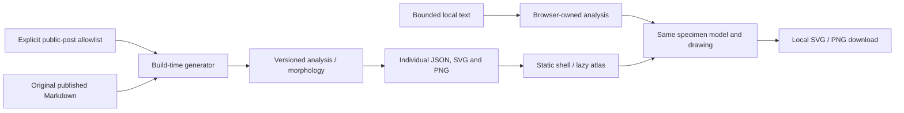

# The Anatomy of an Essay

See the [26 October 2026 verification record](anatomy-of-an-essay-verification.md)
for the tested source boundaries, browser flows, exports and capture coverage.

The feature is an ordinary mdsvex Visualizations article at
`/blog/visualizations/anatomy-of-an-essay`. Its explicit lazy Svelte shell keeps
the analysis and renderer out of other articles. The article retains the site's
metadata, gallery, search, RSS and sitemap mechanisms.

## Source of truth and data flow

`src/lib/visualizations/anatomy-of-an-essay/allowlist.ts` explicitly opts three
published repository articles into the atlas. The source Markdown remains
unchanged. `scripts/generate-essay-anatomy.ts` uses the existing strict YAML
front-matter reader and category slugger. It requires `published: true`, a real
publication date no later than the generator's Asia/Kolkata calendar day, and a
title/category. `--as-of YYYY-MM-DD` supplies an explicit reproducible cutoff.

The generator reads source and implementation text with canonical LF line
endings before hashing or analysis. This keeps Windows CRLF checkouts and CI LF
checkouts consistent. Generated paragraph source offsets address this supplied
LF-normalized source, not the original file's CRLF byte positions.

The generator calls the same pure `analyzeEssay` model and `renderPortrait`
renderer as the feature. Its output consists of:

- An individual model JSON in `static/essay-anatomy/` for each allowlisted post.
- An SVG portrait in `static/images/visualizations/anatomy-of-an-essay/portraits/`.
- A small typed catalog in the feature's `generated/catalog.ts`.
- One default model in `generated/default.json`.
- A default SVG/PNG poster and a 1200 × 630 social PNG.
- A manifest with SHA-256 canonical source/engine/vector/model hashes and the
  model's content hash/version information, plus PNG input-SVG/pixel provenance.

The catalog contains source identity, source route, labels, model/portrait paths
and aggregate measurements. Selecting another specimen fetches its individual
JSON; the initial client module does not import every source article. The
server-rendered shell provides a labelled static portrait and explanatory copy.

## Analysis and meaning

Paragraph chambers, sentence ribs, estimated nesting branches, repeated-word
clusters, explicit-reference struts and long-sentence coils all derive from one
versioned document. Reading-order structure is distinct from citation support.
Every selectable structure resolves to a source paragraph/sentence identity.

Sentence offsets address displayed paragraph text. Paragraph source spans
address the original supplied Markdown or plain text. The parser excludes
front matter, executable/import/component content and code from prose; headings
remain associated with their following paragraphs. Lists and quotations retain
their block kind. Plain-text mode treats pasted markup as text, with Svelte
escaping it during display.

The parser is a deliberately bounded prose subset. It recognizes paragraph
boundaries, ATX/Setext headings, ordinary blockquotes/list items, fenced and
indented code, balanced inline links/emphasis, common HTML entities, and the
explicit reference forms below. It excludes HTML/component blocks rather than
executing or extracting their rendered children. It does not expand embedded
notebooks, arbitrary Svelte expressions, GFM tables or other mdsvex plugins.
Choose ordinary prose sources for this atlas; a rendered page and its analysed
Markdown subset need not have identical text. Unclosed fences/component blocks
are excluded and produce warnings instead of being guessed into prose.

Word counts, punctuation sequences and recurrence are measurements. Branching
uses a documented estimate, not a complete syntactic parse. Unsupported
language-dependent estimates are unavailable. The portrait makes no claim about
literary quality, factual accuracy, personality or biological health.

Words are Unicode letter/number runs with internal apostrophes or hyphens.
Displayed link labels count; link destinations, bare URLs and inline code do
not. The model's English nesting estimate adds maximum bracket depth, one for
any supported subordinate connective, and another when three or more appear,
capped at six. Bengali/mixed-language text retains counts, punctuation and
recurrence while this estimate is unavailable.

The vessel drawing compresses this estimate to at most four branches per
sentence. The inspector retains the model's exact estimated value up to six;
the visual cap is distinct from the analysis cap.

Recurrence uses exact normalized, case-folded tokens of at least three letters
after English/Bengali stop-word filtering. The eight most frequent clusters
are displayed, with code-point tie ordering; their actual occurrence lists
remain in the model. Explicit footnotes with definitions and reference-style
links identified by a `cite:` or `ref:` prefix create citation struts. Long
sentences contain more than 45 words in every specimen.

Geometry uses shared bounded scales: body height follows
`180 + sqrt(words) * 5.4 + log2(paragraphs + 1) * 15`, clamped to 195–554 SVG
units. Organ horizontal radius follows `10 + sqrt(paragraphWords) * 6.2`,
clamped to 17–102; vertical radius is bounded by reading-order spacing.
Sentence rib reach follows `10 + sqrt(sentenceWords) * 9`, clamped to 17–120.
These compressions preserve an inspectable drawing rather than exact physical
area proportionality. Comparison shares the same scales and thresholds by
default; normalized shape comparison is explicitly selected.

The SVG budget is 96 paragraph chambers, 480 sentence ribs, 24 coils, 24
citation struts and at most three drawn connections per displayed word cluster.
The renderer reports omitted structure counts; the document model and text
index retain the complete bounded input. See `ANALYSIS_RULES`, `buildSpecimen`
and the feature methodology for the implemented rules.

## Browser ownership and privacy

The browser owns selected specimen, source selection, comparison, layers,
motion, dissection and pasted text. Pasted text has a 60,000 UTF-16-code-unit
limit, with additional caps of 2,000 paragraphs and 6,000 sentences. It is
analysed locally and is not sent to an endpoint, encoded in URLs,
logged to analytics, or automatically persisted. Replacing input discards the
previous local specimen. SVG exports escape text and use self-contained art.

The specimen SVG carries source identity and interaction hit targets. Optional
motion does not determine geometry. Offscreen/hidden/reduced-motion states
suspend animation; lifecycle teardown releases listeners, observers, frames and
download object URLs. Mobile uses one deliberate reading surface and an
expandable specimen rather than independent nested scrolling columns.

## Generation and incremental checks

Run `npm run essay-anatomy:generate` after editing allowlisted prose or the model.
The generator reuses a cached model/portrait only when the complete source and
feature-engine signature match and the cached bytes match their recorded
SHA-256. It writes files only when their bytes change.

Run `npm run essay-anatomy:assets:check` for a read-only regeneration comparison.
This independently recalculates models and SVGs and compares their actual
expected bytes. For PNGs it verifies the expected input-SVG hash, dimensions,
and committed decoded RGBA pixel hash. A stale model/vector hash alone cannot
make the check pass; PNG provenance must also agree with the newly generated
vector input and actual decoded image.
Unexpected generated JSON/SVG files in the dedicated model/portrait directories,
JSON/SVG/PNG files in the publication-art directory, or JSON/TypeScript files in
the generated catalog directory fail with their paths. After reviewing an
allowlist removal, `--write --prune` removes only the enumerated stale regular
files in those fixed generated directories.

The write cache is an optimization, not the publication check's authority.
Check mode ignores model/vector caches and recomputes their expected outputs
from current public sources. Write mode treats an invalid cache envelope, invalid
cached JSON, mismatched source identity/hash, or wrong managed filenames as a
cache miss. The read-only check remains necessary before publication.

The generator deliberately avoids timestamps in emitted assets. Its manifest
tracks the canonical source recipe, schema/analysis/morphology versions and
source hash. SVG/PNG output comes from the actual model renderer rather than
a separately drawn marketing image.

SVG geometry/text and models are deterministic across line-ending conventions.
PNG typography is rasterized by Sharp/librsvg using the generator host's serif
and monospace fonts, so its bytes are not claimed to reproduce across operating
systems. A PNG receipt records its exact SVG input, dimensions, decoded-pixel
hash and creation rasterizer/OS. Check mode validates that committed artifact
without re-rasterizing system fonts. Lossless PNG container optimization is
accepted when decoded pixels and dimensions stay unchanged. Write mode reuses
a valid raster for the same expected SVG; a changed SVG rebuilds it. Use
`--write --rerender` to explicitly capture a fresh raster on the current host.

## Extending automatic portraits

Add a source slug and specimen label to `allowlist.ts`, confirm the source is
published and its date is due, regenerate, inspect the model and portrait, and
run the focused checks. Keep canonical source identity and source rights intact.
The same generator can become an opt-in publishing stage in a later change.
Existing article thumbnails are not replaced, and private notes or arbitrary
pasted text never enter the build corpus.

## Verification

The focused unit tests cover source parsing, exact sentence ranges,
determinism, safe text handling, geometry and exports. Browser checks cover
reading/selection ownership, comparison, layer dissection, local paste,
keyboard navigation, reduced motion, mobile layout and downloaded files.
Use the local production preview with service workers blocked. Feature work
also uses `npm run check`, `npm run build:full`, and `git diff --check` under the
repository's architecture and verification gate.
