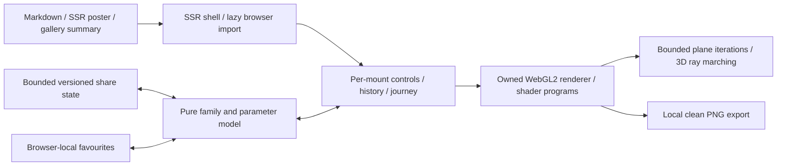

# Fractal Trip

Fractal Trip is an immersive browser-local explorer at
`/blog/visualizations/fractal-trip`. The ordinary Markdown article owns its
publication metadata and explanatory prose. The existing generic article route
supplies category discovery, search, RSS, sitemap, canonical and social metadata.
The visualization registry contains a lightweight summary and local poster path;
it does not import or start the graphics renderer.

## Ownership and data flow

- `src/lib/components/visualizations/fractal-trip/FractalTrip.svelte` is the
  server-rendered shell and lazy browser entry.
- `FractalTripApp.svelte` owns controls, gestures, spatial free-flight and
  orbit exploration, timeline scrubbing, continuous 3D tour playback, undo/redo,
  saved favourites, fullscreen and export interactions.
- `src/lib/visualizations/fractal-trip/model.ts` owns the versioned state,
  parameter bounds, family/palette definitions, four curated 3D scene presets,
  3D camera basis and distance-estimator clearance helpers, starting views, URL
  codec and numerical reference helpers.
- `journeys.ts` owns closed Catmull-Rom 3D spline paths with approximate
  arc-length parameterization and full-path frustum clearance validation for 3D
  scenes, plus bounded detail probing and smooth camera-path sampling for 2D
  families; it plans once when a trip starts rather than searching on every frame.
- `renderer.ts` owns the WebGL2 context, shader programs, framebuffer sizing,
  quality selection, paused-3D progressive refinement accumulation buffer, draw
  scheduling, capture and resource teardown.
- `shaders.ts` owns the plane-fractal and three-dimensional fractal shader sources.
- `src/lib/posts/fractal-trip.md` contains the explanation and component import.
- `static/images/visualizations/fractal-trip/poster.png` is the publication artwork,
  captured from the implemented renderer rather than external reference artwork.

The poster and all seven family thumbnails use PNG. The authoring capture script
records their dimensions and decoded pixel hashes in `assets.json`, together
with normalized source hashes for `model.ts`, `renderer.ts` and `shaders.ts`.
The `fractal-trip:assets:check` command verifies those records. PNG allows the
existing optimizer's lossless re-encoding to preserve pixel provenance; family
thumbnails are referenced as `<family>.png` by the interface.

This extends the existing dedicated visualization pattern. It introduces no
route exception, server rendering endpoint, runtime provider, credential or
shared mutable state framework. Graphics resources and visitor state belong to
one mounted experience. Existing site-wide measurement policy remains in place.

## Mathematical and visual contract

There are four curated three-dimensional scene presets stored as typed data in
`SCENES_3D` (`model.ts`), with `Copper Reef` serving as the default composition
on a fresh visit:

| Scene            | Formula configuration                                                           | Spatial composition and duration                                                   |
| ---------------- | ------------------------------------------------------------------------------- | ---------------------------------------------------------------------------------- |
| Copper Reef      | Power-8 Mandelbulb (`bulbJulia: false`), copper palette                         | Equatorial ridges, floral rosettes and deep cavities; 84-second closed spline loop |
| Folded Cathedral | Mandelbox (`foldScale: -1.75`, `foldLimit: 0.88`, `minRadius: 0.45`)            | Carved architectural vaults, buttresses and arches; 92-second closed spline loop   |
| Alien Garden     | Fixed 3D Julia (`power: 7`, `bulbJulia: true`, `seed: [-0.22,0.64,-0.26]`)      | Separated branching coral-like tendrils with parallax; 80-second closed loop       |
| Fractal Canyon   | High-scale Mandelbox (`foldScale: -2.18`, `foldLimit: 0.96`, `minRadius: 0.26`) | Stratified gorge walls, sheer folds and terraced chasms; 96-second closed loop     |

And there are seven underlying family choices:

| Family       | Equation controls                                                  | Rendering meaning                                                          |
| ------------ | ------------------------------------------------------------------ | -------------------------------------------------------------------------- |
| Mandelbrot   | Integer power; higher powers are labelled Multibrot                | Pixels choose the parameter, with the orbit starting at zero.              |
| Julia        | Integer power and complex seed                                     | Pixels choose the initial value; the seed remains fixed across the image.  |
| Burning Ship | Integer power                                                      | Absolute real and imaginary components are taken before the power.         |
| Tricorn      | Integer power; higher powers are Multicorn variants                | Complex conjugation precedes the power.                                    |
| Newton       | Three to six editable roots and relaxation                         | Colour records root convergence, with finite-budget unresolved cases.      |
| Mandelbulb   | Integer spherical power, optional fixed three-component Julia seed | A three-dimensional iterative field is rendered using distance estimation. |
| Mandelbox    | Negative scale, box-fold limit and inner sphere-fold radius        | Box/sphere folds and scaling produce a three-dimensional iterative field.  |

The model accepts finite, clamped values rather than executable equations. Julia
seed components and Newton root coordinates are bounded to ±2. Newton relaxation
is bounded to 0.25–1.5. The Mandelbox exposes negative scale from −2.5 to −1.2,
box-fold size from 0.5 to 1.5, and inner sphere-fold radius from 0.2 to 0.8; its
outer radius remains one. These constrained artistic controls are not a claim
that all possible fractal formula parameters are supported.

Colour, relief, roughness, glow and lighting are presentation controls, distinct
from the recurrence parameters. Relief in a plane view is raised-looking shading
derived from a calculated field. It does not convert the Mandelbrot set into a
three-dimensional mathematical object. Mandelbulb and Mandelbox modes instead
sample three-dimensional fields along camera rays. Their material finish is
artistic shading, not a physical simulation of copper or thin-film optics.

The plane renderer uses finite GPU arithmetic and a bounded iteration count.
Coordinate resolution places a limit on zoom; a larger iteration budget cannot
recover coordinates that are no longer distinguishable. The runtime does not
activate Fractal Atlas's experimental perturbation renderer. Preserved state and
decimal digits are not evidence of arbitrary-precision rendered detail.

The distinction between escape-time and Newton convergence remains explicit.
Unescaped or unconverged finite-budget points are not proofs of set membership
or divergence. Near-zero Newton derivatives and invalid numerical results need
bounded handling, independent of colour presentation.

## State, interaction and lifecycle

One normalised version-one state describes the family, equation, surface,
palette, camera, quality and journey position. The `trip` URL query carries its
base64url JSON representation; the `fractal-trip` anchor identifies the app.
Encoded share input is limited to 8,192 characters before parsing, and unknown or
malformed values are normalised before reaching the renderer. Up to eight saved
views live under the `suvro-fractal-trip-favourites-v1` localStorage key; reading
that storage rejects inputs over 40,000 characters. Saved state passes through
the same model boundary. No user-controlled shader source, JavaScript or
expression evaluation is used.

The mounted UI owns view changes and playback. Manual view gestures pause a
journey. Plane zoom preserves the point under the pointer. Three-dimensional
scenes maintain independent camera position (`cameraPos`), orientation (`yaw`,
`pitch`, `roll`), field of view (`fov`) and mode (`free` or `orbit`). Legacy v1
shared links and saved views that omit `cameraPos` migrate automatically from
their orbit `yaw`, `pitch` and `distance`. Three-dimensional guided journeys
follow closed Catmull-Rom spline position and look-target paths reparameterized
by a 128-step cumulative arc-length table so camera speed stays steady without
sudden acceleration or roll singularities. Every 3D preset path is validated
against the CPU distance estimator (`checkCameraClearance`, `validateJourney3D`)
for camera clearance, near-plane footprint clearance and visible frustum depth
variation. Continuous tour mode advances across the four 3D scenes with a
controlled crossfade transition; manual free-look or WASD/Q/E/touch spatial
movement pauses the tour, enforces conservative step clearance, and surfaces a
`Return to tour` action.

Plane journeys use a bounded CPU probe of escape/convergence variation to choose
a useful focal view. The planner performs at most 398 probes of 180 iterations,
with finite-budget variation serving as a visual heuristic, not proof of set
membership. When a current view is empty or unhelpful, a broad intermediate view
leads towards a sampled region. Logarithmic zoom and cosine easing travel out
and back over a 96-second speed-adjusted cycle, preserving the starting view
without a jump. Optional Julia-seed motion is a bounded continuous parameter
change kept separate from camera travel. Undo and redo restore complete state
snapshots. Equation reset and view reset have separate meanings.

Native fullscreen is attempted from a user action, with an expanded view when
unavailable. On browsers exposing the Popover API, the fallback uses a manual
popover in the top layer so the blog's transformed article ancestor cannot trap
its fixed position. Expanded mode locks body scrolling and restores the previous
overflow value when it closes or unmounts. The Exit fullscreen control and Escape
close the fallback. Controls retain keyboard and numeric access; shortcuts must
not intercept text entry. Reduced motion begins with a still composition.
Hidden/offscreen work is suspended, and a paused unchanged scene does not need
a continuous rendering loop.

The renderer attempts its actual WebGL2 context and shader path. Unsupported
graphics or initialisation errors retain a readable poster and the explanatory
article. GPU resources are rebuilt after a recoverable context loss. Teardown
releases owned listeners, observers, animation frames and graphics objects.
Image export stays local, is bounded, and restores the live drawing dimensions.

## Rendering budgets

The renderer compiles separate plane and spatial programs, loading the spatial
program only when a three-dimensional family is selected. Quality profiles bound
both pixel work and calculation depth:

| Profile  | Plane pixels | Spatial pixels | Plane iterations | Spatial iterations | Ray steps | AO samples | Shadow steps | Paused 3D samples |
| -------- | -----------: | -------------: | ---------------: | -----------------: | --------: | ---------: | -----------: | ----------------: |
| Saver    |      450,000 |        240,000 |              160 |                 13 |        72 |          2 |            0 |                 4 |
| Balanced |    1,000,000 |        520,000 |              320 |                 15 |        96 |          4 |            8 |                 6 |
| High     |    2,000,000 |        920,000 |              512 |                 18 |       128 |          5 |           14 |                 8 |

Direct manipulation reduces the plane iteration budget to 80% and the pixel
budget to 72%, followed by a settled redraw. After 220 milliseconds without an
update, a plane view can draw once at up to 1.35 times its moving linear
resolution for cleaner downsampling, bounded to three million pixels and the
precision-safe coordinate grid. When a three-dimensional scene is paused, the
renderer checks framebuffer/texture copy capability (`ensureAccumulationBuffer`
with an `RGB8` accumulation texture verified against `gl.getError()` on the
first copy) and accumulates up to 4, 6 or 8 Halton(2,3) sub-pixel jittered
samples before stopping draw scheduling. Any camera, equation, material,
lighting or viewport change resets the sample counter immediately so moving
frames never leave trails. Newton uses at most 96 steps. Auto quality reduces
pixel work after sustained slow frame intervals (>33 ms over 1.2 s) and scales
back up after sustained fast intervals (<19 ms over 2.4 s) with a 5-second
cooldown; touch/constrained devices begin with Saver. These limits describe the
implementation, not certified frame rates on arbitrary devices.

The precision floor accounts for coordinate magnitude and actual framebuffer
height. Export near that floor samples at a precision-safe resolution before
upscaling the existing detail, rather than claiming additional distinguishable
coordinates. PNG export is limited to 2,048 pixels per side and three million
pixels overall. The ordinary interface uses a 1,600-pixel longest edge and preserves
the current viewport aspect ratio, including portrait views.

## Verification boundary

Feature verification must check mathematical reference cases, finite/clamped
state, malformed links, round trips, pointer-centred zoom, all family presets,
parameter extremes, actual image export, fullscreen fallback, mobile layout,
keyboard access, reduced motion, hidden/offscreen suspension and context-loss
recovery. Inspect representative real rendered images; passing a shader compile
alone does not establish a useful or attractive scene.

Use focused model/browser tests and a production preview, followed by the
repository's type/lint checks and full visualization build lane. The canonical
architecture and implementation must remain aligned. Record exact executed
checks and measured browser/device results in the implementation handoff; this
document does not imply that every graphics driver or parameter combination has
been tested.

The repository's forensic audit records absent `security:audit` and
`security:smoke` commands. This feature does not introduce a network endpoint,
and those missing commands must not be reported as safeguards that passed.

## Verification on 4–5 November 2026

The final stable production feature preview at `http://127.0.0.1:4349` passed all
eleven cases in `tests/browser/fractal-trip.spec.ts` using native headless
Google Chrome 156.0.8078.80 on the Windows development host (`ANGLE (Intel,
Intel(R) Iris(R) Xe Graphics (0x000046A6) Direct3D11 vs_5_0 ps_5_0, D3D11)`).
Service workers were blocked. The suite used a 1440 × 1050 desktop viewport and
a 390 × 844 responsive viewport; the latter is desktop-browser layout coverage,
not a physical-phone or physical Android-tablet test.

The suite verifies actual rendered colour variation for all seven families and
all four curated 3D scenes (`Copper Reef`, `Folded Cathedral`, `Alien Garden`
and `Fractal Canyon`), timeline scrubbing across 3D spline paths, free-flight
exploration with `Return to tour`, equation edits changing pixels and shared
state, undo/redo, distinct equation and view resets, exact custom-state and
legacy v1 orbit-state restoration, invalid and oversized share input, local
saved-view persistence/deletion, clean PNG contents and dimensions (including
portrait PNG export at 1,600 pixels longest edge), forced WebGL context
loss/restoration, reduced motion, paused progressive-refinement convergence and
offscreen drawing suspension, native fullscreen, rejected-fullscreen fallback,
Escape from a focused control, and the readable disabled-WebGL fallback.

A separate headless Firefox check confirmed visible artwork across all seven
families and all four curated 3D scenes.

The model and journey suites passed all 27 unit tests (`model.test.ts` and
`journeys.test.ts`), including full-path and near-plane frustum clearance
validation (`validateJourney3D`) for all four 3D scene spline loops. The focused
Svelte/TypeScript check (`npm run fractal-trip:check`) completed with zero
errors and zero warnings, and `npm run fractal-trip:assets:check` verified the
actual-renderer `poster.png` and seven `<family>.png` thumbnails.

Active journey playback on the same Windows Intel Iris Xe host measured steady
~90 Hz animation-callback cadence (`11.1 ms` median, `11.4–11.5 ms` p95 over 180
active frames after warmup) across `Copper Reef`, `Folded Cathedral`,
`Alien Garden` and `Fractal Canyon` at `1036 × 501` (Balanced) and `1378 × 667`
(High), as well as `358 × 500` in the `390 × 844` touch-Saver viewport. Physical
RTX 3090 desktop and physical Android tablet hardware were not attached to this
host and remain unverified directly.
