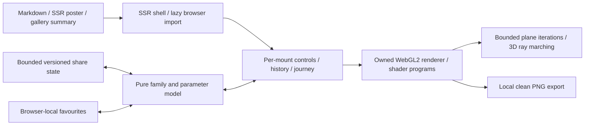

# Fractal Trip

Fractal Trip is an immersive browser-local explorer at
`/blog/visualizations/fractal-trip`. The ordinary Markdown article owns its
publication metadata and explanatory prose. The existing generic article route
supplies category discovery, search, RSS, sitemap, canonical and social metadata.
The visualization registry contains a lightweight summary and local poster path;
it does not import or start the graphics renderer.

## Ownership and data flow

- `src/lib/components/visualizations/fractal-trip/FractalTrip.svelte` is the
  server-rendered shell and lazy browser entry.
- `FractalTripApp.svelte` owns controls, gestures, journey playback,
  undo/redo, saved favourites, fullscreen and export interactions.
- `src/lib/visualizations/fractal-trip/model.ts` owns the versioned state,
  parameter bounds, family/palette definitions, starting views, URL codec and
  numerical reference helpers.
- `journeys.ts` owns bounded detail probing and smooth camera-path sampling;
  it plans once when a trip starts rather than searching on every frame.
- `renderer.ts` owns the WebGL2 context, shader programs, framebuffer sizing,
  quality selection, draw scheduling, capture and resource teardown.
- `shaders.ts` owns the plane-fractal and three-dimensional fractal shader sources.
- `src/lib/posts/fractal-trip.md` contains the explanation and component import.
- `static/images/visualizations/fractal-trip/poster.png` is the publication artwork,
  captured from the implemented renderer rather than external reference artwork.

The poster and all seven family thumbnails use PNG. The authoring capture script
records their dimensions and decoded pixel hashes in `assets.json`, together
with normalized source hashes for `model.ts`, `renderer.ts` and `shaders.ts`.
The `fractal-trip:assets:check` command verifies those records. PNG allows the
existing optimizer's lossless re-encoding to preserve pixel provenance; family
thumbnails are referenced as `<family>.png` by the interface.

This extends the existing dedicated visualization pattern. It introduces no
route exception, server rendering endpoint, runtime provider, credential or
shared mutable state framework. Graphics resources and visitor state belong to
one mounted experience. Existing site-wide measurement policy remains in place.

## Mathematical and visual contract

There are seven family choices:

| Family       | Equation controls                                                  | Rendering meaning                                                          |
| ------------ | ------------------------------------------------------------------ | -------------------------------------------------------------------------- |
| Mandelbrot   | Integer power; higher powers are labelled Multibrot                | Pixels choose the parameter, with the orbit starting at zero.              |
| Julia        | Integer power and complex seed                                     | Pixels choose the initial value; the seed remains fixed across the image.  |
| Burning Ship | Integer power                                                      | Absolute real and imaginary components are taken before the power.         |
| Tricorn      | Integer power; higher powers are Multicorn variants                | Complex conjugation precedes the power.                                    |
| Newton       | Three to six editable roots and relaxation                         | Colour records root convergence, with finite-budget unresolved cases.      |
| Mandelbulb   | Integer spherical power, optional fixed three-component Julia seed | A three-dimensional iterative field is rendered using distance estimation. |
| Mandelbox    | Negative scale, box-fold limit and inner sphere-fold radius        | Box/sphere folds and scaling produce a three-dimensional iterative field.  |

The model accepts finite, clamped values rather than executable equations. Julia
seed components and Newton root coordinates are bounded to ±2. Newton relaxation
is bounded to 0.25–1.5. The Mandelbox exposes negative scale from −2.5 to −1.2,
box-fold size from 0.5 to 1.5, and inner sphere-fold radius from 0.2 to 0.8; its
outer radius remains one. These constrained artistic controls are not a claim
that all possible fractal formula parameters are supported.

Colour, relief, roughness, glow and lighting are presentation controls, distinct
from the recurrence parameters. Relief in a plane view is raised-looking shading
derived from a calculated field. It does not convert the Mandelbrot set into a
three-dimensional mathematical object. Mandelbulb and Mandelbox modes instead
sample three-dimensional fields along camera rays. Their material finish is
artistic shading, not a physical simulation of copper or thin-film optics.

The plane renderer uses finite GPU arithmetic and a bounded iteration count.
Coordinate resolution places a limit on zoom; a larger iteration budget cannot
recover coordinates that are no longer distinguishable. The runtime does not
activate Fractal Atlas's experimental perturbation renderer. Preserved state and
decimal digits are not evidence of arbitrary-precision rendered detail.

The distinction between escape-time and Newton convergence remains explicit.
Unescaped or unconverged finite-budget points are not proofs of set membership
or divergence. Near-zero Newton derivatives and invalid numerical results need
bounded handling, independent of colour presentation.

## State, interaction and lifecycle

One normalised version-one state describes the family, equation, surface,
palette, camera, quality and journey position. The `trip` URL query carries its
base64url JSON representation; the `fractal-trip` anchor identifies the app.
Encoded share input is limited to 8,192 characters before parsing, and unknown or
malformed values are normalised before reaching the renderer. Up to eight saved
views live under the `suvro-fractal-trip-favourites-v1` localStorage key; reading
that storage rejects inputs over 40,000 characters. Saved state passes through
the same model boundary. No user-controlled shader source, JavaScript or
expression evaluation is used.

The mounted UI owns view changes and playback. Manual view gestures pause a
journey. Plane zoom preserves the point under the pointer; three-dimensional
controls orbit and approach within bounded camera settings. Plane journeys use a
bounded CPU probe of escape/convergence variation to choose a useful focal view.
The planner performs at most 398 probes of 180 iterations, with finite-budget
variation serving as a visual heuristic, not proof of set membership. When a
current view is empty or unhelpful, a broad intermediate view leads towards a
sampled region. Logarithmic zoom and cosine easing travel out and back over a
96-second speed-adjusted cycle, preserving the starting view without a jump.
Spatial journeys orbit and vary exterior camera distance; they are not an
autonomous interior collision-avoidance or tunnel-navigation system. Optional
Julia-seed motion is a bounded continuous parameter change. Undo and redo restore
complete state snapshots. Equation reset and view reset have separate meanings.

Native fullscreen is attempted from a user action, with an expanded view when
unavailable. On browsers exposing the Popover API, the fallback uses a manual
popover in the top layer so the blog's transformed article ancestor cannot trap
its fixed position. Expanded mode locks body scrolling and restores the previous
overflow value when it closes or unmounts. The Exit fullscreen control and Escape
close the fallback. Controls retain keyboard and numeric access; shortcuts must
not intercept text entry. Reduced motion begins with a still composition.
Hidden/offscreen work is suspended, and a paused unchanged scene does not need
a continuous rendering loop.

The renderer attempts its actual WebGL2 context and shader path. Unsupported
graphics or initialisation errors retain a readable poster and the explanatory
article. GPU resources are rebuilt after a recoverable context loss. Teardown
releases owned listeners, observers, animation frames and graphics objects.
Image export stays local, is bounded, and restores the live drawing dimensions.

## Rendering budgets

The renderer compiles separate plane and spatial programs, loading the spatial
program only when a three-dimensional family is selected. Quality profiles bound
both pixel work and calculation depth:

| Profile  | Plane pixels | Spatial pixels | Plane iterations | Ray steps |
| -------- | -----------: | -------------: | ---------------: | --------: |
| Saver    |      450,000 |        220,000 |              160 |        64 |
| Balanced |    1,000,000 |        500,000 |              320 |        88 |
| High     |    2,000,000 |        900,000 |              512 |       112 |

Direct manipulation reduces the plane iteration budget to 80% and the pixel
budget to 72%, followed by a settled redraw. After 220 milliseconds without an
update, a plane view can draw once at up to 1.35 times its moving linear
resolution for cleaner downsampling, bounded to three million pixels and the
precision-safe coordinate grid. This refinement does not create a continuous
idle loop. Newton uses at most 96 steps;
spatial distance estimates use at most 12 fractal iterations. High quality adds
a bounded shadow calculation. Auto quality reduces pixel work after sustained
slow frame intervals and applies a cooldown; touch/constrained devices begin
with Saver. These limits describe the implementation, not certified frame rates
on arbitrary devices.

The precision floor accounts for coordinate magnitude and actual framebuffer
height. Export near that floor samples at a precision-safe resolution before
upscaling the existing detail, rather than claiming additional distinguishable
coordinates. PNG export is limited to 2,048 pixels per side and three million
pixels overall. The ordinary interface uses a 1,600-pixel longest edge and preserves
the current viewport aspect ratio, including portrait views.

## Verification boundary

Feature verification must check mathematical reference cases, finite/clamped
state, malformed links, round trips, pointer-centred zoom, all family presets,
parameter extremes, actual image export, fullscreen fallback, mobile layout,
keyboard access, reduced motion, hidden/offscreen suspension and context-loss
recovery. Inspect representative real rendered images; passing a shader compile
alone does not establish a useful or attractive scene.

Use focused model/browser tests and a production preview, followed by the
repository's type/lint checks and full visualization build lane. The canonical
architecture and implementation must remain aligned. Record exact executed
checks and measured browser/device results in the implementation handoff; this
document does not imply that every graphics driver or parameter combination has
been tested.

The repository's forensic audit records absent `security:audit` and
`security:smoke` commands. This feature does not introduce a network endpoint,
and those missing commands must not be reported as safeguards that passed.

## Verification on 4 November 2026

The final stable production feature preview at `http://127.0.0.1:4349` passed all
ten cases in `tests/browser/fractal-trip.spec.ts` in 42.5 seconds, using native headless
Google Chrome 156.0.8078.80 on the Windows development host. Service workers were
blocked. The suite used a 1440 × 1050 desktop viewport and a 390 × 844 responsive
viewport; the latter is desktop-browser layout coverage, not a physical-phone
test.

Higher-power Mandelbrot/Tricorn view reset retains the equation and returns to a
detailed whole-set view. Portrait PNG export preserves the displayed aspect
ratio with its longest edge at 1,600 pixels, checked in an 800 × 1200 expanded
desktop viewport through the visible Save image action. The fullscreen fallback
case adds a translated ancestor to reproduce the blog layout's containing-block
behaviour: the top-layer view still fills the viewport at x=0, y=0, Escape works
from a focused control, and closing restores the previous body overflow value.

The suite verifies actual rendered colour variation for all seven families,
equation edits changing pixels and shared state, undo/redo, distinct equation and
view resets, exact custom-state restoration, invalid and oversized share input,
local saved-view persistence/deletion, clean PNG contents and dimensions, forced
WebGL context loss/restoration, reduced motion, paused/offscreen drawing
suspension, native fullscreen, rejected-fullscreen fallback, Escape from a
focused control, and the readable disabled-WebGL fallback.

A separate Firefox 153 check confirmed visible artwork in all seven families,
parameter changes, shared state and fullscreen. The ten-case automated suite
above was run in Chrome; the Firefox check is additional targeted coverage.

A bounded check inside the complete production blog layout returned HTTP 200,
the correct canonical URL and readable article text. Mandelbrot and Mandelbulb
rendered without WebGL errors, changing the power updated the displayed equation,
and the fullscreen fallback filled the exact viewport. Desktop and mobile widths
matched their viewports without horizontal overflow. There were no feature
JavaScript or CSP errors; the local preview's unavailable Vercel Insights script
was the only unrelated console failure. All seven final PNG thumbnails also
loaded at 400 × 250 without missing-image responses, and their decoded pixel
hashes passed verification after the repository image optimiser ran.

Playwright WebKit 26.5 on this Windows host lost visible canvas compositing after
a late drawing-buffer resize. The same behaviour was reproduced with a minimal
red/blue clear-only canvas: a buffer sized before context creation remained
visible, while GPU pixel readback and exported images retained colour even when
the resized canvas was not composited. Preserving the drawing buffer, adding a
later animation frame and invalidating the layer did not resolve this host-port
behaviour. The production renderer was not changed for this failed workaround.
This is a recorded Windows Playwright WebKit limitation, not a passing WebKit
result or evidence that native Safari behaves identically. Native Safari and
physical mobile GPUs remain unverified.

The model and journey suites passed all 22 unit tests through the repository's
standard Vitest configuration. The focused Svelte/TypeScript check using
`tsconfig.fractal-trip.json` completed with zero errors and zero warnings.
Scoped ESLint checks passed for the new browser suite and configuration.

Repository-wide checks are distinct: `npm run check` reported 45 errors in the
existing `src/lib/components/games/sort-the-tray/SortTheTray.svelte` and
`tests/listening-room.spec.ts`, with no Fractal Trip errors. The global lint
command did not pass its existing formatting checks. These outcomes must not be
reported as a green repository-wide validation run. The full-site build and any
deployment result are recorded separately in the implementation handoff.

The renderer was also measured during active updates in a separate native
headless-Chrome harness on the same desktop host:

| Viewport and quality            | Family     | Frame interval median / p95 | GPU time median / p95 |
| ------------------------------- | ---------- | --------------------------: | --------------------: |
| 1440 × 620, Balanced            | Mandelbrot |              11.1 / 11.2 ms |        4.32 / 5.33 ms |
| 1440 × 620, Balanced            | Mandelbulb |              11.1 / 11.3 ms |        3.47 / 5.41 ms |
| 1440 × 620, Balanced            | Mandelbox  |              11.1 / 11.3 ms |       6.99 / 12.79 ms |
| 390 × 400 touch viewport, Saver | Mandelbrot |              11.1 / 11.3 ms |        2.14 / 3.04 ms |
| 390 × 400 touch viewport, Saver | Mandelbulb |              11.1 / 11.3 ms |        3.73 / 4.57 ms |
| 390 × 400 touch viewport, Saver | Mandelbox  |              11.1 / 11.3 ms |        3.54 / 4.44 ms |

Each case measured 216–227 frame intervals after a 600 ms warmup in a 3.1-second
active update run. GPU times came from `EXT_disjoint_timer_query_webgl2`, excluding
disjoint results. Desktop three-dimensional views used a 1077 × 463 drawing
buffer; the other buffers matched the listed viewports. The Mandelbox measurement
used camera distance 5.2, before its final default framing moved to 7.2. The
measurements used the copper palette. Frame intervals measure animation-callback
scheduling cadence, while GPU timings measure draw duration; neither alone proves
the rate of fully presented frames. The simulated touch viewport still ran on
the desktop GPU. These are bounded samples
of renderer work, not sustained mobile frame-rate guarantees or measurements of
the complete site loading process.
