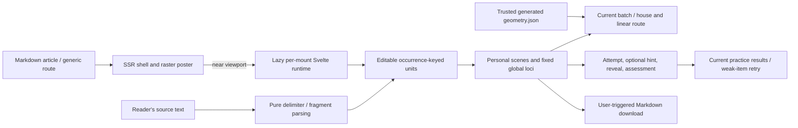

# A Place for Every Idea

The memory palace is a browser-local educational experience published through the
ordinary article at `/blog/visualizations/a-place-for-every-idea`. It teaches the
method of loci using a fixed route through an illustrated Calcutta house,
editable learning material and explicit recall attempts. It is not a semantic
analysis service, an assessment of general memory ability or a validated measure
of conceptual understanding.

## Publication and module boundaries

| Path                                                                   | Responsibility                                                                                                       |
| ---------------------------------------------------------------------- | -------------------------------------------------------------------------------------------------------------------- |
| `src/lib/posts/a-place-for-every-idea.md`                              | Editorial prose, metadata, worked-example tables, scholarly references and the explicit component import.            |
| `src/lib/components/visualizations/memory-palace/MemoryPalace.svelte`  | SSR shell and raster poster; intersection-triggered dynamic runtime import and load-failure explanation.             |
| `src/lib/components/visualizations/memory-palace/PalaceRuntime.svelte` | Per-mount source, reviewed units, scene editors, selected batch, stage, answer entry and practice state.             |
| `src/lib/components/visualizations/memory-palace/Palace.svelte`        | Dimensional house, fixed route, numbered HTML landmark controls, selected locus and scene marker presentation.       |
| `src/lib/components/visualizations/memory-palace/memory-palace.css`    | Scoped paper/ink visual system, responsive layout, controls and reduced-motion behaviour.                            |
| `src/lib/visualizations/memory-palace/model.ts`                        | Pure parsing, Unicode-aware word comparison, occurrence-keyed practice helpers, route constants and Markdown export. |
| `src/lib/visualizations/memory-palace/examples.ts`                     | Authored ten-word example and seven-card water-cycle example shared with the article.                                |
| `src/lib/visualizations/memory-palace/geometry.json`                   | Trusted committed SVG geometry and route/landmark coordinates.                                                       |
| `src/lib/visualizations/memory-palace/generate-geometry.mjs`           | Deterministic build-time house geometry authoring and equality check.                                                |
| `src/lib/visualizations/memory-palace/model.test.ts`                   | Parsing, comparison, occurrence identity, recall bookkeeping, export and example source assertions.                  |
| `scripts/render-memory-palace-assets.mjs`                              | Loopback publication capture and asset provenance checking.                                                          |
| `static/images/visualizations/memory-palace/`                          | Publication image and its associated capture evidence.                                                               |

The generic article route continues to own article SSR, canonical metadata,
discovery, navigation and editorial reading tools. The feature adds no route
entry, endpoint, database, provider credential or shared state store. Its gallery
entry is descriptive metadata rather than a dependency on the runtime.

`MemoryPalace.svelte` renders the publication poster as a static `` during
SSR; it does not eagerly import `Palace.svelte` or its roughly 579 KB SVG geometry
JSON into the article shell. On mount it observes the host with a 400-pixel
intersection margin and dynamically imports `PalaceRuntime.svelte` when the
reader approaches. That runtime owns the `Palace.svelte` import and interactive
SVG rendering. Teardown disconnects the observer and prevents a late import from
installing state on a disposed mount. Failure leaves a readable message, the
poster and the full article. With JavaScript disabled, the poster and article's
complete worked examples remain available.



## Source preparation and bounds

Word input supports commas, line breaks, whitespace and an explicit automatic
choice. Automatic selection prefers commas, then line breaks, then whitespace.
Comma and line-break modes preserve multiword phrases. Empty segments are
removed; repeated words are not deduplicated. Each occurrence has its own ID and
locus even when the text matches another occurrence.

Paragraph suggestions split at sentence punctuation and semicolons, retaining
trimmed source substrings. They are mechanical fragments, not inferred concepts.
For arbitrary input, the learner edits labels and meanings, preserves conditions
and negation, and records relationships in free text. Selecting a source passage
can append another unit. Source references remain visible during preparation.
Reordering, splitting, grouping and removal are explicit controls. Grouping
combines two adjacent units into one card with their internal text order retained;
it does not maintain two separately graded targets at one locus.

The whole input limit is 6,000 JavaScript string code units. There are at most 48
units, in four batches of 12. These are interface bounds, not psychological
capacity claims. The model rejects oversized or empty input rather than returning
a truncated list. Word/phrase targets, new split units and manually selected
passages are limited to 600 characters. An oversized word target or grouped
label is rejected without removing material. Long proposed concept labels are
shortened with an ellipsis while their complete source and meaning remain
available. Editable labels, meanings, conditions, scenes, personal explanations
and recall answers have additional bounded HTML fields. The interface reports
the whole-input and unit limits to the reader.

The authored water-cycle example is distinct from automatic fragmentation. Its
seven cards were manually constructed to preserve solar energy, the cooling
condition, cloud contents, particle growth, infiltration, surface runoff and the
return-flow branch. Infiltration and runoff are alternatives, not mandatory
successive stages. Rising arrows stand for invisible water vapour; visible clouds
contain droplets or ice crystals. The house is a retrieval structure, not a
physical simulation of hydrology.

## Route and batch semantics

The stable landmarks are gate, front steps, veranda, entrance table, armchair,
bookshelf, dining table, stove, staircase, landing, study desk and terrace. Units
receive consecutive global loci. A batch is `floor(locus / 12)` and its visible
house position is `locus % 12`. Reordering material deliberately changes its
addresses and requires another review.

Batches reuse the same illustrated house. They are separate practice sessions,
not additional visually distinct palaces or an assertion that interference has
been eliminated. The UI explains the reuse and recommends distinct familiar
places for important long-term sets. Starting practice from study selects the
current batch. The linear HTML landmark list supplies the same order as the SVG.

The scene editor records a learner-authored scene, why it cues the target, and a
small symbolic token choice. Arbitrary text receives a prompt, not a claim that
the software has intelligently generated an appropriate association. Every unit
needs a nonempty scene before study begins. The worked examples supply authored
scenes which can be edited.

## Practice and invalidation

The stages are preparation, scene building, route study, recall and review. A
confirmation checkbox gates departure from preparation. UI state belongs to the
runtime mount; `model.ts` contains no reader state or browser singleton.

Recall begins with the empty landmark. Source cards, target meanings and scene
details are absent from the active practice panel until requested. A scene hint
is explicitly assisted. Recording a word answer compares it against the target
for that occurrence and location, then reveals feedback. Comparison applies NFC
Unicode normalisation, trims and collapses whitespace, and ignores letter case.
Accents, punctuation and the remaining wording are significant. It does not
award a correct-position result merely because the answer belongs elsewhere.

For concepts, recording an attempt does not grade it. After revealing the meaning
and relationship, the reader chooses remembered, partly remembered or missed.
Those are self-assessments, not an automatic semantic score. Revealing before a
committed attempt cannot count as unassisted recall; neither can using a scene
hint. The practice record separately retains submitted, hinted and revealed
flags, the answer, and its result. The full article and worked examples remain
outside the active practice instrument, available for study.

Review displays each occurrence's address, target, answer, hint/reveal usage and
assessment. Retrying weak or skipped items keeps their original loci. Starting
another practice run creates a fresh attempt set for that selection; it is not a
persistent history of every run. Any source, unit, mapping, scene or association
edit clears previous runtime results. This intentionally invalidates the entire
current practice set rather than risking a stale score after related edits.

## Privacy, export and rendering trust

The feature sends no learning material to a network service. There is no feature
fetch, AI call, URL replay, local storage, IndexedDB, cookie or session restoration.
Reloading or navigating away loses the local exercise. Loading its static runtime
assets is separate from transmitting learner text. Existing site measurement
continues to follow the site's consent policy; raw learning material is not a
feature analytics payload.

The explicit start-over action clears source, units, associations and practice
state and returns the instrument to preparation. It does not delete a previously
downloaded study sheet from the user's filesystem.

Source, labels, scenes and answers render through Svelte text bindings. The only
raw SVG insertion is trusted repository-generated `geometry.art`; learner text
does not enter that string. The SVG is hidden from assistive technology, with
named HTML landmark controls and text panels carrying the meaning.

The explicit download creates a UTF-8 Markdown study sheet with batch, location,
target, meaning, source, scene, personal explanation and relationship. Export
escapes HTML and Markdown-sensitive characters, creates a temporary object URL,
clicks the download link and revokes the URL. The user decides where to retain the
download. It is a study sheet, not an importable session or a practice-history
backup.

## Evidence and verification

The article links directly to the ancient primary text, Wagner and colleagues'
method-of-loci experiment, Karpicke and Roediger's retrieval experiment, Cepeda and
colleagues' spacing experiment, Zeman and colleagues' imagery report, and the
USGS water-cycle guide. The teaching scenes and software limits are authored
choices rather than empirical results from those sources. No study is presented
as a validation of this web interface.

Focused commands are:

```sh
npm run memory-palace:test
npm run memory-palace:geometry
npm run memory-palace:browser:test
npm run memory-palace:assets:check
npm run check
npm run build:full
git diff --check
```

Browser verification and publication captures should use a loopback production
preview of the canonical article route. The browser suite must block service
workers so the verification does not install offline caches or warm unrelated
resources. Check a complete word and concept flow, duplicate occurrences,
material edits, hidden answers, hinted and revealed attempts, weak-item retry,
batch reuse, export, narrow screens, keyboard use and reduced motion.

Generate publication artwork with `npm run memory-palace:assets` against that
loopback preview. The image at
`static/images/visualizations/memory-palace/social.png` must be captured from the
implemented instrument. Retain the capture script's source/pixel provenance and
use the asset check to detect stale artwork after relevant UI, example or geometry
changes. A successful source check alone is not evidence of browser behaviour;
report the actual command results and any unavailable checks in the task handoff.

### Implementation verification, 22 October 2026

- The pure model suite passed all 13 tests. The publishing-workflow boundary suite
  passed all 15 tests.
- All 12 browser scenarios were verified against the compiled article at a
  loopback production preview. Eleven passed in the main run; the no-JavaScript
  scenario passed on its focused rerun after its `<noscript>` assertion was
  corrected to inspect delivered HTML. No feature code changed between those
  runs. The scenario also checked a loaded, visible raster poster, article route
  enumeration and the absence of the mounted runtime.
- Word and concept flows covered preparation, editing, scene construction,
  rehearsal, committed recall, hints, reveal, self-assessment, weak-item retry,
  original-locus batch reuse, export, source bounds and stale-result invalidation.
- Layout and keyboard checks passed at 1,440, 390 and 360 pixels. Four scoped Axe
  audits of the instrument in Study and Recall Hint at desktop and phone widths
  returned zero violations. Screenshots and the audit JSON are retained locally
  under ignored `artifacts/memory-palace/browser/`.
- Svelte checking reported zero errors and warnings. Targeted ESLint, formatting,
  deterministic geometry checks and the geometry depth audit passed. The house
  audit covered 320 solids with zero shape, depth or physical problems.
- `npm run build:full` passed, including feature assets, notebook verification,
  content, resources, contrast, SEO, media, links, search, production compilation
  and rendered discoverability. After the final browser capture, the incremental
  image and gallery generators, media validation and source/pixel provenance check
  passed for the 1,200 × 630 publication image.
