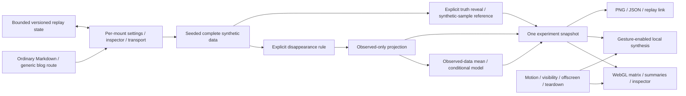

# The Music of Missing Data

This feature uses the ordinary published Visualizations article at
`/blog/visualizations/the-music-of-missing-data`. Its instrument is a browser-local
synthetic-data experiment. It introduces no endpoint, uploaded dataset, account,
provider credential or persistent reader profile.

## Boundaries and state ownership

| Path                                              | Responsibility                                                                                   |
| ------------------------------------------------- | ------------------------------------------------------------------------------------------------ |
| `src/lib/posts/the-music-of-missing-data.md`      | Article, metadata, worked fixture, primary methodological references and JavaScript-free poster. |
| `src/lib/components/visualizations/missing-data/` | Per-mount settings, transport, inspection, viewport lifecycle and lazy runtime boundary.         |
| `src/lib/visualizations/missing-data/model.ts`    | Pure seeded data, missingness, observed-only imputation, summaries and numerical contracts.      |
| `src/lib/visualizations/missing-data/state.ts`    | Bounded normalization and versioned URL replay parameters.                                       |
| `src/lib/visualizations/missing-data/colors.ts`   | Pure shared fixed-score normalization and palette, independent of WebGL and browser resources.   |
| `src/lib/visualizations/missing-data/renderer.ts` | Demand-driven raw WebGL matrix with fixed colour and provenance grammar.                         |
| `src/lib/visualizations/missing-data/audio.ts`    | Explicitly enabled, locally synthesised, per-instance Web Audio.                                 |
| `src/lib/visualizations/missing-data/export.ts`   | Current-state editorial PNG and machine-readable fingerprint JSON.                               |
| `static/images/visualizations/missing-data/`      | Publication artwork generated with the implemented model and fingerprint renderer.               |

The generic blog route supplies discoverability, search, RSS, sitemap and article
SEO. The visualization registry receives lightweight descriptive metadata only;
it does not import the renderer or sound engine. The article imports a small
Svelte shell; the interactive implementation loads through a dynamic import.
Its WebGL renderer has a separate dynamic import. The fallback preview, audio
and fingerprint exporter import only the pure palette helper from `colors.ts`,
so those paths do not pull the GPU renderer into the initial interactive chunk.

The component owns settings and presentation state per mount. The pure model
receives bounded, versioned inputs and returns one experiment snapshot. Matrix,
charts, readouts, sound events and exports consume that same snapshot. Display
ordering is a permutation; it cannot change numerical results or the missingness
mask. Complete synthetic truth is separate from the observed-data projection.
Imputation accepts only the latter and therefore cannot consult masked values.

## Scientific interpretation

For a given seed and matrix view, the complete synthetic dataset stays fixed when missingness settings, sorting,
imputation or inspection change. Data generation, missingness and predictive
draws use separate deterministic random streams. Stable latent missingness draws
make intensity changes reproducible rather than regenerating the world.

Multivariate cells are observation × variable. Longitudinal cells are
participant × visit for one synthetic measure. The displayed scale is stable
across scenario comparisons. A measured zero is a finite value, while absence
uses a separate mask/null representation.

The bounded datasets contain 96 observations × 16 numerical variables, labelled
Measure 01–16, or 96 participants × 24 visits, labelled Visit 01–24. Values use
synthetic score points. A fully observed baseline predictor sits outside the
matrix; a binary group indicator is derived from whether baseline exceeds zero.
The complete score dataset is correlated by construction, not a real cohort or
an empirical estimate of a population relationship.

With at most 2,304 cells and sixteen or twenty-four small regression fits, the
model runs synchronously. There is no Worker or asynchronous numerical-result
channel, and consequently no stale Worker result that can replace a newer
snapshot. Lazy renderer/audio imports have component-lifecycle guards.

The seven presets distinguish mechanisms from collection patterns:

| Preset                | Interpretation                                                                                                                                                                                               |
| --------------------- | ------------------------------------------------------------------------------------------------------------------------------------------------------------------------------------------------------------ |
| MCAR                  | Independent eligible-cell removal with no dependence on measured values.                                                                                                                                     |
| MAR                   | A logistic removal rule uses `strength × baseline`, with an intercept calibrated to the expected rate. Conditional on this observed baseline, it has no additional dependence on the hidden outcome.         |
| MNAR                  | A logistic rule uses `strength × (hidden score − 52) / 12`. The unseen target therefore influences its own disappearance.                                                                                    |
| Dropout               | Each participant has one monotone frontier determined by target intensity, `0.22 × strength × tanh(baseline)` and a fixed random row offset. This is MAR; sorting by dropout time changes presentation only. |
| Entire variables      | An independently seeded column order removes `round(rate × 16)` variables. This is MCAR by construction with clustered missingness; column granularity restricts achievable rates.                           |
| Instrument failure    | Four independent instrument-centre choices produce bounded per-participant outages with small length variation. First and final visits remain measured. This is MCAR by design with dependent gaps.          |
| Selective nonresponse | Whole rows are selected using `strength × (baseline + 0.6 × group)` plus logistic random noise. This is MAR because baseline and group remain observed outside the matrix.                                   |

The instrument reports actual counts/rates alongside requested intensity. Its
same-target comparison keeps the complete sample and analysis target fixed while
contrasting MCAR with a structured mask. Both scenarios request the same target
rate; their realised counts can differ. Whole-column loss restricts the exact
rates that can be attained.

A mask cannot establish MCAR, MAR or MNAR from observed values alone. The scenario
labels are known generative rules, not diagnoses extracted from a picture. See
the National Research Council's [incomplete-data chapter](https://www.nationalacademies.org/read/12955/chapter/6)
for the pattern/mechanism distinction and inference assumptions.

Available-data, imputed-data and complete synthetic-sample estimates have explicit
denominators. Undefined statistics remain undefined when too few observations
exist. One realised difference from the complete-sample estimate is labelled
estimation error; this feature does not estimate repeated-sampling bias.

## Completion and uncertainty

Leave-missing mode preserves the observed projection. Column mean imputation
fills estimable missing values with the observed column mean. This preserves the
available-data mean and reduces variation; it does not restore unseen values.
Its persistent provenance mark is accompanied by “uncertainty not estimated”.

Conditional predictive draws fit per-column ordinary least squares,
`score ~ intercept + baseline`, using measured outcomes only. At least three
observations are required. With residual standard deviation `s`, observed
predictor mean `x̄`, centred sum of squares `Sxx` and count `n`, the Normal
predictive draw has standard deviation
`s × sqrt(1 + 1/n + (x − x̄)²/Sxx)`. Residual variance uses `n − 2` degrees of
freedom, or `n − 1` for the degenerate-predictor intercept-only case. Halos encode
this predictive standard deviation in score points. This is a plug-in Normal
linear model, with homoscedastic residual assumptions; it does not integrate
uncertainty over every possible model or missingness mechanism. A separate
seeded draw stream provides alternative completions. A variable with no observed
outcomes is not estimable from these data and remains unfilled, as does a
predictive target with fewer than three observations. Original observations are
never changed by either imputer.

The bounded MNAR sensitivity setting adds between −2 and +2 fitted residual
standard deviations to missing outcomes in predictive mode, retaining the same
underlying draw and every observed value. Its purpose is to expose dependence of
the completed estimate on unobserved-data assumptions. The National Research
Council's [sensitivity-analysis chapter](https://www.nationalacademies.org/read/12955/chapter/7)
provides the methodological context. These are educational predictive draws;
there is no repeated-analysis pooling, so this is not presented as multiple
imputation inference. The [mice documentation](https://amices.org/mice/reference/mice.html)
describes that larger workflow.

The article's verified fixture uses seed 1847, variables view, target rate 0.35,
strength 2 and column 0 (Measure 01). Both MCAR and MNAR remove 528/1,536 cells,
an achieved 34.375%. The complete Measure 01 mean is 49.948372639451094, n=96.
MCAR retains 79 measurements with mean 50.650214731321604; MNAR retains 74 with
mean 45.81084744208546. Rounded one-sample errors are +0.702 and −4.138 points.
Mean filling leaves each available mean unchanged. Predictive draw index 0 at
zero sensitivity produces completed means 50.41272034102839 and
48.70929425424169 respectively. These are implementation fixtures, not a claim
of population performance or optimal imputation.

## Rendering, sound and exports

The raw WebGL renderer has no third-party runtime dependency and caps device
pixel ratio at 1.75. It renders changed states on demand, with animation only
while transport needs it. Raw values use the fixed colour transform
`(score − 50) / 12`; teal/ivory/coral correspond to 14/50/86 points. Values outside
the range are clipped for colour only, never for numerical analysis. The
labelled fallback preserves an observed-only matrix and useful summaries when
WebGL is unavailable or disabled using
`?webgl=off`. The server-rendered article and poster survive disabled JavaScript.

Sound begins only after an explicit action creates/resumes the feature's owned
Web Audio context. One displayed row is scanned at a time with at most eight
sampled columns. Column roles use a fixed pentatonic vocabulary, and measured
values change loudness using that same fixed normalization. Missing cells generate rests;
imputed cells are auditioned only when requested and use a distinct timbre.
Envelopes last 0.18 seconds with conservative gain. This bounds resources and
prevents per-row automatic loudness compensation; it does not certify a
universal speaker-output level.

Visibility, offscreen state and teardown suspend transport and sound. Teardown
releases owned listeners, observers, animation frames, WebGL resources, audio
nodes/context and generated download URLs. The site's Still setting and the
operating system's reduced-motion preference preserve stable explanatory marks.

The PNG fingerprint is an intentionally composed 1800 × 1300 editorial plate,
not an interface screenshot. The JSON contains versioned replay parameters,
counts, summaries, ordering and imputation assumptions. Both derive from the
current experiment snapshot. Share links encode bounded, validated synthetic
settings. The plate and report state that they describe the pattern without
establishing why measurements are missing. Fingerprints use the canonical article
URL `https://www.suvroghosh.in/blog/visualizations/the-music-of-missing-data`.

Publication artwork uses the shared fingerprint renderer with seed 1847,
dropout, time view, target 0.4, strength 2, dropout ordering, no imputation and no
truth reveal. This 96 × 24 fixture has 922/2,304 missing cells (40.0173611%) and
10 complete participants. `missing-data-social.png` is one 1200 × 630 dropout
plate, and `missing-data-poster.png` is its 1800 × 1300 full composition.
`missing-data-poster.json` records that same experiment.

Run `npm run missing-data:assets` to regenerate both PNGs and the report. It
requires Playwright Chrome (or `PLAYWRIGHT_CHANNEL`), and can run without a live
development server. It first tries a same-origin static document and direct
imports of the actual model/export modules at `http://127.0.0.1:4277`; override
that origin with `MISSING_DATA_BASE_URL`. If the origin is unavailable or does not
serve `/src` modules, esbuild bundles the same repository model/export sources
for execution in the capture browser. The manifest records whether capture used
`browser-source-module` or `bundled-browser-source`, alongside the model version,
settings, source hash and output metadata.

The verification-only command `npm run missing-data:assets:check` requires no
running site or browser. It checks source hashes, decoded-pixel SHA-256 values,
dimensions, and the report's seed and model version against `assets.json`.
Lossless PNG recompression can preserve the pixel hash; arbitrary pixel changes
or stale rendering sources fail.

Replay schema version 1 uses `mdv` and `md_` query parameters. Accepted bounds
are seed 1–2,147,483,647; missingness rate 0–0.90 in hundredth increments;
strength 0.25–4; predictive draw index 0–19; and sensitivity delta −2–2.
Enums and the explicit truth-reveal
boolean are validated. Overlong values are ignored; invalid numbers/enums and
unsupported versions fall back to bounded defaults. Dropout and instrument
outages enforce the time view; entire-variable loss enforces the variables view.
The UI labels draw indices 0–19 as draws 1–20. Sensitivity affects predictive
completions only in the MNAR scenario.

## Verification

On 21 October 2026, the 30 feature tests, 23 shared visualization tests, full
feature build, final production build, discoverability check, asset provenance
checks and ten production-browser tests passed. Svelte/TypeScript reported zero
errors and warnings. Scoped ESLint, Prettier and `git diff --check` passed. The
production-browser checks include JavaScript-disabled reading, real downloads,
scene replay, touch interaction, explicit native audio, automated WCAG A/AA
checks and actual WebGL context loss. The final title and contrast corrections
were rebuilt and verified on the production preview.

The [verification receipt](../../artifacts/missing-data/verification.json) and
adjacent `article-*` captures record the production evidence. The `harness-*`
captures are supplementary checks in an isolated component harness.

Implementation checks and browser evidence are recorded in the task handoff.
The feature's numerical fixtures cover deterministic replay, scenario
dependencies, monotone dropout, recovering outages, sorting invariance,
observed-only imputation and agreement between counts, views and exports.
Browser verification covers controls, responsive geometry, keyboard inspection,
sound activation, motion preferences, JavaScript-free reading, WebGL fallback
and downloads. These checks do not claim a full accessibility-conformance audit
or validate these educational models for analysing real datasets.

Architecture impact: yes

Architecture rationale: The canonical architecture and contribution gate were
reviewed. The feature adds a dedicated per-mount UI and a pure synthetic-data,
mask, observed-only imputation and export flow within the existing ordinary
article pattern. Section 6 of the canonical architecture describes those owners
and data boundaries. No shared state manager, route convention, endpoint,
provider or foundational rendering decision changes, so an additional ADR is
unnecessary.
