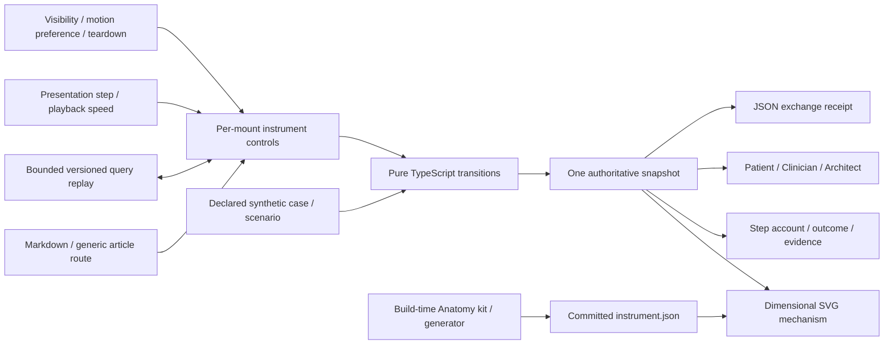

# The Patient Between the Systems

The OpenHIE exchange instrument is published through the ordinary Visualizations
article at `/blog/visualizations/the-patient-between-the-systems`. It teaches
selected health-information-exchange responsibilities through a dimensional
physical metaphor and a deterministic synthetic transaction model. It is not an
OpenHIE deployment, clinical application or protocol-conformance implementation.

## Publication and module boundaries

| Path                                                       | Responsibility                                                                                           |
| ---------------------------------------------------------- | -------------------------------------------------------------------------------------------------------- |
| `src/lib/posts/the-patient-between-the-systems.md`         | Editorial prose, metadata, primary architectural references and JavaScript-free publication image.       |
| `src/lib/components/visualizations/openhie/OpenHIE.svelte` | Per-mount interactive shell, explanatory lenses, selected scenario, playback and inspection.             |
| `src/lib/components/visualizations/openhie/`               | Feature-local presentation and dimensional SVG instrument.                                               |
| `src/lib/visualizations/openhie/types.ts`                  | Browser-safe scenario, component, event, identity, transaction and snapshot contracts.                   |
| `src/lib/visualizations/openhie/catalog.ts`                | Component responsibilities, six scenarios, declared gates and explicit assumptions.                      |
| `src/lib/visualizations/openhie/engine.ts`                 | Pure `compileRun` and settings normalization, source fixtures and immutable event/snapshot construction. |
| `src/lib/visualizations/openhie/replay.ts`                 | Bounded versioned query-string replay and the current-snapshot JSON exchange receipt.                    |
| `src/lib/visualizations/openhie/instrument.json`           | Committed, depth-sorted SVG geometry, assembly markers and supported carriage positions.                 |
| `src/lib/visualizations/openhie/`                          | Focused model and replay checks.                                                                         |
| `scripts/generate-openhie-instrument.mjs`                  | Deterministic Anatomy geometry generation, geometry audit and equality check.                            |
| `scripts/lib/openhie-anatomy/`                             | Unmodified build-time Anatomy kit/audit subset, MIT licence and attribution.                             |
| `scripts/render-openhie-assets.mjs`                        | Local-browser instrument capture and source/pixel provenance checks.                                     |
| `static/images/visualizations/openhie/`                    | Publication artwork captured from the implemented instrument.                                            |
| `docs/visualizations/openhie.md`                           | Model interpretation, metaphor mapping, architectural boundary and verification scope.                   |

The Markdown article explicitly imports the Svelte component. The generic blog
route remains responsible for SSR prose, article SEO, RSS, sitemap, search,
category archives and navigation. The visualization gallery receives lightweight
descriptive metadata rather than importing the model or interactive renderer.

Feature state is local to a component mount. The browser-local model owns domain
facts; presentation state chooses which facts to reveal. The implementation adds
no endpoint, database, provider credential or clinical integration. It does not
accept patient records or other uploaded healthcare data. There is no server
module singleton containing reader or transaction state.



## Architectural interpretation

OpenHIE is an architecture pattern and set of component/workflow specifications.
The official logical architecture is intentionally more general than a physical
deployment. The instrument presents one selected journey; it does not require
every request to visit every registry, or imply that each conceptual component
must correspond to one host, process or product.

The selected responsibilities follow the official [architecture
overview](https://guides.ohie.org/arch-spec/architecture-specification/overview-of-the-architecture):
identity, provider, facility, terminology, clinical information and controlled
exchange. The wider architecture also includes business domains outside this
instrument's bounded case, such as aggregate reporting, finance and logistics.

### Physical-metaphor contract

| Mechanism                          | Meaning                                                                                  | Limit of the analogy                                                                                                                      |
| ---------------------------------- | ---------------------------------------------------------------------------------------- | ----------------------------------------------------------------------------------------------------------------------------------------- |
| Identity indexing drum             | A static rotary index representing the Client Registry's identity responsibility.        | The drum does not dynamically align or perform matching. The active-service highlight and model text report the declared identity result. |
| Terminology reference wheel        | A static reference mechanism representing the governed code/mapping agreement.           | The wheel does not rotate to infer clinical equivalence or create a missing mapping. Model state supplies the outcome.                    |
| Shared-record archive              | The clinical subset, with zero, one or two document cards revealed from persisted state. | The drawers are static, and the cards count unique fixture events rather than representing an entire EHR or analytical warehouse.         |
| Interoperability routing turntable | A static dispatch mechanism representing orchestration, checks and routing.              | The turntable does not rotate or depict a mandatory tour through every registry.                                                          |
| Supported front-rail carrier       | Its position marks the current event's active component.                                 | This is a presentation marker, not a physical patient journey, packet trajectory, transport connection or elapsed-time measurement.       |

The generated part IDs `shr.record-1` and `shr.record-2` carry `recordIndex: 1`
and `recordIndex: 2`. `Instrument.svelte` reveals a card only when
`snapshot.persistedCount >= recordIndex`. The first rests on the archive lid;
the second rests wholly on the first. The visible zero/one/two-copy states thus
retain their supports. Retrieval leaves the cards present because a read does
not remove the shared events. Duplicate delivery leaves the unique-event count
unchanged. These model-driven copies complement the moving carrier and active
service highlighting.

Component names and exact event descriptions remain available in ordinary HTML.
The dimensional machine is explanatory artwork, not the only account of state.
Its visual finish is inspired by the [Anatomy
project](https://github.com/wheresryan22/anatomy); the healthcare interpretation
comes from OpenHIE's primary specifications. Real-world mechanical physics is
not a claim of the software-exchange model.

The 71-solid geometry is generated with an unmodified MIT-licensed subset of
Anatomy's authoring kit. `iso-kit.mjs`, `lathe.mjs`, `tube.mjs` and `audit.mjs`
live under `scripts/lib/openhie-anatomy/` with Ryan's copyright, licence and
provenance note. The frontend imports committed `instrument.json`; it imports no
Anatomy kit or audit implementation into the browser. Its raw SVG strings are
trusted repository output. Reader input and replay parameters are never
interpolated into that markup.

## Source of truth and scenario semantics

The model's patient is Asha, with distinct Clinic A, laboratory and Hospital B
local identifiers linked to `urn:example:synthetic:patient:asha`. A Clinic A
encounter and one laboratory result are the two clinical events. The result's
value is a string containing its synthetic value, unit and no-interpretation
notice; it is not a validated FHIR `Quantity` or a clinical reference range.
The target vocabulary is `https://example.org/openhie/teaching-codes` and its
mapping identity is explicitly fictional.

The model uses authored synthetic fixtures and deterministic transitions.
`compileRun(scenarioId, overrides)` constructs a complete run. The four settings
are actual booleans: `identityKnown`, `terminologyMapped`, `authorized` and
`serviceAvailable`. Normalization accepts booleans only and ignores malformed
values or unknown keys. A recursively frozen result contains its run identity,
settings, exchange events, snapshots and assumptions. The model reads no browser
global, randomness or wall clock.

Animation frames and playback speed cannot introduce domain events, change a
decision or manufacture a successful outcome. Selecting a perspective changes
the explanatory projection of the current snapshot; all three lenses retain the
same identifiers, events and outcome.

The six case distinctions are deliberately narrow:

| Case                                        | Required interpretation                                                                                                                                                                                                                                              |
| ------------------------------------------- | -------------------------------------------------------------------------------------------------------------------------------------------------------------------------------------------------------------------------------------------------------------------- |
| `success` — The ordinary journey            | Two unique clinical events are persisted and returned to Hospital B. This is not evidence of clinical use or improved care.                                                                                                                                          |
| `ambiguous` — Two possible people           | The Client Registry response leaves two candidates. The exchange identity stays null; no clinical event is persisted or returned. No probabilistic score or guessed merge is calculated.                                                                             |
| `terminology` — A code without an agreement | The encounter remains persisted, but the laboratory mapping is unavailable. The original lab event is retained locally and no lab event is appended. The blocked run does not reach Hospital B's query.                                                              |
| `denied` — The wrong permission             | The two clinical events remain persisted, while Hospital B receives no clinical payload. The IOL rejects its query before any clinical-query request reaches the SHR.                                                                                                |
| `outage` — The cupboard is unavailable      | The fixture fails before the encounter write commits: no shared event is persisted. The source original and durable key remain. In a real timeout the commit outcome may be unknown, requiring reconciliation; the fixture does not model every timeout as rollback. |
| `duplicate` — The same envelope, again      | Replaying the original lab source key recognises one duplicate; two unique events remain and are returned. This is an application assumption, not a general OpenHIE or exactly-once-delivery guarantee.                                                              |

These cases have no estimated frequencies. Their order, delays and outcomes are
authored teaching examples, not observed health-service performance. Changes to
scenario definitions require changes to model assertions, prose and any
publication capture whose visible state is affected. The recovery action changes
the relevant declared gate and recompiles the deterministic journey; it does not
resolve real identity evidence, approve a clinical mapping, grant operational
access or retry a network request.

The immutable snapshot retains `localEvents`, `sharedEvents` and
`returnedEvents` separately. Local existence is not shared persistence, and
shared persistence is not delivery to Hospital B. The authorised response is
selected from persisted records for the resolved exchange identity rather than
constructed as a second independent success payload. Requests and responses
carry a shared `requestId`; statuses distinguish sent, accepted, rejected,
persisted, returned, timed-out and deduplicated events.

The durable source record `id` is the demo's deduplication key. Reusing that key
does not append a second event. The model does not implement distributed races,
revisions under the same key, transactional storage or a general recovery
protocol.

### Evidence and record meaning

Keep local identifiers associated with their assigning authority. Patient
identity, facility identity and health-worker identity are separate concerns.
The registry result represents evidence for this selected workflow rather than
a timeless assertion about an institution or person.

A terminology mapping is contextual and version-sensitive. A syntactically
valid message, an existing code and a clinically usable interpretation are
separate propositions. An unavailable mapping remains unavailable.

Clinical event time, record issue/correction time and exchange receipt time
describe different events. A recently received fact need not describe a recent
clinical event. This small fixture retains a source `recordedAt` timestamp; it
does not implement a full specimen, issue, correction or delivery-time model.
Exchange trace entries are ordered model events, without measured latency.
Playback timing is a separate presentation quantity.
The model's simplified record/payload fragments illustrate fields and
references. These are generic exchange records without FHIR `resourceType`,
rather than FHIR resource representations. They do not establish a validated
profile, a live FHIR API, an IHE transaction or OpenHIE conformance.

## Replay links and exchange receipts

Replay uses the article's URL query string and an `#exchange` anchor. Version
`ohie_v=1` admits exactly one occurrence of each owned field:

| Query field              | Accepted value                                                           |
| ------------------------ | ------------------------------------------------------------------------ |
| `ohie_v`                 | `1`                                                                      |
| `ohie_s`                 | `success`, `ambiguous`, `terminology`, `denied`, `outage` or `duplicate` |
| `ohie_step`              | Canonical decimal integer 0–64, without leading zeroes                   |
| `ohie_identityKnown`     | `0` or `1`                                                               |
| `ohie_terminologyMapped` | `0` or `1`                                                               |
| `ohie_authorized`        | `0` or `1`                                                               |
| `ohie_serviceAvailable`  | `0` or `1`                                                               |

`decodeReplay` rejects an input string longer than 4,096 characters, missing or
duplicate owned fields, unsupported versions/scenarios, malformed flags and
unknown fields beginning with `ohie_`. Other page-query keys are ignored by the
decoder. A valid admitted event index beyond the selected run's end is clamped
to its terminal snapshot. `encodeReplay` emits canonical fields from a compiled
run. Replay reconstructs synthetic settings and a selected event; it does not
serialize a reader identity, patient upload, live credential or animation frame.
These are query parameters, so they are included in requests for the URL.

`exchangeReceipt(run, step)` exports version `1`, the model identity, scenario,
settings, bounded step, the same immutable `snapshot`, assumptions and primary
sources. The JSON download does not issue a new query or manufacture a new
outcome. Local, persisted and returned events retain their distinct arrays in
the exported snapshot. Neither the receipt nor the replay link certifies a
clinical record, a real exchange or protocol conformance.

## Security and privacy boundary

All displayed people, identifiers, observations, policy responses and service
responses are synthetic. A permission-denied event demonstrates a decision in a
fixture. It does not authenticate the reader or implement a production clinical
access-control, consent, audit, encryption or legal-compliance service. An event
trace is a local teaching record, not an operational security audit log.

No new server admission controls are needed because this feature introduces no
server operation. Existing application CSP, response headers, public discovery
and consent controls retain their ownership in the site shell. Adding a real
backend or accepting external healthcare data would cross this boundary and
require a separate architecture and security review.

## Reading, accessibility and lifecycle

The introductory paragraph, article, references and publication image remain
readable without JavaScript. Meaningful state, scenario names and outcome text
must remain available without interpreting colour or the SVG metaphor. The
Patient/Clinician/Architect projections supplement rather than replace the
authoritative event account.

Playback is a presentation convenience. Reduced motion must preserve manual
step inspection without requiring automatic movement. Component teardown owns
any interval, animation callback or browser event listener created by the
feature; hidden/offscreen playback must not become an unbounded background job.

The social image is a 1200 × 630 capture of the implemented instrument at
`static/images/visualizations/openhie/openhie-social.png`. It is not separately
generated illustrative evidence of a real deployment. Its alt text names the
mechanisms rather than asserting a measured health outcome.

`scripts/render-openhie-assets.mjs` captures the actual local article or a local
component preview. It rejects non-loopback hosts, blocks service workers,
requests reduced motion, selects the `success` scenario and seeks its terminal
snapshot. The captured `.ohie-capture` area is fitted into a 1200 × 630 PNG.
`assets.json` records the article/capture path, capture mode, scenario, step,
status, normalized source-file hashes and decoded-pixel SHA-256.

Its `--check` path requires no browser or running server. It verifies current
source identities, the PNG's format/dimensions, decoded pixels and declared
capture provenance. `openhie:assets:check` also regenerates the instrument in
memory and compares its JSON deterministically with the committed file.
Changing the model, runtime, styles, committed geometry, authoring kit or capture
script therefore requires regenerating the affected publication artwork.

## Verification scope

Focused model checks should establish deterministic transitions, consistent
lenses, correct blocked outcomes and duplicate-delivery record conservation.
Browser verification should inspect scenario selection, step controls,
presentation speed, keyboard use, mobile layout, reduced motion, JavaScript-free
reading and repeat mounting/navigation. Console and hydration errors are part
of that inspection.

The completed authoring audit reports 71 real recorded solids, five depth states,
1,193 measured overlaps and 241 ordering rules. It found no reported geometry
failures, including at the 61 sampled carrier travel positions. Standalone
geometry previews in both themes also passed the decorative-line check with
zero floating endpoints among 294 checked ends; 4× captures were visually
inspected. Those checks concern the drawing and its recorded shapes. They do not
establish healthcare validity, matching accuracy, clinical safety, protocol
conformance or the site's browser regression results.

The focused commands are:

```sh
npm run openhie:test
npm run openhie:browser:test
npm run openhie:instrument -- --audit
npm run openhie:instrument -- --check
npm run openhie:assets -- --base http://127.0.0.1:4284
npm run openhie:assets:check
npm run build:full
```

The assets command assumes a verified local article server at the given base.
It can receive `--page` for a local component preview. Browser regressions and
capture work belong on loopback with service workers blocked. This documentation
does not mark the browser suite as passed; the release handoff records its
actual result.

The relevant publishing lane is `npm run build:full`, because the change adds an
interactive feature and its publication assets. Repository static checks and
focused feature tests complement the build. The release handoff records which
checks actually ran and their results; this document does not treat intended
coverage as a passed test or an operational certification.

## Primary references

- [OpenHIE Architecture Specification](https://guides.ohie.org/arch-spec/architecture-specification)
- [Client Registry](https://guides.ohie.org/arch-spec/openhie-component-specifications-1/client-registry)
- [Interoperability Layer](https://guides.ohie.org/arch-spec/openhie-component-specifications-1/openhie-interoperability-layer-iol)
- [Terminology Service](https://guides.ohie.org/arch-spec/openhie-component-specifications-1/openhie-terminology-service-ts)
- [Shared Health Record](https://guides.ohie.org/arch-spec/openhie-component-specifications-1/openhie-shared-health-record-shr)
- [FHIR R4 Observation](https://hl7.org/fhir/R4/observation.html)
