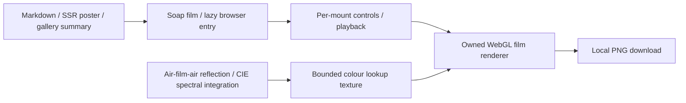

# Soap bubble

“Why Soap Bubbles Change Colour” is an ordinary interactive-first Markdown
article at `/blog/visualizations/why-soap-bubbles-change-colour`. The existing
generic article route owns metadata, category discovery, search, RSS, sitemap
and SEO. The gallery imports only a summary and a captured poster.

## Ownership and data flow

- `src/lib/posts/why-soap-bubbles-change-colour.md` owns the prose and metadata.
- `src/lib/components/visualizations/soap-film/SoapFilm.svelte` is the article
  component and browser entry point; feature-local Svelte UI owns the controls
  and per-mount runtime.
- `src/lib/visualizations/soap-film/optics.ts` owns the numerical reflection
  calculation and spectral colour lookup table.
- The browser renderer under `src/lib/visualizations/soap-film/` owns the WebGL
  programme, textures and rendering resources.
- `static/images/visualizations/soap-film/poster.png` is captured from the
  implemented film and provides the article/gallery/fallback artwork.



This extends the existing feature-owned numerical model and lazy browser UI
pattern. It adds no endpoint, credential, provider, persisted visitor state,
route exception or shared state framework. The renderer is not an API for other
visualizations.

## Optical contract

The optical model is a lossless locally planar layer with refractive indices
1 / 1.333 / 1, evaluated across the nearer wall of a spherical bubble.
Refraction obeys Snell’s law. Signed s- and p-polarised Fresnel amplitudes and
the film’s optical phase include repeated internal reflections; unpolarised
reflectance is their mean. There is no absorption or material dispersion.

Reflection is integrated from 380–780 nm at 5 nm intervals under the official
CIE D65 illuminant and CIE 1931 2° colour-matching functions. The normalisation
sets a perfect reflector’s Y to one. XYZ is converted to linear sRGB; colours
outside the representable gamut are compressed towards equal-luminance grey.
The numerical model does not use an arbitrary RGB rainbow palette.

The 1,025 × 257 lookup table spans 0–1,200 nm and 0–85°. Its RGBA8 representation
uses 1,053,700 bytes, with 1.171875 nm thickness steps and approximately 0.33203°
local-incidence steps.
RGB is sRGB-encoded before quantisation; ordinary linear texture filtering
interpolates those encoded values, which the renderer then decodes before linear
lighting. The focused off-grid test bounds the worst absolute linear-channel
difference from direct spectral integration below 0.01, including saturated-gamut
boundaries. The ordinary UI restricts thickness to 50–1,200 nm and the camera’s
orbit angle to 0–65°. Each pixel’s optical incidence is calculated separately
from the sphere normal; only the narrow final grazing rim clamps to the table’s
85° upper bound. That clamp affects approximately the outer 0.38% of the
projected radius and avoids poorly resolved spectral oscillations at more
extreme grazing angles with the 5 nm wavelength grid. Interpolation and texture
quantisation are rendering approximations, not new optical parameters.

The bubble has a fixed circular silhouette at every orbit angle. Front-hemisphere
normals supply each pixel’s local incidence; the viewing control orbits the
camera around a surface-anchored thickness field without flattening the sphere.
The flowing field is an authored animation. Its antipodal symmetry preserves
the slider value as the average over the whole spherical surface, not the
currently visible hemisphere. Even thickness retains radial interference
colours because local incidence varies across a curved surface. Its optical
pattern is invariant under orbit in uniform white illumination, while the
neutral studio highlights may change brightness.
The artwork uses a near-black `#020304` background. Fixed achromatic lighting
and an exposure multiplier of 8 brighten the optical reflection. A display-only
chroma extension of up to 1.65 increases saturation, bounded before any channel
becomes negative. Peak-based tone compression then limits brightness without
independently clipping linear colour channels. These presentation changes leave
the underlying spectral calculation intact but deliberately change its displayed
colourfulness; the output is not an exact prediction of perceived colour.
The experience does not simulate drainage, surface chemistry or film rupture,
and does not trace refraction through the bubble or reflection from its far wall.
The shape is spherical, but the optics are a nearest-wall approximation. Display colours
are illustrative, not a colour-based thickness measurement instrument.

Sources:

- Steven J. Byrnes, [Multilayer optical calculations](https://arxiv.org/abs/1603.02720).
- CIE, [1931 colour-matching functions, 2° observer](https://cie.co.at/datatable/cie-1931-colour-matching-functions-2-degree-observer), DOI `10.25039/CIE.DS.xvudnb9b`.
- CIE, [standard illuminant D65](https://cie.co.at/datatable/cie-standard-illuminant-d65), DOI `10.25039/CIE.DS.hjfjmt59`.
- Belcour and Barla, [A Practical Extension to Microfacet Theory for the Modeling of Varying Iridescence](https://belcour.github.io/blog/research/publication/2017/05/01/brdf-thin-film.html), graphics background.
- Paul Bakaus, [Radiant](https://github.com/pbakaus/radiant), visual inspiration.

The feature’s colour-data attribution records the CIE datasets’ CC BY-SA 4.0
terms and the sampled derivative. Inspiration credit does not imply that
Radiant’s stylised colour palette supplies this model.

## Interaction and lifecycle contract

Even thickness isolates thickness-dependent radial colour patterns. Flowing film
varies thickness spatially; its control is labelled as an average over the whole
bubble. The worked example starts at even 400 nm and asks the reader to move
towards 200 nm, then choose Flowing film and orbit to reveal other surface patches.
The circle stays round throughout. Pause, Reset and image export operate
on the current feature state.

Browser-only rendering is lazy, bounded in pixel density, suspended while
hidden/offscreen and released on unmount. The runtime resolves the site’s saved
`data-motion-preference` alongside the OS reduced-motion query, and observes
later preference-attribute changes. Still preferences start or switch the film
to paused; an explicit Play remains available. The `?motion=reduce` override
remains effective across preference updates. Switching to a less restrictive
preference does not automatically restart playback. Deliberate input can redraw
a paused frame. The preference observer and media-query listener are released
on teardown.

Native controls provide full keyboard and touch access without requiring a drag
gesture. On narrow screens, choosing Even thickness or Flowing film brings the
film back into view when it has been scrolled past, so the result is visible.
The article and static
poster remain readable without JavaScript or a usable WebGL context.

## Verification

Focused numerical checks cover reflectance bounds, zero-thickness cancellation,
constructive/destructive interference, angle symmetry and agreement between the
lookup table and the reference calculation:

```sh
npx vitest run src/lib/visualizations/soap-film --maxWorkers=2
npm run check
npm run build:full
```

Browser verification should inspect desktop/mobile layouts, a circular silhouette
preserved through camera orbit, even-thickness radial colour consistency, the worked example,
keyboard/touch input, reset, reduced motion, visibility suspension, context loss,
fallback rendering, navigation cleanup and the downloaded image. Use a loopback
preview and block service workers for ordinary browser verification. Performance
measurements describe the available browser and hardware; they do not establish
universal frame rates. The task handoff records executed checks and limitations.
