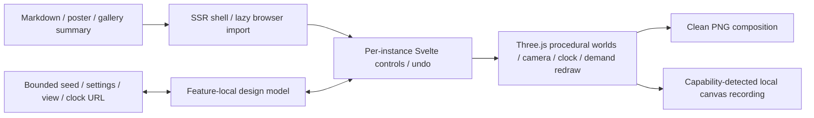

# Strange Matter

See the [verification record](strange-matter-verification.md) for browser evidence,
export dimensions and the tested environment.

Strange Matter is a browser generative-art app within the ordinary immersive
Visualizations article at `/blog/visualizations/strange-matter`. The article owns
publication metadata and explanatory prose; the existing generic route supplies
category discovery, search, RSS, sitemap and article SEO. The gallery imports a
lightweight summary and the captured poster.

## Ownership and data flow

- `src/lib/components/visualizations/strange-matter/StrangeMatter.svelte` is the
  server-rendered shell and lazy entry point.
- `StrangeMatterApp.svelte` owns per-mount controls, history, export interactions,
  browser capability messages and presentation state.
- `src/lib/visualizations/strange-matter/model.ts` owns the bounded design contract,
  deterministic seed stream, curated worlds/palettes/presets and URL codec.
- `renderer.ts` and feature-local geometry/material helpers own the Three.js
  scene, camera, procedural forms, animation clock and GPU resources.
- `static/images/visualizations/strange-matter/poster.png` is captured from the
  actual implemented app.



The app reuses the installed Three.js dependency and the established dedicated
feature pattern. It adds no endpoint, backend provider, credential, persistent
account state, new route exception or shared global state manager. Seeded
generation describes the design; graphics hardware can produce small pixel
differences.

The shell bundles the already installed Archivo and Newsreader variable fonts.
Studio heading selectors explicitly outrank the generic blog typography, keeping
the artwork's editorial labels consistent in both the isolated preview and full
article layout without changing site-wide styles.

## Design and export contract

The four worlds are Liquid Knot, Alien Bloom, Neon Current and Impossible Tunnel.
Each has its own procedural geometry and movement. The common controls map
Shape, Energy, Detail, Glow, Speed and Colour onto each world's bounded settings.
Curated presets and constrained randomisation provide useful starting points.

URL state includes the world, seed, controls, palette, framing, camera and animation
position. Decoding accepts only the known state shape and normalises malformed,
nonfinite or excessive values before they reach geometry allocation. Undo keeps
session-local design snapshots.

Landscape, square and portrait framing are visible before export. PNG capture
uses the scene renderer with the selected aspect ratio and restores the live
renderer afterwards. Higher-resolution capture remains bounded. Video is offered
only when canvas capture and a compatible MediaRecorder MIME type are available;
the UI names the actual format. Recordings are ordinary short clips, not a claim
that every procedural motion closes into a seamless loop.

## Browser lifecycle and accessibility

WebGL loading belongs to the mounted browser runtime. The SSR poster and guide
remain readable when JavaScript or WebGL is unavailable. Renderer ownership
includes resize handling, bounded pixel density, camera input, geometry/material
cleanup and animation scheduling. Hidden/offscreen work is suspended. Reduced
motion starts with a still composition; explicit playback is a user action.

When paused or set to zero speed, each invalidation settles the settings and requests
one frame before returning to idle. A pending geometry rebuild remains responsible
for its final redraw, so edits and exported/shared compositions retain their fidelity.
Moving animation keeps its existing easing. Stationary artwork no longer schedules
a 35-frame settling sequence after every input, resize or export restoration.

Controls use native buttons, ranges and selects with accessible labels and
visible focus. Keyboard shortcuts are scoped to the app and must preserve normal
typing behaviour. Fullscreen and recording depend on browser capabilities and
permission; the ordinary composition and PNG controls remain available.

## Development and verification

```sh
npm run strange-matter:test
npm run strange-matter:preview
npm run strange-matter:browser:test
npm run strange-matter:assets
npm run strange-matter:assets:check
npm run check
npm run build:full
```

The authoring preview reads the actual article and component source while avoiding
the entire site's eager content catalogue. Its default port is 4337. Use
`--production` to check a production feature bundle; use
`STRANGE_MATTER_BASE_URL` for browser checks against a running loopback full-site
preview. The Playwright configuration blocks service workers.

`strange-matter:assets` captures the app's normal 1600 × 1000 PNG download from
the default Liquid Knot at animation time zero with reduced motion requested,
then resizes that artwork to the 1200 × 750 poster. Pass `-- --base
http://127.0.0.1:4337` to choose a loopback preview. Its manifest records SHA-256
hashes of `model.ts`, `geometry.ts` and `renderer.ts`, the original PNG encoding,
and decoded poster pixels. `strange-matter:assets:check` verifies the committed
source and pixel provenance without opening a browser; the full feature build
includes this check. Pixel verification tolerates the existing build's lossless,
same-dimension PNG optimisation. Interface and prose changes do not invalidate
this clean artwork capture.

The checked-in feature-artifacts workflow includes Strange Matter's article and
browser spec in both its pull-request and main-push path filters. It runs the
seeded design/URL unit suite and, after installing full Chromium, the browser
suite against its self-started production feature bundle. The workflow retains
test results with its existing artifact step. The poster provenance check runs
through `build:full`. These are configured CI steps; local validation does not
establish a successful hosted Actions run.

Final verification should cover all four worlds, seeded replay, malformed URL
recovery, actual control changes, Undo, camera interaction, share-link restoration,
clean PNG framing and dimensions, supported video recording, reduced motion,
WebGL failure, navigation teardown and mobile overflow. Browser captures establish
the inspected configurations, not every possible graphics driver or parameter
combination.
