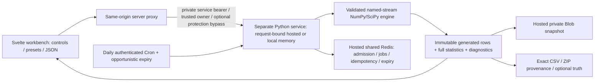

# Synthetic Data Lab

An interactive dataset workbench at `/tools/synthetic-data-lab`. It combines the existing
SvelteKit site with a separate NumPy/SciPy service. The page is linked from Work & Experiments.

The hosted adapter uses a separate Python Vercel project, private Blob result snapshots and
shared Redis control state. Generation completes inside its original request. The implementation
is present; release checks and live activation remain pending until recorded below. Earlier local
measurements describe the supported memory mode and do not establish hosted availability.

## Run locally

Requires the repository's Node runtime and Python 3.12 or a compatible Python with the pinned
scientific wheels. The setup installs into an ignored, isolated virtual environment.

```sh
npm run synthetic-data:setup
npm run synthetic-data:dev
```

Open `http://127.0.0.1:5175/tools/synthetic-data-lab`. The launcher starts Python on loopback
port 8765 and Vite on port 5175. It supplies an ephemeral service token directly to both
child processes. Stop the launcher to stop its child services. It does not write a secret
file. `SYNTHETIC_LAB_PYTHON` may select an already prepared Python executable;
`SYNTHETIC_LAB_PORT` and `SYNTHETIC_LAB_WEB_PORT` select local ports.

After a successful site build, `npm run synthetic-data:preview` runs the
same owned service with the production Vite preview instead of the development compiler.

## Interaction and data flow

Choose a preset, select a variable, and change its distribution parameters. A debounced,
versioned request updates the preview. The fixed seed exposes parameter changes without a
fresh unrelated draw; Resample changes the seed. Histogram bins, empirical CDF and paired
plots describe the displayed observations. The statistics panel distinguishes population
parameters from realized sample summaries. Pin a baseline to compare shapes and summaries.

Generate dataset disables duplicate submissions immediately. Hosted generation shows indeterminate
progress until the original request returns its completed result; Cancel request aborts that
request. Local mode retains queued jobs, progress polling and job cancellation. The completed
result remains associated with its original configuration even after controls change. Downloading
an existing result never regenerates it. Preview downloads are explicitly identified. Large
results use bounded table pages and sampled figures; full summaries come from the generated output.



## Implemented modelling families

- Standard continuous/discrete families, including heavy tails, mixtures, empirical values,
  histogram/KDE, validated custom numeric PDF/PMF/CDF knots, and multivariate normal,
  multinomial and Dirichlet vectors. The capability endpoint is the authoritative registry.
- Independent variables or PSD-validated latent Gaussian copula dependence; restricted
  mathematical derived fields; exact category allocation and limited exact-normal moments;
  truncation, clipping, censoring and precision controls.
- Regression and binary logistic outcomes, label disturbance, train/validation/test assignment,
  group/time/stratified strategies, additive noise, injected anomalies, MCAR/MAR/MNAR and
  duplicate families. Clean truth and masks require an explicit ZIP export choice.
- Poisson, positive renewal and bounded sinusoidal nonhomogeneous Poisson arrivals; count/window
  stopping semantics; event duration; AR(1), trend and seasonal series.
- Parametric causal DAGs with shared-noise counterfactuals; Weibull proportional hazards with
  independent censoring; Cartesian Gaussian spatial clusters; simple Bernoulli/community graphs;
  one parent-child relationship; Gaussian entity intercept/slope repeated measurements.
- Pseudorandom and supported QMC/grid sampling designs. The registry/configuration validation
  rejects unimplemented combinations rather than silently ignoring their settings.

The full original request is retained in [the build prompt](synthetic-data-lab-build-prompt.txt)
and [factor inventory](synthetic-data-lab-factor-inventory.txt). Every factor has a record in
`services/synthetic-data-lab/synthetic_lab/factor_coverage.json`, generated with
`node scripts/generate-synthetic-data-coverage.mjs` and searchable in the Validate workspace.
An implemented base model does not imply that every related advanced factor is supported.

## Exports and reproducibility

CSV uses UTF-8, explicit column order, quoting and UTC ISO timestamps. Missing values default
to empty cells; that representation is ambiguous with legitimate empty strings. The service
supports `null_value` for an explicit collision-checked sentinel. Spreadsheet-safe mode changes
formula-like **strings** and preserves numeric negative values. This transformation is recorded.

ZIP bundles contain the exact main CSV, supplementary table CSVs/schemas, configuration and
effective preview configuration, data dictionary, validation, summary statistics, checksums,
dependency/RNG provenance and a Python reproduction script. `truth=true` explicitly includes
clean values and diagnostic masks. Ordinary feature rows and result JSON omit that truth.

The reproducibility boundary is fixed engine/dependency versions, configuration, seed, logical
generation size and mode. Named PCG64DXSM streams are derived through SHA-256 and SeedSequence.
Preview and full draws can differ in modes that depend on global size or constraints. The
effective configuration and warnings state preview changes. Empirical/KDE configurations
include their explicitly supplied values; treat these configurations as potentially sensitive.
No cross-version/hardware invariance or anonymization guarantee is asserted.

The displayed model curve describes the generating distribution. Coarse numerical rounding
can create observed point masses; that base curve should not be read as their exact PMF.
Discrete adapters use probability bars and PMF marks, with omitted displayed mass disclosed.

## Operations and security

Configure `SYNTHETIC_DATA_API_URL` and `SYNTHETIC_DATA_SERVICE_TOKEN` only on the SvelteKit server.
The Python service needs the matching token, at least 24 characters. Production proxy connections
require HTTPS. A protected Python deployment also needs `SYNTHETIC_DATA_DEPLOYMENT_BYPASS` on the
SvelteKit server; the proxy sends it only as an upstream `x-vercel-protection-bypass` header.
The browser receives neither credential. Development permits loopback HTTP. See the
[service README](../../services/synthetic-data-lab/README.md) for the container and exact limits.

The local launcher sets the private `SYNTHETIC_DATA_ALLOW_LOOPBACK=true` opt-in so production
preview can contact its owned loopback service. This exception accepts only loopback HTTP;
it does not permit cleartext remote service connections. Hosted connections should leave it false.

The proxy allowlists operations and query options, checks exact-origin JSON mutations, applies a
512 KiB actual streamed input bound and ten-second input timeout. Upstream deadlines are 150
seconds for full generation, 40 seconds for previews and 30 seconds for other operations, inside
the route's 180-second Vercel duration. JSON/CSV/ZIP output streams with a 64 MiB actual-byte cap;
the abort signal, timeout and process-local admission lease remain active until the stream ends.
An excessive declared length is rejected before response headers; crossing the cap later errors
the stream and can leave a partial download. Responses are private/no-store/nosniff. The proxy derives
the trusted owner header from a random HttpOnly/SameSite=Strict cookie, never a submitted header.
The backend separately authenticates the service and isolates all owner jobs/results/idempotency.
The page creates that one-hour cookie before browser requests begin. It is a capability for
ephemeral generated results, not an account identity.

Hosted mode uses `SYNTHETIC_DATA_STORAGE_MODE=blob`, also the default on Vercel. Configure a
dedicated private Redis connection (`UPSTASH_REDIS_REST_URL` and `UPSTASH_REDIS_REST_TOKEN`, or
Marketplace's `KV_REST_API_URL` and `KV_REST_API_TOKEN` aliases), a connected private Blob store
and a separate random `CRON_SECRET` of at least 24 characters on the Python project. Blob uses
`BLOB_STORE_ID` with Vercel's injected `VERCEL_OIDC_TOKEN`, or a scoped `BLOB_READ_WRITE_TOKEN`.
All are private environment values. The frontend deployment does not need Blob or Redis credentials.

Redis atomically coordinates two generation requests globally and per owner using expiring
leases and owner/config-bound idempotency. Preview and full requests have separate minute
admission buckets; result reads and downloads also have shared owner/global quotas. The
frontend admission guard remains process-local; shared backend admission works across instances.
This is request-bound computation, with a 120-second full compute budget or 20-second preview
budget plus a bounded 16-second commit allowance. Disconnects set cooperative cancellation;
individual native numerical operations cannot be forcibly interrupted. An interrupted request
does not resume automatically. Use a new request key after a failed generation.

Hosted result snapshots are immutable private gzip JSON objects. Redis metadata binds owner
digests to result IDs, verifies expiry and records a checksum for bounded snapshot reads. At most
24 results/256 MiB of serialized JSON are admitted globally, capped at 128 MiB each. Capacity
pressure can expire the oldest completed result early. Results expire after 30 minutes independently
of physical deletion. Generated rows, supplied configuration and optional internal diagnostic
truth can reside in private storage; ordinary responses omit truth, and the ZIP includes it only
on explicit request. This feature does not anonymize empirical values supplied by the user.

The Python project's `vercel.json` schedules `/cleanup` daily at 03:00 UTC. It accepts only
the separate Cron bearer secret, deletes at most 500 indexed expired Blob objects per invocation
and is not exposed by the public proxy. Generation also attempts at most 500 expired deletions,
gated once per minute by a shared lock. Paths enter the cleanup index before upload. Expired
results are inaccessible even when cleanup is delayed; physical removal can occur later, and
requires working storage credentials and successful scheduled/opportunistic execution. Verify
the Cron and private deployment access on the actual host before reporting them as activated.

Local `memory` service mode runs **one long-lived process**, two computation threads, bounded jobs and TTL memory.
It currently accounts for at most 128 MiB serialized JSON per saved result and 256 MiB aggregate
serialized results; Python objects, arrays, working memory and export buffers add overhead.
CSV/ZIP transfers have their own 64 MiB cap. This is not an operating-system resident-memory limit.
Results expire after 30 minutes and disappear on process restart. Use one ASGI worker; this local
store does not coordinate multiple instances. A SvelteKit deployment alone does not provision
the Python service or its hosted storage. The memory accounting limits are not platform cost limits.

The existing CSP and security headers remain in place. The repository's named `security:audit`
and `security:smoke` commands are absent; they are not presented as passing safeguards. This
feature supplies focused proxy/service security tests, not a replacement claim for the audit.

## Explicit boundaries

This release implements user-specified parametric simulation. Automated reference-upload fitting,
private synthesizer training, formal differential privacy, privacy attack evaluations, arbitrary
relational graphs, competing risks, spatial covariance/geodesic models, arbitrary graph degree
targets and many specialized sampling/validation requirements remain unavailable. The factor
matrix states these limits individually. Correlation does not infer causal direction. Event
duration is currently constant. Time-series support is narrower than a general ARIMA/GARCH engine.

## Verification

```sh
npm run synthetic-data:test
npm run check
# With the local launcher running:
node scripts/verify-synthetic-data-lab.mjs
npm run build:full
```

The feature test command runs independent Python engine/domain/service tests and the focused
Vitest proxy and probability-chart suites. The earlier local implementation passed 86 Python
tests and 20 Vitest tests. Hosted shared-store and streaming regressions are additional release
checks; their final totals/results must be recorded after the clean release test run. The HTTP
verification script exercises every shipped preset through
the real SvelteKit proxy, tests a controlled parameter change, completes a job, compares repeated
CSV bytes and inspects the ZIP. Its local sample outputs/report are ignored under
`.codex-artifacts/synthetic-data-lab/`.

Local implementation verification on 25 October 2026 passed the site build and rendered discoverability
checks, Svelte/TypeScript analysis with zero errors/warnings, the focused test collection and
all twelve HTTP preset scenarios. Browser verification confirmed a normal mean change to 3
produced an observed mean of 3.0171 with seed 1847, full generation downloaded 5,000 rows and
four columns, and switching the event-gap model from exponential to gamma changed the
interarrival mean from 1.0163 to 2.0191. Event mode plots interarrival values by default and
allows inspection of every generated output column. A 390 by 844 phone breakpoint had no
horizontal page overflow. The inspected browser session reported no console errors.

Measured service benchmark on the development Windows/Python 3.12 environment with NumPy 2.5.4
and SciPy 1.18.1: 100,000 rows by 20 normal columns took 9.393 seconds through job handling and
immutable storage, and 2.649 seconds for CSV size preflight/download. The CSV was 14.21 MiB and
the serialized saved result including truth was 82.57 MiB. These are environment-specific
measurements, not a latency guarantee. These results came from local memory mode before the
hosted adapter and fresh-main release integration; they do not establish its test/build status.

Hosted acceptance is pending: test owner isolation and config-bound retry identity across two
service instances, private snapshot retrieval, expiry and bounded cleanup, interrupted commits,
request abort, a streamed export above the host's buffered-response threshold, and actual
frontend-to-protected-backend access. Confirm the deployment environment, daily Cron and a small
public browser-to-CSV flow before marking the launch live. Use service-worker-blocked browsers
for production acceptance so checks do not warm unrelated offline assets. No live result is
claimed by the earlier local browser measurements.

Architecture impact: yes

Architecture rationale: a separate scientific computation service, same-origin streaming proxy,
owner-scoped private Blob results, shared Redis admission/metadata and authenticated expiration
are new boundaries. The canonical architecture was reviewed and updated;
[ADR 0016](../architecture/decisions/0016-synthetic-data-lab-service.md) records the trade-offs.
